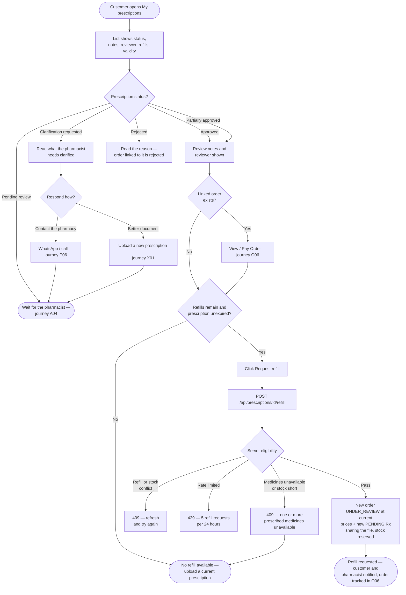

# X03 — Prescription outcomes and refills

After a pharmacist reviews an uploaded prescription (journeys A04/A05), the customer reads the decision — approved, partially approved, rejected, or clarification requested — in the prescriptions workspace. Approved prescriptions carry a pharmacist-set refill allowance (0–6) and a validity window (30–180 days); while refills remain and the prescription is unexpired, the customer can request a refill, which creates a brand-new order in `UNDER_REVIEW` and a new `PENDING` prescription that shares the original document — every refill use is re-verified by a pharmacist, never auto-dispensed. Old prescriptions eventually leave the system through the retention job (journey SYS-06).

| Metadata | Value |
| --- | --- |
| Primary actor | Customer |
| Secondary actors | Pharmacist (decisions — A04/A05), System (refill reminders — SYS-04; retention — SYS-06) |
| Functional area | Prescriptions |
| Entry point | Prescriptions view → "My prescriptions" |
| Status | Implemented — verified against code |
| End condition | Outcome read (and document viewed privately); if eligible, refill order created (`UNDER_REVIEW`, new PENDING prescription, stock reserved) |
| Related journeys | X01 (upload), X02 (Rx ordering), A04/A05 (review side), O06 (tracking the refill order), SYS-04/SYS-06 (system follow-ups) |

## Journey map

## Journey steps

### Step 1 — Read the decision

- **User action:** The customer opens My prescriptions and reads the updated card for the reviewed document.
- **Location:** Prescriptions view — `src/components/views/prescriptions-view.tsx`; data from `GET /api/prescriptions`.
- **Destination:** The outcome details.
- **Purpose:** Learn the pharmacist's decision and any conditions attached.
- **System behaviour:** Each card shows the status badge (`RxStatusBadge`), the customer's upload notes, the pharmacist's review notes quoted with the reviewer's name and review date, the refill usage chip ("Refills: N of M used") and the validity chip ("Valid until …") when set. The outcome-specific notification (approved / partially approved with notes / rejected with reason / clarification needed with the question) has already arrived in-app and by email when the decision was recorded (journeys A04/A05).
- **Outcome:** The customer knows exactly where the prescription stands and why.
- **Next step:** View the document or act on the outcome.
- **Alternative paths:** Pending prescriptions simply show "Pending review" — the customer waits for the pharmacist (journey A04).

### Step 2 — View or download the document privately

- **User action:** The customer clicks View on a prescription card (or Download in the viewer).
- **Location:** `PrescriptionFileDialog` in `prescriptions-view.tsx`; data from `GET /api/prescriptions/[id]` (`src/app/api/prescriptions/[id]/route.ts`).
- **Destination:** A dialog rendering the image or PDF.
- **Purpose:** Re-read the customer's own prescription.
- **System behaviour:** The GET route allows only the owner or ADMIN/PHARMACIST staff; it mints a presigned R2 download URL valid for 300 seconds (never exposing the `storageKey`) and writes a `PrescriptionAccessLog` row (action VIEW, or DOWNLOAD when `?download=1` triggers a redirect to a presigned attachment). The dialog renders images inline, PDFs in an iframe, and offers an authenticated download; if object storage is unavailable the API returns 503 and the dialog reports the file is temporarily unavailable.
- **Outcome:** The customer can privately inspect their document; the access is logged for compliance.
- **Next step:** Continue based on the outcome.
- **Alternative paths:** Deleting a prescription is possible while it is not linked to an order (soft delete); order-linked rows return 409 and require the pharmacy.

### Step 3 — Act on non-approval outcomes

- **User action:** For a clarification request, the customer reads the pharmacist's question and responds; for a rejection, they read the reason.
- **Location:** Outcome cards in `prescriptions-view.tsx`; contact channels from journey P06 (WhatsApp/phone) and new uploads from journey X01.
- **Destination:** A clarification conversation or a replacement document.
- **Purpose:** Resolve the blocker the pharmacist identified.
- **System behaviour:** The clarification card surfaces the pharmacist's review notes verbatim. There is no direct replacement-upload action inside the clarification card by design — the supported responses are contacting the pharmacy (WhatsApp/phone links exist across the app) or uploading a clearer/new prescription (journey X01), after which the pharmacist re-reviews. A rejected prescription keeps its review history; if it was linked to an order, that order has already moved to `REJECTED` with its stock released (journey A05).
- **Outcome:** The pharmacist receives the clarification or better document and can decide.
- **Next step:** The prescription returns to review (or a new one enters the queue).
- **Alternative paths:** The customer may also simply order a different (OTC) product in the meantime (journeys O01/O02).

### Step 4 — Request a refill

- **User action:** On an approved prescription with remaining refills, the customer clicks "Request refill".
- **Location:** `requestRefill` in `prescriptions-view.tsx` (also available on the order detail view); endpoint `POST /api/prescriptions/[id]/refill` (`src/app/api/prescriptions/[id]/refill/route.ts`).
- **Destination:** A toast with the new order reference, and the orders view.
- **Purpose:** Get the next dispense of an approved prescription.
- **System behaviour:** The button renders when `status === "APPROVED"` and `refillsAllowed > refillsUsed` (the refill rules also accept `PARTIALLY_APPROVED` server-side). The route requires a customer session (rate limit 5 per 24 hours) and re-checks everything server-side: ownership, status APPROVED/PARTIALLY_APPROVED, `refillsUsed < refillsAllowed`, `validUntil` not expired, a source order with at least one Rx item that still maps to an active, in-stock product. In a Serializable transaction it optimistically claims the refill (`refillsUsed + 1`), decrements stock per line with conditional guards, and creates a **new order** (type `PRESCRIPTION`, status `UNDER_REVIEW`, fulfillment and address copied from the source order, **current** product prices, fresh pickup code, history "Refill queued for pharmacist re-verification") plus a **new `PENDING` prescription row sharing the original `storageKey`**. Customer and pharmacist are notified; an `RX_REFILL_REQUESTED` audit event is written.
- **Outcome:** A refill order exists in `UNDER_REVIEW`; the pharmacist re-verifies before dispensing.
- **Next step:** Track the refill order (journey O06) and complete it after verification (journey X02 step 6 onwards).
- **Alternative paths:** Failures are explicit: no refills remain (409), expired (409, "Upload a current prescription"), linked medicines unavailable (409), refill/stock races (409, refresh and retry), rate limit (429).

### Step 5 — Follow validity and retention

- **User action:** None — the customer watches the validity chip and eventually sees old prescriptions disappear.
- **Location:** Validity in `prescriptions-view.tsx` ("Valid until …"); retention in `GET /api/cron/prescription-retention` (`src/app/api/cron/prescription-retention/route.ts`) — journey SYS-06.
- **Destination:** Expired or deleted prescriptions leave the usable set.
- **Purpose:** Keep refills inside the pharmacist-set window and honour record-retention policy.
- **System behaviour:** `validUntil` is set at approval (now + 30/60/90/180 days as chosen by the pharmacist); once passed, refills are refused and the customer must upload a current prescription. Customers can soft-delete their own unlinked prescriptions (`DELETE /api/prescriptions/[id]`); the retention cron later destroys soft-deleted records older than `PRESCRIPTION_RETENTION_DAYS` (30–36,500 days), removing the R2 object (unless another prescription row shares the storage key — refill copies do) and hard-deleting the row. Chronic patients additionally receive time-based refill reminder emails from the chronic-refills job (journey SYS-04), which never infer dosage.
- **Outcome:** Prescription data has a bounded, policy-driven lifetime.
- **Next step:** None — this is the tail of the prescription lifecycle.
- **Alternative paths:** If the customer wants history beyond retention, they should download the document beforehand (step 2); after destruction the record is gone.

## Decision points

| Decision | Branches | Enforced by/where |
| --- | --- | --- |
| Prescription status | APPROVED/PARTIALLY_APPROVED → usable; CLARIFICATION_REQUESTED → respond; REJECTED → reason + linked order rejected; PENDING → wait | `RX_STATUSES` in `src/lib/constants.ts`; card rendering in `prescriptions-view.tsx` |
| Document access | Owner or PHARMACIST/ADMIN → presigned URL (300 s) + access log; others → 403 | `GET /api/prescriptions/[id]` |
| Refill button visible? | APPROVED and refills remaining → shown; otherwise not | `eligibleForRefill` in `prescriptions-view.tsx` |
| Refill eligible server-side? | Owned + APPROVED/PARTIALLY_APPROVED + refills left + unexpired + source Rx items in stock → proceed; else 409 | eligibility block in `POST /api/prescriptions/[id]/refill` |
| Refill concurrency | Optimistic claim wins → refill; lost → 409 "refresh and try again" | conditional `updateMany` (`REFILL_CONFLICT`) and stock guards (`STOCK_CONFLICT`) in the refill route |
| Refill order content | Current product prices at request time (totals may differ) + new PENDING prescription — approval never carries over | price snapshot and new-prescription creation in the refill transaction |
| Delete allowed? | Owner and not order-linked → soft delete; order-linked → 409 (contact pharmacy); ADMIN override | `DELETE /api/prescriptions/[id]` |
| Retention | Soft-deleted older than `PRESCRIPTION_RETENTION_DAYS` → R2 object + row destroyed (shared keys skipped) | `GET /api/cron/prescription-retention` (SYS-06) |

## Error and recovery paths

- **File temporarily unavailable (503):** the presigned URL could not be minted (storage issue); retry shortly — the prescription and its status are unaffected.
- **No refills remain (409):** the allowance is exhausted; upload a current prescription (journey X01) for a new review.
- **Prescription expired (409):** `validUntil` has passed; the message directs the customer to upload a current prescription.
- **Prescribed medicines unavailable (409):** a linked product is inactive, discontinued or short of stock; contact the pharmacy for alternatives — the refill is not partially created.
- **Refill/stock conflict (409):** another request changed the refill count or stock mid-flight; refresh and retry — the Serializable transaction guarantees no partial changes.
- **Rate limited (429):** refill requests are capped at 5 per 24 hours per user; wait before requesting again.
- **Cannot delete (409):** the prescription is linked to an order; the pharmacy must handle linked records (audit trail preserved).
- **Notification misses:** outcomes are durable — the status and notes are visible in the workspace regardless of channel failures; channel retries happen in the notification pipeline (journey SYS-10).

## Traceability

| Concern | Implementation reference |
| --- | --- |
| Prescriptions list UI (outcomes, refills, validity) | `src/components/views/prescriptions-view.tsx` (`PrescriptionCard`) |
| List data | `prescriptionsApi.mine()` → `GET /api/prescriptions` (`src/app/api/prescriptions/route.ts`) |
| Private viewer/download | `PrescriptionFileDialog` in `prescriptions-view.tsx`; `GET /api/prescriptions/[id]` (presigned 300 s URL, `?download=1` redirect) |
| Access audit | `PrescriptionAccessLog` writes in `GET /api/prescriptions/[id]` |
| Refill request | `requestRefill` in `prescriptions-view.tsx` and `order-detail-view.tsx`; `POST /api/prescriptions/[id]/refill` (`src/app/api/prescriptions/[id]/refill/route.ts`) |
| Refill order construction | refill transaction (new order `UNDER_REVIEW`, new PENDING prescription, stock decrement) in the refill route |
| Refill rules and limits | eligibility checks + `prescription-refill` rate limit (5/24 h) in the refill route |
| Refill allowance and validity | `refillsAllowed` (0–6), `validDays` ({30,60,90,180}) in `PATCH /api/prescriptions/[id]` (journeys A04/A05) |
| Delete (soft) | `DELETE /api/prescriptions/[id]` |
| Retention job | `GET /api/cron/prescription-retention` (`src/app/api/cron/prescription-retention/route.ts`) — journey SYS-06 |
| Chronic refill reminders | `GET /api/cron/chronic-refills` — journey SYS-04 |
| Data model | `Prescription`, `PrescriptionAccessLog` models (`prisma/schema.prisma`) |
| API contract | `openapi/sphere-api.yaml` — `GET /prescriptions/{id}`, `POST /prescriptions/{id}/refill` |

## Related journeys and documents

- **X01** — the upload that started this prescription
- **X02** — ordering against a prescription (and completing the refill order after verification)
- **A04 / A05** — the pharmacist decisions the customer reads here
- **O06** — tracking the refill order that the refill request creates
- **SYS-04** — time-based refill reminders for chronic patients
- **SYS-06** — the retention job that ends the prescription's life
- Docs: [prescriptions feature](../../features/prescriptions.md) · [prescription lifecycle](../../workflows/prescription-lifecycle.md) · [retention and deletion](../../security/retention-and-deletion.md)
