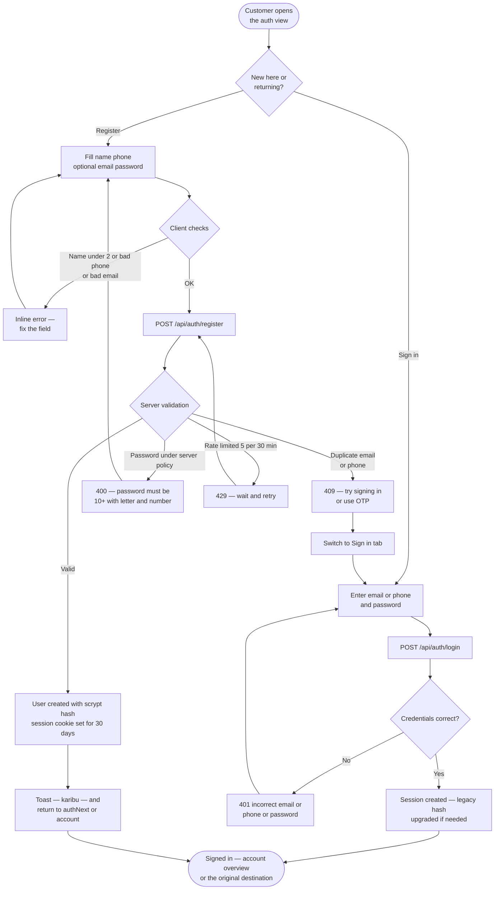

# C01 — Create an account and sign in

A customer creates an account to keep orders, prescriptions and loyalty in one place, then signs out and back in on a later visit. Registration validates name, a Kenyan phone (email optional) and the server password policy (10–128 characters with a letter and a digit), hashes the password with scrypt, and immediately creates a 30-day session. Sign-in accepts email or phone plus password, returns a generic error on bad credentials, and opportunistically upgrades legacy password hashes. Both paths honor `authNext` — the view the customer was trying to reach when asked to sign in.

| Metadata | Value |
| --- | --- |
| Primary actor | Customer |
| Secondary actors | None |
| Functional area | Accounts and authentication |
| Entry point | `/auth` — `AuthView` in `src/components/views/auth-view.tsx` (Sign in / Register / Phone OTP / Staff tabs) |
| Status | Implemented — verified against code |
| End condition | Signed-in customer session; client on `authNext ?? account` view |
| Related journeys | C02 (phone-code sign-in), C03 (sign-in return with a cart), C04 (profile and security), P03 (product actions that trigger sign-in), X02 (Rx ordering that requires the account) |

## Journey map

## Journey steps

### Step 1 — Open the auth view

- **User action:** The customer taps the account icon (header), the mobile Account tab, or a sign-in prompt inside a flow (product review, stock alert, checkout).
- **Location:** Auth view — `src/components/views/auth-view.tsx`, rendered when the app-store view is `auth`; mode from `openAuth(...)` or URL params.
- **Destination:** The tabbed sign-in card (Sign in · Register · Phone OTP · Staff).
- **Purpose:** Reach the account entry point.
- **System behaviour:** The view reads `authMode`, `authNext`, `authNextParams` and `authMessage` from the app store; a message banner (e.g. "Sign in to leave a review") shows when a flow sent the customer here. Mode syncs from URL `?mode=` params for deep links. The Staff tab renders the separate admin sign-in frame (journey A01, not this journey).
- **Outcome:** The right tab is showing with the reason for the detour, if any.
- **Next step:** Register or sign in.
- **Alternative paths:** "Continue as guest" returns to the home view — guests can shop OTC products; prescriptions and order history need the account.

### Step 2 — Register: fill the form

- **User action:** On the Register tab the customer enters Full name, Phone number, optional Email and a password (with show/hide toggle).
- **Location:** Register form in `auth-view.tsx` (`handleRegister`).
- **Destination:** A form ready to submit.
- **Purpose:** Create the account the customer will order with.
- **System behaviour:** The client checks name length ≥ 2, phone normalizable to a Kenyan number (`normalizePhone` maps 07xx/01xx/254…/7xx forms to `254XXXXXXXX`), email shape when present, and a local password length check. Note the local check only enforces 6 characters — the server policy is stricter (10–128 with at least one letter and one digit), so a short-but-6+ password passes the client and is rejected by the server with the authoritative message.
- **Outcome:** Details captured client-side.
- **Next step:** Submit the registration.
- **Alternative paths:** The helper text notes the phone is used for order updates and M-Pesa payments; customers without email can register phone-only.

### Step 3 — Register: server creates the account and session

- **User action:** The customer clicks "Create account".
- **Location:** `POST /api/auth/register` (`src/app/api/auth/register/route.ts`) via `authApi.register`.
- **Destination:** Account created; session started.
- **Purpose:** Turn the form into a durable account.
- **System behaviour:** The route caps the body at 8 KB and rate limits to 5 registrations per 30 minutes per IP. It re-validates: name ≥ 2 chars, email or phone required (email regex, Kenyan phone normalized to `+254XXXXXXXXX`), and `validatePassword` (10–128 chars, letter + digit). Duplicate email or phone returns 409 with guidance to sign in or use OTP. On success it creates the `User` with a scrypt password hash, best-effort creates default `NotificationPref`, and calls `createSession` — a 30-day `sphere_session` httpOnly cookie.
- **Outcome:** The account exists and the customer is signed in immediately (no email verification step exists — documented limitation).
- **Next step:** Land signed-in.
- **Alternative paths:** Validation failures return to the form with the server's message; the customer corrects and retries.

### Step 4 — Land signed-in (register)

- **User action:** None — the client finishes the flow.
- **Location:** `handleRegister` completion in `auth-view.tsx`; session store `src/store/use-auth-store.ts`.
- **Destination:** The account view, or the view stored in `authNext`.
- **Purpose:** Put the customer where they were heading before the sign-in detour.
- **System behaviour:** The session payload is written to `useAuthStore`, `refresh()` re-reads `GET /api/auth/me`, a welcome toast shows, and `replace(authNext ?? "account", authNextParams)` navigates without polluting the back-stack, then `clearAuthIntent()` wipes the detour state.
- **Outcome:** The customer is signed in and positioned (e.g. back on the product they wanted to review).
- **Next step:** Continue the interrupted flow or explore the account.
- **Alternative paths:** If the customer came from checkout, this is journey C03's return step.

### Step 5 — Sign in on a later visit

- **User action:** The returning customer opens the Sign in tab, enters "Email or phone number" and password, and clicks "Sign in".
- **Location:** Login form in `auth-view.tsx` (`handleLogin`); endpoint `POST /api/auth/login` (`src/app/api/auth/login/route.ts`).
- **Destination:** A fresh customer session.
- **Purpose:** Re-access the account from any device.
- **System behaviour:** The identifier is lower-cased and matched against email or phone (with a `+`-prefix-tolerant phone clause). The route rate limits to 10 attempts per 15 minutes keyed by IP and identifier, verifies the scrypt hash with `timingSafeEqual`, returns a generic 401 ("Incorrect email/phone or password.") on any failure — no account enumeration — and re-hashes the password with current parameters when a legacy hash verifies. A session is created (30 days) and returned with the user payload.
- **Outcome:** The customer is signed in; `finishAuth` lands them on `authNext ?? "account"` with a welcome toast.
- **Next step:** Continue shopping or manage the account (journey C04).
- **Alternative paths:** Customers who cannot recall the password can use phone-code sign-in instead (journey C02); there is no self-service password reset — profile security handles changes once signed in (journey C04).

### Step 6 — Sign out (boundary of this journey)

- **User action:** From the account view the customer signs out.
- **Location:** `useAuthStore.logout()` in `src/store/use-auth-store.ts`; endpoint `POST /api/auth/logout`.
- **Destination:** Signed-out state on the storefront.
- **Purpose:** End the session on a shared device.
- **System behaviour:** The client posts the stored push token (if any) so the server can deregister it, the server deletes the `Session` row and clears the cookie, and local session state and the device token are removed. Cart and wishlist persist in localStorage — signing out does not clear shopping state.
- **Outcome:** The customer is signed out; the next sign-in repeats step 5.
- **Next step:** Journey C04 covers profile, password changes and this step in depth.
- **Alternative paths:** A lapsed session (cookie older than 30 days) simply reads as signed out on the next `GET /api/auth/me`.

## Decision points

| Decision | Branches | Enforced by/where |
| --- | --- | --- |
| Register vs sign in vs OTP tab | Register → create; Sign in → password; OTP → journey C02 | tab state `authMode` in `auth-view.tsx` |
| Identifier on sign-in | Email or phone (both accepted, phone matched with/without `+`) | `findFirst` OR clause in `POST /api/auth/login` |
| Duplicate account | Email or phone exists → 409 with sign-in/OTP guidance | uniqueness checks in `POST /api/auth/register` |
| Password policy | Server: 10–128 chars with a letter and a digit; client pre-check is looser (6+) | `validatePassword` in `src/lib/hash.ts`; client check in `auth-view.tsx` |
| Credentials on sign-in | Match → session; no match → generic 401 (no enumeration) | verify + generic error in `POST /api/auth/login` |
| Rate limits | Register 5/30 min per IP; login 10/15 min per IP + identifier | `enforceRateLimit` calls in both routes |
| Return destination | `authNext` present → return there; else → account view | `finishAuth`/register completion in `auth-view.tsx` |

## Error and recovery paths

- **Duplicate email or phone (409):** the message suggests signing in (or OTP for phones) — switching tabs preserves nothing to lose; the customer signs in instead.
- **Password rejected by the server (400):** the client's 6-character hint under-validates; the server message ("at least 10 characters", letter + number) is authoritative — the customer strengthens the password and resubmits.
- **Wrong credentials (401):** generic message; the customer retries (bounded by the 10/15-minute limit) or switches to the OTP tab.
- **Rate limited (429):** registration pauses for up to 30 minutes, sign-in for 15 — deliberate brute-force protection; the OTP tab is an alternative path to the same account by phone.
- **Missing fields:** client-side inline errors block submission before any request.
- **No email verification (documented limitation):** accounts are usable immediately; OTP sign-in is the only channel that actually verifies a phone, and no channel verifies email — a known, documented gap, not a fault to work around.
- **No self-service password reset:** recovery is phone-code sign-in (journey C02); password changes require being signed in (journey C04).

## Traceability

| Concern | Implementation reference |
| --- | --- |
| Auth view (tabs, forms, `finishAuth`) | `src/components/views/auth-view.tsx` |
| Registration endpoint | `POST /api/auth/register` in `src/app/api/auth/register/route.ts` |
| Login endpoint | `POST /api/auth/login` in `src/app/api/auth/login/route.ts` |
| Password policy and hashing | `validatePassword`, `hashPassword`, `verifyPassword` in `src/lib/hash.ts` (scrypt, N=16384) |
| Session creation and lifetime | `createSession` with `SESSION_DAYS = 30` in `src/lib/session.ts`; `sphere_session` cookie |
| Phone normalization | `normalizePhone` (client) in `auth-view.tsx`; `PHONE_RE` (server) in both routes |
| Auth intent (return-to) | `openAuth` / `authNext` / `clearAuthIntent` in `src/store/use-app-store.ts` |
| Session store | `src/store/use-auth-store.ts` (`setSession`, `refresh`, `logout`) |
| Session bootstrap | `GET /api/auth/me` (no-store) read by `refresh()` |
| Rate limiting | `enforceRateLimit` in `src/lib/security/request.ts` (register 5/30min, login 10/15min) |
| Data model | `User`, `Session`, `NotificationPref` models (`prisma/schema.prisma`) |
| Architecture contract | `docs/architecture/authentication.md` (§2 registration and login, §5 hashing) |

## Related journeys and documents

- **C02** — phone-code sign-in (and the alternative when a password is forgotten)
- **C03** — the cart-preserving sign-in return during checkout
- **C04** — managing the profile, password and sign-out in depth
- **P03** — product actions (reviews, stock alerts) that route through this journey
- **X02** — why prescriptions require this account
- Docs: [authentication](../../architecture/authentication.md) · [user roles and permissions](../../product/user-roles-and-permissions.md) · [customer CRM](../../features/customer-crm.md)
