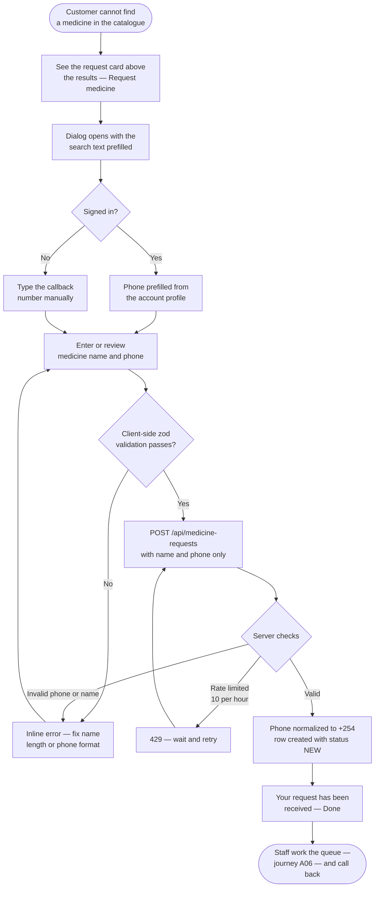

# P04 — Request a medicine without a photo

A shopper who cannot find a medicine in the catalogue asks the pharmacy to source it. The flow is deliberately friction-free: a medicine name and a Kenyan phone number are enough — no account, no session, no photo. The server normalizes the phone, stores the request with status NEW, and staff pick it up from the admin queue (journey A06) and call back; there are intentionally no notifications, the loop closes by phone or WhatsApp.

| Metadata | Value |
| --- | --- |
| Primary actor | Customer (guest by design — no account needed) |
| Secondary actors | Staff (triage and callback in the admin queue, journey A06) |
| Functional area | Medicine requests |
| Entry point | `/catalog` — `MedicineRequest` card above the results in `src/components/views/catalog-view.tsx` |
| Status | Implemented — verified against code |
| End condition | `MedicineRequest` row created with status `NEW` and no photo; confirmation screen shown |
| Related journeys | P02 (the search that found nothing), P05 (photo variant), A06 (staff triage), P06 (WhatsApp alternative), X01 (prescription upload instead) |

## Journey map

## Journey steps

### Step 1 — Reach the request entry point

- **User action:** The customer searches for a medicine that is not in the catalogue (or simply notices the card) and reads "Can't find your medicine? Tell us what you need and leave your number."
- **Location:** `MedicineRequest` card rendered above the results in `src/components/views/catalog-view.tsx`; component `src/components/catalog/medicine-request.tsx`.
- **Destination:** The catalogue with the request card visible above the results grid.
- **Purpose:** Offer an escape hatch exactly where the failed search happened.
- **System behaviour:** The card renders on every catalogue view, not only empty results; the empty-results state additionally points at it ("use Request medicine above"). No data is loaded for the card itself.
- **Outcome:** The customer knows they can ask instead of giving up.
- **Next step:** Click "Request medicine".
- **Alternative paths:** The empty state also offers "Ask on WhatsApp" (journey P06); customers with a prescription file should use the prescription upload instead (journey X01).

### Step 2 — Open the request form

- **User action:** The customer clicks "Request medicine" and the dialog opens.
- **Location:** Dialog in `src/components/catalog/medicine-request.tsx` (`MedicineRequestForm`, remounted fresh via a form key on each open).
- **Destination:** The request form with Medicine name, Phone number and optional photo fields.
- **Purpose:** Collect the minimum the pharmacy needs to follow up.
- **System behaviour:** The current catalogue search text is passed in and prefilled into "Medicine name" (capped at 200 characters) — so a failed search becomes the starting point of the request. If the customer is signed in, their account phone prefills the phone field. The form states that no account is needed.
- **Outcome:** The form is open, prefilled with as much as the system already knows.
- **Next step:** Review the name and enter the phone number.
- **Alternative paths:** Closing the dialog discards the draft (a fresh form opens next time); the photo field is skipped entirely in this journey (see P05).

### Step 3 — Enter the medicine name and callback number

- **User action:** The customer types or reviews the medicine name (2–200 characters — name, strength or brand) and a Kenyan phone number (e.g. 0712 345 678).
- **Location:** `Medicine name` and `Phone number` inputs in `medicine-request.tsx`.
- **Destination:** A form the customer believes is correct.
- **Purpose:** Give the team something concrete to source and a number to call back.
- **System behaviour:** On submit the client runs `medicineRequestSchema.safeParse` (from `src/lib/medicine-requests.ts`): name trimmed to 2–200 characters, phone matching `[+\d\s()-]` and normalizable to a Kenyan number. The first validation issue is shown inline and submission is blocked. A `submitting` ref guards against double submits while busy.
- **Outcome:** Validated details ready to send.
- **Next step:** Send the request without attaching a photo.
- **Alternative paths:** Signed-in customers can correct a stale profile phone inline — the field is editable even when prefilled.

### Step 4 — Send the request (no photo)

- **User action:** With the photo field left empty, the customer clicks "Send request".
- **Location:** Submit handler in `medicine-request.tsx`; `medicineRequestsApi.create` in `src/lib/api-client.ts`.
- **Destination:** `POST /api/medicine-requests` (`src/app/api/medicine-requests/route.ts`).
- **Purpose:** Persist the request so the pharmacy team can act on it.
- **System behaviour:** The route is public by design (guest requests are intentional). It enforces a 10-per-hour per-IP rate limit, bounds the request body, re-validates with the same zod schema, and normalizes the phone to `+254XXXXXXXX` via `normalizePaymentPhone`. With no photo, no storage is touched: the `MedicineRequest` row is created with `medicineName`, `phone`, `status` defaulting to `NEW` and null photo fields. The response is `{ id }` with 201 and `Cache-Control: no-store`.
- **Outcome:** The request exists in the database with status NEW; the customer sees "Your request has been received".
- **Next step:** Close the dialog with "Done".
- **Alternative paths:** Attaching a photo switches this to journey P05 (the photo travels in the same POST, stored privately).

### Step 5 — Confirmation and staff follow-up

- **User action:** The customer reads the confirmation ("Our team will contact you on the number you provided. Availability will be confirmed when we follow up.") and clicks "Done".
- **Location:** Submitted state in `medicine-request.tsx`; staff side `src/components/views/admin/sections/medicine-requests-section.tsx`.
- **Destination:** Back to the catalogue.
- **Purpose:** Close the loop on the customer side and set the expectation of a callback.
- **System behaviour:** No notifications are queued — by design, staff monitor the admin queue (`GET /api/admin/medicine-requests`, staff-only) where the request appears as NEW with its phone. Staff call or WhatsApp the customer back and move the status through `CONTACTED` to `FULFILLED` or `UNAVAILABLE` with notes (journey A06); every change is audit-logged. There is no customer-facing status view — the callback is the feedback channel.
- **Outcome:** The request waits in the queue for a human; the customer's part is done.
- **Next step:** The customer continues shopping or waits for the call.
- **Alternative paths:** Submitting a request does not place an order or guarantee availability — the confirmation text states this explicitly.

## Decision points

| Decision | Branches | Enforced by/where |
| --- | --- | --- |
| Photo attached? | No → this journey (row without photo fields); yes → journey P05 | `photo` state in `medicine-request.tsx`; optional `photo` in `medicineRequestSchema` |
| Signed in? | Yes → phone prefilled from profile; no → typed manually (both allowed) | `useAuthStore` session read in `medicine-request.tsx` |
| Client validation | Name 2–200 and valid Kenyan phone → submit; else → inline first-issue message | `medicineRequestSchema.safeParse` in `medicine-request.tsx` |
| Server validation | Same schema re-run server-side; invalid → 400 with the message | zod parse in `POST /api/medicine-requests` |
| Rate limit | ≤ 10 per hour per IP → accept; exceeded → 429 | `enforceRateLimit(request, "medicine-request-create", 10, 3600000)` |
| Phone normalization | Any Kenyan format → `+254XXXXXXXX`; unusable → 400 | `normalizePaymentPhone` via the schema transform in `src/lib/medicine-requests.ts` |
| Staff visibility | Row NEW in queue → staff contact → status changes audited | `GET/PATCH /api/admin/medicine-requests`; `MEDICINE_REQUEST_STATUSES` |

## Error and recovery paths

- **Name too short or too long (400):** the inline message asks for 2–200 characters; the customer edits and resubmits — nothing was stored.
- **Invalid phone (400):** the message shows the expected format (e.g. 0712 345 678); the customer corrects the number and retries.
- **Rate limited (429):** the endpoint allows 10 requests per hour per IP; the customer waits and retries — the limit exists to stop spam, not to punish repeated honest use.
- **Server error (500):** a generic "Could not save your medicine request" is shown; retrying is safe because no row was created on failure.
- **Double-click protection:** the submit handler ignores concurrent submissions via a `submitting` ref, preventing duplicate rows.
- **No notification of progress (by design):** there is no in-app status view for requests; if the callback is missed, the customer can re-submit or use WhatsApp/call (journey P06) — a documented limitation, not a fault.
- **No dedupe:** the same phone can file repeated requests (bounded only by the rate limit) — documented limitation.

## Traceability

| Concern | Implementation reference |
| --- | --- |
| Request card and dialog | `src/components/catalog/medicine-request.tsx` (mounted in `catalog-view.tsx`) |
| Shared validation schema | `medicineRequestSchema`, `MEDICINE_REQUEST_STATUSES` in `src/lib/medicine-requests.ts` |
| Create endpoint | `POST /api/medicine-requests` in `src/app/api/medicine-requests/route.ts` (rate limit, body cap, normalization) |
| Phone normalization | `normalizePaymentPhone` in `src/lib/security/payment.ts` (used by the schema transform) |
| Typed API client | `medicineRequestsApi.create` in `src/lib/api-client.ts` |
| Data model | `MedicineRequest` model (`prisma/schema.prisma`) — `medicineName`, `phone`, `status NEW`, `staffNotes`, photo fields, index `[status, createdAt]` |
| Staff queue | `GET /api/admin/medicine-requests` and `src/components/views/admin/sections/medicine-requests-section.tsx` (journey A06) |
| Status vocabulary | `NEW` / `CONTACTED` / `FULFILLED` / `UNAVAILABLE` in `src/lib/medicine-requests.ts` |
| Rate limiting | `enforceRateLimit` in `src/lib/security/request.ts` (10/hour/IP) |
| Feature contract | `docs/features/medicine-requests.md` (no notifications, guest-by-design, callback loop) |

## Related journeys and documents

- **P02** — the catalogue search that produced no results
- **P05** — the same request with a pack photo attached
- **A06** — the staff side: triage, callback and status changes
- **P06** — asking on WhatsApp as an alternative channel
- **X01** — uploading a prescription when the ask is really an Rx document
- Docs: [medicine requests](../../features/medicine-requests.md) · [customer journeys](../../product/customer-journeys.md) · [file storage security](../../security/file-storage-security.md)
