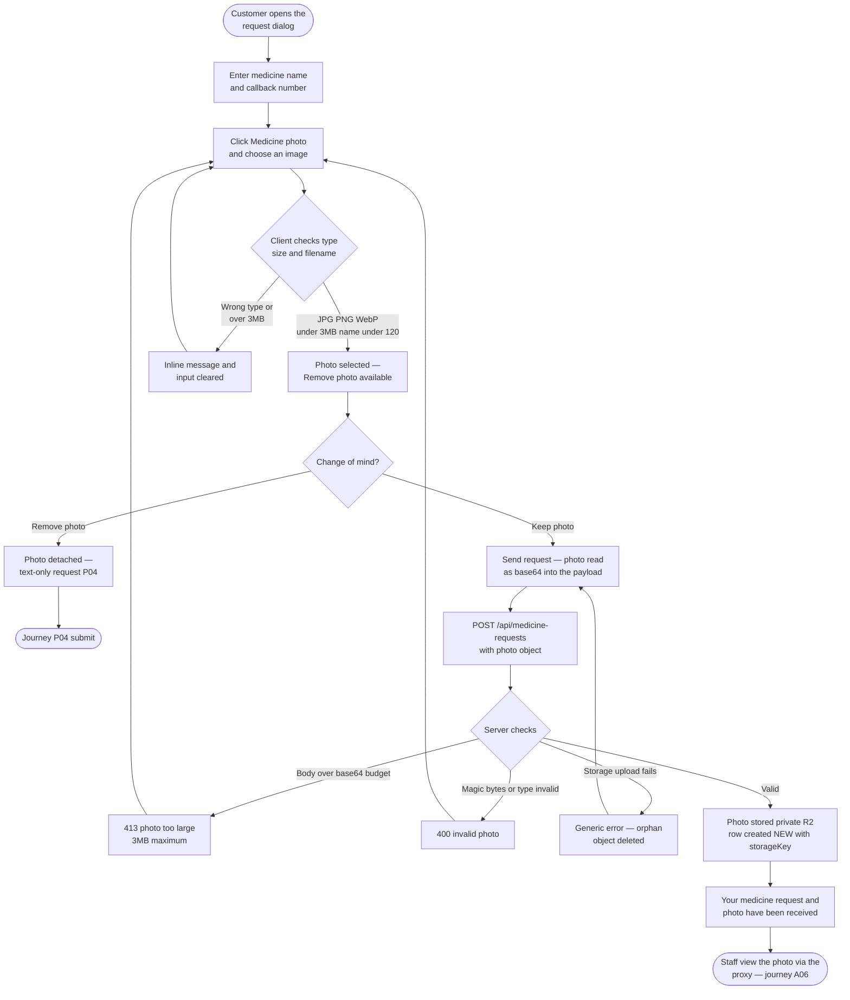

# P05 — Request a medicine with a photo

The photo variant of the medicine request: the customer attaches a picture of the pack or prescription so the team can identify the exact product. The photo never goes through the general upload endpoint (which requires a session) — it travels inline in the request payload as base64, is magic-byte validated server-side, and is stored privately in object storage under `medicine-requests/<uuid>.<ext>`. Only staff can view it, through a streaming proxy. Exercising this flow end-to-end requires live R2 credentials; without them the request cannot be saved once a photo is attached.

| Metadata | Value |
| --- | --- |
| Primary actor | Customer (guest by design — no account needed) |
| Secondary actors | Staff (view the photo and triage in journey A06) |
| Functional area | Medicine requests |
| Entry point | Request dialog — `MedicineRequestForm` in `src/components/catalog/medicine-request.tsx` |
| Status | Environment-dependent (requires live provider) — verified against code |
| End condition | `MedicineRequest` row with `storageKey` set and status `NEW`; photo readable only via `GET /api/admin/medicine-requests/[id]/photo` |
| Related journeys | P04 (text-only variant), A06 (staff triage), X01 (proper prescription upload), P06 (WhatsApp alternative), SYS-06 (retention model for private files) |

## Journey map

## Journey steps

### Step 1 — Prepare the request with a photo in mind

- **User action:** The customer opens "Request medicine" from the catalogue and fills in the medicine name and callback phone exactly as in journey P04.
- **Location:** Request dialog — `src/components/catalog/medicine-request.tsx`, rendered by `src/components/views/catalog-view.tsx`.
- **Destination:** The dialog with name and phone filled and the photo field empty.
- **Purpose:** Have the text details ready so the photo is the only remaining step.
- **System behaviour:** Identical to P04: search text prefills the name, a signed-in customer's phone prefills, and zod validation runs on submit. The helper text under the photo input states the constraint: JPG, PNG or WebP, up to 3MB, viewable only by the pharmacy team.
- **Outcome:** The base request is ready to attach a photo to.
- **Next step:** Choose the image file.
- **Alternative paths:** If the customer has a full prescription document rather than a pack photo, the prescription upload (journey X01) is the compliant route.

### Step 2 — Attach the photo

- **User action:** The customer clicks "Medicine photo", picks an image from the device, and sees it selected.
- **Location:** File input in `medicine-request.tsx`; constants `MEDICINE_PHOTO_TYPES` / `MEDICINE_PHOTO_MAX_BYTES` in `src/lib/medicine-requests.ts`.
- **Destination:** The photo is held in component state (`File` object) with a "Remove photo" button visible.
- **Purpose:** Give the team a visual reference that a name alone cannot provide.
- **System behaviour:** The `onChange` guard rejects the file client-side when its MIME type is not `image/jpeg`, `image/png` or `image/webp`, when it exceeds 3MB, when it is empty, or when its name exceeds 120 characters — the input is reset and an inline message explains the limit. Accepted files are kept locally; nothing is uploaded yet.
- **Outcome:** A valid photo is staged for submission (or rejected with guidance).
- **Next step:** Review, then send.
- **Alternative paths:** "Remove photo" detaches the file and clears the input — the request becomes the text-only variant (journey P04); reselecting replaces the previous choice.

### Step 3 — Send the request with the attachment

- **User action:** The customer clicks "Send request".
- **Location:** Submit handler in `medicine-request.tsx`; `medicineRequestsApi.create` in `src/lib/api-client.ts`.
- **Destination:** `POST /api/medicine-requests` with `{ medicineName, phone, photo: { name, type, data } }`.
- **Purpose:** Deliver the request and the image together in one atomic submission.
- **System behaviour:** The client reads the file with `FileReader` and strips the data-URL prefix, producing raw base64 in `photo.data` (a read failure surfaces as an error asking the customer to re-choose the file). The request body budget on the server accounts for base64 inflation (`ceil(3MB/3)*4 + 4096`) and is additionally enforced while streaming, so oversized payloads are rejected with 413 before parsing. The same 10-per-hour rate limit as P04 applies.
- **Outcome:** The payload is on its way to the server.
- **Next step:** Server-side validation and storage.
- **Alternative paths:** If reading the file fails locally, the customer re-selects the image; nothing has been sent.

### Step 4 — Server validates and stores the photo privately

- **User action:** None — this step records what the server does with the attachment.
- **Location:** `POST /api/medicine-requests` (`src/app/api/medicine-requests/route.ts`); `validateFile` in `src/lib/security/file.ts`; `uploadToR2` / `deleteFromR2` in `src/lib/r2.ts`.
- **Destination:** The photo in private object storage; the row in PostgreSQL.
- **Purpose:** Never trust the client: verify the actual bytes before storing anything.
- **System behaviour:** The base64 is decoded and `validateFile` checks magic bytes, MIME/extension agreement and the 3MB cap — a mismatch is a 400 with a specific message. The storage key is `medicine-requests/<uuid>.<jpg|png|webp>` and the object is written with `access: "private"` (never public). Only after a successful upload is the `MedicineRequest` row created with `storageKey`, `photoName` and `photoType`; if the row creation fails, the just-uploaded object is deleted so no orphaned private file remains. The general upload endpoint is not used: `POST /api/upload` requires a session and has no medicine-requests folder, which is exactly why guests can attach photos here.
- **Outcome:** The request row exists, status NEW, with a private photo the customer cannot even retrieve themselves.
- **Next step:** Confirmation and staff access.
- **Alternative paths:** Without live R2 credentials the upload throws and the route returns the generic save error — the code is complete but end-to-end exercise needs the provider (hence environment-dependent).

### Step 5 — Confirmation and staff-only photo access

- **User action:** The customer reads "Your request has been received" (the team will contact them on the number provided) and clicks "Done".
- **Location:** Submitted state in `medicine-request.tsx`; staff side `src/components/views/admin/sections/medicine-requests-section.tsx`.
- **Destination:** Back to the catalogue.
- **Purpose:** Close the customer side of the loop.
- **System behaviour:** Staff open the admin queue (journey A06); when a request has a `storageKey`, the list DTO carries a `photoUrl` pointing at `GET /api/admin/medicine-requests/[id]/photo`, which streams the private object to authenticated staff (ADMIN/PHARMACIST/STAFF) with the original content type and `no-store` headers — no presigned URL is ever exposed. Staff then call back and move the status through CONTACTED / FULFILLED / UNAVAILABLE.
- **Outcome:** The team can see exactly which pack the customer meant; the customer waits for the callback.
- **Next step:** The staff journey A06 takes over.
- **Alternative paths:** If the photo cannot be fetched on the staff side, the request row remains fully actionable — the team still has the name and phone.

## Decision points

| Decision | Branches | Enforced by/where |
| --- | --- | --- |
| File type allowed? | jpeg/png/webp → accept; anything else → client rejects with message | `MEDICINE_PHOTO_TYPES` guard in `medicine-request.tsx` |
| Size and filename within limits? | ≤ 3MB, name ≤ 120 chars, non-empty → accept; else → input reset | `MEDICINE_PHOTO_MAX_BYTES` guard in `medicine-request.tsx` |
| Keep or remove the attachment? | Keep → submit with photo; remove → text-only journey P04 | `photo` state and "Remove photo" button |
| Server body budget | Within base64 budget → parse; over → 413 before parsing | `rejectOversizedRequest` + streamed size cap in `POST /api/medicine-requests` |
| Bytes genuine? | Magic bytes match declared type → store; mismatch → 400 | `validateFile` (`src/lib/security/file.ts`) |
| Row creation after upload | Success → done; failure → orphan object deleted | try/catch with `deleteFromR2` cleanup in the route |
| Who can see the photo? | Staff via streaming proxy only; never a public URL | `GET /api/admin/medicine-requests/[id]/photo` (staff session required) |

## Error and recovery paths

- **Wrong file type, oversized, or bad filename (client):** the inline message states the rule, the input is cleared, and the customer picks a compliant image — no request is sent.
- **Oversized payload (413):** the streamed cap rejects the body before parsing; the customer removes the photo (P04 path) or compresses the image.
- **Invalid photo bytes (400):** the declared type does not match the actual bytes; the customer re-exports or re-screenshots the image and retries.
- **Storage upload failure:** a generic save error is returned and the customer can retry; if the upload partially succeeded, the cleanup path deletes the orphan object.
- **Object storage not configured (environment-dependent):** `uploadToR2` throws "Private object storage is not configured"; with a photo attached the request cannot be saved until R2 credentials exist. The text-only variant (P04) remains fully functional.
- **File read failure on the client:** the error asks the customer to choose the file again; nothing was transmitted.
- **Rate limited (429):** as in P04, 10 requests per hour per IP; wait and retry.

## Traceability

| Concern | Implementation reference |
| --- | --- |
| Photo input and client guards | `src/components/catalog/medicine-request.tsx` (type/size/name checks, Remove photo) |
| Photo constraints | `MEDICINE_PHOTO_MAX_BYTES`, `MEDICINE_PHOTO_TYPES` in `src/lib/medicine-requests.ts` |
| Photo schema | optional `photo` object (name 1–120, type enum, base64 with padding regex) in `medicineRequestSchema` |
| Create endpoint with photo | `POST /api/medicine-requests` in `src/app/api/medicine-requests/route.ts` (streamed 413 cap, cleanup) |
| Byte-level validation | `validateFile` in `src/lib/security/file.ts` (magic bytes, MIME agreement) |
| Private object storage | `uploadToR2` / `deleteFromR2` in `src/lib/r2.ts`; key pattern `medicine-requests/<uuid>.<ext>` |
| Why not the upload endpoint | `POST /api/upload` (`src/app/api/upload/route.ts`) requires a session and has no medicine-requests folder |
| Staff photo proxy | `GET /api/admin/medicine-requests/[id]/photo` (streams the private object, staff-only, no-store) |
| Data model | `MedicineRequest` model (`prisma/schema.prisma`) — `storageKey`, `photoName`, `photoType` |
| Staff queue UI | `src/components/views/admin/sections/medicine-requests-section.tsx` (journey A06) |
| Storage integration | `docs/integrations/cloudflare-r2.md`; access model in `docs/security/file-storage-security.md` |

## Related journeys and documents

- **P04** — the text-only variant of this request
- **A06** — staff triage: viewing the photo, calling back, status changes
- **X01** — uploading a prescription document through the signed-in flow
- **P06** — sending a photo over WhatsApp instead (no private storage involved)
- **SYS-06** — the retention pattern for private files (prescriptions) that medicine-request photos follow
- Docs: [medicine requests](../../features/medicine-requests.md) · [file storage security](../../security/file-storage-security.md) · [Cloudflare R2 integration](../../integrations/cloudflare-r2.md)
