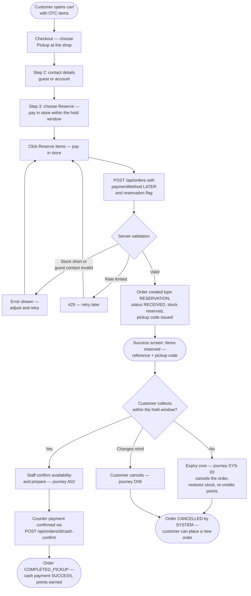

# O05 — Reserve items for collection

A customer who is not ready to pay online can reserve items: checkout's "Reserve" option (`LATER` payment method) places the order without any charge, marks it as type `RESERVATION`, and holds the reserved stock. The customer visits the shop, quotes the order reference, and staff confirm the cash payment at the counter (journey A02). If the reservation is never claimed, the reservation-expiry cron (journey SYS-03) cancels the order and returns the stock. The UI copy tells the customer items are held for 24 hours; the actual hold is the configured reservation TTL (`ORDER_RESERVATION_TTL_MINUTES`), so the real window depends on the environment's settings.

| Metadata | Value |
| --- | --- |
| Primary actor | Customer (guest or signed-in) |
| Secondary actors | Staff (in-store cash confirmation), System (reservation-expiry cron — SYS-03) |
| Functional area | Orders and fulfillment |
| Entry point | Checkout step 3 → Reserve |
| Status | Implemented — verified against code |
| End condition | Order type `RESERVATION` status `RECEIVED` (stock reserved); ends as `COMPLETED_PICKUP` after in-store payment, or `CANCELLED` by the expiry job |
| Related journeys | O01 (cash pickup sibling), O03/O04 (pay online instead), O06 (tracking/cancelling), A02 (staff processing), SYS-03 (expiry), C08 (points on payment) |

## Journey map

## Journey steps

### Step 1 — Choose pickup and provide details

- **User action:** The customer checks out an OTC cart, selects "Pickup at the shop" on step 1, and completes contact details on step 2 (signed-in customers confirm pre-filled details; guests enter name, Kenyan phone and optional email).
- **Location:** Checkout view steps 1–2 — `src/components/views/checkout-view.tsx`.
- **Destination:** Step 3, payment method.
- **Purpose:** Establish that the items will be collected in store, which is what makes a pay-later reservation possible.
- **System behaviour:** Identical to journey O01 steps 1–3: `fulfillment: "PICKUP"` is set; guests are validated client-side and server-side; prescription items in the cart require an account and follow journey X02 instead.
- **Outcome:** The wizard reaches the payment step with pickup selected.
- **Next step:** Choose the Reserve option.
- **Alternative paths:** Customers who want the items delivered choose delivery (journey O02); the Reserve card itself is not removed for delivery orders, but the pay-in-store copy targets collection.

### Step 2 — Choose Reserve and place the reservation

- **User action:** The customer selects the "Reserve" card ("Pay in store within 24h" / "No card needed") and clicks "Reserve items · pay in store".
- **Location:** Checkout view step 3 — `checkout-view.tsx` (`startLater` handler).
- **Destination:** The order is submitted; on success the step-4 success screen shows the reservation confirmation.
- **Purpose:** Commit to buying the items later, in store, while holding the stock now.
- **System behaviour:** `startLater` calls `placeOrder("LATER")`. `buildPayload` sets `paymentMethod: "LATER"` and `reservation: true` (the reservation flag is derived from the method). The panel copy states items are held for 24 hours and unclaimed reservations are released after that. `POST /api/orders` runs the standard validation (stock availability, guest contact, rate limit `order-create` 12/15 min), then in one Serializable transaction reserves stock and creates the order with `type: "RESERVATION"` (no Rx lines + reservation flag), `status: "RECEIVED"` (LATER is not an online method, so the initial status is the unconfirmed one), `paymentMethod: "LATER"`, a pickup code (pickup fulfillment), `inventoryReservedAt: now` and the initial history entry. Customer and staff are notified (`NEW_ORDER`).
- **Outcome:** A reservation order exists with stock held; the success screen says "Items reserved!" and repeats the pay-in-store instruction with the order reference.
- **Next step:** Track the reservation or travel to the shop.
- **Alternative paths:** Stock shortfalls return 409 naming the product; guests with invalid contact are rejected 400; rate limiting returns 429. The customer can also switch to M-Pesa/card (journeys O03/O04) or plain cash-on-pickup (journey O01) before submitting.

### Step 3 — Track the reservation

- **User action:** The customer opens My orders (or the guest order link) and checks the reservation's status and pickup code.
- **Location:** Orders view and order detail view — `src/components/views/orders-view.tsx`, `src/components/views/order-detail-view.tsx`; `GET /api/orders`, `GET /api/orders/[id]`.
- **Destination:** The order detail view for the reservation.
- **Purpose:** Confirm the hold and know what to quote at the counter.
- **System behaviour:** The order detail shows the type badge (Reservation — pay in store), status history, items and totals; no payment exists yet, so no payment records are shown. Staff see the reservation in the admin order queue (journey A02) and can confirm availability and prepare it like any cash pickup order. The customer can cancel while the order is in a cancellable status (journey O06), which releases the stock immediately rather than waiting for expiry.
- **Outcome:** The customer knows the reservation is held and has the reference and pickup code.
- **Next step:** Collect and pay in store (or cancel / let it expire).
- **Alternative paths:** If stock pressure or other issues arise, staff may contact the customer; a staff rejection releases the stock and notifies the customer.

### Step 4 — Pay in store and complete

- **User action:** At the counter, the customer quotes the order reference (or pickup code); staff take the cash and confirm the payment in the admin orders section.
- **Location:** Admin workspace orders section — `src/components/views/admin/sections/orders-section.tsx`; endpoint `POST /api/orders/[id]/cash-confirm` (`src/app/api/orders/[id]/cash-confirm/route.ts`).
- **Destination:** The order detail shows a successful cash payment and completed status.
- **Purpose:** Record the physical payment so accounting and order state stay truthful.
- **System behaviour:** The route requires a staff session and only allows confirmation when the order status is one of `AVAILABILITY_CONFIRMED`, `AWAITING_PAYMENT`, `READY_FOR_PICKUP`, `OUT_FOR_DELIVERY` (staff first move a `RECEIVED` reservation forward by confirming availability), no unreviewed prescriptions exist, and no successful payment is already recorded. It then creates a `Payment` (provider `CASH`, status `SUCCESS`) and moves the order to `COMPLETED_PICKUP` through the order workflow, crediting loyalty points for the paid amount.
- **Outcome:** The reservation completes as `COMPLETED_PICKUP`; the customer's points balance increases.
- **Next step:** The journey ends; points can fund future orders (journey C08).
- **Alternative paths:** If the order sits in a non-confirmable status, the confirmation is rejected with an actionable error and staff must correct the order state first (journey A02).

### Step 5 — Expiry if never claimed

- **User action:** None — this step records what the system does when a reservation is not collected.
- **Location:** `GET /api/cron/order-reservations` (`src/app/api/cron/order-reservations/route.ts`) — journey SYS-03.
- **Destination:** The reservation is cancelled and inventory restored.
- **Purpose:** Keep stock from being held indefinitely by abandoned reservations.
- **System behaviour:** The cron (authenticated with `CRON_SECRET`, requires `ORDER_RESERVATION_TTL_MINUTES` between 15 and 10,080) finds orders in `RECEIVED`…`AWAITING_PAYMENT` whose `inventoryReservedAt` is older than the TTL, with no successful payment, and cancels them with an optimistic-lock claim: stock is restored, redeemed loyalty points are re-credited (`RESERVATION_EXPIRED` ledger event), dangling pending/processing payments are failed, and a status-history entry with actor `SYSTEM` ("Inventory reservation expired before payment.") is written.
- **Outcome:** The reservation becomes `CANCELLED`; the customer can place a fresh order.
- **Next step:** None — the customer simply orders again if still interested.
- **Alternative paths:** The customer can pre-empt expiry by cancelling themselves (journey O06) or by paying online before the window closes if staff have advanced the order to `AWAITING_PAYMENT` (journeys O03/O04).

## Decision points

| Decision | Branches | Enforced by/where |
| --- | --- | --- |
| Payment method | LATER → `RESERVATION` type + `RECEIVED` status; MPESA/CARD → online payment journeys; CASH → journey O01 | `paymentMethod` → `reservation` flag in `buildPayload`; type/`initialStatus` derivation in `POST /api/orders` |
| Cart contains Rx items? | Yes → journey X02 (reservation type never applies to Rx carts); no → reservation allowed | `hasRx` type derivation in `POST /api/orders` |
| Stock available? | Yes → reserved transactionally; no → 409 with product name | conditional bulk stock `UPDATE` in `POST /api/orders` |
| Cash confirmation state allowed? | `AVAILABILITY_CONFIRMED`/`AWAITING_PAYMENT`/`READY_FOR_PICKUP`/`OUT_FOR_DELIVERY` → confirm; else 409 | `CASH_ALLOWED` status list in `POST /api/orders/[id]/cash-confirm` |
| Collected within TTL? | Yes → `COMPLETED_PICKUP` with cash payment; no → cron cancel with stock restore | `POST /api/orders/[id]/cash-confirm`; `GET /api/cron/order-reservations` (SYS-03) |
| Customer cancels first? | Cancellable statuses → immediate cancel + stock release; else contact pharmacy | `POST /api/orders/[id]/cancel` (journey O06) |
| Hold duration | UI copy says 24 hours; actual hold = `ORDER_RESERVATION_TTL_MINUTES` configuration | checkout copy in `checkout-view.tsx`; TTL validation in the cron route |

## Error and recovery paths

- **Insufficient stock at submit (409):** the error names the product; adjust quantities and retry — no partial reservation is kept.
- **Guest contact invalid (400):** the inline message asks for a valid name/phone; no order is created.
- **Rate limited (429):** reservation creation shares the 12-per-15-minutes order limit; wait and retry.
- **Staff cannot cash-confirm (409):** the reservation is still in `RECEIVED` — staff must confirm availability first (journey A02); the error tells them the order is not in a confirmable state.
- **Duplicate cash confirmation (409):** a successful payment already exists; the confirmation is refused instead of double-recording.
- **Reservation expired:** the cron cancels the order and restores stock/points automatically; the customer sees `CANCELLED` with a SYSTEM history note and can order again (prices/stock re-validated at that time).
- **Hold-window misunderstanding:** the UI says 24 hours but the effective window is the environment's TTL setting; when the TTL is shorter, an unclaimed reservation can expire sooner than the copy suggests — the order history always shows the authoritative cancellation time.
- **Customer changes their mind:** self-service cancellation (journey O06) releases the stock immediately and re-credits any redeemed points.

## Traceability

| Concern | Implementation reference |
| --- | --- |
| Reserve option UI and starter | `startLater`, LATER `MethodCard` and copy in `src/components/views/checkout-view.tsx` |
| Reservation flag on the payload | `buildPayload` (`reservation: paymentMethod === "LATER"`) in `checkout-view.tsx` |
| Order type derivation | `type` computation in `POST /api/orders` (`src/app/api/orders/route.ts`) — `RESERVATION` when no Rx and reservation flag set |
| Initial status for LATER | `initialStatus` logic in `POST /api/orders` (LATER → `RECEIVED`) |
| Stock reservation + `inventoryReservedAt` | transaction in `POST /api/orders`; `Order.inventoryReservedAt` (`prisma/schema.prisma`) |
| Pickup code | `pickupCode()` from `src/lib/hash.ts`, stored on `Order.pickupCode` |
| In-store payment | `POST /api/orders/[id]/cash-confirm` (`src/app/api/orders/[id]/cash-confirm/route.ts`) |
| Expiry job | `GET /api/cron/order-reservations` (`src/app/api/cron/order-reservations/route.ts`) — journey SYS-03 |
| Loyalty re-credit on expiry/cancel | `LoyaltyLedger` events `RESERVATION_EXPIRED` / `ORDER_CANCELLED` in the cron and cancel routes |
| Order statuses and types | `ORDER_STATUSES`, `ORDER_TYPES` in `src/lib/constants.ts` |
| Notifications | `notifyCustomer`, `notifyStaff` from `src/lib/notify.ts` |
| API contract | `openapi/sphere-api.yaml` — `POST /orders`, `POST /orders/{id}/cash-confirm` |

## Related journeys and documents

- **O01** — the cash-on-pickup sibling (pay at the counter from the start)
- **O03 / O04** — paying the reservation online if staff advance it to awaiting payment
- **O06** — tracking and cancelling the reservation from the orders list
- **A02** — staff-side processing, availability confirmation and cash confirmation
- **SYS-03** — the reservation-expiry job that ends unclaimed holds
- **C08** — Sphere Points earned when the in-store payment is confirmed
- Docs: [orders-and-fulfillment](../../features/orders-and-fulfillment.md) · [order lifecycle](../../workflows/order-lifecycle.md) · [payments and refunds](../../features/payments-and-refunds.md)
