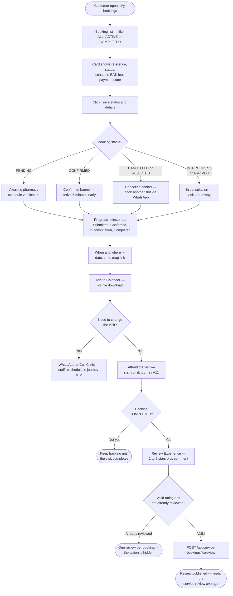

# S03 — Track an appointment and review a visit

The bookings tab is the customer's appointment workspace: every booking appears with its status, schedule (Nairobi time), fee and payment state, and a "Trace status & details" dialog that shows the progress milestones, the visit logistics, an `.ics` calendar download, and the WhatsApp/call actions for requesting changes — there is deliberately no customer-side reschedule or cancel button; changes go through the pharmacy (staff actions are journey A12). After a visit is completed, the customer can leave a star rating with a comment, which publishes immediately and feeds the service's public review summary.

| Metadata | Value |
| --- | --- |
| Primary actor | Customer |
| Secondary actors | Staff (confirm, reschedule, complete — journeys A11/A12) |
| Functional area | Services and bookings |
| Entry point | Services view → My bookings tab (deep link `?tab=bookings`) |
| Status | Implemented — verified against code |
| End condition | Booking traced to its current status; review submitted for a completed visit (one per booking, published) |
| Related journeys | S01 (booking), S02 (payment), A11 (visit workflow), A12 (staff reschedule/cancel), C09 (product-review sibling), SYS-07 (reminders) |

## Journey map

## Journey steps

### Step 1 — Open the appointments workspace

- **User action:** The customer opens Services and switches to the My bookings tab (or uses My account → Appointments).
- **Location:** Bookings tab in `src/components/views/services-view.tsx`; data from `serviceBookingsApi.mine()` → `GET /api/service-bookings/mine`.
- **Destination:** The customer's booking list.
- **Purpose:** Keep track of appointments in one place.
- **System behaviour:** The view loads the signed-in customer's bookings (newest scheduled first) with their status history, and offers three filters: ALL, ACTIVE (PENDING, CONFIRMED, ARRIVED, IN_PROGRESS) and COMPLETED. Signed-out customers have no bookings list (booking requires an account — journey S01); a deep link `?tab=bookings` opens the tab directly. The services banner surfaces a live count of scheduled appointments.
- **Outcome:** The customer sees every appointment with its current state.
- **Next step:** Trace a booking.
- **Alternative paths:** An empty list links back to the service catalogue to make a first booking (journey S01).

### Step 2 — Trace status and details

- **User action:** The customer clicks "Trace status & details" on a booking card.
- **Location:** `BookingTraceDialog` in `services-view.tsx`.
- **Destination:** The tracker dialog.
- **Purpose:** See the full status and visit details behind the card.
- **System behaviour:** The dialog shows the reference (with copy), the service name and a status badge, a status banner matched to the current status (pending verification / confirmed with arrival guidance / cancelled-or-declined with re-booking guidance), a four-step progress stepper — Request Submitted, Confirmed by Pharmacy, In Consultation, Visit Completed — with the current step pulsing, and the When & Where card (date, start–end times in East Africa Time, pharmacy name, address and a Google Maps link). Preparation guidelines (ID, medication packaging, arrive 5 minutes early) and the customer's own notes are included. Status changes are made by staff (journeys A11/A12) and reminders arrive 24 h and 2 h before the visit (journey SYS-07).
- **Outcome:** The customer knows exactly where the appointment stands and what to bring.
- **Next step:** Keep the appointment in a calendar.
- **Alternative paths:** Cancelled/declined bookings show a dedicated banner directing the customer to WhatsApp for re-booking — no self-service cancel/resume exists by design.

### Step 3 — Add the appointment to a calendar

- **User action:** The customer clicks "Add to Calendar".
- **Location:** `downloadIcsCalendar` in `services-view.tsx`.
- **Destination:** A downloaded `.ics` file (`SpherePharmacy-<reference>.ics`).
- **Purpose:** Carry the appointment into the customer's own calendar app.
- **System behaviour:** The client generates the iCalendar content locally from the booking (start/end as UTC timestamps, summary "Sphere Pharmacy: <service>", the reference and pharmacy phone in the description, the pharmacy address as location) and triggers a browser download with a success toast; a generation failure shows an error toast. No server round-trip is involved.
- **Outcome:** The appointment exists in the customer's calendar.
- **Next step:** Attend (or request changes).
- **Alternative paths:** The map link in When & Where opens Google Maps for directions.

### Step 4 — Request changes through contact actions

- **User action:** Needing to reschedule or cancel, the customer uses the "Chat on WhatsApp" or "Call Clinic" actions in the tracker (or the WhatsApp icon on the booking card).
- **Location:** Assistance section of `BookingTraceDialog` and booking-card action in `services-view.tsx` (`waLink`, `tel:` link with `PHARMACY` constants).
- **Destination:** A WhatsApp conversation or phone call with the pharmacy.
- **Purpose:** Request a reschedule or cancellation — there is no customer-side booking mutation.
- **System behaviour:** The WhatsApp link is pre-filled with the booking reference and service so staff can identify the appointment immediately. Staff perform reschedules and cancellations in the admin workspace (`PATCH /api/admin/service-bookings` with new times or a status; reschedule is allowed from PENDING/CONFIRMED/RESCHEDULED into a valid future slot and records history + notifications) — journey A12. The customer then sees the updated schedule and status in this view.
- **Outcome:** The change is requested and, once staff act on it, reflected in My bookings.
- **Next step:** Attend the (possibly new) time.
- **Alternative paths:** Payment questions use the same channels or the payment dialog (journey S02).

### Step 5 — Review the completed visit

- **User action:** After a visit the staff marked COMPLETED, the customer clicks "Review" on the booking card (or "Review Experience" in the tracker), picks 1–5 stars, optionally writes a comment, and submits.
- **Location:** `ServiceReviewDialog` in `services-view.tsx`; endpoint `POST /api/service-bookings/[id]/review` (`src/app/api/service-bookings/[id]/review/route.ts`).
- **Destination:** A published review.
- **Purpose:** Give feedback on the consultation and care experience.
- **System behaviour:** The Review button renders only for `COMPLETED` bookings the customer has not yet reviewed (the view tracks submitted reviews to hide the action). The route requires the booking owner (404 otherwise), accepts only an integer rating 1–5 (400 otherwise), requires the booking status to be exactly `COMPLETED` (409 otherwise), and enforces one review per booking per customer via the unique `(bookingId, userId)` constraint (409 on duplicates). The review is created `PUBLISHED` with the comment (≤ 1,000 chars) and the assigned staff recorded; a success toast confirms.
- **Outcome:** The review is recorded and immediately visible.
- **Next step:** See the review's effect on the service.
- **Alternative paths:** Duplicates are refused; reviews of non-completed bookings are refused — both server-side, not just in the UI.

### Step 6 — Where reviews appear

- **User action:** The customer (or any visitor) opens a service's details and sees its review summary.
- **Location:** Service detail surfaces and `GET /api/services/[id]/reviews` (`src/app/api/services/[id]/reviews/route.ts`).
- **Destination:** The service's published reviews.
- **Purpose:** Close the loop between feedback and the catalogue.
- **System behaviour:** The reviews endpoint aggregates published reviews for the service into an average (one decimal), a count, and a list with anonymized author names (first name plus ellipsis) — informing future customers browsing the catalogue (journey S01). Unlike product reviews (journey C09), service reviews publish without a moderation queue.
- **Outcome:** The customer's feedback contributes to the service's public rating.
- **Next step:** None — the journey ends with the reviewed visit.
- **Alternative paths:** Customers preferring private feedback use the contact channels (journey P06).

## Decision points

| Decision | Branches | Enforced by/where |
| --- | --- | --- |
| Booking filter | ALL · ACTIVE (PENDING/CONFIRMED/ARRIVED/IN_PROGRESS) · COMPLETED | `filteredBookings` in `services-view.tsx` |
| Current status | PENDING → verification banner; CONFIRMED → arrival guidance; CANCELLED/REJECTED → re-book guidance; later stages → progress stepper | status banners in `BookingTraceDialog` |
| Change request channel | Customer → WhatsApp/call only; reschedule/cancel performed by staff | no customer mutation route; `PATCH /api/admin/service-bookings` (journey A12) |
| Review offered? | Booking COMPLETED and not yet reviewed → Review action; otherwise hidden | card/tracker conditions + `reviewedIds` in `services-view.tsx` |
| Rating valid? | Integer 1–5 → accept; else 400 | rating check in `POST /api/service-bookings/[id]/review` |
| Review allowed? | Owner + COMPLETED status + first review for the booking → accept; foreign → 404; wrong status → 409; duplicate → 409 | guards and unique `(bookingId, userId)` in the review route |
| Review visibility | Created PUBLISHED — aggregated into the service's average via the reviews endpoint | `ServiceReview` model; `GET /api/services/[id]/reviews` |
| Calendar entry | Generated client-side from the booking — no server dependency | `downloadIcsCalendar` in `services-view.tsx` |

## Error and recovery paths

- **Bookings fail to load:** the mine call fails silently per its catch — the list simply stays empty; switching tabs or reloading re-fetches. (Treat an unexpectedly empty list with a refresh before assuming no appointments.)
- **Status looks stale:** staff transitions and reschedules (journeys A11/A12) drive the state — reopen the tracker or reload the tab; notifications also announce changes.
- **Reschedule/cancel attempt:** there is no customer-side button — this is intentional; use WhatsApp/call and staff action (journey A12). The cancelled banner in the tracker repeats this guidance.
- **Review refused (409 — not completed):** the visit has not been marked COMPLETED yet; wait for staff to close it out (journey A11) and try again.
- **Review refused (409 — duplicate):** one review per booking; the view also hides the action after submission, so a duplicate attempt means a stale list — refresh.
- **Review refused (400 — rating):** pick a whole star rating from 1 to 5 before submitting.
- **Calendar generation failure:** an error toast appears; retrying regenerates the file — the booking itself is unaffected.
- **Reminder not received:** reminders depend on the scheduler (journey SYS-07) and the customer's channel preferences (journey C06); the tracker always shows the authoritative time.

## Traceability

| Concern | Implementation reference |
| --- | --- |
| Bookings tab (list, filters, actions) | `src/components/views/services-view.tsx` (bookings tab, `filteredBookings`, booking cards) |
| Bookings data | `serviceBookingsApi.mine()` → `GET /api/service-bookings/mine` (`src/app/api/service-bookings/mine/route.ts`) |
| Tracker dialog (milestones, banners, logistics) | `BookingTraceDialog` in `services-view.tsx` |
| Calendar download | `downloadIcsCalendar` in `services-view.tsx` (client-side `.ics`) |
| Change-request actions | `waLink` / `tel:` links using `PHARMACY` constants in `src/lib/constants.ts` |
| Review dialog | `ServiceReviewDialog` in `services-view.tsx` |
| Review endpoint | `POST /api/service-bookings/[id]/review` (`src/app/api/service-bookings/[id]/review/route.ts`) |
| Review model and uniqueness | `ServiceReview` model, unique `[bookingId, userId]` (`prisma/schema.prisma`) |
| Public review aggregation | `GET /api/services/[id]/reviews` (`src/app/api/services/[id]/reviews/route.ts`) |
| Staff reschedule/cancel (referenced) | `PATCH /api/admin/service-bookings` (`src/app/api/admin/service-bookings/route.ts`) — journey A12 |
| Booking statuses | status sets in `services-view.tsx` filters; workflow in `docs/workflows/service-bookings.md` |
| Reminders | `GET /api/cron/service-booking-reminders` — journey SYS-07 |
| API contract | `openapi/sphere-api.yaml` — `GET /service-bookings/mine`, `POST /service-bookings/{id}/review` |

## Related journeys and documents

- **S01** — how the appointment being tracked was created
- **S02** — the payment state shown in the tracker
- **A11** — the staff-side visit workflow that drives the milestones
- **A12** — staff rescheduling and cancellation (the customer-requested changes)
- **C09** — the product-review sibling flow (moderated, unlike service reviews)
- **SYS-07** — the reminder job for upcoming appointments
- Docs: [services and bookings](../../features/services-and-bookings.md) · [service bookings workflow](../../workflows/service-bookings.md)
