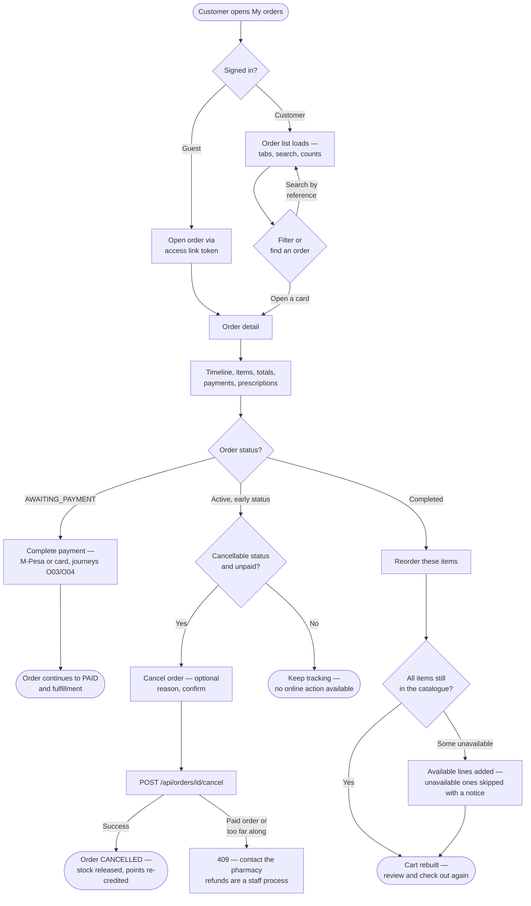

# O06 — Track, cancel and reorder

After checkout, the customer's relationship with an order happens in three places: the orders list (tabs, search, payment nudges), the order detail (timeline, items, payments, prescriptions, actions) and — for guests — the order access link issued at checkout. Cancellation is strictly gated: only pre-fulfillment statuses are cancellable and any captured payment blocks it entirely (refunds are a separate administrator process). Reordering is deliberately conservative: it rebuilds the cart from the completed order's lines and lets the customer review it — it never places an order automatically.

| Metadata | Value |
| --- | --- |
| Primary actor | Customer (guests via the 7-day order access token) |
| Secondary actors | Staff (status transitions), System (reservation expiry — SYS-03, payment callbacks) |
| Functional area | Orders and fulfillment |
| Entry point | My account → Orders; order detail via any order card |
| Status | Implemented — verified against code |
| End condition | Order tracked to its current status; eligible order `CANCELLED` with stock released; or a completed order's items re-added to the cart |
| Related journeys | O01/O02 (placement), O03/O04 (payment from this view), O05 (reservations), A02/A03 (staff side), SYS-03 (auto-cancel) |

## Journey map

## Journey steps

### Step 1 — Open the order history

- **User action:** The customer opens My account → Orders (or the mobile navigation's track-orders entry) and browses the list.
- **Location:** Orders view — `src/components/views/orders-view.tsx` (rendered for the app-store `orders` view).
- **Destination:** The customer's order list.
- **Purpose:** Find current and previous orders quickly.
- **System behaviour:** For signed-in customers the view loads `ordersApi.myOrders()` (`GET /api/orders`, own orders only, newest first) and renders four tabs — All, Active (`ACTIVE_STATUSES`), Completed (`TERMINAL_STATUSES`) and Prescriptions (types `PRESCRIPTION`/`MIXED`) — with counts, plus search by order reference. Each card shows the short reference, status badge, type badge, items summary, fulfillment label, total and relative time; Awaiting-payment cards are visually highlighted with a "Complete payment" button. Signed-out visitors see a sign-in prompt; staff accounts are pointed to the admin dashboard.
- **Outcome:** The customer can locate any order and see its current status at a glance.
- **Next step:** Open an order for detail.
- **Alternative paths:** Guests reach the order detail through the order link issued at checkout (the access token lives in `sessionStorage` under `sphere_order_access_<orderId>` and is valid for 7 days). Load failures show an inline error with retry.

### Step 2 — Open the order detail and timeline

- **User action:** The customer clicks an order card to open its detail page.
- **Location:** Order detail view — `src/components/views/order-detail-view.tsx`; data from `GET /api/orders/[id]`.
- **Destination:** The full order record.
- **Purpose:** See the detail behind the current status.
- **System behaviour:** The route enforces owner access (session owner, staff, or a valid guest token) — 401 prompts sign-in, 403 means the order belongs to another account, 404 means not found. The view renders the status timeline from `OrderStatusHistory` (oldest first, current status highlighted, failure states styled), items with prescription flags, totals (subtotal, promo discount, points redeemed, delivery fee, total), payment records with provider badges, attached prescriptions with their review status, and contextual actions. A refresh control re-fetches the order.
- **Outcome:** The customer can follow each stage of the order with notes and timestamps.
- **Next step:** Take a status-dependent action.
- **Alternative paths:** If the order was placed moments ago and the network dropped, the "not found" state resolves once the order is reachable; wrong-account errors suggest signing in with the right account.

### Step 3 — Complete payment on an awaiting-payment order

- **User action:** On an Awaiting payment order, the customer uses the Complete payment panel and picks M-Pesa or card.
- **Location:** Payment panel in `order-detail-view.tsx` (`startMpesa`, `startCard`).
- **Destination:** Journeys O03 (M-Pesa STK push) or O04 (IntaSend hosted checkout).
- **Purpose:** Move the order forward by paying it.
- **System behaviour:** The panel appears only while the order status is `AWAITING_PAYMENT`; cash orders see an explanatory note that they can still pay online to speed things up. The payment starters mirror checkout: initiate + poll for M-Pesa, hosted redirect for card, with the guest token attached where relevant.
- **Outcome:** Payment completes through the linked journey and the order refetches to `PAID`.
- **Next step:** Fulfillment continues (journeys A02/A03).
- **Alternative paths:** Orders still `RECEIVED` or `UNDER_REVIEW` cannot be paid yet — the pharmacy must confirm availability (or verify prescriptions) first; the customer simply keeps tracking.

### Step 4 — Cancel an eligible order

- **User action:** On an unpaid order in an early status, the customer clicks Cancel order, optionally types a reason, and confirms.
- **Location:** Cancel dialog in `order-detail-view.tsx` (`confirmCancel`); endpoint `POST /api/orders/[id]/cancel` (`src/app/api/orders/[id]/cancel/route.ts`).
- **Destination:** A terminal CANCELLED order.
- **Purpose:** Back out of an order before fulfillment.
- **System behaviour:** The button only renders for `CANCELLABLE_STATUSES` (`RECEIVED`, `UNDER_REVIEW`, `PRESCRIPTION_VERIFIED`, `AVAILABILITY_CONFIRMED`, `AWAITING_PAYMENT`). The route requires owner, staff (non-rider) or valid guest token; enforces the same server-side `CANCELLABLE` list; and **rejects cancellation outright (409) if any payment has status `SUCCESS`** — captured payments are never auto-refunded; an administrator must run the provider refund process. Inside a retried transaction (3 attempts with backoff, optimistic `version` guard) it sets `CANCELLED` + `inventoryReleasedAt`, restores the reserved stock per item, re-credits redeemed loyalty points (idempotent `cancel:<orderId>` ledger event), fails dangling pending/processing payments, writes a history entry ("Cancelled by customer" or the given reason), and notifies the customer and staff.
- **Outcome:** The order shows CANCELLED with the reason; stock is back in the catalogue.
- **Next step:** The customer can place a fresh order any time.
- **Alternative paths:** Orders past the window (e.g. `PREPARING`, `READY_FOR_PICKUP`, `OUT_FOR_DELIVERY`, or paid) return 409 with guidance to contact the pharmacy; concurrent changes return a conflict error that a refresh resolves.

### Step 5 — Reorder from a completed order

- **User action:** On a completed order (`COMPLETED_PICKUP` or `COMPLETED_DELIVERY`), the customer clicks "Reorder these items" and confirms.
- **Location:** Reorder dialog in `order-detail-view.tsx` (`confirmReorder`); cart store `src/store/use-cart-store.ts`.
- **Destination:** The cart view with the order's lines re-added.
- **Purpose:** Recreate a past purchase for review rather than an automatic repurchase.
- **System behaviour:** The button only renders for completed statuses. `confirmReorder` iterates the order items and adds each line with its stored snapshot (name, price, prescription flag) to the cart via `addToCart`; items whose `productId` is null (product since deleted from the catalogue) are skipped and reported ("N items no longer available and couldn't be added"). The customer lands on the cart to review — current prices and stock are re-validated by the server only when a new order is placed (journeys O01/O02), so the cart is a proposal, not a purchase.
- **Outcome:** A cart ready for a fresh checkout; unavailable lines surfaced explicitly.
- **Next step:** Check out again (journey O01 or O02; prescription lines will require the X02 flow).
- **Alternative paths:** Guests don't get an in-app history, but their order-link access still shows the completed order; reorder is most useful for signed-in customers.

### Step 6 — Guest tracking alternative

- **User action:** A guest who kept the order link opens it (or returns from a notification email) and tracks, pays or cancels the order.
- **Location:** Order detail view with the `x-order-access` token from `sessionStorage`; routes `GET /api/orders/[id]`, `POST /api/orders/[id]/cancel`, payment initiates.
- **Destination:** The same order detail capabilities as an owner.
- **Purpose:** Let guests manage an order without an account.
- **System behaviour:** The token is validated against `guestAccessTokenHash` with a 7-day expiry and unlocks view, pay and cancel. If the token is lost, the order becomes untrackable in-app — the customer-side recovery path is claiming the order later by verifying their phone via OTP (journey C02), which attaches guest orders to the account.
- **Outcome:** Guests can complete the same track/pay/cancel actions within the window.
- **Next step:** None specific — the flows above apply unchanged.
- **Alternative paths:** Expired tokens fall back to sign-in/OTP; staff can always see the order in the admin workspace.

## Decision points

| Decision | Branches | Enforced by/where |
| --- | --- | --- |
| Viewer authorized? | Owner session · staff · guest token → detail; else 401/403/404 | `GET /api/orders/[id]` access checks |
| Tab/filter | All · Active (`ACTIVE_STATUSES`) · Completed (`TERMINAL_STATUSES`) · Prescriptions (type) · reference search | tab filtering in `orders-view.tsx`; status groups in `src/lib/constants.ts` |
| Order awaiting payment? | Yes → Complete payment panel (O03/O04); no → no payment panel | `awaitingPayment` check in `order-detail-view.tsx`; `AWAITING_PAYMENT` guard in the initiate routes |
| Cancellable? | `CANCELLABLE` statuses and no `SUCCESS` payment → cancel; paid or advanced → 409 contact pharmacy | `CANCELLABLE` list + payment guard in `POST /api/orders/[id]/cancel` |
| Cancel race? | version/status guard → retry (3×) → conflict resolved by refresh | optimistic `updateMany` + retry loop in the cancel route |
| Refund after cancel? | Never automatic — captured payments require the admin refund process | payment guard in the cancel route; `POST /api/payments/refund` (ADMIN) |
| Reorder available? | `COMPLETED_PICKUP`/`COMPLETED_DELIVERY` only → rebuild cart | `canReorder` in `order-detail-view.tsx` |
| Reordered line still exists? | `productId` present → added; null → skipped with notice; prices/stock re-checked at next placement | `confirmReorder` loop; `POST /api/orders` re-validation |

## Error and recovery paths

- **Orders fail to load:** inline error card with a retry button; the list stays empty until a reload succeeds.
- **Order not accessible (401/403/404):** sign in, switch account, or use the original order link; the views distinguish these cases with dedicated empty states.
- **Cancellation rejected (409 — paid):** the order has a captured payment; cancellation is impossible online and refunds are an administrator action through the provider — contact the pharmacy. (The success toast mentions refunds for paid orders, but a paid order can never reach that path — the guard fires first.)
- **Cancellation conflict (409 — order changed):** another action (staff transition or the expiry job) changed the order mid-cancel; refreshing shows the new state, including the possibility it is already CANCELLED.
- **Cancellation rate limit (429):** 8 cancels per 15 minutes per client; wait and retry.
- **Reorder with deleted products:** unavailable lines are skipped and counted in a notice; the rest of the cart is built normally.
- **Stale cart prices after reorder:** the reordered cart uses the snapshot prices; the server re-validates at placement, so an out-of-date price or stock is caught at checkout with a 409 naming the product.
- **Guest token lost/expired:** no staff tool re-issues it; the customer signs in/verifies by OTP to claim the order (journey C02) or contacts the pharmacy.

## Traceability

| Concern | Implementation reference |
| --- | --- |
| Orders list UI | `src/components/views/orders-view.tsx` (tabs, counts, search, awaiting-payment highlight) |
| Own-orders data | `ordersApi.myOrders()` → `GET /api/orders` (customer scope) |
| Order detail UI | `src/components/views/order-detail-view.tsx` (timeline, payments, actions) |
| Order detail data | `GET /api/orders/[id]` (`src/app/api/orders/[id]/route.ts`) with `x-order-access` support |
| Cancellable statuses (client) | `CANCELLABLE_STATUSES` in `order-detail-view.tsx` |
| Cancellation endpoint | `POST /api/orders/[id]/cancel` (`src/app/api/orders/[id]/cancel/route.ts`) — `CANCELLABLE` list, payment guard, stock restore, points re-credit |
| Reorder logic | `confirmReorder` in `order-detail-view.tsx`; `use-cart-store.ts` (`add`) |
| Status groups and labels | `ACTIVE_STATUSES`, `TERMINAL_STATUSES`, `ORDER_STATUS_LABELS` in `src/lib/constants.ts` |
| Guest access token | created in `POST /api/orders`; stored as `sphere_order_access_<orderId>`; 7-day expiry |
| Payment retry from detail | `startMpesa`/`startCard` in `order-detail-view.tsx` (journeys O03/O04) |
| Notifications on transitions | `statusNotifications`, `notifyCustomer`, `notifyStaff` in `src/lib/notify.ts` |
| Refund process (paid orders) | `POST /api/payments/refund` (ADMIN) — see payments-and-refunds doc |
| API contract | `openapi/sphere-api.yaml` — `GET /orders`, `GET/POST /orders/{id}`, `POST /orders/{id}/cancel` |

## Related journeys and documents

- **O01 / O02** — the placement journeys whose orders are tracked here
- **O03 / O04** — payment completion from the awaiting-payment panel
- **O05** — reservations, which this view tracks and which SYS-03 can auto-cancel
- **A02 / A03** — the staff-side transitions that drive the timeline
- **SYS-03** — automatic cancellation of expired reservations (also releases stock)
- **C02** — the OTP path a guest uses to claim orders after losing the access link
- Docs: [orders-and-fulfillment](../../features/orders-and-fulfillment.md) · [order lifecycle](../../workflows/order-lifecycle.md) · [payments and refunds](../../features/payments-and-refunds.md)
