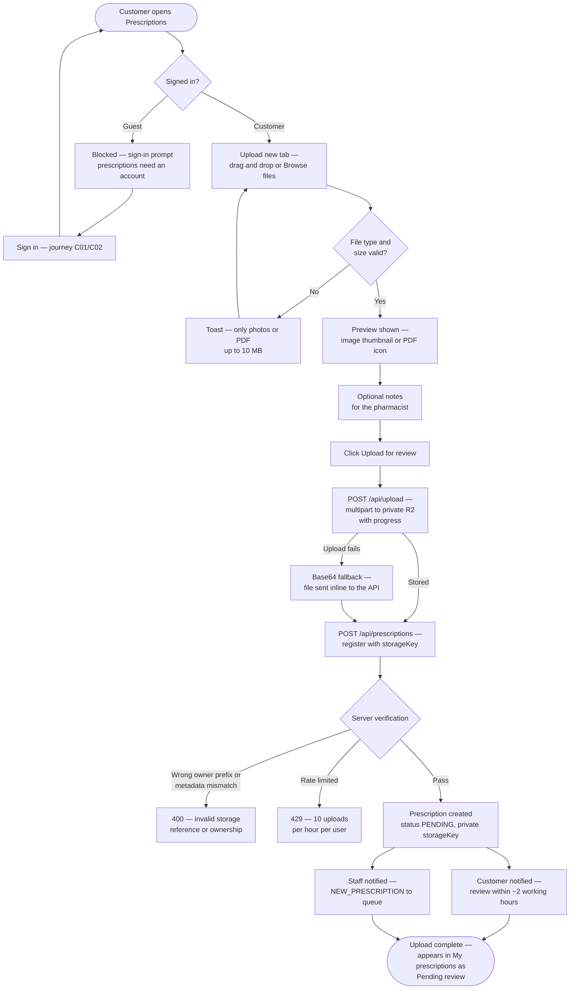

# X01 — Upload a prescription for review

A signed-in customer uploads a prescription document (photo or PDF) from the prescriptions workspace. The file is stored privately — only the owner and reviewing pharmacists can ever read it, through short-lived presigned URLs — and a `PENDING` prescription row is created that immediately enters the pharmacist review queue (journey A04). The upload itself places no order and charges nothing: its purpose is to have the document verified so medicines can be ordered against it afterwards (journey X02) or refilled later (journey X03).

| Metadata | Value |
| --- | --- |
| Primary actor | Customer (signed-in — guests are blocked) |
| Secondary actors | Pharmacist (review queue — A04), System (notifications, retention — SYS-06) |
| Functional area | Prescriptions |
| Entry point | Prescriptions view → "Upload new" tab |
| Status | Implemented — verified against code |
| End condition | `Prescription` row `PENDING` with `storageKey` under `prescriptions/{userId}/…`; customer and staff notified |
| Related journeys | X02 (ordering against an approval), X03 (outcomes/refills), A04 (review), A05 (non-approval outcomes), SYS-06 (retention) |

## Journey map

## Journey steps

### Step 1 — Open the prescriptions workspace

- **User action:** The customer opens Prescriptions from the account navigation; if not signed in, they use the sign-in action offered.
- **Location:** Prescriptions view — `src/components/views/prescriptions-view.tsx`.
- **Destination:** The "My prescriptions" list or the sign-in prompt.
- **Purpose:** Reach the private prescription workspace.
- **System behaviour:** Guests see a lock empty state explaining that prescription uploads need an account (private review, history, refill tracking) with a sign-in action; staff accounts are redirected to the admin dashboard. Signed-in customers see their prescription list (`prescriptionsApi.mine()` → `GET /api/prescriptions`) with status badges, notes and review outcomes, plus the "Upload new" tab.
- **Outcome:** The customer is in the workspace and can start an upload.
- **Next step:** Choose the file.
- **Alternative paths:** Staff who need the review queue use the admin workspace (journey A04/T01); there is no guest upload path by design.

### Step 2 — Choose and validate the file

- **User action:** The customer drags a file onto the drop zone or clicks Browse files and picks a photo (JPG, PNG, WebP, HEIC) or PDF of the prescription.
- **Location:** Upload tab in `prescriptions-view.tsx` (`pickFile`, `ACCEPTED_FILE_TYPES`, `MAX_FILE_BYTES`).
- **Destination:** A staged file with a preview.
- **Purpose:** Attach the prescription document.
- **System behaviour:** The client validates the MIME type against `^image/(png|jpe?g|webp|gif|heic|heif)$|^application/pdf$` and the 10 MB size cap immediately, rejecting invalid files with a toast; images get an object-URL thumbnail preview, PDFs an icon; the file can be removed and re-picked before upload.
- **Outcome:** A valid file is staged with a visible preview.
- **Next step:** Add notes and submit.
- **Alternative paths:** Invalid type/size never leaves the browser — the customer picks a different file. (The server re-validates everything again later.)

### Step 3 — Add notes and submit the upload

- **User action:** The customer optionally writes notes for the pharmacist (e.g. prescriber, hospital, date) and clicks "Upload for review".
- **Location:** `submitUpload` in `prescriptions-view.tsx`; storage via `storageApi.uploadFile` (`src/lib/api-client.ts`).
- **Destination:** A progress state ("Uploading file… N%", then "Securing your prescription…").
- **Purpose:** Move the file into private storage and register it.
- **System behaviour:** The client first attempts the binary path: a multipart `POST /api/upload` with folder `prescriptions` (XHR with progress, 120-second timeout). If that fails, it falls back to reading the file as base64 and sending it inline to the registration call. The upload route requires a session, restricts the `prescriptions` folder to customer sessions, rate-limits uploads (20 per 15 minutes), sanitizes the file name, validates the declared type against the allowlist, sniffs the content's magic bytes via `validateFile` (`src/lib/security/file.ts`), and stores the object privately in R2 under `prescriptions/{userId}/{uuid}{ext}` with metadata `{ownerid, originalname, category: "prescriptions"}`.
- **Outcome:** The file is stored privately and the client holds the returned `storageKey`.
- **Next step:** Register the prescription record.
- **Alternative paths:** Network interruption or timeout surfaces an upload-error toast; the file stays staged so the customer can retry without re-picking it.

### Step 4 — Register the prescription record

- **User action:** None — the registration call is issued automatically after storage succeeds.
- **Location:** `prescriptionsApi.upload` → `POST /api/prescriptions` (`src/app/api/prescriptions/route.ts`).
- **Destination:** A `PENDING` prescription row.
- **Purpose:** Create the auditable record the pharmacist will review.
- **System behaviour:** The route requires a customer session (`requireCustomer`), rate-limits prescription creation (10 per hour per user) and body size. With a `storageKey` it verifies the reference end-to-end: the key must start with `prescriptions/{userId}/`, and a `HeadObject` check must confirm the stored object's metadata (`ownerid` equals the caller, category `prescriptions`) and content type, with size between 1 and 10 MB — otherwise 400. On the base64 fallback path it validates magic bytes and uploads to the same key layout before inserting. The row is created with `status: "PENDING"`, the notes (≤ 1,000 chars) and `fileData`/`fileUrl` null; the `storageKey` never leaves the server in list responses.
- **Outcome:** The prescription exists in `PENDING` with a private storage key.
- **Next step:** Notifications fire and the queue updates.
- **Alternative paths:** Ownership/metadata mismatches return 400 ("Prescription upload ownership or metadata is invalid."); oversized registered objects return 400; corrupt base64 returns 400 with a re-upload hint.

### Step 5 — Notifications and queue entry

- **User action:** None — the customer watches the confirmation and the list refresh.
- **Location:** `after()` block in `POST /api/prescriptions`; prescriptions view switching back to the list tab.
- **Destination:** The customer's "My prescriptions" list showing the new upload as Pending review.
- **Purpose:** Close the loop on both sides without phone calls.
- **System behaviour:** After the record is safely stored, the route sends the customer an in-app notification (plus email when available) stating the pharmacist is reviewing, usually within 2 working hours, and notifies staff (`NEW_PRESCRIPTION` to PHARMACIST/ADMIN) with a deep link into the review queue (journey A04). The view clears the form and reloads the list. The customer can open the document again at any time through a presigned viewer (journey X03) and delete the prescription while it is still unlinked to any order.
- **Outcome:** Both parties know the prescription awaits review; nothing has been ordered or charged.
- **Next step:** The pharmacist reviews (journeys A04/A05); the customer reads the outcome in X03.
- **Alternative paths:** If notifications fail, the status change is already durable — the customer still sees the prescription and its status in the app; failed channel deliveries are retried by the notification pipeline (journey SYS-10).

## Decision points

| Decision | Branches | Enforced by/where |
| --- | --- | --- |
| Signed in? | Customer → workspace; guest → blocked with sign-in prompt; staff → redirected to admin | guards in `prescriptions-view.tsx`; `requireCustomer` in `POST /api/prescriptions` |
| File valid? | Allowed image/PDF ≤ 10 MB → staged; otherwise rejected with a toast | `ACCEPTED_FILE_TYPES`/`MAX_FILE_BYTES` in `prescriptions-view.tsx`; `ALLOWED_TYPES`/`MAX_FILE_BYTES` server-side |
| Upload path | Binary multipart succeeds → register with `storageKey`; fails → base64 fallback through the registration route | `submitUpload` in `prescriptions-view.tsx`; two paths in `POST /api/prescriptions` |
| Storage reference trustworthy? | Prefix + HeadObject metadata + content type + size verified → row created; mismatch → 400 | verification block in `POST /api/prescriptions` |
| Content genuine? | Magic bytes match the declared type → accept; mismatch → 400 | `sniffMime`/`validateFile` in `src/lib/security/file.ts` |
| Rate limits | Upload 20/15 min per principal; prescription-create 10/hour per user → 429 beyond | `enforceRateLimit` in both routes |
| Linked to an order at upload? | Standalone upload (this journey) → no order effects; order-linked upload → order history UNDER_REVIEW entry (journey X02) | `orderId` handling in `POST /api/prescriptions` |

## Error and recovery paths

- **Wrong file type or oversized (client toast / server 400):** pick a supported photo or PDF at most 10 MB; both layers enforce the same rules.
- **Upload interrupted or timed out:** the XHR fails with an explicit message; the file remains staged — retry without re-selecting. The base64 fallback is attempted automatically first.
- **Storage reference invalid (400):** the R2 object's owner metadata or category does not match the caller — treated as an invalid upload; retry the upload (a fresh key is generated each time).
- **Registration rate limit (429):** at most 10 prescription creations per hour per user; wait before uploading more.
- **Corrupt file (400):** base64 content that fails validation is rejected with a re-upload hint; re-export or re-photograph the document.
- **Object storage unavailable:** the upload or presign call fails; the workspace surfaces the error and the customer can retry — no partial prescription row is created (registration only happens after verified storage).
- **Uploaded by mistake:** the customer can delete the prescription while it is not linked to an order (`DELETE /api/prescriptions/[id]` soft-deletes; order-linked rows return 409 and require the pharmacy).
- **Notification failure:** the upload is already durable; in-app status remains the source of truth and channel retries happen in the notification pipeline (SYS-10).

## Traceability

| Concern | Implementation reference |
| --- | --- |
| Prescriptions workspace UI | `src/components/views/prescriptions-view.tsx` (tabs, drop zone, `pickFile`, `submitUpload`) |
| Typed client methods | `prescriptionsApi.mine/upload`, `storageApi.uploadFile` in `src/lib/api-client.ts` |
| Binary upload route | `POST /api/upload` (`src/app/api/upload/route.ts`) — folder permissions, name sanitization, private access |
| Registration route | `POST /api/prescriptions` (`src/app/api/prescriptions/route.ts`) — prefix/HeadObject verification, row creation, notifications |
| File content validation | `validateFile`/`sniffMime` in `src/lib/security/file.ts` |
| Private object storage | `src/lib/r2.ts` (`uploadToR2`, `uploadBase64ToR2`, presigned access); keys under `prescriptions/{userId}/` |
| Prescription statuses | `RX_STATUSES` in `src/lib/constants.ts` (`PENDING` initial) |
| Data model | `Prescription`, `PrescriptionAccessLog` models (`prisma/schema.prisma`) |
| Notifications | `notifyCustomer`, `notifyStaff` from `src/lib/notify.ts` (fired via `after()`) |
| Review queue (next stage) | `GET /api/prescriptions?scope=queue` — journey A04 |
| Retention (end of life) | `GET /api/cron/prescription-retention` — journey SYS-06 |
| Security documentation | `docs/security/file-storage-security.md` |
| API contract | `openapi/sphere-api.yaml` — `POST /prescriptions`, `POST /upload` |

## Related journeys and documents

- **X02** — ordering prescription medicines against an uploaded (or newly uploaded) document
- **X03** — reading the review outcome and requesting refills
- **A04** — the pharmacist review this upload enters
- **A05** — clarification, partial approval and rejection outcomes
- **SYS-06** — the retention job that eventually destroys old prescription files
- Docs: [prescriptions feature](../../features/prescriptions.md) · [prescription lifecycle](../../workflows/prescription-lifecycle.md) · [file storage security](../../security/file-storage-security.md)
