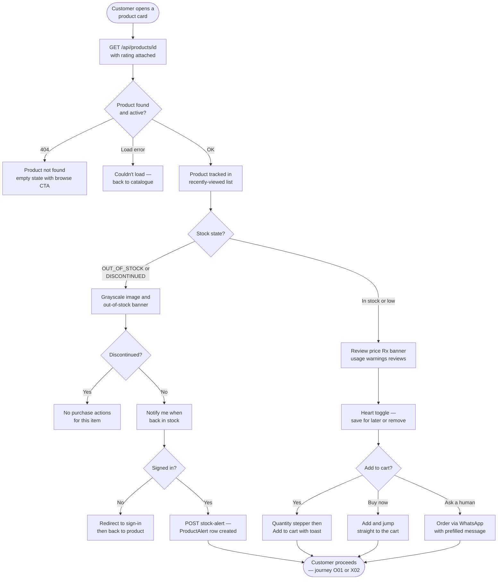

# P03 — View product details and save items

A shopper opens a product page from the catalogue and checks everything that matters before buying: price and pack size, live stock state, whether a prescription is required, how to use the product, warnings, and what other customers said. They can save the item for later with the heart toggle (a local, device-persisted list that works for guests), ask to be told when an out-of-stock item returns, or add packs to the cart.

| Metadata | Value |
| --- | --- |
| Primary actor | Customer (guest or signed-in) |
| Secondary actors | None (staff restock later triggers alerts, but not in this journey) |
| Functional area | Storefront and catalogue |
| Entry point | `/products/<id>` — `ProductView` in `src/components/views/product-view.tsx` |
| Status | Implemented — verified against code |
| End condition | The customer has reviewed the listing and saved, alerted, added to cart, or left the page informed |
| Related journeys | P02 (arrival from the catalogue), C07 (back-in-stock alerts), C09 (writing a review), O01 (ordering the item), X02 (Rx checkout) |

## Journey map

## Journey steps

### Step 1 — Open the product page

- **User action:** The customer clicks a product card or product name in the catalogue (or a cart line's name later).
- **Location:** Product view — `src/components/views/product-view.tsx`, with the id from `useAppStore` `selectedProductId` (URL `/products/<id>`).
- **Destination:** The product detail page.
- **Purpose:** See the full listing before committing to a purchase.
- **System behaviour:** The view calls `catalogApi.product(id)` (`GET /api/products/[id]`), which returns 404 for missing or inactive products and otherwise attaches the average rating. On success the id is recorded in `useRecentStore` (the last 12 viewed products, persisted as `sphere-recent`). While loading, a skeleton layout is shown; switching products resets quantity and error state.
- **Outcome:** The listing renders with image, price, stock badge and SKU.
- **Next step:** Review the details.
- **Alternative paths:** A 404 shows the "Product not found" empty state with a "Browse products" action; other load errors show a "Couldn't load this product" empty state that returns to the catalogue.

### Step 2 — Review the listing details

- **User action:** The customer reads the name, brand, pack size, category, price (with any compare-at price and discount badge), stock badge, "Only N left" hint, and the prescription banner.
- **Location:** Details column in `product-view.tsx`; data from `GET /api/products/[id]`.
- **Destination:** The scrollable description, "How to use" and "Warnings & precautions" blocks.
- **Purpose:** Check what the product is, what it costs, and whether it can be bought straight away.
- **System behaviour:** `requiresPrescription` switches the banner between a "Prescription required" warning (upload at checkout, pharmacist verification) and a "No prescription needed" notice. `outOfStock` is derived from `stockStatus` being `OUT_OF_STOCK` or `DISCONTINUED`, which greys the image and overlays a banner. The quantity stepper is clamped to the available stock (max 99); the average rating and review count, when present, link to the reviews section.
- **Outcome:** The customer understands the product and its constraints.
- **Next step:** Read customer reviews, or act on the item.
- **Alternative paths:** The breadcrumb (Home / Shop / category) and the Back button (`goBack`) return to where the customer came from; related products from the same category load beneath (non-critical, failures ignored).

### Step 3 — Read the reviews

- **User action:** The customer scrolls to "Customer reviews" and reads the average, the 5-to-1 star breakdown and individual reviews.
- **Location:** Reviews section in `product-view.tsx`; data from `catalogApi.reviews(id)` (`GET /api/products/[id]/reviews`).
- **Destination:** The reviews summary card and list.
- **Purpose:** Judge the product from other customers' experiences.
- **System behaviour:** The endpoint returns only `PUBLISHED` reviews (most recent 50) with a rating breakdown and a one-decimal average; a signed-in customer's own review (including its moderation status) is returned separately. The "Write a review" form is only live for signed-in customers; guests see a sign-in prompt (journey C01), and posting requires a completed purchase (journey C09).
- **Outcome:** The customer sees how the product is rated, or a "No reviews yet" prompt.
- **Next step:** Save the item or buy it.
- **Alternative paths:** If the reviews request fails, the section silently renders as if there were no reviews — the page stays usable.

### Step 4 — Save the item for later

- **User action:** The customer clicks the heart button ("Save for later"); clicking again removes the saved state.
- **Location:** Heart toggle in `product-view.tsx` (`handleWish`); wishlist state in `src/store/use-wish-store.ts`.
- **Destination:** Stays on the product page; the heart fills and a toast confirms.
- **Purpose:** Keep the product findable on this device without adding it to the cart.
- **System behaviour:** `useWishStore.toggle` adds or removes the product (name, price, image, Rx flag, pack size, brand, `savedAt`) in a list capped at 100 items, persisted to localStorage as `sphere-wishlist`. The button reflects `has(productId)` with `aria-pressed`. This works for guests and customers alike — it is device-local; there is no separate saved-items screen in the active header.
- **Outcome:** The item is saved (or unsaved) on this device.
- **Next step:** Continue browsing or add to the cart.
- **Alternative paths:** Clearing browser storage removes saved items — the list is intentionally not server-synced at this stage.

### Step 5 — Out-of-stock items: ask to be notified

- **User action:** On an out-of-stock (not discontinued) product the customer clicks "Notify me when back in stock".
- **Location:** Out-of-stock block in `product-view.tsx` (`handleStockAlert`); endpoint `POST /api/products/[id]/stock-alert` (`src/app/api/products/[id]/stock-alert/route.ts`).
- **Destination:** The button flips to "Alert set — we'll message you" with a toast.
- **Purpose:** Be told the moment the pharmacy restocks the item.
- **System behaviour:** Guests are first redirected to sign-in with a return to this product (`openAuth("login", "product", ...)`) because alerts require an account. Signed-in customers get a `ProductAlert` row for the product. The endpoint rejects products that are currently in stock (400) and duplicate active watches (409); a previously notified watcher can re-arm the alert. When staff later mark the product available (`PATCH /api/products/[id]`), pending watchers are notified in-app (and by email where set) and their alert rows are stamped `notifiedAt` (journey C07).
- **Outcome:** The customer will be messaged when the product returns.
- **Next step:** Continue shopping.
- **Alternative paths:** Discontinued products show no notify button — the state is final for that listing.

### Step 6 — Add to cart, buy now, or ask a human

- **User action:** The customer sets a quantity and clicks "Add to cart" (or the mobile sticky bar), clicks "Buy now" (add and go to the cart), or clicks "Order via WhatsApp".
- **Location:** Purchase actions in `product-view.tsx` (`handleAdd`); cart store `src/store/use-cart-store.ts`.
- **Destination:** The cart view (Buy now), a toast with "View cart" (Add to cart), or a prefilled WhatsApp conversation.
- **Purpose:** Commit to buying, or ask the pharmacy to confirm availability first.
- **System behaviour:** `add()` writes a cart line (product id, name, price, image, Rx flag, pack size, stock status) with the chosen quantity (merged and capped at 99), persisted to localStorage `sphere-cart`. The toast distinguishes prescription items ("upload your prescription at checkout"). The WhatsApp link (`waLink`) pre-fills the product name, pack size, price and quantity.
- **Outcome:** The item is in the cart (journey C03/O01) or the conversation is with the pharmacy team (journey P06).
- **Next step:** Checkout (O01/O02), prescription upload (X02), or continue shopping.
- **Alternative paths:** Out-of-stock items show no add-to-cart actions at all; the quantity stepper cannot exceed the available stock.

## Decision points

| Decision | Branches | Enforced by/where |
| --- | --- | --- |
| Product exists and is active? | Yes → render; no → 404 empty state | `GET /api/products/[id]` (404 when missing or `active: false`) |
| Stock state | In stock/low → purchase actions; `OUT_OF_STOCK` → notify button; `DISCONTINUED` → none | `outOfStock` derivation in `product-view.tsx`; `STOCK_STATUSES` in `src/lib/constants.ts` |
| Prescription required? | Rx → warning banner + upload-at-checkout toast; OTC → order-straight-away notice | `requiresPrescription` from the product DTO |
| Stock alert: signed in? | Guest → `openAuth("login", "product", ...)`; customer → `POST /api/products/[id]/stock-alert` | `requireCustomer()` in the stock-alert route |
| Already watching this product? | Active watch → 409; previously notified → re-arm | `productId_userId` unique lookup in `POST stock-alert` |
| Reviews exist? | Summary + list; none → "No reviews yet"; load failure → treated as none | `GET /api/products/[id]/reviews` (`count`, `breakdown`, `reviews`) |
| Purchase route | Add to cart · Buy now · Order via WhatsApp | `handleAdd`, `navigate("cart")`, `waLink(waText)` in `product-view.tsx` |

## Error and recovery paths

- **Product not found (404):** the empty state explains the product may have been removed and offers "Browse products" back to the catalogue.
- **Product load error:** the "Couldn't load this product" state offers a return to the catalogue; retrying means reopening the product.
- **Reviews request failure:** the section falls back to the no-reviews prompt; the rest of the page is unaffected (non-critical by design).
- **Stock alert rejected — product in stock (400):** the listing refreshed its stock state; the customer can simply add the item to the cart.
- **Stock alert rejected — already watching (409):** nothing is lost; the existing alert stays armed and the button state reflects it after reload.
- **Stock alert network failure:** a toast asks the customer to try again; no alert row was created.
- **Related-products failure:** the section shows "No related products right now" — silently ignored, never blocks the page.

## Traceability

| Concern | Implementation reference |
| --- | --- |
| Product view | `src/components/views/product-view.tsx` (details, wishlist, stock alert, purchase actions, reviews) |
| Product endpoint | `GET /api/products/[id]` in `src/app/api/products/[id]/route.ts` |
| Reviews endpoint | `GET /api/products/[id]/reviews` in `src/app/api/products/[id]/reviews/route.ts` (published only, breakdown, own review) |
| Review submission | `POST /api/products/[id]/reviews` (rating 1–5, comment ≤ 500, purchase required) |
| Stock alert | `POST /api/products/[id]/stock-alert` in `src/app/api/products/[id]/stock-alert/route.ts` |
| Back-in-stock dispatch | became-available block in `PATCH /api/products/[id]/route.ts` (`notifyCustomer` + `notifiedAt` stamp) |
| Wishlist store | `src/store/use-wish-store.ts` (`toggle`, `has`, persisted `sphere-wishlist`, cap 100) |
| Recently viewed | `useRecentStore` in `src/store/use-wish-store.ts` (last 12, `sphere-recent`) |
| Cart line creation | `add` in `src/store/use-cart-store.ts` |
| Alert data model | `ProductAlert` model (`prisma/schema.prisma`), unique `productId_userId` |
| Review data model | `Review` model (`prisma/schema.prisma`); `REVIEW_STATUSES` in `src/lib/constants.ts` |
| WhatsApp hand-off | `waLink` in `src/lib/constants.ts`; `waText` built in `product-view.tsx` |

## Related journeys and documents

- **P02** — the catalogue this page is opened from
- **C07** — subscribing to and receiving back-in-stock alerts
- **C09** — writing a review after a completed purchase
- **O01 / X02** — checkout with the item (OTC or prescription)
- **P06** — the WhatsApp order-a-human alternative
- Docs: [storefront and catalogue](../../features/storefront-and-catalogue.md) · [inventory and stock](../../features/inventory-and-stock.md) · [notifications](../../features/notifications.md)
