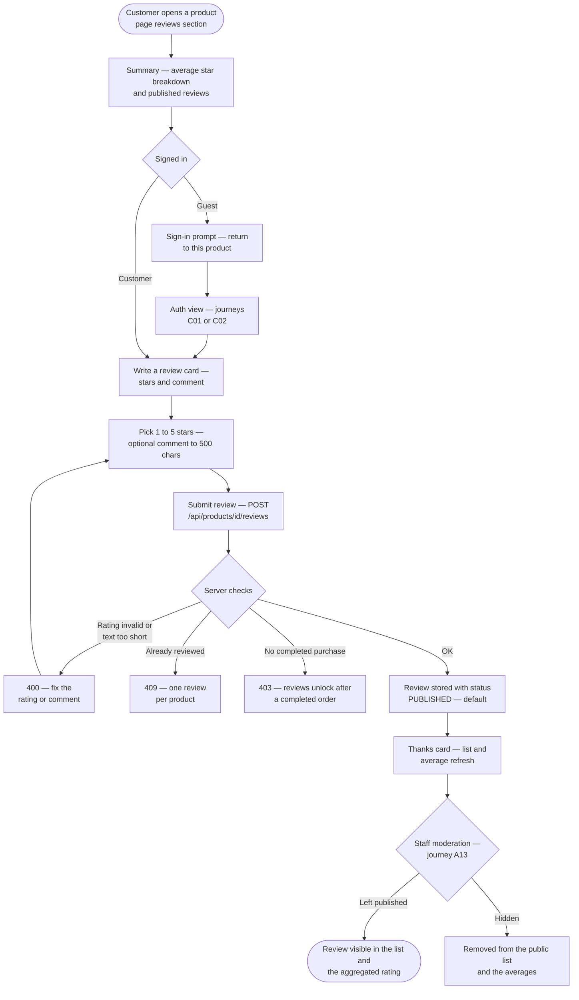

# C09 — Write a product review

Reviews are post-purchase only. On every product page the "Customer reviews" section shows the average, the 5-to-1 star breakdown and the published reviews, plus a "Write a review" card. Submitting requires a customer session, a 1–5 star rating and (optionally) up to 500 characters of text; the server additionally requires a completed purchase of that product on the account and rejects second reviews (one per customer per product). There is no pre-moderation queue — reviews are stored with status `PUBLISHED` (the model default) and appear immediately. Moderation is post-publication: admins and pharmacists can hide or re-publish reviews (journey A13), and hidden reviews drop out of the public list and the aggregated ratings. Author names are shown as first name plus initial.

| Metadata | Value |
| --- | --- |
| Primary actor | Customer (signed-in, prior completed purchase of the product) |
| Secondary actors | Staff (moderation — ADMIN/PHARMACIST) |
| Functional area | Storefront and catalogue |
| Entry point | Reviews section of `src/components/views/product-view.tsx` (`ReviewsForm`) |
| Status | Implemented — verified against code |
| End condition | `Review` row stored (unique per product+customer); public list and `attachRatings` aggregates reflect published reviews only |
| Related journeys | P03 (the product page), A13 (staff moderation), O06 (the completed orders that qualify), C01 (sign-in), P02 (discovery) |

## Journey map

## Journey steps

### Step 1 — Open the reviews section

- **User action:** The customer scrolls to "Customer reviews" on a product page (or clicks the rating link near the title).
- **Location:** Reviews section in `src/components/views/product-view.tsx`; endpoint `GET /api/products/[id]/reviews` (`src/app/api/products/[id]/reviews/route.ts`).
- **Destination:** The summary card and the review list.
- **Purpose:** Judge the product from other customers' experiences before reviewing it.
- **System behaviour:** The public GET returns only `PUBLISHED` reviews (newest first, up to 50), a 5-to-1 star `breakdown` computed by rating group-by, the `count`, and a one-decimal `average`. For a signed-in customer it also returns `mine` — their own review whatever its status, so a hidden review is still visible to its author. A missing/inactive product returns 404; a load failure renders as "no reviews" without breaking the page.
- **Outcome:** The customer sees the current rating picture.
- **Next step:** Open the write-a-review card.
- **Alternative paths:** Products with no reviews show a prompt inviting the first one; guests are invited to sign in to review.

### Step 2 — Sign in if needed

- **User action:** A guest clicking toward a review sees "Sign in to your account to share your experience with this product" and clicks Sign in.
- **Location:** Guest branch of `ReviewsForm` in `product-view.tsx` → `openAuth("login", "product", "Sign in to leave a review.", { productId })`.
- **Destination:** The auth view, then back to this product.
- **Purpose:** Reviews are attributed to accounts (and purchase-checked against them).
- **System behaviour:** The auth intent stores the product id so a successful sign-in (journeys C01/C02) returns to the same product page with the form live. Nothing is submitted yet.
- **Outcome:** The review form is live for the signed-in customer.
- **Next step:** Rate and comment.
- **Alternative paths:** OTP sign-in works identically; there is no anonymous review path.

### Step 3 — Rate and comment

- **User action:** The customer taps 1–5 stars (labels Poor → Excellent) and optionally types a comment (placeholder mentions the 500-character cap, with a live counter).
- **Location:** Star radiogroup and textarea in `ReviewsForm` (`product-view.tsx`).
- **Destination:** A complete rating ready to submit.
- **Purpose:** Capture the verdict and any useful context.
- **System behaviour:** The star row is an accessible radiogroup (`aria-checked`, per-star labels) with hover states; the submit button stays disabled until a rating is chosen. The comment is optional and clamped client-side at 500 characters (`maxLength`). The card footer notes this is not a treatment recommendation (prescription products carry that caution elsewhere on the page).
- **Outcome:** A rating (and optional text) ready to POST.
- **Next step:** Submit.
- **Alternative paths:** A missing rating is caught client-side ("Pick a star rating first.") before any request is made.

### Step 4 — Submit the review

- **User action:** The customer clicks "Submit review".
- **Location:** `catalogApi.createReview(productId, { rating, comment })` in `src/lib/api-client.ts`; endpoint `POST /api/products/[id]/reviews`.
- **Destination:** The thanks card, or an inline error.
- **Purpose:** Publish the customer's experience.
- **System behaviour:** The route requires a customer session and an active product. Validation: rating must truncate to an integer 1–5 (400 "Rating must be between 1 and 5 stars."); a comment is trimmed to 500 characters and must be at least 3 characters long if present (400). An existing review for the same product+customer returns 409 ("You've already reviewed this product." — enforced by the unique `productId_userId` constraint). Purchase eligibility is checked server-side: an `OrderItem` for this product on an order owned by the customer with status `COMPLETED_PICKUP` or `COMPLETED_DELIVERY`; otherwise 403 ("Reviews are available after a completed purchase."). The row is created with the model-default status `PUBLISHED` — there is no pending state — and the DTO (author name masked to first name + initial) is returned with 201.
- **Outcome:** The review exists and is public immediately.
- **Next step:** See it in the list.
- **Alternative paths:** 400/403/409 errors show inline in the card with the server's message; the form keeps the entered text for correction.

### Step 5 — See the review published

- **User action:** None — the card flips to a confirmation.
- **Location:** `posted` state in `ReviewsForm`; `onPosted` → `refetchReviews` in `product-view.tsx`.
- **Destination:** The refreshed summary and list including the new review.
- **Purpose:** Confirm the review landed and counts.
- **System behaviour:** The success card thanks the customer ("It's now helping other customers shop with confidence") with a toast; the reviews GET re-runs so the average, breakdown and list include the new entry. The customer's own review also arrives via the `mine` field. Elsewhere in the app, catalogue and product endpoints attach ratings via `attachRatings` (`src/lib/dto.ts`), which averages only `PUBLISHED` reviews — so the new rating flows to cards, search results and the product header line.
- **Outcome:** The review is visible with the author's masked name and relative time.
- **Next step:** Continue shopping.
- **Alternative paths:** If the refetch fails, the current list is kept (non-critical by design) — a reload shows the review.

### Step 6 — Moderation aftermath

- **User action:** None — staff may moderate later (journey A13).
- **Location:** `GET /api/admin/reviews` and `PATCH /api/admin/reviews/[id]` (`src/app/api/admin/reviews/…`); admin reviews section (`src/components/views/admin/sections/reviews-section.tsx`).
- **Destination:** The review stays published or becomes hidden.
- **Purpose:** Keep the review surface trustworthy.
- **System behaviour:** Moderation is restricted to ADMIN and PHARMACIST roles (`requireStaff(["ADMIN", "PHARMACIST"])`). The queue lists reviews filterable by status; PATCH accepts only `PUBLISHED` or `HIDDEN` (`REVIEW_STATUSES` in `src/lib/constants.ts`), updates the row, and writes an audit entry (`REVIEW_PUBLISHED` / `REVIEW_HIDDEN`). A hidden review disappears from the public list, the breakdown/average, and `attachRatings` aggregates everywhere; the author still sees it under `mine` with its status. Staff cannot edit the rating or text — only visibility.
- **Outcome:** Public content reflects moderation decisions; the author retains their copy.
- **Next step:** The journey ends (the customer cannot edit or delete their review in-app — see limitations).
- **Alternative paths:** A hidden review can be re-published by the same moderation path, restoring it to the aggregates.

## Decision points

| Decision | Branches | Enforced by/where |
| --- | --- | --- |
| Signed in? | Guest → sign-in prompt with product return; customer → live form | `isCustomer` branch in `ReviewsForm`; `requireCustomer()` in POST |
| Rating valid? | Integer 1–5 → accept; else 400 | truncation + range check in `POST /api/products/[id]/reviews` |
| Comment valid? | Absent → ok; 3–500 chars → accept; else 400 | trim + length checks in the POST route and `maxLength` in the form |
| Already reviewed? | Existing product+customer row → 409; none → create | unique `@@unique([productId, userId])` on `Review` |
| Completed purchase? | Order item on a `COMPLETED_PICKUP`/`COMPLETED_DELIVERY` order → eligible; else 403 | `orderItem.findFirst` eligibility check in the POST route |
| Initial status? | Always `PUBLISHED` (model default) — no pending queue | `Review.status @default("PUBLISHED")` in `prisma/schema.prisma` |
| Moderation outcome | `PUBLISHED` ↔ `HIDDEN` only; every change audited | `REVIEW_STATUSES` + audit in `PATCH /api/admin/reviews/[id]` |
| Aggregates | Only `PUBLISHED` reviews counted | `attachRatings` and the reviews GET group-by |

## Error and recovery paths

- **No star rating:** client-side message before any request; tap a star and submit again.
- **Invalid rating or too-short text (400):** the server message names the rule; adjust and retry — the entered text is preserved.
- **Duplicate review (409):** the customer already reviewed this product; the existing review remains authoritative (visible via `mine`).
- **No completed purchase (403):** the review unlocks only after an order containing the product completes (pickup or delivery) — check My orders (journey O06); reservation and cancelled orders do not qualify.
- **Product gone (404):** the product was deactivated or removed; the page shows its not-found state.
- **Submit network failure:** an inline error asks the customer to retry; the unique constraint guarantees a retry cannot double-post.
- **Review hidden by moderation:** no in-app notification or customer-facing appeal path — the author sees the review with hidden status via `mine`; a documented simplicity trade-off.
- **Cannot edit or delete:** there is no customer-facing update/delete endpoint — a change requires staff moderation (journey A13).

## Traceability

| Concern | Implementation reference |
| --- | --- |
| Reviews section and form | `src/components/views/product-view.tsx` (reviews effect, `ReviewsForm`, star radiogroup, 500-char counter, thanks card) |
| Client API | `catalogApi.reviews` / `catalogApi.createReview` in `src/lib/api-client.ts` |
| Public reviews endpoint | `GET /api/products/[id]/reviews` in `src/app/api/products/[id]/reviews/route.ts` (published list, breakdown, average, `mine`) |
| Review submission | `POST /api/products/[id]/reviews` (session, rating/comment validation, duplicate 409, purchase 403, status default) |
| Aggregated ratings | `attachRatings` in `src/lib/dto.ts` (avg + count over `PUBLISHED` only) |
| Author name masking | `toReviewDTO` in `src/lib/dto.ts` (first name + initial) |
| Moderation endpoints | `GET /api/admin/reviews`, `PATCH /api/admin/reviews/[id]` (`src/app/api/admin/reviews/…`) with `requireStaff(["ADMIN", "PHARMACIST"])` |
| Status vocabulary | `REVIEW_STATUSES` / `REVIEW_STATUS_LABELS` in `src/lib/constants.ts` |
| Staff-side surface | `src/components/views/admin/sections/reviews-section.tsx` (journey A13) |
| Data model | `Review` model (`prisma/schema.prisma`) — `rating`, `comment`, `status @default("PUBLISHED")`, `@@unique([productId, userId])`, index `[productId, status, createdAt]` |

## Related journeys and documents

- **P03** — the product page this section lives on
- **A13** — the staff moderation that can hide or re-publish the review
- **O06** — the completed orders that make a customer eligible
- **C01 / C02** — sign-in paths that unlock the form
- **P02** — catalogue discovery where the aggregated rating shows
- Docs: [storefront and catalogue](../../features/storefront-and-catalogue.md) · [customer CRM](../../features/customer-crm.md) · [user roles and permissions](../../product/user-roles-and-permissions.md)
