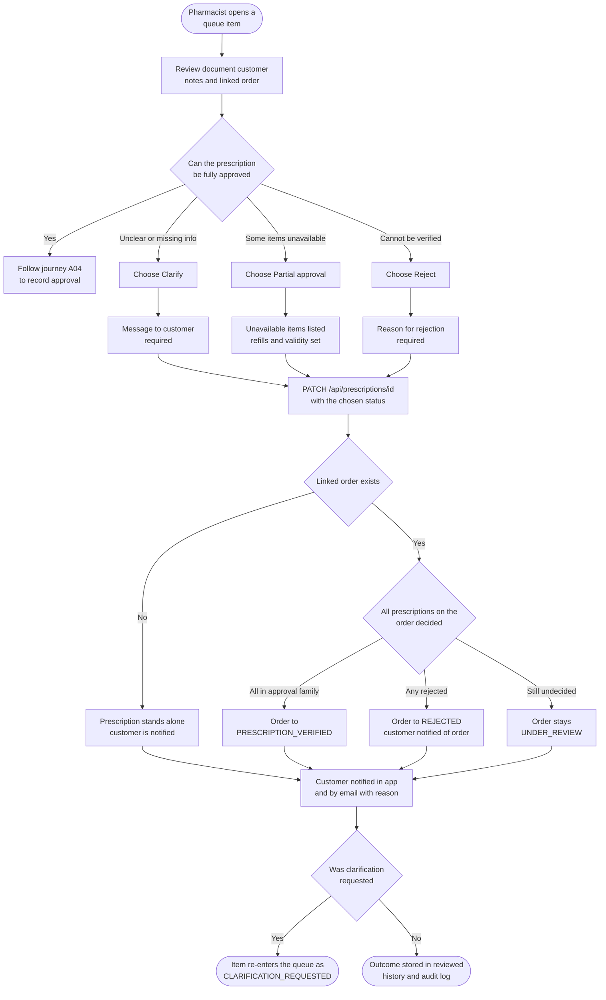

# A05 — Clarify, partially approve or reject a prescription

Not every prescription can be approved outright. When the document is unreadable or incomplete, when only some of the prescribed items are in stock, or when the prescription simply cannot be verified, the pharmacist records one of three non-approval outcomes — and every one of them requires a customer-facing reason. The server treats these decisions as the compliance twin of approval (journey A04): the prescription status changes inside a transaction, the linked order is re-evaluated against every other prescription attached to it, the customer is notified in-app and by email, and the decision is written to the audit log with the reviewer's name.

| Metadata | Value |
| --- | --- |
| Primary actor | Pharmacist (ADMIN can also review) |
| Secondary actors | Customer (receives the outcome and reason), Admin (fallback reviewer) |
| Functional area | Prescriptions |
| Entry point | `/admin` → Prescriptions section → review dialog for a pending or clarification-requested prescription |
| Status | Implemented — verified against code |
| End condition | Prescription `CLARIFICATION_REQUESTED` / `PARTIALLY_APPROVED` / `REJECTED` with notes; linked order recomputed; customer notified IN_APP + email; `AuditLog` `RX_<STATUS>` entry |
| Related journeys | X01 (upload side), X02 (Rx ordering), X03 (customer outcomes), A04 (approval), T01 (boundaries) |

## Journey map

## Journey steps

### Step 1 — Open a queue item for review

- **User action:** The pharmacist opens the Prescriptions section and clicks Review on a pending (or previously clarified) prescription.
- **Location:** `src/components/views/admin/sections/prescriptions-section.tsx` — queue tab; data from `GET /api/prescriptions?scope=queue`.
- **Destination:** The full review dialog with document preview, customer notes and linked order items.
- **Purpose:** Examine the actual prescription before choosing a non-approval outcome.
- **System behaviour:** The queue shows PENDING first, then CLARIFICATION_REQUESTED items, each with customer, file name, upload time, linked order reference and quick call/WhatsApp buttons. The dialog fetches the full record (`GET /api/prescriptions/[id]`) with a presigned R2 URL valid for 300 seconds and writes a `PrescriptionAccessLog` row. Items sent for clarification stay in the queue with a hint to follow up by phone or WhatsApp.
- **Outcome:** The pharmacist can read the document, the customer's notes and the linked order items flagged as prescription-required.
- **Next step:** Decide which outcome applies.
- **Alternative paths:** If object storage is unavailable the API returns 503 and the dialog reports the file as temporarily unavailable — the item stays in the queue. Non-reviewing staff see the section but the Review button is disabled (journey T01).

### Step 2 — Choose the non-approval outcome

- **User action:** In the Pharmacist Decision panel the pharmacist selects Clarify, Partial approval or Reject instead of Approve.
- **Location:** Review dialog radio group (`ReviewChoice` options) in `prescriptions-section.tsx`.
- **Destination:** The conditional fields for the chosen outcome.
- **Purpose:** Map the professional judgement onto one of the three non-approval statuses the server accepts.
- **System behaviour:** Each choice swaps the form: Clarify and Reject relabel the notes field to a required message/reason, Partial approval additionally shows the required Unavailable items input plus refills (0–6) and validity (30/60/90/180 days). Submission stays disabled until every required field has at least 3 characters (`notesValid`, `partialValid`).
- **Outcome:** The form matches the decision the pharmacist intends to record.
- **Next step:** Fill in the required reason and submit.
- **Alternative paths:** If the prescription is actually fine, switching back to Approve follows journey A04. If the item is already APPROVED the decision form is replaced by an already-verified notice.

### Step 3 — Request clarification

- **User action:** The pharmacist writes the Message to customer (for example asking for a clearer photo showing the doctor's signature) and clicks Send clarification request.
- **Location:** Review dialog in `prescriptions-section.tsx`; `PATCH /api/prescriptions/[id]` with `status: "CLARIFICATION_REQUESTED"`.
- **Destination:** The dialog closes and the queue refreshes.
- **Purpose:** Tell the customer exactly what is missing instead of rejecting outright.
- **System behaviour:** The route requires `requireStaff(["PHARMACIST", "ADMIN"])` and rejects the request without `reviewNotes` (400). Inside a transaction it sets the status, stamps `reviewedById`/`reviewedAt`, zeroes `refillsAllowed` and clears `validUntil`. The customer receives an in-app notification ("Clarification needed: …") plus an email ("Clarification Needed on Prescription") linking to the order or prescriptions page; an `RX_CLARIFICATION_REQUESTED` audit entry is written.
- **Outcome:** The prescription is CLARIFICATION_REQUESTED and stays in the review queue (sorted after PENDING items).
- **Next step:** Follow up by phone or WhatsApp if the customer does not respond; when they re-upload or reply, the item is re-reviewed from the queue.
- **Alternative paths:** The pharmacist can re-open the item at any time and record a final decision — the decision form is available for every status except APPROVED.

### Step 4 — Record a partial approval

- **User action:** The pharmacist lists the unavailable items (required, for example "Augmentin 625mg out of stock"), sets refills and validity as applicable, and clicks Save partial approval.
- **Location:** Review dialog in `prescriptions-section.tsx`; `PATCH /api/prescriptions/[id]` with `status: "PARTIALLY_APPROVED"`.
- **Destination:** The dialog closes and the queue refreshes.
- **Purpose:** Authorize the items that can be dispensed while recording exactly which cannot.
- **System behaviour:** The client appends the unavailable list to the review notes ("… — unavailable items: …") before submitting. The server keeps `refillsAllowed` (clamped 0–6) and sets `validUntil` (now + validDays) because partial approvals belong to the approval family. The customer is notified ("Partially approved: …") with an email ("Prescription Partially Approved"); audit `RX_PARTIALLY_APPROVED`. If every prescription on the linked order is APPROVED or PARTIALLY_APPROVED, the order advances to `PRESCRIPTION_VERIFIED`.
- **Outcome:** The prescription is PARTIALLY_APPROVED with the unavailable items permanently part of the review notes.
- **Next step:** The customer can pay for the approved portion; a partial approval alone does not free the order for packing until every other linked prescription is also decided in the approval family.
- **Alternative paths:** If the customer later supplies an alternative, the pharmacist can re-review and upgrade the decision; the reviewed history keeps both decisions with reviewer names.

### Step 5 — Record a rejection

- **User action:** The pharmacist enters the Reason for rejection (for example expired prescription or illegible handwriting) and clicks Reject prescription.
- **Location:** Review dialog in `prescriptions-section.tsx`; `PATCH /api/prescriptions/[id]` with `status: "REJECTED"`.
- **Destination:** The dialog closes and the queue refreshes.
- **Purpose:** Close the prescription with a documented, customer-visible reason.
- **System behaviour:** The server requires `reviewNotes` (400 without it), sets the status, zeroes refills and validity, and recomputes the linked order: when all prescriptions on the order are decided and any is REJECTED, the order moves to `REJECTED` (version bump, status history "Prescription set rejected after all documents were reviewed") and the customer gets an additional order-level notification. The prescription-level notification reads "Prescription could not be verified: …" with the email "Prescription Could Not Be Verified"; audit `RX_REJECTED`.
- **Outcome:** The prescription is REJECTED with the reason stored; the linked order is rejected once every sibling prescription is decided.
- **Next step:** If the order was rejected, staff handle any follow-up from the orders board; the customer sees the outcome in the app (journey X03).
- **Alternative paths:** A rejection recorded in error can be superseded by re-review (the form allows any status except APPROVED to be re-decided) — corrections are visible by design, never silent.

### Step 6 — Customer notification and audit trail

- **User action:** None by the pharmacist — this step records what the system does after submission.
- **Location:** `PATCH /api/prescriptions/[id]` notification block in `src/app/api/prescriptions/[id]/route.ts`; `src/lib/email/templates.ts`.
- **Destination:** Customer in-app notification plus email; `AuditLog` and reviewed history.
- **Purpose:** Close the loop with the customer and leave a compliance record.
- **System behaviour:** The notification title is derived from the status ("Prescription clarification requested", "Prescription partially approved", "Prescription rejected") and the body carries the pharmacist's notes verbatim; the email uses `prescriptionStatusTemplate` with per-status titling and a deep link to the order or the prescriptions page. The audit entry `RX_<STATUS>` records actor, role, file name and notes. The Reviewed tab shows the decision with reviewer, time, refills and validity, filterable by outcome.
- **Outcome:** Both sides see the same outcome; the decision survives in history even if the prescription is later re-reviewed.
- **Next step:** The pharmacist continues with the next queue item; clarification items return to the top of the queue once the customer responds.
- **Alternative paths:** If notification delivery fails, the status change is already committed — the notification pipeline retries channel delivery (journey SYS-10) and the customer still sees the outcome in the app.

## Decision points

| Decision | Branches | Enforced by/where |
| --- | --- | --- |
| Reviewer role | PHARMACIST/ADMIN may decide; other staff blocked (UI disabled + 403) | `requireStaff(["PHARMACIST", "ADMIN"])` in `PATCH /api/prescriptions/[id]`; `canReview` in `prescriptions-section.tsx` |
| Outcome | Approve → A04; unclear → clarify; mixed stock → partial; unverifiable → reject | `ReviewAction` radio group; `RX_STATUSES` validation in the PATCH route |
| Reason present | Notes required for clarify/reject/partial (server 400); partial additionally needs the unavailable-items list (client, min 3 chars) | `reviewNotes` check in PATCH; `notesValid`/`partialValid` in the dialog |
| Refills and validity | Kept for PARTIALLY_APPROVED (and APPROVED); zeroed and cleared for clarify/reject | `refillsAllowed`/`validUntil` logic in `PATCH /api/prescriptions/[id]` |
| Linked order recomputation | All approval family → `PRESCRIPTION_VERIFIED`; all decided + any rejected → `REJECTED`; else stays `UNDER_REVIEW` | Aggregation block inside the PATCH transaction |
| Re-review | Any status except APPROVED can be re-decided; APPROVED shows a locked notice | `detail.status !== "APPROVED"` condition in the dialog |
| Queue placement after clarify | Item remains in the queue (CLARIFICATION_REQUESTED sorts after PENDING) with a follow-up hint | Queue filter and `queueOrder` sort in `prescriptions-section.tsx` |

## Error and recovery paths

- **Missing note/reason (400):** clarification, rejection and partial-approval submissions without notes are refused by the server; the dialog also disables submit until the required fields have at least 3 characters.
- **Unknown status (400):** only the five `RX_STATUSES` values are accepted; a stale client submitting anything else is rejected before any write.
- **Not permitted to review (403):** STAFF/RIDER sessions cannot call the review PATCH — intentional role enforcement, not a fault (journey T01).
- **Could not save the review (500):** a transaction failure rolls back the prescription and any order update together; retrying the decision is safe because nothing was half-written.
- **Notification delivery failure:** the decision is already durable; the notification pipeline retries channel delivery (journey SYS-10) and the customer still sees the outcome on the prescriptions and order pages.
- **Two pharmacists on the same order:** order updates are version-guarded inside the transaction — the losing write is refused and the pharmacist reloads the queue to see the recorded decision.
- **Wrong outcome discovered later:** there is no silent undo — the pharmacist re-reviews and the reviewed history preserves the original decision with reviewer and timestamp, which is the audit-friendly correction path.

## Traceability

| Concern | Implementation reference |
| --- | --- |
| Review queue UI and decision form | `src/components/views/admin/sections/prescriptions-section.tsx` |
| Queue data | `GET /api/prescriptions?scope=queue` in `src/app/api/prescriptions/route.ts` |
| Full record + presigned document | `GET /api/prescriptions/[id]` in `src/app/api/prescriptions/[id]/route.ts` |
| Decision mutation, aggregation, notifications, audit | `PATCH /api/prescriptions/[id]` in `src/app/api/prescriptions/[id]/route.ts` |
| Status values and labels | `RX_STATUSES` / `RX_STATUS_LABELS` in `src/lib/constants.ts` |
| API client call | `prescriptionsApi.review` in `src/lib/api-client.ts` |
| Customer email copy | `prescriptionStatusTemplate` in `src/lib/email/templates.ts` |
| Notifications and audit helper | `notifyCustomer`, `audit` in `src/lib/notify.ts` |
| Access audit per document view | `PrescriptionAccessLog` model (`prisma/schema.prisma`) |
| Lifecycle rules | `docs/workflows/prescription-lifecycle.md` |
| Feature surface | `docs/features/prescriptions.md` |
| API contract | `openapi/sphere-api.yaml` — `PATCH /prescriptions/{id}` |

## Related journeys and documents

- **X01** — the customer-side upload that created the queue item
- **X02** — ordering prescription medicines affected by the outcome
- **X03** — what the customer experiences after clarification, partial approval or rejection
- **A04** — the approval sibling journey
- **T01** — pharmacist workspace boundaries (who may review at all)
- Docs: [prescriptions feature](../../features/prescriptions.md) · [prescription lifecycle](../../workflows/prescription-lifecycle.md) · [file storage security](../../security/file-storage-security.md)
