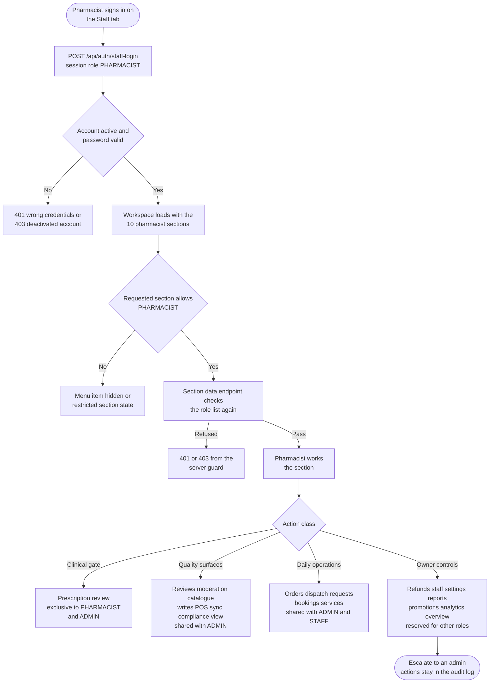

# T01 — Pharmacist workspace and access boundaries

The pharmacist is the platform's clinical gatekeeper: the only role (together with Admin) that can decide prescriptions, and the role that owns catalogue quality, review moderation and the compliance record. In the admin workspace this translates into ten of the sixteen sections — the patient-care and quality surfaces — while owner controls (staff, settings, reports, promotions, analytics and the overview dashboard) stay admin-side. The sidebar is only a picture: every section's data endpoints re-check the PHARMACIST role through `requireStaff` role lists, so the boundaries below hold even against hand-crafted requests.

| Metadata | Value |
| --- | --- |
| Primary actor | Pharmacist (staff role `PHARMACIST` on `StaffUser.role`) |
| Secondary actors | Admin (escalation target and co-reviewer), Staff (shared operational sections) |
| Functional area | Workspace and access control |
| Entry point | `/admin` after staff sign-in on the Staff tab |
| Status | Implemented — verified against code |
| Section visibility | 10 of 16 sections: Orders, Dispatch, Prescriptions, Medicine requests, Bookings, Services, Catalogue, Reviews, Compliance, POS Sync |
| Enforcement | `NAV` role lists in `admin-view.tsx` (UI) + `requireStaff([...])` role lists on every API route (server) |
| Related journeys | A04/A05 (exclusive review duties), A02/A03 (shared order flow), A06 (shared medicine requests) |

## Journey map

## Journey steps

### Step 1 — Sign in to the staff workspace

- **User action:** The pharmacist opens `/admin`, chooses the Staff tab of the sign-in dialog and submits their staff email and password.
- **Location:** Staff gate and auth dialog in `src/components/views/admin/admin-view.tsx`; `POST /api/auth/staff-login` in `src/app/api/auth/staff-login/route.ts`.
- **Destination:** The admin workspace shell with the pharmacist's navigation.
- **Purpose:** Establish the PHARMACIST identity that every later check reads.
- **System behaviour:** The login route rate-limits 5 attempts per 15 minutes per IP+email, verifies the password hash, refuses deactivated accounts (403) and creates a staff session carrying `staffId` and `staffRole: "PHARMACIST"`. Staff sessions expire after 12 hours idle and 7 days at most, and are revoked immediately if an admin changes the account's role, password or active flag.
- **Outcome:** The workspace renders with only the sections whose role list includes PHARMACIST; a customer session instead sees the staff gate.
- **Next step:** Work the navigation.
- **Alternative paths:** Five failed attempts trigger the rate limit; a deactivated account must be reactivated by an admin first (journey A15).

### Step 2 — Read the pharmacist navigation

- **User action:** The pharmacist scans the sidebar (or the mobile sheet / Ctrl-K command palette) to see their workspace.
- **Location:** `NAV` array and `visibleNav` filter in `src/components/views/admin/admin-view.tsx`.
- **Destination:** The ten pharmacist sections grouped as Workspace (Orders, Dispatch), Patient care (Prescriptions, Medicine requests, Bookings, Services), Business (Catalogue, Reviews) and Management (Compliance, POS Sync).
- **Purpose:** Know where the pharmacist's work lives — and where it does not.
- **System behaviour:** `visibleNav` keeps only items whose `roles` include the session role. Overview, Service analytics, Promotions, Staff, Reports and Settings are absent for PHARMACIST. The live-changes poll that toasts new orders/bookings runs for ADMIN, PHARMACIST and STAFF.
- **Outcome:** The pharmacist sees a care-and-quality workspace; owner controls are not merely hidden but unreachable through the UI.
- **Next step:** Open a section.
- **Alternative paths:** Navigating directly to a restricted section URL (for example `?section=staff`) renders a Restricted section empty state with a link back; the `goTo` helper also refuses with a toast.

### Step 3 — Work the pharmacist-exclusive areas

- **User action:** The pharmacist reviews prescriptions (journeys A04/A05), moderates product reviews, edits or creates catalogue products, imports CSVs and works the BandaGo POS Sync hub.
- **Location:** `prescriptions-section.tsx`, `reviews-section.tsx`, `catalogue-section.tsx`, `pos-sync-section.tsx` under `src/components/views/admin/sections/`.
- **Destination:** The clinical and quality surfaces shared only with ADMIN.
- **Purpose:** Exercise the responsibilities that make PHARMACIST distinct from counter staff.
- **System behaviour:** The review PATCH and queue scope require `requireStaff(["PHARMACIST", "ADMIN"])`; review moderation (`PATCH /api/admin/reviews/[id]`), product create/edit (`POST /api/products`, `PATCH /api/products/[id]`), bulk import (`POST /api/products/bulk`) and the BandaGo sync/CSV/CRM routes allow PHARMACIST; catalogue Add product and Delete product buttons are admin-only in the UI and the product DELETE route is `requireStaff(["ADMIN"])`.
- **Outcome:** The pharmacist can decide prescriptions and maintain catalogue quality, but cannot delete products.
- **Next step:** Cross into the shared operational sections.
- **Alternative paths:** In Compliance, the pharmacist sees the PPB licence and superintendent record read-only — inputs are disabled, the Edit record button and the audit history are admin-only (`isAdmin` gating in `compliance-section.tsx`; `GET /api/settings` allows PHARMACIST to view the record, `PUT` is admin-only).

### Step 4 — Work the shared operational sections

- **User action:** The pharmacist processes orders, watches the dispatch control room, works medicine requests, manages service bookings and the service catalogue.
- **Location:** `orders-section.tsx`, `dispatch-control-room.tsx`, `medicine-requests-section.tsx`, `service-bookings-section.tsx`, `services-section.tsx`.
- **Destination:** The sections shared with ADMIN and STAFF.
- **Purpose:** Fill any operational role the shift requires.
- **System behaviour:** Orders scopes (`scope=all|dispatch|dispatch-history`), rider assignment (`POST /api/orders/[id]/assign`), prepare, medicine-request management, bookings and services routes all allow `ADMIN, PHARMACIST, STAFF` (riders excluded from these scopes). The orders section enables `canManage` and `canAssignRider` for pharmacists. Dispatch renders the full control room (the personal rider board is reserved for RIDER sessions).
- **Outcome:** The pharmacist can move orders, assign riders and run the care calendar exactly like staff.
- **Next step:** Recognise where the pharmacist's permissions end.
- **Alternative paths:** The pharmacist can list active riders for assignment via `GET /api/orders/riders`, but the full staff roster (`/api/admin/staff`) is admin-only.

### Step 5 — Meet a boundary

- **User action:** The pharmacist attempts an admin-only action — recording a refund, changing settings or delivery fees, opening Reports, Promotions, Staff or the Overview dashboard.
- **Location:** Restricted-section state and `goTo` guard in `admin-view.tsx`; guard lists in `src/app/api/payments/refund/route.ts`, `src/app/api/settings/route.ts`, `src/app/api/admin/*` routes.
- **Destination:** A refused action, not a degraded one.
- **Purpose:** Understand that the boundary is enforced twice — UI and server.
- **System behaviour:** The sections are absent from the pharmacist menu and a direct URL renders the Restricted section empty state. Even bypassing the UI, the server refuses: refunds, staff CRUD, stats, audit, notification-health and settings writes are `requireStaff(["ADMIN"])`; Promotions routes allow only ADMIN and STAFF; order transitions to REFUNDED are admin-only in `canTransitionOrder`.
- **Outcome:** The pharmacist gets a clear refusal (403 "You do not have permission to perform this action.") rather than partial access.
- **Next step:** Escalate to an admin.
- **Alternative paths:** A pharmacist who needs one of these capabilities must be granted the ADMIN role by an admin (journey A15) — which revokes their current sessions and signs them in fresh.

### Step 6 — Escalation, revocation and audit

- **User action:** None in the UI — this step records how the boundary behaves over time.
- **Location:** `src/lib/session.ts` (`requireStaff`, `revokeStaffSessions`); `audit` in `src/lib/notify.ts`.
- **Destination:** Admin-side handling of escalations and account changes.
- **Purpose:** Close the loop on who can change a pharmacist's access.
- **System behaviour:** Every sensitive action the pharmacist does perform (prescription decisions, cash confirmation, product edits, rider assignment) writes an `AuditLog` row with actor and role. When an admin changes the pharmacist's role, password or active flag, `revokeStaffSessions` ends their open sessions immediately; idle sessions die after 12 hours and all staff sessions after 7 days.
- **Outcome:** Access is accountable and revocable at any moment; the workspace boundary is a living control, not a one-time menu.
- **Next step:** The pharmacist continues the shift within their ten sections.
- **Alternative paths:** A session that fails the activity/version check is deleted on read — the next request simply returns to the staff gate.

## Decision points

| Decision | Branches | Enforced by/where |
| --- | --- |
| Sign-in validity | Correct password + active account → session; wrong → 401; deactivated → 403; over limit → 429 | `POST /api/auth/staff-login` (rate limit 5/15 min) |
| Section visibility | Role in the item's `roles` list → rendered; else hidden / restricted empty state | `NAV` + `visibleNav` + `renderSection` in `admin-view.tsx` |
| Prescription review | PHARMACIST/ADMIN only (button disabled otherwise; 403 server-side) | `requireStaff(["PHARMACIST", "ADMIN"])` in prescriptions routes; `canReview` in the section |
| Catalogue writes | Create/edit/bulk import → PHARMACIST+ADMIN; delete → ADMIN only | `POST/PATCH /api/products*` role lists; `isAdmin` gating in `catalogue-section.tsx` |
| Compliance record | View → PHARMACIST+ADMIN; edit and audit history → ADMIN only | `canViewRecord` in `src/app/api/settings/route.ts`; `isAdmin` in `compliance-section.tsx` |
| Order operations | Manage, assign riders, prepare → ADMIN+PHARMACIST+STAFF; refund and REFUNDED → ADMIN only | Orders route role lists; `canTransitionOrder` in `src/lib/security/order-workflow.ts` |
| Promotions | ADMIN+STAFF — pharmacist excluded | `requireStaff(["ADMIN", "STAFF"])` in `src/app/api/promotions/*` |
| Staff roster and stats | ADMIN only (staff CRUD, stats, audit, notification-health, settings writes) | `requireStaff(["ADMIN"])` across `src/app/api/admin/*` |

## Error and recovery paths

- **Deactivated account at sign-in (403):** the pharmacist contacts an admin; reactivation restores access without data loss.
- **Direct URL to a restricted section:** the menu never offered it, the section renders a Restricted empty state, and the section's data endpoint would refuse the call anyway — the server is the lock.
- **Hand-crafted API call with a pharmacist session:** admin-only routes answer 403 from `requireStaff(["ADMIN"])`; promotions routes answer 403 for PHARMACIST. This is enforcement working, not an outage.
- **Session lost mid-shift:** after 12 hours idle (or 7 days absolute) the session is deleted on read and the workspace falls back to the staff gate — sign in again.
- **Role or password changed by an admin:** all open pharmacist sessions end immediately (`revokeStaffSessions` + `authVersion` bump) — by design, no stale access survives a role change.
- **Prescription review button disabled:** the signed-in role is not PHARMACIST/ADMIN — verify the account role with an admin (journey A15) rather than retrying.

## Traceability

| Concern | Implementation reference |
| --- | --- |
| Workspace shell, NAV role lists, restricted-section state | `src/components/views/admin/admin-view.tsx` |
| Staff sign-in | `src/app/api/auth/staff-login/route.ts` |
| Guard helpers and session rules | `src/lib/session.ts` (`requireStaff`, `revokeStaffSessions`) |
| Roles and labels | `ROLES` / `ROLE_LABELS` in `src/lib/constants.ts` |
| Prescription review guard | `PATCH /api/prescriptions/[id]` and queue scope in `src/app/api/prescriptions/route.ts` |
| Review moderation guard | `src/app/api/admin/reviews/[id]/route.ts` |
| Product create/edit vs delete | `src/app/api/products/route.ts`, `src/app/api/products/[id]/route.ts` |
| Orders scopes and assignment | `src/app/api/orders/route.ts`, `src/app/api/orders/[id]/assign/route.ts` |
| Order transition role rules | `src/lib/security/order-workflow.ts` |
| Settings view vs write | `src/app/api/settings/route.ts` |
| Compliance read-only boundary | `src/components/views/admin/sections/compliance-section.tsx` |
| Admin-only routes | `src/app/api/admin/staff/*`, `src/app/api/admin/stats/route.ts`, `src/app/api/payments/refund/route.ts` |
| Route-to-role matrix | `docs/security/access-control.md` |

## Related journeys and documents

- **A04 / A05** — the pharmacist-exclusive prescription review journeys
- **A02** — shared order processing to pickup (staff perspective)
- **A03** — shared dispatch and rider assignment (admin perspective)
- **A06** — shared medicine-request triage
- **A15** — how an admin changes the roles that define these boundaries
- Docs: [access control](../../security/access-control.md) · [user roles and permissions](../../product/user-roles-and-permissions.md) · [prescriptions feature](../../features/prescriptions.md)
