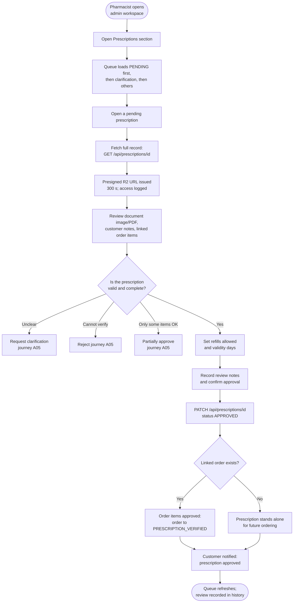

# A04 — Review and approve a prescription

A pharmacist opens the compliance-critical review queue, examines the customer's uploaded prescription image or PDF through a time-limited presigned URL, and records an approval. Every access to the document is audit-logged; the approval unlocks the customer's prescription order and notifies them.

| Metadata | Value |
| --- | --- |
| Primary actor | Pharmacist (ADMIN can also review) |
| Secondary actors | Customer (uploader), Staff (order preparation after verification) |
| Functional area | Prescriptions |
| Entry point | `/admin` → Prescriptions section (`/admin/prescriptions` link in notifications) |
| Status | Implemented — verified against code |
| End condition | Prescription `APPROVED` (refills + validity recorded); linked order `PRESCRIPTION_VERIFIED` if all items approved |
| Related journeys | X01 (upload side), X02 (Rx ordering), X03 (outcomes/refills), A05 (non-approval outcomes), T01 (boundaries), SYS-06 (retention) |

## Journey map

## Journey steps

### Step 1 — Open the prescription review queue

- **User action:** The pharmacist signs in with their staff account and opens the Prescriptions section of the admin workspace.
- **Location:** Admin workspace — `src/components/views/admin/sections/prescriptions-section.tsx` (admin view reached via the app-store `admin` view).
- **Destination:** The prescription review queue.
- **Purpose:** Find prescriptions waiting for professional verification, in priority order.
- **System behaviour:** The section loads the queue via `prescriptionsApi.queue()` (`GET /api/prescriptions`, staff scope) and sorts PENDING first, then CLARIFICATION_REQUESTED, then others, with a separate reviewed history list (filterable by status) showing reviewer, notes, refills and validity. A compliance banner reminds the pharmacist that prescription documents are confidential.
- **Outcome:** The pharmacist sees every pending prescription with customer, file name, upload time, and linked order context.
- **Next step:** Open one prescription for review.
- **Alternative paths:** If the queue fails to load, an inline error with a retry appears. If the queue is empty, an empty state confirms nothing is waiting. Non-pharmacist staff see the section but the review action is disabled (journey T01).

### Step 2 — Open the prescription document

- **User action:** The pharmacist clicks a pending prescription to open the full review dialog and views the uploaded image or PDF.
- **Location:** Review dialog inside `prescriptions-section.tsx`; data from `GET /api/prescriptions/[id]` (`src/app/api/prescriptions/[id]/route.ts`).
- **Destination:** The review dialog with document preview, customer notes and linked order items flagged as prescription-required.
- **Purpose:** Examine the actual prescription before any clinical decision.
- **System behaviour:** The GET route requires a session; only the owner or ADMIN/PHARMACIST staff may read it. The stored file in private R2 (`storageKey`) is exposed only through a presigned download URL valid for 300 seconds; the `storageKey` itself is never returned. Every view (and download) writes a `PrescriptionAccessLog` row with actor, role and action. If object storage is unavailable the API returns 503 and the dialog reports the file is temporarily unavailable.
- **Outcome:** The pharmacist can read the document and all submitted context; the access is audit-logged.
- **Next step:** Decide the outcome.
- **Alternative paths:** A customer who uploaded by mistake can delete the prescription while it is still unlinked (their side, journey X01). Staff accounts without review permission cannot open the review action (button disabled, server would reject the PATCH anyway).

### Step 3 — Record the approval

- **User action:** The pharmacist confirms the prescription is valid, optionally sets refills allowed and validity days, writes review notes, and confirms approval.
- **Location:** Review dialog form in `prescriptions-section.tsx` (action `APPROVED`).
- **Destination:** The dialog closes and the queue refreshes.
- **Purpose:** Turn professional verification into a system state that unlocks ordering.
- **System behaviour:** The client calls `PATCH /api/prescriptions/[id]` with `status: "APPROVED"`, `refillsAllowed` and `validDays`. The route requires `requireStaff(["PHARMACIST", "ADMIN"])`; only these roles may review. It re-reads the prescription with its items and linked order inside a transaction, records reviewer, review notes, `refillsAllowed` (kept only for APPROVED/PARTIALLY_APPROVED, otherwise 0), and `validUntil` (now + validDays). If the prescription belongs to an order, item statuses are recomputed: all items approved → order status `PRESCRIPTION_VERIFIED`; all decided with any rejected → order `REJECTED`; otherwise the order stays `UNDER_REVIEW`.
- **Outcome:** The prescription is APPROVED with refills and validity; the linked order (if any) advances; the reviewed history shows the pharmacist as reviewer.
- **Next step:** Notify the customer (automatic) and continue with the next queue item.
- **Alternative paths:** Rejections, clarification requests and partial approvals follow journey A05. Attempting to review a prescription that is already decided is rejected by the server (stale state), and the queue refresh resolves the conflict.

### Step 4 — Customer is notified and ordering proceeds

- **User action:** None by the pharmacist — this step records what the system does next.
- **Location:** `PATCH /api/prescriptions/[id]` notification block; customer-side prescriptions view.
- **Destination:** Customer receives an in-app notification ("Your prescription has been verified and approved by our pharmacist.").
- **Purpose:** Close the loop with the customer without manual phone calls.
- **System behaviour:** The route sends a notification whose copy is specific to the decision; the customer's order detail and prescriptions view reflect the new status on next load. The customer can now pay and complete the order (journey X02) or use the approval for refills until `validUntil` (journey X03).
- **Outcome:** Both sides see the approved state; the pharmacy continues order preparation (journey A02 for pickup, A03 for delivery).
- **Next step:** The pharmacist proceeds to the next prescription; the order flows into the standard fulfillment pipeline.
- **Alternative paths:** If notifications fail, the status change itself is already durable — the customer still sees the outcome in the app; failed channel deliveries are retried by the notification pipeline (journey SYS-10).

## Decision points

| Decision | Branches | Enforced by/where |
| --- | --- | --- |
| Reviewer role | PHARMACIST/ADMIN may review; STAFF/RIDER cannot (UI disabled + server 403) | `requireStaff(["PHARMACIST", "ADMIN"])` in `PATCH /api/prescriptions/[id]`; `canReview` in `prescriptions-section.tsx` |
| Document readable? | Presigned URL issued → review; storage unavailable → 503 retry | `getPresignedDownloadUrl` (300 s) in `GET /api/prescriptions/[id]` |
| Clinical outcome | Approve → this journey; unclear → clarify; unverifiable → reject; mixed items → partial | `PATCH` status validation: `APPROVED`/`REJECTED`/`CLARIFICATION_REQUESTED`/`PARTIALLY_APPROVED` |
| Review notes present? | Required unless status is APPROVED/PARTIALLY_APPROVED | `PATCH` validation (`reviewNotes` requirement) |
| Linked order item statuses | All approved → order `PRESCRIPTION_VERIFIED`; all decided + any rejected → `REJECTED`; else `UNDER_REVIEW` | Order-status recomputation block in `PATCH /api/prescriptions/[id]` |
| Refills and validity | Recorded for approvals; zeroed otherwise | `refillsAllowed`/`validUntil` logic in `PATCH` |

## Error and recovery paths

- **Not permitted to review (403):** only pharmacists and admins can record decisions; other staff see the disabled action and the server rejects the call — this is intentional role enforcement, not a fault.
- **File temporarily unavailable (503):** the presigned URL could not be generated (object storage issue); retry after a moment. The prescription stays PENDING; nothing is lost.
- **Stale review (409):** if another pharmacist decided the same prescription moments earlier, the server rejects the second PATCH; reloading the queue shows the recorded decision.
- **Missing review notes (400):** rejections, clarifications and partial approvals require notes; the dialog blocks submission until notes are entered.
- **Notification delivery failure:** the decision is already committed; the notification pipeline retries channel delivery (journey SYS-10). No recovery action is needed by the pharmacist.
- **Wrong approval discovered later:** staff with permission can still act on the linked order (e.g. reject it), and the prescription review history preserves the original decision for audit; there is no silent "unapprove" — corrections are visible by design.

## Traceability

| Concern | Implementation reference |
| --- | --- |
| Review queue UI | `src/components/views/admin/sections/prescriptions-section.tsx` |
| Queue data | `GET /api/prescriptions` (staff scope) in `src/app/api/prescriptions/route.ts` |
| Full record + presigned access | `GET /api/prescriptions/[id]` in `src/app/api/prescriptions/[id]/route.ts` |
| Review mutation | `PATCH /api/prescriptions/[id]` (status transitions, refills, validity, order recomputation) |
| Access audit | `PrescriptionAccessLog` model (`prisma/schema.prisma`); one row per view/download |
| Private storage | `src/lib/r2.ts` presigned URLs; `storageKey` never leaves the server |
| Role guard | `requireStaff(["PHARMACIST", "ADMIN"])` — `src/lib/session.ts` |
| Prescription statuses | `RX_STATUSES` in `src/lib/constants.ts` |
| Data model | `Prescription`, `PrescriptionAccessLog` models (`prisma/schema.prisma`) |
| API contract | `openapi/sphere-api.yaml` — `GET/PATCH /prescriptions/{id}` |

## Related journeys and documents

- **X01** — the customer-side upload that created this queue item
- **X02** — ordering prescription medicines against an approval
- **X03** — refills and outcomes the customer experiences
- **A05** — clarification, partial approval and rejection outcomes
- **T01** — pharmacist workspace boundaries (what only pharmacists can do)
- **SYS-06** — retention job that eventually expires old prescription files
- Docs: [prescriptions feature](../../features/prescriptions.md) · [prescription lifecycle](../../workflows/prescription-lifecycle.md) · [file storage security](../../security/file-storage-security.md)
