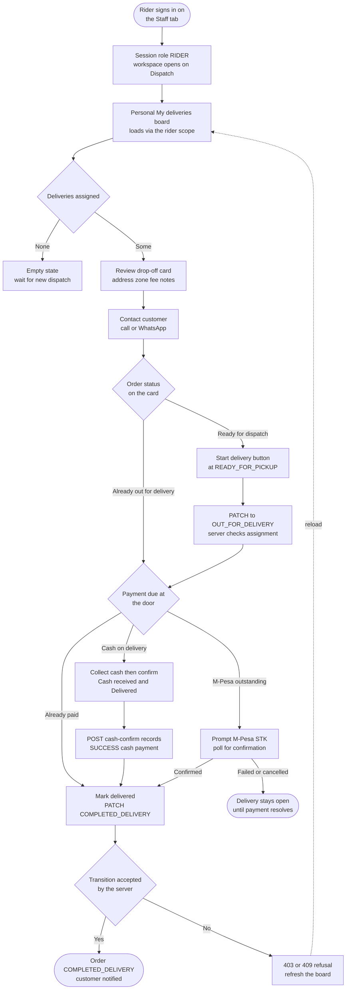

# R01 — Complete an assigned delivery

The rider is the narrowest staff role: one section, one board, two allowed transitions. After staff sign-in the admin workspace opens straight onto the personal "My deliveries" board, populated only with delivery orders assigned to that rider. The rider reviews each drop-off (address, zone fee, notes, map link, customer contact), starts the run when the order is packed, collects cash or prompts M-Pesa when payment is due at the door, and marks the delivery complete — every step guarded server-side so a rider can never touch an order that is not theirs.

| Metadata | Value |
| --- | --- |
| Primary actor | Rider (staff role `RIDER` on `StaffUser.role`) |
| Secondary actors | Admin/Staff/Pharmacist (assign and dispatch, journey A03), Customer (recipient) |
| Functional area | Delivery and dispatch |
| Entry point | `/admin` → Dispatch — the only section a rider sees; renders the personal board |
| Status | Implemented — verified against code |
| End condition | Order `COMPLETED_DELIVERY`; cash-on-delivery recorded as a SUCCESS `CASH` payment before completion |
| Related journeys | A03 (assignment side), O02 (customer delivery order), O06 (customer tracking), T01 (role boundaries) |

## Journey map

## Journey steps

### Step 1 — Sign in as a rider

- **User action:** The rider opens `/admin`, chooses the Staff tab and signs in with their rider email and password.
- **Location:** Staff gate in `src/components/views/admin/admin-view.tsx`; `POST /api/auth/staff-login` in `src/app/api/auth/staff-login/route.ts`.
- **Destination:** The admin workspace with the rider's single section, Dispatch.
- **Purpose:** Establish the RIDER identity that every later scope check and transition check reads.
- **System behaviour:** The login route verifies the password, refuses deactivated accounts (403) and creates a staff session with `staffRole: "RIDER"`. In the workspace, `visibleNav` keeps only the Dispatch item (`ALL_STAFF`), so Dispatch is the default landing section and any other section key yields the restricted state; the section router renders the personal `DispatchSection` board for RIDER (other staff get the control room).
- **Outcome:** The rider lands directly on "My deliveries".
- **Next step:** Read the board.
- **Alternative paths:** A customer or anonymous visitor sees the staff gate instead; a deactivated rider must be reactivated by an admin (journey A15).

### Step 2 — Read the personal board

- **User action:** The rider scans the shift snapshot and the delivery cards.
- **Location:** Rider branch of `src/components/views/admin/sections/dispatch-section.tsx`; data from `GET /api/orders?scope=rider` (`ordersApi.myDeliveries()`).
- **Destination:** The list of deliveries assigned to this rider only.
- **Purpose:** See what has to be delivered without exposure to anyone else's orders.
- **System behaviour:** The scope requires `requireStaff(["RIDER"])` and returns only orders where `riderId` is the session's staff id, `fulfillment` is `DELIVERY` and the status is in `DISPATCH_STATUSES` (PAID, PREPARING, READY_FOR_PICKUP, OUT_FOR_DELIVERY), oldest first. The snapshot counts Out for delivery, Ready to start (PAID/PREPARING/READY_FOR_PICKUP) and Total assigned today.
- **Outcome:** The rider sees their active deliveries; completed drops leave the board.
- **Next step:** Open the details of the next drop.
- **Alternative paths:** With nothing assigned the board shows an empty state telling the rider to check back after the team dispatches new runs. A load failure shows a retry error.

### Step 3 — Review the drop-off details

- **User action:** The rider reads the card: reference, status, delivery area and exact address, zone fee, delivery notes, item count, total, payment method label, and customer name and phone.
- **Location:** `RiderDeliveryCard` in `dispatch-section.tsx`.
- **Destination:** A clear picture of where to go and what to hand over.
- **Purpose:** Prepare the run and resolve ambiguities before setting off.
- **System behaviour:** The card renders a Google Maps link built from the order's coordinates when present, otherwise from address + area + Nairobi; call and WhatsApp buttons open the customer's phone directly with a prefilled delivery message. A missing address is flagged with a prompt to call the customer.
- **Outcome:** The rider knows the drop-off and can reach the customer if directions are unclear.
- **Next step:** Start the delivery.
- **Alternative paths:** If the order is already OUT_FOR_DELIVERY, the start step is skipped and the card shows payment handling plus Mark delivered.

### Step 4 — Start the delivery

- **User action:** For an order at READY_FOR_PICKUP the rider clicks Start delivery.
- **Location:** `RiderDeliveryCard` action in `dispatch-section.tsx`; `PATCH /api/orders/[id]` with `status: "OUT_FOR_DELIVERY"`.
- **Destination:** The order moves to OUT_FOR_DELIVERY and the customer is told the rider is on the way.
- **Purpose:** Record that the parcel has left the pharmacy with this rider.
- **System behaviour:** The PATCH requires a staff session and, for riders, that the order is assigned to them and is a DELIVERY order (otherwise 403 "This delivery is not assigned to you."). The route additionally requires an assigned rider for OUT_FOR_DELIVERY, and `canTransitionOrder` limits riders to exactly READY_FOR_PICKUP → OUT_FOR_DELIVERY and OUT_FOR_DELIVERY → COMPLETED_DELIVERY. The write is version-guarded; the customer receives an in-app notification ("Order … is out for delivery — our rider is on the way.") plus email, and the history and audit log record the transition.
- **Outcome:** The card flips to the out-for-delivery state with payment handling visible.
- **Next step:** Collect payment if due.
- **Alternative paths:** The reliable dispatch path is staff-side: an admin or staff member uses Dispatch for delivery (journey A03) and the rider completes from there. If the server refuses the rider-start (409), the board reload shows the current state — the recording script notes the earlier rider-start branch should be rehearsed before being demonstrated.

### Step 5 — Collect payment when due

- **User action:** For an unpaid OUT_FOR_DELIVERY order the rider collects cash and confirms it, or prompts an M-Pesa payment.
- **Location:** Unpaid block in `RiderDeliveryCard` and the confirmation dialog in `dispatch-section.tsx`; `POST /api/orders/[id]/cash-confirm` and `POST /api/orders/[id]/request-payment`.
- **Destination:** A recorded payment for the order.
- **Purpose:** Settle payment at the door before the delivery can be completed.
- **System behaviour:** When the order is OUT_FOR_DELIVERY with no SUCCESS payment, the card shows the outstanding total. For CASH_ON_DELIVERY orders the rider confirms a dialog ("Only continue after physically collecting …") which calls cash-confirm — the rider branch demands the order be the rider's own cash-on-delivery delivery that is out for delivery — creating a SUCCESS `CASH` payment (method CASH_ON_DELIVERY), notifying the payment outcome, crediting loyalty points and auditing `CASH_CONFIRMED`; the board then immediately marks the order COMPLETED_DELIVERY. For other methods the rider sends an M-Pesa STK push (rider branch: own order, OUT_FOR_DELIVERY) and the board polls the payment status about every 3 seconds up to roughly 20 attempts.
- **Outcome:** Cash is banked into the order record, or the customer's M-Pesa prompt is out and being watched.
- **Next step:** Mark the delivery complete once payment is settled.
- **Alternative paths:** If the customer cancels the STK or enters a wrong PIN, the rider can re-prompt or escalate to the pharmacy; cash-confirm refuses orders that already have a successful payment (409).

### Step 6 — Mark the delivery complete

- **User action:** After handing over the parcel — and with payment settled — the rider clicks Mark delivered.
- **Location:** `RiderDeliveryCard` action in `dispatch-section.tsx`; `PATCH /api/orders/[id]` with `status: "COMPLETED_DELIVERY"`.
- **Destination:** The order reaches its delivery terminal state.
- **Purpose:** Close out the assigned delivery.
- **System behaviour:** The button is only enabled when the order is OUT_FOR_DELIVERY and paid. The server requires DELIVERY fulfillment plus a SUCCESS payment for COMPLETED_DELIVERY and applies the rider transition subset; the cash path records the history note "Rider confirmed cash collected and parcel handed to customer". The transition writes `OrderStatusHistory` and an `ORDER_STATUS_COMPLETED_DELIVERY` audit entry, and notifies the customer in-app plus email ("Your order … is now: Completed (delivered).").
- **Outcome:** The order is COMPLETED_DELIVERY; it leaves the rider board and appears for the customer (journey O06) and in the admin dispatch history.
- **Next step:** The rider proceeds to the next card.
- **Alternative paths:** If the order changed underneath (version conflict), the server answers 409 and the board reload resolves it; unpaid orders cannot be completed this way (409 "Confirm the customer's M-Pesa or cash payment before marking the delivery complete.").

### Step 7 — Boundaries on other orders and sections

- **User action:** None — this step records the restrictions that frame the whole journey.
- **Location:** Guards across `src/app/api/orders/**` and the rider model in `docs/security/access-control.md`.
- **Destination:** A deliberately narrow surface.
- **Purpose:** Make the limits explicit: the board is not a filter, it is the whole view.
- **System behaviour:** Riders are excluded from the `all|dispatch|dispatch-history` order scopes (those are ADMIN/PHARMACIST/STAFF); a single order GET is allowed only for their own assigned DELIVERY orders; riders cannot cancel orders, cannot set REJECTED or REFUNDED (blocked in the cancel route and `canTransitionOrder`), and the only workspace section they can reach is Dispatch. Request-payment and cash-confirm work solely on their own out-for-delivery deliveries.
- **Outcome:** A rider session can only ever affect the deliveries assigned to it.
- **Next step:** Anything outside these boundaries goes back to staff or an admin.
- **Alternative paths:** Attempting a PATCH on another rider's order returns 403 before any data is read; attempts on non-delivery transitions return 409 from the transition map.

## Decision points

| Decision | Branches | Enforced by/where |
| --- | --- | --- |
| Board contents | Own assigned DELIVERY orders in dispatch statuses → shown; everything else invisible | `scope=rider` branch of `GET /api/orders` |
| Start delivery | READY_FOR_PICKUP + assigned → OUT_FOR_DELIVERY; any other state refused | Rider subset of `canTransitionOrder` + PATCH guards |
| Mark delivered | OUT_FOR_DELIVERY + SUCCESS payment → COMPLETED_DELIVERY; unpaid blocked | PATCH payment guard in `src/app/api/orders/[id]/route.ts` |
| Cash confirmation | Own CASH_ON_DELIVERY OUT_FOR_DELIVERY order → SUCCESS payment; anything else 403 | Rider branch of `POST /api/orders/[id]/cash-confirm` |
| M-Pesa prompt | Own OUT_FOR_DELIVERY unpaid order → STK push; otherwise 403 | Rider branch of `POST /api/orders/[id]/request-payment` |
| Other orders | Assigned DELIVERY order → readable; anything else 403/404 | `staffCanView` in `GET /api/orders/[id]` |
| Concurrent change | Version matches → transition; mismatch → 409 refresh | `updateMany` version guard + `ORDER_CONFLICT` |

## Error and recovery paths

- **Not your delivery (403):** a rider PATCHing or reading an order assigned to someone else is refused — re-check the board; only assigned deliveries appear there.
- **Unpaid completion blocked (409):** the server refuses COMPLETED_DELIVERY without a SUCCESS payment — collect cash, prompt M-Pesa or escalate to the pharmacy.
- **Order changed underneath (409):** a version conflict (staff reassigned or status moved mid-action) — the board reloads and the card shows the new state.
- **Cash already confirmed (409):** cash-confirm refuses an order with an existing successful payment — the completion step alone finishes the delivery.
- **M-Pesa cancelled or failing:** the STK poll reports failure or times out after about 20 attempts — re-prompt, or bring the order back to the pharmacy team; the delivery stays OUT_FOR_DELIVERY until payment resolves.
- **Rate limits:** cash-confirm is capped at 20 actions per 15 minutes and staff payment requests at 5 per 15 minutes per order — pacing a busy shift avoids the 429.
- **Prescriptions not reviewed:** cash-confirm refuses payment when any linked prescription is outside APPROVED/PARTIALLY_APPROVED (409) — hand the order back to the pharmacist queue (journeys A04/A05).

## Traceability

| Concern | Implementation reference |
| --- | --- |
| Rider board and personal cards | `src/components/views/admin/sections/dispatch-section.tsx` |
| Board data | `scope=rider` branch in `src/app/api/orders/route.ts` |
| Status mutation and rider guards | `PATCH /api/orders/[id]` in `src/app/api/orders/[id]/route.ts` |
| Transition map | `canTransitionOrder` in `src/lib/security/order-workflow.ts` |
| Cash on delivery | `POST /api/orders/[id]/cash-confirm` in `src/app/api/orders/[id]/cash-confirm/route.ts` |
| M-Pesa prompt at the door | `POST /api/orders/[id]/request-payment` in `src/app/api/orders/[id]/request-payment/route.ts` |
| Assignment upstream | `POST /api/orders/[id]/assign` in `src/app/api/orders/[id]/assign/route.ts` |
| Staff sign-in | `src/app/api/auth/staff-login/route.ts` |
| Dispatch statuses and rider statuses | `DISPATCH_STATUSES` / `RIDER_ALLOWED_STATUSES` in `src/lib/constants.ts` |
| API client calls | `ordersApi.myDeliveries`, `markPaidCash`, `updateStatus`, `assignRider` in `src/lib/api-client.ts` |
| Order lifecycle rules | `docs/workflows/order-lifecycle.md` |
| Rider authorization model | `docs/security/access-control.md` |

## Related journeys and documents

- **A03** — the admin/staff side that assigns and dispatches the delivery
- **O02** — the customer journey that created the delivery order
- **O06** — the customer watching the delivery complete
- **T01** — how role boundaries work in the shared workspace
- **SYS-01** — the M-Pesa callback that settles a doorstep STK push
- Docs: [order lifecycle](../../workflows/order-lifecycle.md) · [orders and fulfillment](../../features/orders-and-fulfillment.md) · [access control](../../security/access-control.md)
