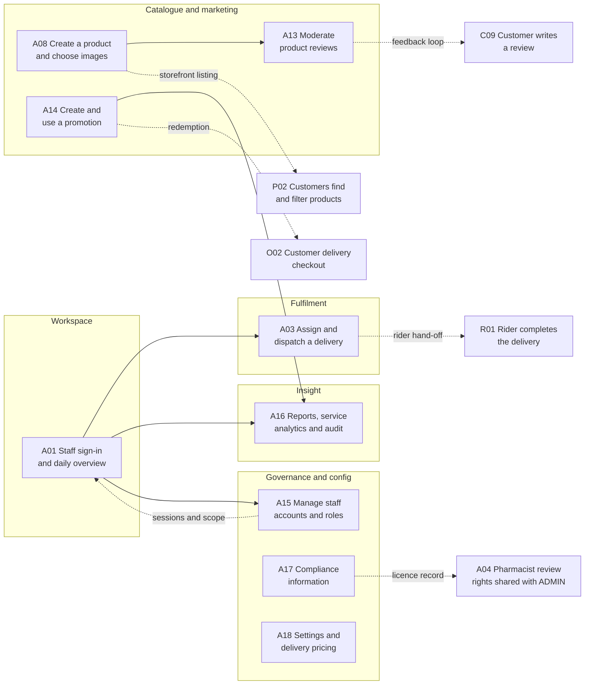

# Administrator journey map

Administrators own the operational and configurational surface of Sphere Pharmacy: they authenticate through the staff sign-in, read the daily overview, walk delivery orders through dispatch, curate the catalogue and its imagery, moderate reviews, run bounded promotions, manage staff accounts and roles, read reports and audit activity, maintain the internal compliance record and control pharmacy settings including delivery pricing. This map groups those journeys by area; each node links to the detailed flowchart document.

| Metadata | Value |
| --- | --- |
| Primary actor | Admin (ADMIN role on `StaffUser`) |
| Coverage | Workspace · dispatch · catalogue and imagery · review moderation · promotions · staff and roles · reports, analytics and audit · compliance · settings and delivery pricing |
| Status | Implemented — verified against code |
| Permissions baseline | Full access to every workspace section; the only role that can manage staff, settings, reports, service analytics and the compliance record. ADMIN also holds the pharmacist review rights (journeys A04/A05) |

## Journey map

## The journeys

| ID | Journey | What it covers |
| --- | --- | --- |
| A01 | [Staff sign-in and daily overview](../admin/staff-signin-overview.md) | Staff tab sign-in, session rules, role-scoped navigation, overview KPIs and the needs-attention list |
| A03 | [Assign and dispatch a delivery](../admin/assign-dispatch-delivery.md) | Dispatch control room, rider assignment, status transitions to COMPLETED_DELIVERY, payment follow-up |
| A08 | [Create a product and choose images](../admin/create-product-images.md) | Product editor, Rx flag, pricing and stock, gallery vs upload imagery (R2-dependent upload leg) |
| A13 | [Moderate product reviews](../admin/moderate-product-reviews.md) | Moderation queue, hide/restore decisions, storefront and rating effects, audit trail |
| A14 | [Create and use a promotion](../admin/create-use-promotion.md) | Campaign design, codes and limits, validation and locked redemption at checkout |
| A15 | [Manage staff accounts and roles](../admin/manage-staff-roles.md) | Staff CRUD, role assignment, password resets, immediate session revocation |
| A16 | [Reports, service analytics and audit activity](../admin/reports-analytics-audit.md) | Revenue and funnel reporting, CSV exports, care-service analytics, audit feed |
| A17 | [Compliance information](../admin/compliance-information.md) | Internal PPB licence and superintendent record, expiry watch, compliance audit history |
| A18 | [Pharmacy settings and delivery pricing](../admin/settings-delivery-pricing.md) | Storefront profile, flat vs zone fees, distance pricing, night-delivery flag |

Pharmacist-adjacent rights: ADMIN shares the pharmacist's prescription review authority — [A04 review and approve](../pharmacist/review-approve-prescription.md) and [A05 clarify, partially approve or reject](../pharmacist/clarify-partial-reject-prescription.md) are documented in the pharmacist folder and apply to admin accounts identically.

## Cross-role handoffs

- **Admin assigns a rider (A03) → Rider completes the delivery (R01):** the assignment notification puts the order on the rider's personal board; the admin's control room tracks it until COMPLETED_DELIVERY, and the customer's tracking (O06) reflects each handoff.
- **Admin creates a product (A08) → Customers discover it (P02/P03) → Staff maintain it (A07):** creation goes live immediately; stock steppers and edits keep it healthy; back-in-stock alerts (C07) close the loop when inventory returns.
- **Admin launches a promotion (A14) → Customers redeem at checkout (O01/O02):** validation and the advisory-locked placement check enforce every limit; loyalty redemption (C08) stacks after the discount.
- **Customers write reviews (C09) → Admin/Pharmacist moderate (A13) → Storefront shows the result (P03):** published reviews shape product ratings; hidden reviews stay visible to their authors with their status.
- **Admin changes roles or passwords (A15) → Every staff session re-scopes (A01):** session revocation applies the change on the member's next request, and rider availability on the dispatch board (A03) follows active RIDER accounts.
- **Pharmacists review prescriptions (A04/A05) → Admin monitors via audit (A16) and retention (SYS-06):** prescription decisions and document access are logged; the admin can evidence the whole clinical trail without holding clinical authority exclusively.

## Related journeys and documents

- Docs: [user roles and permissions](../../product/user-roles-and-permissions.md) · [pharmacy operations](../../product/pharmacy-operations.md) · [journey index](../README.md)
