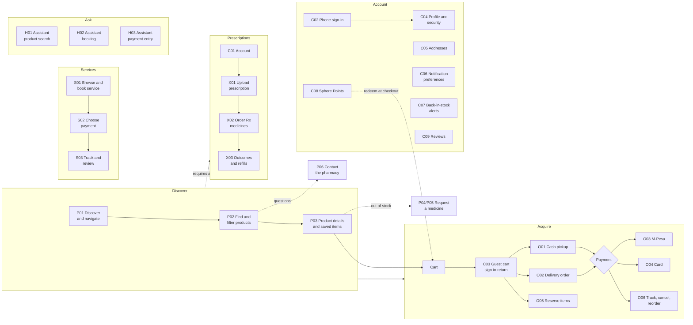

# Customer journey map

Customers experience Sphere Pharmacy as a storefront first: they can browse, search and request medicines as guests, then sign in (email or phone code) to unlock prescriptions, loyalty, saved addresses and order history. This map shows how the individual customer journeys connect; each node links to the detailed flowchart document.

| Metadata | Value |
| --- | --- |
| Primary actor | Customer (guests included where noted) |
| Coverage | Discovery · catalogue · cart · checkout · payments · orders · prescriptions · services · loyalty · account · assistant |
| Status | Implemented — verified against code |
| Permissions baseline | Guests: browse, cart, OTC orders with contact details. Signed-in customers: everything plus prescriptions, loyalty, addresses, reviews, service bookings |

## Journey map

## The journeys

| ID | Journey | What it covers |
| --- | --- | --- |
| P01 | [Discover the pharmacy and navigate](../customer/discover-home.md) | Homepage, header, mobile menu, moving between destinations |
| P02 | [Find and filter products](../customer/find-and-filter-products.md) | Catalogue search, categories, Rx/availability filters, sorting |
| P03 | [View product details and save items](../customer/view-product-and-save.md) | Product page, reviews, wishlist, out-of-stock states |
| P04 | [Request a medicine without a photo](../customer/request-medicine-no-photo.md) | Text-only medicine request from the catalogue |
| P05 | [Request a medicine with a photo](../customer/request-medicine-with-photo.md) | Medicine request with a photo of the prescription or packaging |
| P06 | [Ask questions and contact the pharmacy](../customer/contact-pharmacy.md) | Contact details, WhatsApp, assistant hand-off |
| C01 | [Create an account and sign in](../customer/register-account.md) | Registration, email/password sign-in, guest-to-account |
| C02 | [Sign in with a phone code](../customer/otp-signin.md) | OTP request and verification |
| C03 | [Review the cart and return after sign-in](../customer/guest-cart-signin-return.md) | Guest cart persistence and post-login return |
| C04 | [Manage profile and account security](../customer/manage-profile-security.md) | Profile details, password change, sign-out |
| C05 | [Save and manage delivery addresses](../customer/manage-addresses.md) | Address book create/edit/delete, default address |
| C06 | [Manage notifications and preferences](../customer/notification-preferences.md) | Inbox, channel preferences, push opt-in |
| C07 | [Subscribe to back-in-stock alerts](../customer/back-in-stock-alerts.md) | Alert subscription and stock-back notification |
| C08 | [Earn and redeem Sphere Points](../customer/loyalty-points-redemption.md) | Earning rules, balance, redemption at checkout |
| C09 | [Write a product review](../customer/write-product-review.md) | Reviewing a purchased product |
| O01 | [Place a cash pickup order](../customer/place-cash-pickup-order.md) | Full OTC checkout paying cash at the counter |
| O02 | [Place a delivery order](../customer/place-delivery-order.md) | Delivery address, zone fee, placing the order |
| O03 | [Pay an order with M-Pesa](../customer/pay-with-mpesa.md) | STK Push from request to confirmation |
| O04 | [Pay an order by card](../customer/pay-by-card.md) | IntaSend hosted checkout |
| O05 | [Reserve items for collection](../customer/reserve-for-collection.md) | Pay-later reservations and in-store payment |
| O06 | [Track, cancel and reorder](../customer/track-cancel-reorder.md) | Order tracking, cancellation windows, reordering |
| X01 | [Upload a prescription for review](../customer/upload-prescription.md) | Private upload into the pharmacist queue |
| X02 | [Order prescription medicines](../customer/order-prescription-medicines.md) | Rx requirements at checkout |
| X03 | [Prescription outcomes and refills](../customer/prescription-outcomes-refills.md) | Decisions, refills, expiry |
| S01 | [Browse services and book an appointment](../customer/browse-and-book-service.md) | Service catalogue, slots, booking |
| S02 | [Choose appointment payment](../customer/choose-appointment-payment.md) | M-Pesa, card or pay-at-pharmacy |
| S03 | [Track an appointment and review a visit](../customer/track-appointment-review.md) | Appointment lifecycle and reviews |
| H01 | [Find products with the assistant](../customer/assistant-find-products.md) | Assistant product search |
| H02 | [Book through the assistant](../customer/assistant-booking.md) | Assistant-guided service booking |
| H03 | [Pay through the assistant](../customer/assistant-payment.md) | Assistant-guided payment entry |

## Cross-role handoffs

- **Customer uploads prescription → Pharmacist reviews it (A04/A05):** the moment journey X01 completes, the prescription enters the pharmacist queue; the customer's next experience (X03) is shaped by that review.
- **Customer pays → Staff prepare (A02) → Rider delivers (R01):** a paid delivery order appears on the staff order board and then the dispatch board; the customer's O06 tracking reflects each handoff.
- **Customer requests a missing medicine (P04/P05) → Staff triage (A06):** staff resolve requests by adding products or answering; the customer is notified when the requested medicine becomes orderable.
- **Customer leaves a review (C09) → Admin/Pharmacist moderate (A13):** reviews appear publicly only after moderation.
- **Customer enables alerts (C07) → System notifies on restock:** the back-in-stock pipeline notifies subscribers when inventory changes.
- **Customer asks the assistant (H01–H03) → Assistant surfaces next-step actions:** the assistant never completes actions itself; it hands the customer to the real catalog, booking and payment flows.

## Related journeys and documents

- Docs: [user roles and permissions](../../product/user-roles-and-permissions.md) · [customer journeys (product view)](../../product/customer-journeys.md) · [journey index](../README.md)
