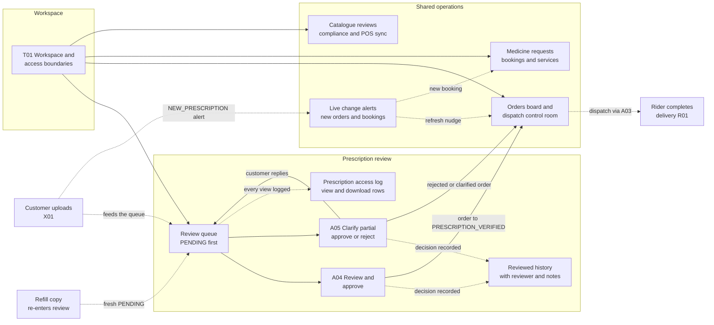

# Pharmacist journey map

The pharmacist is the clinical authority on the platform: the only role (with Admin) that can decide whether a prescription is dispensed, and the role that owns catalogue quality, review moderation and the read-only compliance record. Their workspace spans ten of the sixteen admin sections — prescription review at the centre, shared daily operations around it, and owner controls deliberately out of reach. Every review decision is audit-logged, drives customer notifications, and gates the order pipeline; every boundary drawn in the sidebar is re-checked by the server. This map shows how the pharmacist journeys connect; each node links to the detailed flowchart document.

| Metadata | Value |
| --- | --- |
| Primary actor | Pharmacist (staff role `PHARMACIST`) |
| Coverage | Prescription review · non-approval outcomes · workspace boundaries, plus the shared surfaces: orders, dispatch, medicine requests, bookings, services, catalogue, reviews, compliance and POS sync |
| Status | Implemented — verified against code |
| Section visibility | 10 of 16 admin sections; Overview, Service analytics, Promotions, Staff, Reports and Settings are admin- or staff-side |
| Session model | Staff sign-in with email and password; 12-hour idle timeout, 7-day absolute cap, immediate revocation when an admin changes the account |
| Permissions baseline | Prescriptions review, review moderation, product create/edit and imports, compliance record viewing: PHARMACIST + ADMIN. Orders, dispatch, requests, bookings, services: shared with STAFF. Refunds, staff management, settings, reports, promotions, analytics, product deletion: ADMIN only |

## Journey map

## The journeys

| ID | Journey | What it covers |
| --- | --- | --- |
| A04 | [Review and approve a prescription](../pharmacist/review-approve-prescription.md) | Review queue, presigned document access, approval with refills and validity |
| A05 | [Clarify, partially approve or reject a prescription](../pharmacist/clarify-partial-reject-prescription.md) | The three non-approval outcomes, mandatory reasons, linked-order recomputation |
| T01 | [Pharmacist workspace and access boundaries](../pharmacist/pharmacist-workspace-boundaries.md) | The ten pharmacist sections, exclusive vs shared actions, server-side enforcement |

The review journeys are the pharmacist's exclusive duty: counter staff never see the review controls, and the queue itself (`GET /api/prescriptions?scope=queue`) refuses non-pharmacist sessions. The shared sections behave exactly as they do for counter staff, with two exceptions that matter: pharmacists can also moderate product reviews and work the POS Sync hub, and they see the compliance record read-only where admins can edit it.

Three structural facts frame the whole map. First, the review queue never empties on its own — clarification items stay queued until the customer responds, and every refill use re-enters as a fresh PENDING copy, so each dispense cycle is re-verified. Second, everything the pharmacist does perform — decisions, product edits, cash confirmations, rider assignments — lands in the audit log with actor and role, which is what journey T01's boundaries protect. Third, pharmacist sessions follow the staff rules — a 12-hour idle timeout, a 7-day absolute cap and immediate revocation when an admin changes the account — so a role change never leaves stale access behind.

## Cross-role handoffs

- **Customer uploads a prescription → Pharmacist reviews it (A04/A05):** the moment journey X01 completes, the document enters the pharmacist queue; every refill use creates a fresh PENDING copy, so the pharmacist re-verifies each dispense cycle, and the customer's next experience (X03) is shaped by the recorded decision.
- **Pharmacist approves → Staff and Admin fulfil:** an approval (or a full round of partial approvals) moves the linked order to `PRESCRIPTION_VERIFIED`, unlocking payment, packing (A02) and dispatch (A03) — the clinical decision is the gate on the whole fulfillment pipeline.
- **Customer leaves a review → Pharmacist moderates it:** reviews written in journey C09 publish only after moderation; the pharmacist and admin share the publish/hide surface, and customers only ever see published reviews on product pages.
- **Customer requests a missing medicine → Pharmacist triages (A06):** requests from journeys P04/P05 land in the shared medicine-requests section, where pharmacists and staff add products, adjust stock or answer the customer.
- **Physical shop feeds the pharmacist's catalogue:** BandaGo POS ingestion (SYS-08) keeps products, stock and batch expiry current in the catalogue and POS Sync surfaces the pharmacist maintains, and stock levels there feed refill eligibility (SYS-04) and back-in-stock alerts (C07).
- **Boundaries escalate to Admin:** order rejections after a full review round, refunds, staff and settings changes stay admin-side (journey T01); the pharmacist hands off rather than works around.

## Related journeys and documents

- Docs: [user roles and permissions](../../product/user-roles-and-permissions.md) · [access control](../../security/access-control.md) · [journey index](../README.md)
