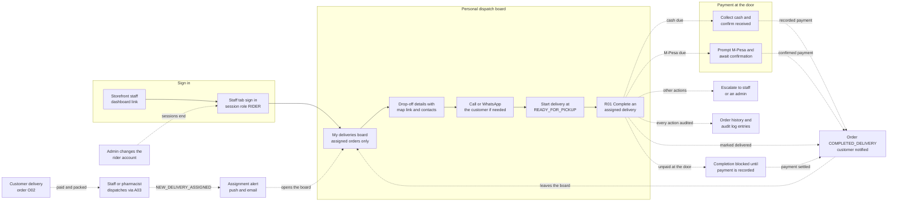

# Rider journey map

The rider is a narrow role by design: one workspace section, one personal board, one journey. After staff sign-in the admin workspace opens directly onto "My deliveries" — a board populated only with delivery orders assigned to that rider — and every action on it (start the run, confirm cash, mark delivered) is checked server-side against the assignment. A rider cannot cancel orders, cannot see orders assigned to colleagues, and cannot reach any other admin section; anything beyond the two delivery transitions belongs to staff or admins. The detailed flowchart — R01 — walks one delivery end to end, and the handoffs below show exactly where the role begins and ends.

| Metadata | Value |
| --- | --- |
| Primary actor | Rider (staff role `RIDER`) |
| Coverage | Sign-in · the personal dispatch board · assigned delivery completion with cash or M-Pesa at the door |
| Status | Implemented — verified against code |
| Section visibility | 1 of 16 admin sections — Dispatch, rendered as the personal board instead of the control room |
| Permissions baseline | Sees only own assigned DELIVERY orders; may set exactly READY_FOR_PICKUP to OUT_FOR_DELIVERY and OUT_FOR_DELIVERY to COMPLETED_DELIVERY; cash-confirm only on own cash-on-delivery deliveries; no cancellations, no other orders, no other sections |
| Board data | `GET /api/orders?scope=rider` — own assigned DELIVERY orders in PAID, PREPARING, READY_FOR_PICKUP or OUT_FOR_DELIVERY |
| Rate limits | Cash confirmations 20 per 15 minutes · M-Pesa payment requests 5 per 15 minutes per order |
| Session model | Staff sign-in with email and password; 12-hour idle timeout, 7-day absolute cap, immediate revocation when an admin changes the account |

## Journey map

## The journeys

| ID | Journey | What it covers |
| --- | --- | --- |
| R01 | [Complete an assigned delivery](../rider/complete-assigned-delivery.md) | Rider sign-in, the personal board, drop-off details, start delivery, cash-on-delivery confirmation, mark delivered, restrictions on other orders |

The narrowness is enforced, not just drawn: the board data comes from a rider-only order scope (`GET /api/orders?scope=rider`), the status mutation route refuses orders that are not assigned to the calling rider, and the order transition map gives riders exactly two moves. The constant `RIDER_ALLOWED_STATUSES` in `src/lib/constants.ts` names those two statuses, and the board only ever lists orders in PAID, PREPARING, READY_FOR_PICKUP or OUT_FOR_DELIVERY — completed drops leave it and stay visible to staff in the seven-day dispatch history.

The workspace UI and the API surface agree — and only the API surface is load-bearing. A hand-crafted request from a rider session hits the same guards: no staff order scopes, no cancellations, no REJECTED or REFUNDED transitions, and cash or M-Pesa collection only on the rider's own out-for-delivery orders. Payment at the door is deliberately two-step: money is recorded first, the delivery completed second, so a failed action always leaves an auditable state. When the shift ends, signing out removes the session and the device push registration together.

## Cross-role handoffs

- **Admin, staff or pharmacist assigns → Rider board fills (R01):** journey A03 attaches an active rider to a paid delivery order; the assignment writes an audit record (`RIDER_ASSIGNED`), notifies the customer that a named rider is coming, and sends the rider a `NEW_DELIVERY_ASSIGNED` alert with the address and total. Reassignment updates the same chain, so the board always reflects the current rider.
- **Customer orders → Pharmacy prepares → Rider delivers → Customer tracks:** a delivery order placed in journey O02 moves through staff preparation (A02) and dispatch (A03) before reaching the rider; when the rider marks it delivered, the customer's tracking (O06) shows `COMPLETED_DELIVERY` and the admin dispatch history records the drop.
- **Cash and M-Pesa at the door:** the rider's cash confirmation records a SUCCESS cash payment — loyalty points credited and the payment outcome notified — while a doorstep M-Pesa prompt is settled by the Daraja callback pipeline (SYS-01) with the rider's board polling for confirmation. If the customer cannot pay at the door, the order simply stays OUT_FOR_DELIVERY and the pharmacy team decides the next step.
- **Anything beyond the two rider transitions goes back to staff:** cancellations, refunds, rejected orders and prescription problems are handled by pharmacists, staff or admins — the rider escalates rather than acts, because the transition map and the cancel route both refuse rider sessions.
- **Admin manages the rider account:** role, password or active-flag changes revoke the rider's sessions immediately, so a rider leaving the team is locked out of the board at once — and only admins create, deactivate or re-role staff accounts (journey A15).
- **Rider actions are the customer's updates:** the two transitions the rider records are exactly the two updates the customer sees — out for delivery, then completed (O06) — each with an in-app notification and email, so the rider never needs to relay status manually.

## Related journeys and documents

- Docs: [user roles and permissions](../../product/user-roles-and-permissions.md) · [order lifecycle](../../workflows/order-lifecycle.md) · [journey index](../README.md)
