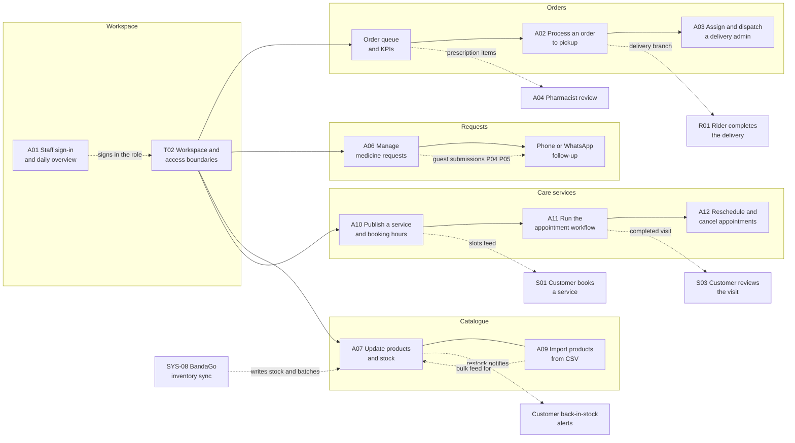

# Staff journey map

The counter-staff role is the platform's daily operator: seven of the sixteen admin sections belong to it — orders, dispatch, medicine requests, bookings, services, catalogue and promotions. Staff run the order pipeline from triage to handover, close the phone-first medicine-request loop, and own the entire appointment calendar including publishing the services behind it. Two boundaries shape the role: prescriptions and catalogue writes belong to pharmacists and admins (the catalogue section is visible to staff but its write endpoints are not), while promotions are the one business surface staff hold that pharmacists do not. Every boundary drawn in the sidebar is re-checked by the server on each call. This map shows how the staff journeys connect; each node links to the detailed flowchart document.

| Metadata | Value |
| --- | --- |
| Primary actor | Staff (staff role `STAFF` on `StaffUser.role`) |
| Coverage | Workspace boundaries · order processing · medicine requests · catalogue reading and imports · services, booking hours and appointments |
| Status | Implemented — verified against code |
| Section visibility | 7 of 16 admin sections: Orders, Dispatch, Medicine requests, Bookings, Services, Catalogue, Promotions |
| Session model | Staff sign-in with email and password; 12-hour idle timeout, 7-day absolute cap, immediate revocation when an admin changes the account |
| Permissions baseline | Orders, dispatch, requests, bookings, services, promotions: fully STAFF-capable. Prescription review, catalogue writes (create/edit/import/upload), review moderation, staff management, settings, reports, analytics, compliance, POS sync, refunds: not STAFF |

## Journey map

## The journeys

| ID | Journey | What it covers |
| --- | --- | --- |
| A02 | [Process an order to pickup](../staff/process-order-to-pickup.md) | Order queue, availability confirmation, payment, packing, cash at handover |
| A06 | [Manage medicine requests](../staff/manage-medicine-requests.md) | Request queue, private photo view, callback, status and notes |
| A07 | [Update products and stock](../staff/update-products-stock.md) | Product edits, pricing, stock statuses, thresholds, the write-role boundary |
| A09 | [Import products from CSV](../staff/import-products-csv.md) | Template, paste/upload, SKU upsert, per-row errors, the BandaGo caveat |
| A10 | [Publish a service and set booking hours](../staff/publish-service-booking-hours.md) | Service editor, images, weekly availability windows, slot generation |
| A11 | [Run the appointment workflow](../staff/run-appointment-workflow.md) | Bookings board, confirm, check-in, visit, completion, no-show |
| A12 | [Reschedule and cancel appointments](../staff/reschedule-cancel-appointments.md) | Slot re-validation, cancellation, notification, the paid-booking refund gap |
| T02 | [Counter staff workspace and access boundaries](../staff/staff-workspace-boundaries.md) | The seven STAFF sections, exclusive vs refused actions, server enforcement |

The order journey is the daily spine: most staff shifts start in the Orders queue and end there. Three structural facts frame the rest of the map. First, the phone is part of the product — medicine requests close by callback (the customer is never notified in-app), and order and booking changes are what generate the notifications customers do receive. Second, the catalogue boundary is real but quiet: staff see prices, stock and filters, while every write — a stock stepper, a price edit, a CSV import — is refused server-side and belongs to a pharmacist or admin. Third, the appointment machine is fully staff-driven: publishing services, setting hours, confirming, rescheduling and cancelling are all STAFF-capable, and money never moves inside that workflow — payments attach through the customer-side flows and refunds for paid appointments are a manual admin task.

## Cross-role handoffs

- **Customer orders → Staff process (A02) → Rider delivers (R01):** a paid delivery order appears on the staff order board, moves through packing, and hands off at `READY_FOR_PICKUP` to the dispatch board and rider (journey A03) — the customer's tracking reflects each handoff.
- **Pharmacist approves → Staff fulfil:** a prescription approval (A04/A05) moves the linked order to `PRESCRIPTION_VERIFIED`, unlocking the payment and packing steps staff run in A02 — the clinical decision gates the whole pipeline.
- **Customer requests a missing medicine (P04/P05) → Staff triage (A06):** staff call the customer back; when the medicine becomes a catalogue product (A08/A07), the request closes FULFILLED and the customer can order normally.
- **Staff publish services and hours (A10) → Customers book (S01) → Staff run the visit (A11):** the availability windows staff set are exactly what the public slot generator offers, so a scheduling mistake surfaces as missing slots, not booking errors.
- **Staff reschedule or cancel (A12) → Customer notified → Admin handles money:** every change notifies the customer, but a cancelled paid appointment keeps its captured payment — an admin arranges the provider-side refund manually because no service-payment refund endpoint exists.
- **BandaGo POS sync (SYS-08) → Catalogue stock (A07):** the nightly POS ingestion writes `stock`, `stockQty`, batches and expiry, so the stock staff read in the catalogue reflects the physical shelf — and the writes staff cannot make are usually unnecessary for POS-linked products.

## Related journeys and documents

- Docs: [user roles and permissions](../../product/user-roles-and-permissions.md) · [access control](../../security/access-control.md) · [journey index](../README.md)
