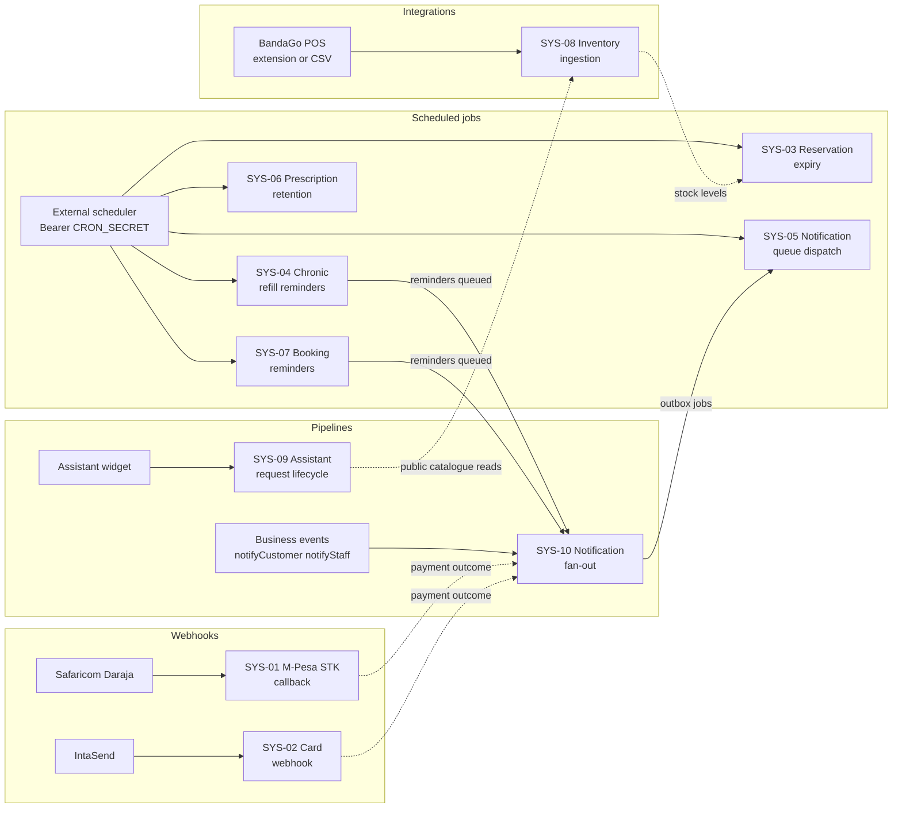

# System journey map

The System actor is everything that happens without a human clicking: payment providers confirm money, a scheduler drains queues and expires holds, the BandaGo POS pushes the physical shop's truth into the catalogue, the AI assistant answers chats, and a durable outbox turns business events into in-app, email and push messages. Three of these flows are triggered from outside (webhooks, the POS), five run on an external scheduler with the `CRON_SECRET`, and two are always-on pipelines that other journeys feed. This map shows how they connect; each node links to the detailed journey document.

| Metadata | Value |
| --- | --- |
| Primary actor | System (webhooks, cron jobs, integrations, pipelines) |
| Coverage | Payments · orders and inventory · prescriptions and compliance · services · notifications · assistant |
| Status | Implemented — verified against code (provider-dependent flows marked environment-dependent per journey) |
| Trigger model | Provider webhooks (SYS-01/SYS-02), scheduled GETs with Bearer `CRON_SECRET` (SYS-03–SYS-07), ingestion pushes with bearer key or staff session (SYS-08), in-process library calls (SYS-09/SYS-10) |
| Operational baseline | External scheduler required for all cron routes (no in-repo scheduler); `CRON_SECRET` ≥ 32 chars; `ORDER_RESERVATION_TTL_MINUTES` and `PRESCRIPTION_RETENTION_DAYS` must be set or their jobs fail closed |

## Journey map

## The journeys

| ID | Journey | What it covers |
| --- | --- | --- |
| SYS-01 | [M-Pesa STK callback processing](../system/mpesa-callback.md) | Daraja callback to trusted, idempotent order payment state |
| SYS-02 | [IntaSend card webhook processing](../system/intasend-webhook.md) | Hosted-checkout webhook, invoice re-fetch, order and booking settlement |
| SYS-03 | [Order reservation expiry job](../system/cron-order-reservations.md) | TTL-driven release of unpaid holds: stock, points, payments, audit history |
| SYS-04 | [Chronic refill reminders job](../system/cron-chronic-refills.md) | 30-day refill eligibility, per-patient throttle, reminder queueing |
| SYS-05 | [Notification queue job](../system/cron-notifications.md) | Outbox dispatcher: leases, Resend/FCM delivery, backoff, reconciliation |
| SYS-06 | [Prescription retention job](../system/cron-prescription-retention.md) | Retention window enforcement, R2-first deletion, shared-key protection |
| SYS-07 | [Service booking reminders job](../system/cron-service-booking-reminders.md) | 24-hour and 2-hour appointment reminders with stable dedupe keys |
| SYS-08 | [BandaGo inventory ingestion](../system/bandago-inventory-sync.md) | POS product/stock/batch ingestion, FEFO and PPB rules, PosSyncLog telemetry |
| SYS-09 | [Assistant request lifecycle](../system/assistant-pipeline.md) | Guardrails, deterministic intent, Groq enhancement, action resolution |
| SYS-10 | [Notification fan-out pipeline](../system/notification-dispatch.md) | Event to in-app row plus email/push outbox jobs, suppression loop |

Scheduling is external for every cron route: the repository contains no scheduler, so the runbook cadences (notifications every minute, reminders at least every 15 minutes, retention and refills daily) are deployment responsibilities, and each job is safe to re-run by hand.

## Cross-role handoffs

- **Customer pays → System confirms → Staff fulfill:** the M-Pesa and card webhooks (SYS-01/SYS-02) flip orders to `PAID` with loyalty credited; staff pick the order up on the board (A02) and admins dispatch it (A03), while the customer tracks it (O06).
- **Customer uploads a prescription → Pharmacist reviews → System retains:** X01 puts the prescription in the pharmacist queue (A04/A05); once soft-deleted, SYS-06 enforces the retention window and removes the private file, with audit evidence surviving in `AuditLog`.
- **Physical shop ↔ online catalogue:** BandaGo ingestion (SYS-08) keeps products, stock and batch expiry current for customers browsing (P02) and staff managing (A07); reservation expiry (SYS-03) returns abandoned checkout holds to that pool.
- **System outreach reaches customers through one pipeline:** refill and booking reminders (SYS-04/SYS-07) and payment outcomes (SYS-01/SYS-02) all queue through the fan-out (SYS-10) and are delivered by the dispatcher (SYS-05); customers control channels in C06 and admins watch health in A16.
- **Assistant prepares, humans verify:** the assistant pipeline (SYS-09) only ever returns action cards — customers complete products, bookings and payments in the real flows (H01–H03), and escalated turns hand off to pharmacists and contact channels (P06).
- **Operators keep the system actor alive:** every cron route depends on an external scheduler and the `CRON_SECRET`; the scheduled-jobs runbook is the contract operators must honour or the queue stalls, holds linger and retention never fires.

## Related journeys and documents

- Docs: [user roles and permissions](../../product/user-roles-and-permissions.md) · [scheduled jobs runbook](../../operations/scheduled-jobs.md) · [system architecture](../../architecture/system-architecture.md) · [journey index](../README.md)
