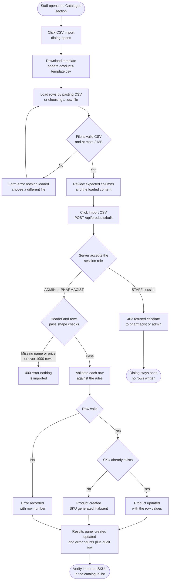

# A09 — Import products from CSV

When dozens of listings need to change at once — a supplier price list, an initial load, a stock count — the CSV import dialog turns a spreadsheet into catalogue rows. The importer is deliberately simple: there is no interactive column mapping and no dry-run; the header row is matched by name, rows are validated one by one, and existing SKUs are updated while new SKUs are created. Rows that fail are reported by row number while the rest still import — a partial import by design, which is why the results panel always shows created, updated and error counts together. The journey runs standalone on a staff session; the separate BandaGo POS CSV dropzone (which shares the "CSV" name) is a different route with its own credentials and a known security caveat, documented honestly below.

| Metadata | Value |
| --- | --- |
| Primary actor | Staff in the UI; the import endpoint requires ADMIN or PHARMACIST |
| Secondary actors | Admin/Pharmacist (the only roles the endpoint accepts) |
| Functional area | Catalogue |
| Entry point | `/admin?section=catalogue` → CSV import → `CsvImportDialog` in `catalogue-section.tsx` |
| Status | Implemented — verified against code (works standalone; no external credentials required) |
| Matching key | SKU — existing SKU updates the product, anything else creates one |
| End condition | `CSV_IMPORT` audit row with created/updated/error counts; catalogue refreshed |

## Journey map

## Journey steps

### Step 1 — Open the importer and download the template

- **User action:** The staff member clicks "CSV import" in the Catalogue header, then "Download template" to get the expected format.
- **Location:** `CsvImportDialog` in `src/components/views/admin/sections/catalogue-section.tsx`; template generated client-side from `CSV_COLUMNS` and `CSV_TEMPLATE_ROWS` via `downloadCsv`.
- **Destination:** A downloaded `sphere-products-template.csv` with the header row and two example rows.
- **Purpose:** Start from the exact column set the parser expects.
- **System behaviour:** The expected columns, in order, are `name, sku, category, brand, packSize, price, compareAtPrice, stockQty, stockStatus, requiresPrescription, description, image`. The dialog explains the constraints inline: `stockStatus` must be one of IN_STOCK / LOW_STOCK / OUT_OF_STOCK / DISCONTINUED, `requiresPrescription` is true/false, values containing commas must be quoted, and optional columns may be left empty.
- **Outcome:** A valid starter file the staff member can edit in any spreadsheet tool.
- **Next step:** Prepare the rows and load them.
- **Alternative paths:** Experienced staff paste rows directly; the template is a convenience, not a requirement — only the header names matter.

### Step 2 — Load the CSV content

- **User action:** The staff member either pastes CSV text into the textarea or picks a `.csv` file with the file input.
- **Location:** Paste textarea and file input in `CsvImportDialog` (`readFile`).
- **Destination:** The dialog shows the loaded file name (or the pasted text) and the "expected columns" reference side by side.
- **Purpose:** Get the rows into the importer and sanity-check them against the column list before submitting.
- **System behaviour:** The file must end in `.csv` or carry the `text/csv` type and be at most 2 MB (about the server's request cap) — otherwise a form error appears and nothing is loaded. The file is read as text into the same field the paste uses; editing the text clears the previous result and file name. There is no server-side dry-run or parsed-row preview: what you see in the textarea is what will be submitted.
- **Outcome:** The CSV content is staged in the dialog.
- **Next step:** Run the import.
- **Alternative paths:** If the file cannot be read, the dialog reports it and keeps the previous state.

### Step 3 — Run the import

- **User action:** The staff member clicks "Import CSV" and waits for the result panel.
- **Location:** `runImport` in `CsvImportDialog` → `adminApi.importCsv(csv)` → `POST /api/products/bulk` with `{ csv }`.
- **Destination:** A results panel with created, updated and error counts (and a toast).
- **Purpose:** Execute the bulk upsert.
- **System behaviour:** The route requires `requireStaff(["ADMIN", "PHARMACIST"])` and caps the request at 2 MB. Shape checks run first: the text needs a header row plus at least one product row, at most 1,000 product rows, and the header must contain `name` and `price` (other columns are optional and matched case-insensitively by name — there is no interactive column mapping). Rows are then processed sequentially, each against: name 2–160 characters, a positive price, a non-negative integer `stockQty`, a `stockStatus` that falls back to a quantity-derived value (≤ 0 → OUT_OF_STOCK, ≤ 5 → LOW_STOCK, else IN_STOCK) when absent or invalid, a `compareAtPrice` that must exceed the price, a SKU matching `[A-Za-z0-9._-]{3,64}` (auto-generated as `SPH-IMP-…` when the column is empty), a `requiresPrescription` value from the true-set (1/true/yes/y/rx/true()), a category matched by name or slug (unknown categories keep the row uncategorised and add a note), and an image that must pass `managedImage`. Quoted values with embedded commas are handled by the parser. Finally the route writes one `AuditLog` row (`CSV_IMPORT`) with the counts.
- **Outcome:** Valid rows are written; invalid rows are listed with their row numbers.
- **Next step:** Read the results and correct failures.
- **Alternative paths:** A STAFF session answers 403 before any row is touched; a shape-check failure answers 400 with nothing imported.

### Step 4 — Read the results and correct errors

- **User action:** The staff member reads the results panel — "N created · N updated · N errors" — and, when there are errors, fixes the offending rows in the source file and re-imports.
- **Location:** Result block in `CsvImportDialog`; the error list renders each per-row message.
- **Destination:** Either a clean import (green panel) or a mixed result (amber panel with the row errors).
- **Purpose:** Know exactly what landed and what did not.
- **System behaviour:** Because rows are processed individually with no wrapping transaction, a failed row never rolls back its neighbours — the import is deliberately partial, and per-row errors are reported as "Row N: …" messages (invalid price, invalid SKU, compare-at must exceed price, unmanaged image, could-not-save). Re-running the import after fixes is safe: the same SKUs are simply updated again.
- **Outcome:** The catalogue reflects every valid row; the staff member knows which rows still need work.
- **Next step:** Verify one imported product in the catalogue list.
- **Alternative paths:** The toast distinguishes a fully clean import from one with row errors, so a mixed result is never presented as complete success.

### Step 5 — Verify in the catalogue

- **User action:** The staff member closes the dialog, searches the catalogue for one imported SKU and opens the product to confirm the values.
- **Location:** Catalogue list in `catalogue-section.tsx` (the dialog triggers a reload to page 1); the product detail on the storefront (journey P03) shows the customer view.
- **Destination:** The imported product with the expected price, stock and photo.
- **Purpose:** Close the loop with a spot check.
- **System behaviour:** The importer refreshes the section on completion; imported products are ordinary `Product` rows from here on — every later change follows journey A07.
- **Outcome:** The bulk change is confirmed live.
- **Next step:** None — the import journey ends here.
- **Alternative paths:** For ongoing POS-driven stock and price updates, the BandaGo sync (journey SYS-08) keeps the catalogue current automatically.

## Decision points

| Decision | Branches | Enforced by/where |
| --- | --- | --- |
| Who may import | ADMIN/PHARMACIST accepted; STAFF → 403 | `requireStaff(["ADMIN", "PHARMACIST"])` in `POST /api/products/bulk` |
| Payload shape | Header + ≥ 1 row, ≤ 1,000 rows, ≤ 2 MB, `name` and `price` columns present | Shape checks at the top of the bulk route |
| Column handling | Matched by header name (case-insensitive); no mapping UI; unknown optional columns ignored | `idx()` header lookup in the bulk route |
| Row validity | Any failed check → error recorded, row skipped, others proceed | Per-row validation loop with `errors.push` |
| SKU resolution | Existing SKU → update; new/absent SKU → create (generated when empty) | `findUnique({ where: { sku } })` branch in the bulk route |
| Stock status | Explicit valid value used; otherwise derived from quantity | `stockStatus` fallback logic in the bulk route |
| Image acceptance | Site image or owned R2 upload only | `managedImage` in `src/lib/security/service.ts` |

## Error and recovery paths

- **STAFF import refused (403):** the dialog is reachable for all staff roles but the endpoint is not — hand the file to a pharmacist or admin (journey T02 documents the boundary).
- **Header or row-count failure (400):** missing `name`/`price` columns, a header-only file, or more than 1,000 product rows imports nothing; fix the file and resubmit.
- **Oversized payload:** files over 2 MB are rejected client-side and by the request cap server-side — split the file.
- **Row-level errors:** reported per row with the reason; the remaining rows still import. Correct the failed rows and re-run — SKU matching makes the retry idempotent for the rows that already landed.
- **Unknown category:** the row still imports, uncategorised, with a note in the error list — create the category or fix the spelling and re-import.
- **No undo:** the import is not transactional and there is no rollback; reversing a bad import means re-importing corrected rows (updates) or discontinuing unwanted products (journey A07). The audit row preserves what was done.
- **BandaGo POS CSV dropzone (separate surface, honest caveat):** the POS Sync hub posts multipart CSVs to `POST /api/integrations/bandago/csv-import`, a different importer (flexible POS column aliases, `externalPosId`-keyed, delegating to the BandaGo sync). It authenticates with a Bearer key or a staff session, and it currently falls back to a hard-coded secret literal when `BANDAGO_SYNC_API_KEY` is unset while the admin page also ships a browser-borne `NEXT_PUBLIC_POS_SYNC_SECRET` — a registered HIGH technical-debt item (H1 in `docs/governance/technical-debt.md`). Until remediated, treat that surface as compromised-by-design and prefer the session-based catalogue importer documented above for staff-driven imports.

## Traceability

| Concern | Implementation reference |
| --- | --- |
| Import dialog, template, file checks | `CsvImportDialog` in `src/components/views/admin/sections/catalogue-section.tsx` |
| Import endpoint and validation | `POST /api/products/bulk` in `src/app/api/products/bulk/route.ts` |
| Typed client call | `adminApi.importCsv` in `src/lib/api-client.ts` |
| CSV parser (quoted values) | `splitCsvLine` in the bulk route file |
| Stock statuses | `STOCK_STATUSES` in `src/lib/constants.ts` |
| Image validation | `managedImage` in `src/lib/security/service.ts` |
| Audit record | `audit(... "CSV_IMPORT" ...)` in the bulk route; `AuditLog` model |
| BandaGo POS CSV importer | `src/app/api/integrations/bandago/csv-import/route.ts` |
| Hard-coded fallback secret incident | H1 in `docs/governance/technical-debt.md` |
| Role matrix for products | `docs/security/access-control.md` |

## Related journeys and documents

- **A07** — single-product edits after (or instead of) an import
- **A08** — creating one product by hand with images
- **T02** — the ADMIN/PHARMACIST import boundary
- **SYS-08** — the BandaGo sync that supersedes manual imports for POS-linked stock
- Docs: [storefront and catalogue](../../features/storefront-and-catalogue.md) · [technical debt register (H1)](../../governance/technical-debt.md) · [access control](../../security/access-control.md)
