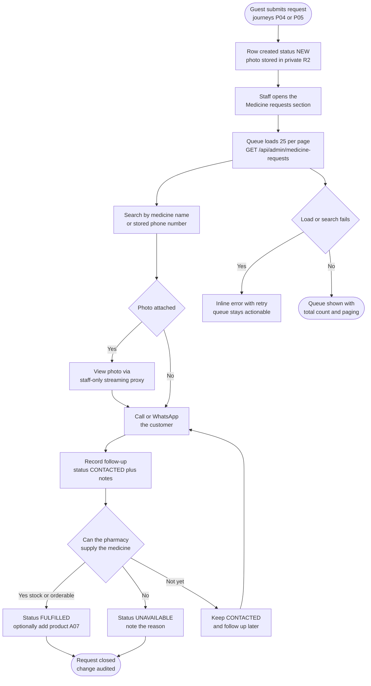

# A06 — Manage medicine requests

Medicine requests are the no-account "find this medicine" channel: a customer submits a medicine name and a Kenyan phone number (optionally a photo of the prescription or packaging) and waits for a callback. Staff work the resulting queue — search, filter, open the photo, call or WhatsApp the customer and record the outcome as CONTACTED, FULFILLED or UNAVAILABLE. The loop closes by phone by design: no notification ever tells the customer their request's status, so keeping the queue current is the staff member's responsibility.

| Metadata | Value |
| --- | --- |
| Primary actor | Staff (ADMIN and PHARMACIST share the section) |
| Secondary actors | Customer (guest requester), Admin/Pharmacist (same queue) |
| Functional area | Medicine requests (guest CRM) |
| Entry point | `/admin?section=medicine-requests` — `medicine-requests-section.tsx` |
| Status | Implemented — verified against code |
| Status values | `NEW` → `CONTACTED` → `FULFILLED` or `UNAVAILABLE` (flat list, no enforced order) |
| End condition | Request resolved with `staffNotes`; `UPDATE_MEDICINE_REQUEST` audit row written |

## Journey map

## Journey steps

### Step 1 — Open the request queue

- **User action:** The staff member opens the Medicine requests section from the admin menu and scans the newest requests.
- **Location:** `src/components/views/admin/sections/medicine-requests-section.tsx`; data from `medicineRequestsApi.list()` → `GET /api/admin/medicine-requests`.
- **Destination:** A card-per-request queue, newest first, with medicine name, status badge, phone link, timestamp, optional photo thumbnail and per-card status/notes editors.
- **Purpose:** See every outstanding customer request in one place.
- **System behaviour:** The route requires `requireStaff(["ADMIN", "PHARMACIST", "STAFF"])` and returns a fixed page size of 25 ordered by `createdAt` descending, with a total count and page navigation. An invalid status filter answers 400; nothing is cached (`private, no-store`). There are deliberately no notifications — the queue only changes when someone works it.
- **Outcome:** The staff member sees how many requests are waiting and which are still NEW.
- **Next step:** Find the request to work on.
- **Alternative paths:** A status filter (All statuses, New, Contacted, Fulfilled, Unavailable) narrows the queue; the empty state confirms when there is nothing outstanding.

### Step 2 — Find the request by name or phone

- **User action:** The staff member types the medicine name or the customer's phone number into the search box, and optionally picks a status filter.
- **Location:** Search input and status select in `medicine-requests-section.tsx`; `search` and `status` query parameters on `GET /api/admin/medicine-requests`.
- **Destination:** A filtered list matching the search.
- **Purpose:** Pull up the request a customer is calling about, or group follow-ups by medicine.
- **System behaviour:** The search term (trimmed, max 200 characters) matches case-insensitively against `medicineName` or as a contains-match against the stored `phone`. Phones are stored normalized to the international format (`+2547XXXXXXXX`), so searching the local `07…` spelling will not match — staff search by name or the stored format.
- **Outcome:** The relevant request card is on screen.
- **Next step:** View the attached photo if there is one.
- **Alternative paths:** If nothing matches, clearing the search restores the full page; pagination reaches older requests.

### Step 3 — View the private photo

- **User action:** On a request with an attachment, the staff member clicks the thumbnail or "View photo" link to inspect the prescription or packaging image the customer shared.
- **Location:** Photo link in `medicine-requests-section.tsx`; the `photoUrl` points at `GET /api/admin/medicine-requests/[id]/photo`.
- **Destination:** The image opens in a new tab, streamed from private storage.
- **Purpose:** Read the exact product, strength or prescription the customer photographed before calling back.
- **System behaviour:** The photo endpoint requires a staff session (ADMIN/PHARMACIST/STAFF), loads the row, and only when both `storageKey` and `photoType` exist streams the R2 object with its original content type, `inline` disposition, `private, no-store` caching and `X-Content-Type-Options: nosniff`. No presigned URL is ever minted and the storage key never leaves the server — the proxy is the only door to the photo.
- **Outcome:** The staff member can identify the requested medicine precisely.
- **Next step:** Contact the customer.
- **Alternative paths:** Requests without a photo show "No photo attached"; if storage is unavailable the proxy errors and the card stays fully actionable — the request can still be worked from the name alone.

### Step 4 — Contact the customer

- **User action:** The staff member clicks the phone link to place the call (or uses the customer's preferred channel discovered on the call).
- **Location:** `tel:` link rendered from the stored phone in `medicine-requests-section.tsx`.
- **Destination:** A phone call outside the platform.
- **Purpose:** Close the loop the customer actually experiences — the channel was designed phone-first.
- **System behaviour:** The platform only supplies the deep link; it never places calls or messages. A status change does not automatically call, SMS or notify the customer — this is a documented, deliberate limitation of the feature.
- **Outcome:** The staff member and customer discuss availability, price and alternatives.
- **Next step:** Record the outcome in the card.
- **Alternative paths:** For guests who ordered before, staff may cross-check the catalogue (journey A07) or take a normal order at the counter (journey A02) once availability is confirmed.

### Step 5 — Record the outcome and save

- **User action:** The staff member chooses a status in the card's select (New, Contacted, Fulfilled, Unavailable), writes internal follow-up notes, and clicks Save changes.
- **Location:** Status select and staff-notes textarea in `MedicineRequestRow`; `medicineRequestsApi.update()` → `PATCH /api/admin/medicine-requests` with `{ id, status, staffNotes }`.
- **Destination:** The card reloads with the saved status; the list refreshes.
- **Purpose:** Keep the queue truthful about where each request stands.
- **System behaviour:** The PATCH requires a staff session, validates the body against `medicineRequestUpdateSchema` (status exactly one of NEW/CONTACTED/FULFILLED/UNAVAILABLE, notes ≤ 1,000 characters), and inside a transaction reads the existing row, updates status and notes, and writes an `AuditLog` row `UPDATE_MEDICINE_REQUEST` capturing the previous and new status. The save button is disabled until something actually changed; notes are optional and internal-only.
- **Outcome:** The request reflects reality; the audit trail records who changed what.
- **Next step:** If the medicine should become orderable, add or update the product.
- **Alternative paths:** Resolving by catalogue: when the requested medicine is (or becomes) a catalogue product, staff point the customer to it — or an admin/pharmacist creates it (journey A08, or A07 for an existing listing's stock) — and mark the request FULFILLED. There is no automatic product creation or order from a request.

## Decision points

| Decision | Branches | Enforced by/where |
| --- | --- | --- |
| Queue access | ADMIN/PHARMACIST/STAFF may list, update and stream photos; riders and customers cannot | `requireStaff([...])` in `src/app/api/admin/medicine-requests/route.ts` and `.../[id]/photo/route.ts` |
| Photo visibility | Photo streams only through the staff-only proxy; no presigned URLs, no public path | `photoUrl` in `src/lib/medicine-request-dto.ts`; proxy route |
| Status change | Any of the four statuses may be set at any time — no enforced order, but the audit log captures previous → new | `medicineRequestUpdateSchema` in `src/lib/medicine-requests.ts`; PATCH transaction |
| Search matching | Name is case-insensitive; phone must match the stored `+254…` format | `where` clause in `GET /api/admin/medicine-requests` |
| Customer notification | None — the customer is never messaged automatically; the loop closes by phone | Feature design (documented limitation) |
| Resolution route | Supply from stock/order → FULFILLED; cannot supply → UNAVAILABLE; still working → CONTACTED | Staff judgement; no workflow guard |

## Error and recovery paths

- **Queue fails to load:** a section-level error with Retry appears; the staff member re-enters or retries — the requests themselves are untouched.
- **Invalid status value (400):** only the exact four statuses are accepted; a stale client showing an old status list is fixed by reloading.
- **Photo not found (404):** the row has no stored photo (or the key is missing); the card still works from the medicine name.
- **Photo temporarily unavailable:** the streaming proxy fails while storage is down; retry later — the request row and notes remain fully actionable.
- **Notes too long (400):** notes are capped at 1,000 characters; the textarea has the same `maxLength`, so this only surfaces with hand-crafted requests.
- **Nothing tells the customer:** by design there is no notification when a request is resolved — if the callback does not happen, the customer has no in-app status view. Staff must actually call; an unresolved queue is visible only inside the workspace.

## Traceability

| Concern | Implementation reference |
| --- | --- |
| Section UI | `src/components/views/admin/sections/medicine-requests-section.tsx` |
| Queue endpoint | `GET /api/admin/medicine-requests` in `src/app/api/admin/medicine-requests/route.ts` |
| Status update endpoint | `PATCH /api/admin/medicine-requests` (id in body) in the same route file |
| Photo streaming proxy | `GET /api/admin/medicine-requests/[id]/photo` in `src/app/api/admin/medicine-requests/[id]/photo/route.ts` |
| Statuses and validation | `MEDICINE_REQUEST_STATUSES`, `medicineRequestUpdateSchema` in `src/lib/medicine-requests.ts` |
| DTO and photo URL | `src/lib/medicine-request-dto.ts` |
| Typed client | `medicineRequestsApi` in `src/lib/api-client.ts` |
| Data model | `MedicineRequest` model (`prisma/schema.prisma`) — status `@default("NEW")`, photo fields, index `[status, createdAt]` |
| Guest submission side | `POST /api/medicine-requests` (public, rate-limited 10/hour/IP) |
| Feature reference | `docs/features/medicine-requests.md` |

## Related journeys and documents

- **P04 / P05** — the guest submissions that populate this queue (text-only and with photo)
- **A07 / A08** — updating or creating the catalogue product a request resolves into
- **A02** — taking the counter order once availability is agreed with the customer
- **T02** — the staff workspace this section belongs to
- Docs: [medicine requests feature](../../features/medicine-requests.md) · [file storage security](../../security/file-storage-security.md) · [access control](../../security/access-control.md)
