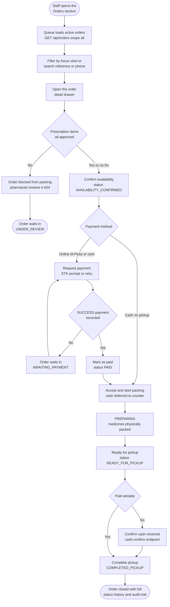

# A02 — Process an order to pickup

Counter staff work the order queue: they triage new orders, confirm availability, take or verify payment, pack the medicines and hand the parcel over at the counter. The Orders section is the staff workhorse — queue and all-orders tabs, focus filters, one-click batch actions and a full detail drawer — while the server enforces every status change through the transition map in `order-workflow.ts`. Cash-on-pickup orders deliberately allow packing before payment, but money is only ever recorded by the cash-confirm endpoint when a staff member physically receives it.

| Metadata | Value |
| --- | --- |
| Primary actor | Staff (ADMIN and PHARMACIST share the same surface) |
| Secondary actors | Customer (order owner), Pharmacist (prescription gate), Admin (refunds, escalations) |
| Functional area | Orders and fulfillment |
| Entry point | `/admin?section=orders` — `orders-section.tsx` |
| Status | Implemented — verified against code |
| Status path | RECEIVED → AVAILABILITY_CONFIRMED → AWAITING_PAYMENT → PAID → PREPARING → READY_FOR_PICKUP → COMPLETED_PICKUP (cash confirmed at handover) |
| End condition | Order `COMPLETED_PICKUP` with a `SUCCESS` payment; every transition in `OrderStatusHistory` and `AuditLog` |

## Journey map

## Journey steps

### Step 1 — Work the order queue

- **User action:** The staff member opens the Orders section, reads the KPI snapshot (awaiting review, awaiting payment, ready for dispatch, out for delivery, ready for pickup) and uses the focus buttons (All work, Needs review, Pack, Rider handoff, Payment at delivery) or the search box to find the next order.
- **Location:** `src/components/views/admin/sections/orders-section.tsx`; data from `ordersApi.allOrders()` → `GET /api/orders?scope=all`.
- **Destination:** A filtered worklist — desktop table or mobile cards — showing reference, customer, items, fulfillment, status, payment summary and the suggested next action per order.
- **Purpose:** Triage the day's queue without opening every order.
- **System behaviour:** The `scope=all` endpoint requires `requireStaff(["ADMIN", "PHARMACIST", "STAFF"])` and returns the newest 100 orders (cursor-paginated via "Load older orders"). The Queue tab keeps only `ACTIVE_STATUSES`; the All tab includes terminal ones. Client-side filters apply status, type, date range and sort (newest, longest waiting, needs attention); a 15-second live-changes poll nudges a background refresh.
- **Outcome:** The staff member can see every active order and its single suggested next action (for example "Accept & start packing", "Collect cash at counter", "Review order").
- **Next step:** Open the order that needs action, or use the one-click action straight from the row.
- **Alternative paths:** Batch "one-click order processing" lets staff select up to 25 eligible orders and run "Accept & start packing" or "Confirm packed & ready" sequentially; ineligible orders show an info icon explaining the blocker (`batchBlocker`), and each write is still checked individually server-side.

### Step 2 — Review the order detail

- **User action:** The staff member clicks an order row or card to open the full-height detail drawer and inspects customer contact, items and totals, payment attempts, pickup code, notes and the status-history timeline.
- **Location:** `OrderDetailSheet` in `orders-section.tsx`; record from the queue payload (same `GET /api/orders?scope=all` DTO with payments, prescriptions and history included).
- **Destination:** The order drawer with Call and WhatsApp buttons, prescription links, payment evidence and the workflow action footer.
- **Purpose:** Verify what was ordered, who ordered it and what has been paid before touching the status.
- **System behaviour:** The drawer renders the pickup code for pickup orders, flags prescription-required items with an Rx badge, shows every payment attempt with provider, status and reference, and lists `OrderStatusHistory` newest-first with actor and note. Attached prescriptions offer "Review here" only when the session role is ADMIN or PHARMACIST (journey A04).
- **Outcome:** Staff know the order's clinical state, payment state and history before acting.
- **Next step:** Confirm stock availability.
- **Alternative paths:** If the order should not proceed, Cancel order opens a reason dialog (minimum 3 characters) and calls the cancel endpoint, which restores reserved stock and redeemed points — only while no `SUCCESS` payment exists.

### Step 3 — Confirm availability and request payment

- **User action:** For a RECEIVED order the staff member confirms the medicines are in stock ("Confirm availability"), then for online-payment orders sends an M-Pesa STK prompt ("Request payment") or waits for the customer to pay from their side.
- **Location:** Workflow footer in `OrderDetailSheet`; `PATCH /api/orders/[id]` for `AVAILABILITY_CONFIRMED` / `AWAITING_PAYMENT`; `POST /api/orders/[id]/request-payment` for the STK prompt.
- **Destination:** The order moves to `AVAILABILITY_CONFIRMED` and then `AWAITING_PAYMENT`.
- **Purpose:** Convert a reviewed order into one that is ready to be settled.
- **System behaviour:** Each PATCH validates the target status against `canTransitionOrder`, re-checks contextual guards, then updates the order inside a transaction guarded by `status` + `version` (`changed.count !== 1` → 409 conflict), appends an `OrderStatusHistory` row, writes an `AuditLog` entry `ORDER_STATUS_<STATUS>` and notifies the customer in-app (plus an order-status email). The STK-prompt action polls the M-Pesa query endpoint and only celebrates when the callback records `SUCCESS`.
- **Outcome:** The order sits at `AWAITING_PAYMENT` (or `PAID` once payment succeeds) and the customer has been prompted.
- **Next step:** Take or confirm payment.
- **Alternative paths:** A customer who paid by card or M-Pesa from their own side (journeys O03/O04) reaches `PAID` without staff involvement; the provider webhook records the payment and staff see the `SUCCESS` badge. Cash orders skip this step entirely — packing is allowed while unpaid.

### Step 4 — Accept the order and start packing

- **User action:** The staff member clicks "Accept & start packing" (single order) or runs the batch action over selected eligible orders.
- **Location:** Quick action in the orders table, workflow footer button, or the one-click processing card — all calling `ordersApi.startPreparing()` → `POST /api/orders/[id]/prepare`.
- **Destination:** Order status `PREPARING`.
- **Purpose:** One deliberate staff action that accepts the order and begins physical packing — without ever claiming money was received.
- **System behaviour:** The prepare route requires `requireStaff(["ADMIN", "PHARMACIST", "STAFF"])` and allows the move only when the order is `PAID` with a `SUCCESS` payment, or is explicitly cash-on-pickup/cash-on-delivery in `RECEIVED`, `PRESCRIPTION_VERIFIED`, `AVAILABILITY_CONFIRMED` or `AWAITING_PAYMENT`. It refuses when stock was not reserved or was released, when prescription items lack an approved prescription, or while a payment attempt is still processing. The transaction is version-guarded, writes a history note ("Accepted for packing — collect cash on pickup; payment not yet received" for unpaid cash orders), audits `ORDER_PREPARATION_STARTED` and notifies the customer that their order is being packed.
- **Outcome:** The order is `PREPARING`; the queue's Pack focus shows it in the packing batch.
- **Next step:** Pack the medicines and mark the parcel ready.
- **Alternative paths:** If the guard refuses (409), the toast explains which precondition failed — for example outstanding pharmacist review — and the order stays put until that is resolved.

### Step 5 — Mark the order ready for pickup

- **User action:** After physically checking and packing all items, the staff member clicks "Ready for pickup" (labelled "Confirm packed & ready" in the batch flow) and confirms the dialog, optionally adding a note.
- **Location:** Workflow footer / batch confirm dialog in `orders-section.tsx`; `PATCH /api/orders/[id]` with `status: "READY_FOR_PICKUP"`.
- **Destination:** Status `READY_FOR_PICKUP`; the customer is notified the parcel is ready and given the pickup code.
- **Purpose:** Signal that the parcel is physically waiting at the counter.
- **System behaviour:** Beyond the transition map, the PATCH refuses `READY_FOR_PICKUP` when any linked prescription is not `APPROVED`/`PARTIALLY_APPROVED`. The status notification includes the pickup code for pickup orders; `OrderStatusHistory` records the optional note (for example "customer called to collect at 4pm").
- **Outcome:** The order appears in the "Ready for pickup" KPI and the customer can come in.
- **Next step:** Hand over the parcel at the counter.
- **Alternative paths:** For delivery orders the same status means "ready for dispatch" and the drawer instead points to rider assignment and the Dispatch board (journey A03) — this journey follows the pickup branch.

### Step 6 — Confirm cash at handover and complete the pickup

- **User action:** When the customer arrives, the staff member verifies the pickup code, collects the cash total for unpaid pickup orders ("Confirm cash received at counter"), then clicks "Complete pickup".
- **Location:** Payment section and workflow footer in `OrderDetailSheet`; `POST /api/orders/[id]/cash-confirm` then `PATCH /api/orders/[id]` with `COMPLETED_PICKUP`.
- **Destination:** Terminal status `COMPLETED_PICKUP`.
- **Purpose:** Record real money at the moment it changes hands, then close the order.
- **System behaviour:** Cash-confirm requires a staff session (rate-limited 20 per 15 minutes), is allowed only from `AVAILABILITY_CONFIRMED`, `AWAITING_PAYMENT`, `READY_FOR_PICKUP` or `OUT_FOR_DELIVERY`, refuses when any prescription is unreviewed or a `SUCCESS` payment already exists, and inside a Serializable transaction creates a `CASH` `SUCCESS` payment keyed `cash:{orderId}` with `CASH_ON_PICKUP` as the method, queues the payment-outcome notification, awards loyalty points for signed-in customers (1 point per KSh 100 with a `LoyaltyLedger` row) and audits `CASH_CONFIRMED`. `COMPLETED_PICKUP` is then granted only for `PICKUP` fulfillment with a `SUCCESS` payment — the UI hides it until the cash confirmation or online payment is recorded.
- **Outcome:** The order is terminal with a complete payment, history and audit trail; the customer's order tracking shows completion.
- **Next step:** The staff member returns to the queue for the next order.
- **Alternative paths:** Paid orders skip cash confirmation and go straight from `READY_FOR_PICKUP` to `COMPLETED_PICKUP`. A double cash confirmation (two staff, same order) is impossible — the second attempt hits the payment conflict guard and answers 409 with a refresh instruction.

## Decision points

| Decision | Branches | Enforced by/where |
| --- | --- | --- |
| Queue visibility | Active orders on Queue tab; everything on All; riders see only their assigned scope | `ACTIVE_STATUSES`/`TERMINAL_STATUSES` filters; `scope=all` guard in `src/app/api/orders/route.ts` |
| Prescription gate | All linked prescriptions APPROVED/PARTIALLY_APPROVED → pack; else blocked | `POST /api/orders/[id]/prepare`; READY_FOR_PICKUP guard in `PATCH /api/orders/[id]` |
| Payment path | Online (M-Pesa/card) → AWAITING_PAYMENT until webhook SUCCESS; cash on pickup → pack unpaid, confirm at counter | `paymentMethod` on the order; `CASH_ALLOWED` list in cash-confirm route |
| Prepare eligibility | PAID + SUCCESS payment, or cash order in pre-payment statuses; in-flight payment blocks | `POST /api/orders/[id]/prepare` guard block |
| Mark as paid via PATCH | Only when a `SUCCESS` payment exists | `PATCH /api/orders/[id]` PAID guard (409 otherwise) |
| Completion | COMPLETED_PICKUP requires PICKUP fulfillment + recorded payment | PATCH guards; `nextStatusesFor` hides the button until paid |
| Status transition legality | Any move outside `STAFF_TRANSITIONS` rejected; STAFF cannot set REFUNDED or REJECTED | `canTransitionOrder` in `src/lib/security/order-workflow.ts` |
| Concurrent edits | Same-order races resolved by version guard; loser gets 409 | `updateMany` version guard + `ORDER_CONFLICT` handling |

## Error and recovery paths

- **Invalid transition (409):** the server answers that the order cannot move between the two statuses; the drawer's suggested actions already reflect `NEXT_STATUS`, so this mostly catches stale screens — reload the order.
- **Order changed while updating (409):** another staff member, a webhook or the cron job won the race; the optimistic `version` guard discarded the losing write. Refresh and re-apply the action.
- **Payment still processing:** prepare and cash-confirm refuse while a `PENDING`/`PROCESSING` payment attempt exists — resolve the payment (wait for the provider outcome) before switching to cash collection.
- **Prescription review incomplete (409):** packing and ready-for-pickup are blocked until a pharmacist records the decision (journey A04/A05); the queue's Needs review focus surfaces these orders first.
- **Cash confirmed twice (409):** the second staff member's attempt is rejected by the payment-exists check and the Serializable-transaction conflict guard; the refresh reveals the recorded payment.
- **Cancellation with money taken:** the cancel endpoint refuses once a `SUCCESS` payment exists — an admin must run the refund flow instead (journey SYS-02/payments docs); staff escalate rather than work around.
- **Queue fails to load:** an inline error with Retry appears; background refresh failures never blank a working queue.

## Traceability

| Concern | Implementation reference |
| --- | --- |
| Orders section UI | `src/components/views/admin/sections/orders-section.tsx` |
| Order list scope and guard | `GET /api/orders?scope=all` in `src/app/api/orders/route.ts` |
| Status transitions | `PATCH /api/orders/[id]` in `src/app/api/orders/[id]/route.ts` |
| Transition authorization | `canTransitionOrder` + `STAFF_TRANSITIONS` in `src/lib/security/order-workflow.ts` |
| Suggested next statuses | `NEXT_STATUS` in `src/lib/constants.ts`; `nextStatusesFor` in the section |
| Prepare flow | `POST /api/orders/[id]/prepare` in `src/app/api/orders/[id]/prepare/route.ts` |
| Cash confirmation | `POST /api/orders/[id]/cash-confirm` in `src/app/api/orders/[id]/cash-confirm/route.ts` |
| STK prompt from staff | `POST /api/orders/[id]/request-payment` |
| Cancellation with reason | `POST /api/orders/[id]/cancel` |
| History and audit models | `OrderStatusHistory`, `AuditLog`, `Payment` in `prisma/schema.prisma` |
| Workflow reference doc | `docs/workflows/order-lifecycle.md` |
| Role matrix | `docs/security/access-control.md` |

## Related journeys and documents

- **O01** — the cash pickup order this journey fulfils from the customer side
- **O03** — M-Pesa payment whose callback records the `SUCCESS` staff rely on
- **X02 / A04** — prescription ordering and the pharmacist review gate
- **A03** — the delivery branch after `READY_FOR_PICKUP` (rider handoff)
- **T02** — the staff workspace boundaries this journey operates within
- Docs: [order lifecycle](../../workflows/order-lifecycle.md) · [orders and fulfillment](../../features/orders-and-fulfillment.md) · [access control](../../security/access-control.md)
