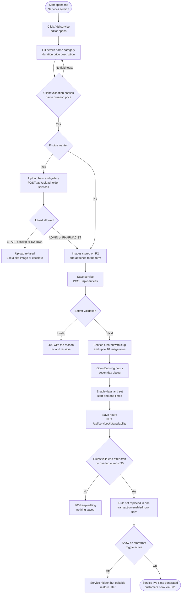

# A10 — Publish a service and set booking hours

Care services — consultations, screenings, wellness visits — are catalogue entries with a clock: a duration, a price (or a display label like "Ask for price"), photos, and weekly availability windows that the slot generator turns into bookable times. Staff create the service in a two-tab editor, upload or choose its imagery, set the booking hours in a seven-day dialog, and publish with the storefront toggle. The service endpoints accept any staff role (ADMIN, PHARMACIST, STAFF); only photo uploads are narrower — the `services` upload folder requires ADMIN or PHARMACIST.

| Metadata | Value |
| --- | --- |
| Primary actor | Staff (ADMIN and PHARMACIST share the surface) |
| Secondary actors | Customer (books the service), Admin/Pharmacist (photo uploads) |
| Functional area | Services and bookings |
| Entry point | `/admin?section=services` — `services-section.tsx` |
| Status | Implemented — verified against code (new photo uploads need R2 credentials and an ADMIN/PHARMACIST session; text, pricing and hours do not) |
| End condition | Service active with enabled availability rules; `GET /api/services/[id]/slots` returns free times |

## Journey map

## Journey steps

### Step 1 — Create the service record

- **User action:** The staff member clicks "Add service" and fills the Details & publishing tab: name, category, duration in minutes, price (optional), display price, short and full descriptions, plus the "Show on storefront" and "Feature service" switches.
- **Location:** `ServicesSection` editor dialog in `src/components/views/admin/sections/services-section.tsx`; `servicesApi.create()` → `POST /api/services`.
- **Destination:** A saved `Service` row; the list refreshes with the new entry.
- **Purpose:** Define what the customer sees and what the booking clock will use.
- **System behaviour:** The client blocks a save when the name is shorter than two characters, the duration is not a whole number between 5 and 480 minutes, or a price is present but not a non-negative number. Server-side `validateServiceFields` repeats the checks (duration default 15; price null allowed up to 10,000,000 — null means free or price-on-application with `priceLabel`), the slug is generated from the name (a collision gets a timestamp suffix), and the route requires a staff session from ADMIN, PHARMACIST or STAFF. A new service starts active ("Show on storefront" defaults on).
- **Outcome:** The service exists and appears in the section list with Live status.
- **Next step:** Add imagery.
- **Alternative paths:** "Duplicate as draft" copies an existing service's fields into a new, unfeatured, inactive draft — useful for seasonal variants.

### Step 2 — Add the service photos

- **User action:** On the Photos tab the staff member uploads a hero image (cover photo) and up to ten gallery images, or removes them.
- **Location:** Media tab of the editor; `storageApi.uploadFile(file, "services")` → `POST /api/upload`.
- **Destination:** Uploaded images attach to the form (hero plus gallery with alt text), and are saved as `ServiceImage` rows with the service.
- **Purpose:** Give the listing a customer-facing identity — the hero appears on the storefront and featured cards.
- **System behaviour:** The upload route accepts the `services` folder only for ADMIN or PHARMACIST sessions and stores the object publicly in R2 (a configured `R2_PUBLIC_URL` origin is required for the URL to later pass `managedImage`). On save, the images array is validated (≤ 10, every URL a managed image) and written with ascending `sortOrder`; a PATCH that includes images replaces the whole set in one transaction. Photos are optional — a service can publish with none.
- **Outcome:** The service carries validated imagery.
- **Next step:** Set the booking hours.
- **Alternative paths:** A STAFF session cannot upload new photos (403 from the folder rule) — it can still reference existing site images or hand the task to a pharmacist/admin; an R2 outage fails the upload with a clear error while the rest of the service can still be saved.

### Step 3 — Set the weekly booking hours

- **User action:** The staff member opens "Booking hours" (Hours button or the row menu) and, for each day of the week, enables the day and sets a start and end time.
- **Location:** Availability dialog in `services-section.tsx`; loads `GET /api/services/[id]/availability`, saves via `servicesAdminApi.saveAvailability()` → `PUT /api/services/[id]/availability`.
- **Destination:** The service's `ServiceAvailability` rule set is replaced.
- **Purpose:** Define when the service can actually be booked — the slot generator only works inside these windows.
- **System behaviour:** The dialog starts each disabled day at a 09:00–17:00 default. On save the route requires a staff session (ADMIN/PHARMACIST/STAFF), validates the whole set — at most 35 rules, `dayOfWeek` 0–6, real HH:MM times, end after start, and no overlapping enabled windows on the same day — and then, inside one transaction, deletes the existing rules and creates only the enabled ones. Any validation failure answers 400 and changes nothing.
- **Outcome:** Enabled weekday windows exist; disabled days simply produce no slots.
- **Next step:** Publish and verify the slots.
- **Alternative paths:** Re-opening the dialog later and saving rewrites the full rule set (there is no per-day patching), so the dialog always shows the current state before editing.

### Step 4 — Publish and verify the slots

- **User action:** The staff member leaves "Show on storefront" on (or flips a draft live via Restore to live / the bulk Publish action), then checks the customer side or the slot endpoint for a chosen date.
- **Location:** Active switch in the editor, dropdown actions and bulk toolbar in `services-section.tsx`; slots from `GET /api/services/[id]/slots?date=YYYY-MM-DD` (public).
- **Destination:** The service is live in the storefront catalogue and bookable.
- **Purpose:** Make the service real for customers.
- **System behaviour:** The public services list returns only active services (staff can pass `includeInactive=true`); an inactive service's slots endpoint answers 404. Slot generation loads the enabled rules for the requested weekday, steps from each window's start by the service's `durationMinutes` while the whole appointment fits before the window end, skips past times and any overlap with a live booking (CANCELLED/REJECTED/NO_SHOW excluded), and labels times in Nairobi (UTC+3) — capacity is strictly one booking per slot.
- **Outcome:** Customers browsing services (journey S01) see the listing and can pick a real slot.
- **Next step:** The appointment pipeline takes over (journeys A11/A12).
- **Alternative paths:** Archiving (Archive action or bulk Archive) soft-deactivates the service: it disappears from the storefront and cannot receive new bookings, but existing bookings remain intact and the service can be restored at any time. Note that the "Feature service" switch records marketing priority in the catalogue ordering — the storefront list shows featured services first — but the current homepage's service content is static, so featuring does not automatically change the homepage.

## Decision points

| Decision | Branches | Enforced by/where |
| --- | --- | --- |
| Who may manage services | Create/edit/hours/archive: ADMIN/PHARMACIST/STAFF; photo uploads: ADMIN/PHARMACIST | `canManage` checks in `src/app/api/services/route.ts` and `[id]` routes; folder rule in `POST /api/upload` |
| Field validity | Name ≥ 2; duration whole 5–480 (default 15); price null or 0–10M; priceLabel free text | `validateServiceFields` in `src/lib/security/service.ts`; client checks in the section |
| Image acceptance | ≤ 10 images, each a managed site image or owned R2 URL | `managedImage`; images validation in POST/PATCH |
| Availability validity | ≤ 35 rules, real times, end > start, no same-day overlap | `PUT /api/services/[id]/availability` |
| Rule persistence | Save replaces the entire set with the enabled rows only | deleteMany + create transaction in the availability route |
| Publication state | active true → listed and bookable; active false → hidden, 404 on slots, restorable | `GET /api/services`, `GET /api/services/[id]/slots`; DELETE = soft deactivate |
| Slot generation | Duration-stepped windows, past and overlapping slots removed, capacity 1, Nairobi time | `GET /api/services/[id]/slots` |

## Error and recovery paths

- **Validation failure on save (400):** the client already blocks the common cases with a toast and a jump to the offending tab; a server rejection shows the exact reason — fix the field and save again.
- **Photo upload refused (403):** the session is STAFF (the `services` folder is ADMIN/PHARMACIST) — escalate the upload or reference an existing managed image; the service itself remains fully editable.
- **Photo upload failed (R2 unavailable):** uploads need object storage; save the service without images and attach photos once storage is healthy.
- **Availability rejected (400):** an end time not after the start, an impossible time, or overlapping windows on one day — the dialog keeps the edited values so the fix is immediate; nothing is saved until the set validates.
- **Too many rules (400):** more than 35 rules is rejected; consolidate windows (for example merge morning and afternoon into one range).
- **Slug collision:** handled automatically with a timestamp suffix — no user action needed.
- **Accidentally archived service:** restore it with "Restore to live"; existing bookings were never touched, and no slot data is lost because availability rules persist independently of the active flag.

## Traceability

| Concern | Implementation reference |
| --- | --- |
| Section UI, editor, availability dialog | `src/components/views/admin/sections/services-section.tsx` |
| Create and list services | `src/app/api/services/route.ts` |
| Edit and archive (soft deactivate) | `src/app/api/services/[id]/route.ts` |
| Booking hours get/put | `src/app/api/services/[id]/availability/route.ts` |
| Slot generation | `src/app/api/services/[id]/slots/route.ts` |
| Field validation | `validateServiceFields` in `src/lib/security/service.ts` |
| Image validation | `managedImage` in `src/lib/security/service.ts` |
| Photo uploads | `POST /api/upload` (folder `services`) |
| Data models | `Service`, `ServiceImage`, `ServiceAvailability` in `prisma/schema.prisma` |
| Workflow reference | `docs/workflows/service-bookings.md` |

## Related journeys and documents

- **S01** — the customer booking flow the published service feeds
- **A11** — running the appointments this service generates
- **A12** — rescheduling and cancelling those appointments
- **T02** — the staff workspace this section belongs to
- Docs: [service bookings workflow](../../workflows/service-bookings.md) · [services and bookings feature](../../features/services-and-bookings.md) · [file storage security](../../security/file-storage-security.md)
