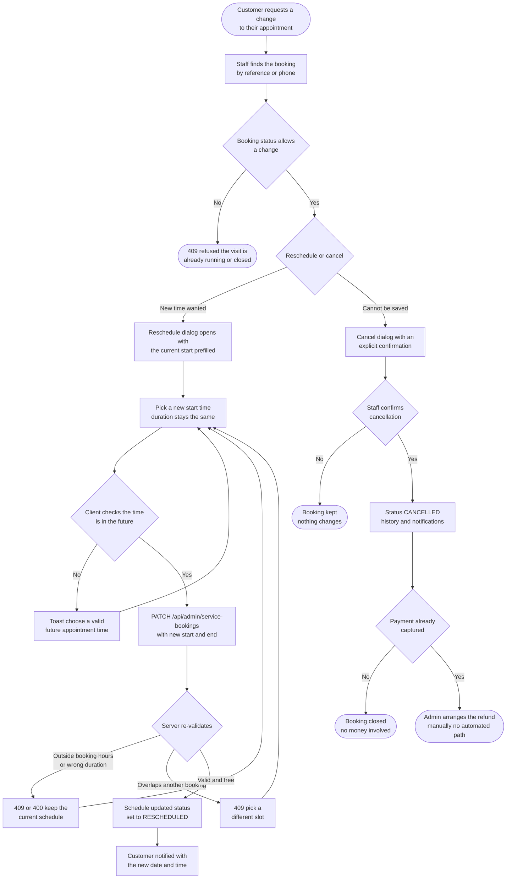

# A12 — Reschedule and cancel appointments

Plans change: a patient calls, the pharmacist is called away, the consultation room is double-booked. Staff handle both outcomes from the Bookings section — a reschedule dialog that re-validates the new time against the service's availability rules and overlapping bookings, and a cancellation flow that records the outcome and tells the customer. Rescheduling and cancellation are staff-driven: customers request changes by phone or chat (the storefront booking view is read-only for status), and every change lands in the booking's status history. What the platform deliberately does not do is refund a paid appointment automatically — that is a manual, honest gap documented in Step 4.

| Metadata | Value |
| --- | --- |
| Primary actor | Staff (ADMIN and PHARMACIST share the surface) |
| Secondary actors | Customer (notified of every change), Admin (manual refund handling) |
| Functional area | Services and bookings |
| Entry point | `/admin?section=service-bookings` — reschedule dialog / cancel dialog in `service-bookings-section.tsx` |
| Status | Implemented — verified against code |
| Eligible statuses | PENDING, CONFIRMED, RESCHEDULED (both actions); all other statuses refuse |
| End condition | Booking RESCHEDULED on a valid free slot, or CANCELLED — history recorded, customer notified |

## Journey map

## Journey steps

### Step 1 — Find the booking that needs to change

- **User action:** The staff member opens the Bookings section, locates the appointment by booking date and reference (or by searching the patient's name or phone), and opens its details.
- **Location:** Views, search and detail dialog in `src/components/views/admin/sections/service-bookings-section.tsx`; `GET /api/admin/service-bookings?scope=manage` and `?scope=detail`.
- **Destination:** The appointment detail with schedule, patient contact, assigned team member, payment status and history.
- **Purpose:** Confirm the right appointment before touching it.
- **System behaviour:** The manage/detail scopes require a staff session (ADMIN, PHARMACIST or STAFF). The detail dialog shows the reference, service, schedule in Nairobi time, patient contact links and up to 100 status-history entries, so staff can confirm the booking's state and payment situation in one place.
- **Outcome:** Staff know exactly which appointment changes, and whether money is attached.
- **Next step:** Reschedule or cancel.
- **Alternative paths:** If the booking has already started (ARRIVED, IN_PROGRESS) or closed (COMPLETED, NO_SHOW), neither action is offered and the server would refuse anyway — staff explain the outcome to the customer instead.

### Step 2 — Reschedule to a new slot

- **User action:** From the detail dialog (or a booking row) the staff member opens Reschedule, picks a new start date and time, and saves.
- **Location:** Reschedule dialog in `service-bookings-section.tsx` (`openReschedule` / `saveReschedule`); `adminServiceBookingsApi.reschedule(id, start, end)` → `PATCH /api/admin/service-bookings` with `scheduledStart` and `scheduledEnd`.
- **Destination:** The booking keeps its duration but moves to the new time; status becomes `RESCHEDULED`.
- **Purpose:** Save the appointment the customer can actually attend.
- **System behaviour:** The dialog pre-fills the current start (Nairobi time), keeps the original duration, and blocks obviously invalid input client-side (a past time, an unparseable value). Server-side the PATCH re-validates everything from scratch: the new window must be in the future, its length must equal the service's `durationMinutes`, it must fit entirely inside one enabled availability rule for that Nairobi weekday (same day, start and end within the window), it must not overlap any other live booking on the same service (CANCELLED/REJECTED/NO_SHOW excluded), and the booking must still be PENDING, CONFIRMED or RESCHEDULED. On success the schedule is updated, the status is set to `RESCHEDULED`, a history row ("Appointment rescheduled by staff.") is written with the acting staff id, and the customer is notified in-app (plus email) with the new date and time.
- **Outcome:** The appointment has a valid new slot; the customer knows the new time.
- **Next step:** Optionally confirm the rescheduled booking (journey A11) or assign a different team member.
- **Alternative paths:** Reminder emails follow the new time automatically — the reminder job keys on the booking's current `scheduledStart`, so the old reminder cannot suppress the new one.

### Step 3 — Cancel the appointment

- **User action:** The staff member opens Cancel on a PENDING, CONFIRMED or RESCHEDULED booking, reads the confirmation dialog, and confirms the cancellation.
- **Location:** Cancel dialog in `service-bookings-section.tsx`; `adminServiceBookingsApi.updateStatus(id, "CANCELLED")` → `PATCH /api/admin/service-bookings` with `status: "CANCELLED"`.
- **Destination:** Terminal status `CANCELLED`.
- **Purpose:** Close an appointment that will not happen.
- **System behaviour:** The transition map allows CANCELLED from PENDING, CONFIRMED and RESCHEDULED only. The update and its history row are written in one transaction; the customer is notified ("Your appointment has been cancelled. Please contact the pharmacy if you need assistance."), and the staff roles receive a service-booking-updated notification as well. The cancelled booking stops occupying its slot immediately — the slots endpoint and reschedule conflict checks both exclude CANCELLED bookings — so the time can be rebooked by anyone.
- **Outcome:** The appointment is closed and the customer has been told.
- **Next step:** Handle any money already paid.
- **Alternative paths:** A patient who simply missed the visit is marked NO_SHOW (only from ARRIVED) instead — a different outcome with its own notification.

### Step 4 — Handle payment when the appointment was paid

- **User action:** None automated — this step records what staff must do when a cancelled or rescheduled booking carries a captured payment.
- **Location:** Payment status on the booking detail; refund policy in `docs/workflows/payment-lifecycle.md`; refund endpoint `POST /api/payments/refund`.
- **Destination:** A manual refund arranged by an admin outside the booking workflow.
- **Purpose:** Keep the money story honest.
- **System behaviour:** Cancelling a booking does not touch its `ServicePayment` rows or `paymentStatus` — a paid booking stays `PAID` and the captured payment stays `SUCCESS`. There is no in-platform refund path for service payments: the refund endpoint operates on order `Payment` rows only (M-Pesa refunds are refused outright and must be completed in the M-Pesa organisation portal; IntaSend refunds go through the provider; cash is confirmed against a till reference), and `ServicePayment` carries no refund fields. Rescheduling, notably, is the customer-friendlier path for paid bookings — the money stays attached to the moved appointment.
- **Outcome:** The booking record is truthful; the refund is a deliberate, auditable manual action rather than a silent automatic one.
- **Next step:** An admin processes the provider-side refund and records it appropriately; the booking itself needs no further change.
- **Alternative paths:** For pay-at-pharmacy bookings nothing is owed — the `PAY_AT_PHARMACY` marker is an intent only and no settlement endpoint exists, so cancellation simply ends the intent.

## Decision points

| Decision | Branches | Enforced by/where |
| --- | --- | --- |
| Who may reschedule or cancel | ADMIN/PHARMACIST/STAFF sessions only | `can()` guard in `PATCH /api/admin/service-bookings` |
| Eligible statuses | PENDING/CONFIRMED/RESCHEDULED → change allowed; ARRIVED/IN_PROGRESS/COMPLETED/CANCELLED/NO_SHOW/REJECTED → 409 | Status guard and `transitions` map in the PATCH handler |
| New slot validity | Future, duration equals `durationMinutes`, fits one enabled availability rule on one Nairobi weekday | Reschedule validation block in the PATCH |
| Slot conflict | Any overlap with a live booking on the same service → 409; CANCELLED/REJECTED/NO_SHOW ignored | Overlap query in the PATCH |
| Cancellation notification | Customer always notified; staff notified for CANCELLED/NO_SHOW/REJECTED | `notifyServiceBooking` / `notifyStaff` in the PATCH |
| Refund on cancellation | Never automatic; no service-payment refund endpoint exists — manual provider-side refund by an admin | `ServicePayment` model (no refund fields); `POST /api/payments/refund` scope |

## Error and recovery paths

- **Invalid status for the change (409):** the booking is already running or terminal — read the current status and choose the appropriate action (complete it, mark no-show, or leave it).
- **Outside service hours (409):** the chosen time does not fit inside an enabled availability window for that weekday — pick a slot the slot generator would offer (journey A10 explains the hours editor when the hours themselves need to change).
- **Overlaps another booking (409):** another patient holds that time; the booking keeps its previous schedule and the dialog stays open to try another slot.
- **Wrong duration (400/409):** the end time must be exactly the service duration after the start — the dialog computes it, so this mainly guards hand-crafted requests.
- **Past time (400):** reschedules must be in the future; the client blocks this before the call.
- **Customer was not told:** notifications are queued transactionally with the change, but if a channel fails the pipeline retries (journey SYS-10); staff can always call the patient from the detail dialog's contact links.
- **Paid booking cancelled by mistake:** the booking cannot be un-cancelled (terminal statuses are absorbing) — rebook the patient onto a new slot and arrange the refund manually as in Step 4.

## Traceability

| Concern | Implementation reference |
| --- | --- |
| Reschedule dialog and validation | `openReschedule` / `saveReschedule` in `src/components/views/admin/sections/service-bookings-section.tsx` |
| Reschedule and cancel endpoint | `PATCH /api/admin/service-bookings` in `src/app/api/admin/service-bookings/route.ts` |
| Transition map incl. cancellation | `transitions` record in the PATCH handler |
| Availability-window re-validation | Nairobi formatter + `allowedByHours` check in the PATCH |
| Overlap / conflict check | `serviceBooking.findFirst` conflict query in the PATCH |
| Customer notifications | `notifyServiceBooking` (event `SERVICE_BOOKING_RESCHEDULED`, status messages) |
| Reminder re-targeting after a move | `docs/workflows/service-bookings.md` §4.2 (dedupe key uses the new `scheduledStart`) |
| Refund boundary | `POST /api/payments/refund` (order payments only); `ServicePayment` model in `prisma/schema.prisma` |
| Payment lifecycle reference | `docs/workflows/payment-lifecycle.md` |

## Related journeys and documents

- **S01 / S03** — the booking being changed, and the customer's tracking view of it
- **S02** — how the booking was paid (matters for Step 4)
- **A10** — editing the booking hours when availability, not the patient, is the constraint
- **A11** — the confirm/check-in/complete workflow around these changes
- **T02** — the staff workspace this section belongs to
- Docs: [service bookings workflow](../../workflows/service-bookings.md) · [payment lifecycle — refunds](../../workflows/payment-lifecycle.md) · [services and bookings feature](../../features/services-and-bookings.md)
