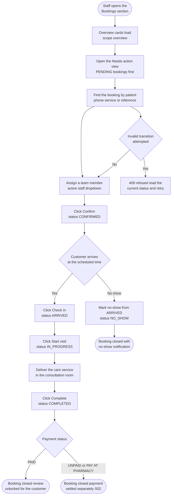

# A11 — Run the appointment workflow

The Bookings section is the daily care calendar: staff confirm new appointments, assign a team member, check the patient in when they arrive, start and complete the visit. The nine-status booking machine is driven entirely by staff PATCH calls — each one validated against the transition map, recorded in `ServiceBookingStatusHistory`, and pushed to the customer as a notification. One thing this workflow deliberately does not do is settle money: payment status (UNPAID, PAID, PAY_AT_PHARMACY) lives on the booking and is changed by the payment flows, not by Confirm or Complete.

| Metadata | Value |
| --- | --- |
| Primary actor | Staff (ADMIN and PHARMACIST share the surface) |
| Secondary actors | Customer (patient), Admin/Pharmacist (assignable team members) |
| Functional area | Services and bookings |
| Entry point | `/admin?section=service-bookings` — `service-bookings-section.tsx` |
| Status | Implemented — verified against code |
| Status chain | PENDING → CONFIRMED → ARRIVED → IN_PROGRESS → COMPLETED (alternatives: NO_SHOW from ARRIVED) |
| End condition | Booking terminal with complete history; customer notified; review unlocked when COMPLETED |

## Journey map

## Journey steps

### Step 1 — Read the day's overview

- **User action:** The staff member opens the Bookings section and reads the overview cards: awaiting confirmation (across all dates), upcoming visits, and the next scheduled visit.
- **Location:** `ServiceBookingsSection` in `src/components/views/admin/sections/service-bookings-section.tsx`; data from `adminServiceBookingsApi.overview(todayNairobi())` → `GET /api/admin/service-bookings?scope=overview&date=…`.
- **Destination:** The appointment list with views, filters and the day's counts.
- **Purpose:** Know what the care day looks like before working it.
- **System behaviour:** The overview scope requires a staff session (ADMIN, PHARMACIST or STAFF) and computes the pending count, the upcoming count (active statuses from the start of the Nairobi day), a preview of the four earliest pending bookings and the next booked visit. All date math uses Nairobi day boundaries (UTC+3) regardless of server time zone, and the list labels every time as EAT.
- **Outcome:** Staff see how many confirmations are outstanding and when the next patient arrives.
- **Next step:** Work the queue view.
- **Alternative paths:** Clicking a card jumps straight to the matching view and clears filters; a failed overview load shows a compact error with Retry while the list still works.

### Step 2 — Find and open the appointment

- **User action:** The staff member switches between the Needs action, Upcoming, History and All bookings views, searches by patient name, phone, service or booking reference, and filters by date range, status or assigned team member.
- **Location:** View tabs, search box and filter panel in `service-bookings-section.tsx`; `adminServiceBookingsApi.search()` → `GET /api/admin/service-bookings?scope=manage&…`.
- **Destination:** A paged list (20 per page) of matching bookings; Details opens the full dialog.
- **Purpose:** Locate exactly the appointment that needs action.
- **System behaviour:** The manage scope validates every parameter server-side (view, status, range, staff filter, search ≤ 120 characters over reference, service name and customer name/phone/email; custom ranges up to 366 days). Rows are ordered by scheduled start ascending for active views and descending for history/all. Pending bookings whose start time has passed are flagged "Past appointment".
- **Outcome:** The target booking is on screen with its status badge and one-click next action.
- **Next step:** Confirm the booking (or open Details for the full picture).
- **Alternative paths:** The one-click action buttons (Confirm, Check in, Start visit, Complete) run directly from the row — the dialog is only needed for contact details, notes and history.

### Step 3 — Confirm the booking

- **User action:** On a PENDING (or RESCHEDULED) booking the staff member clicks Confirm.
- **Location:** Row action or detail dialog in `service-bookings-section.tsx`; `adminServiceBookingsApi.updateStatus(id, "CONFIRMED")` → `PATCH /api/admin/service-bookings`.
- **Destination:** Status `CONFIRMED`; the customer is notified.
- **Purpose:** Record the pharmacy's commitment to the appointment.
- **System behaviour:** The PATCH requires a staff session and checks the transition map — `PENDING → CONFIRMED` (and `RESCHEDULED → CONFIRMED`) are legal. Inside a transaction the booking is updated and a `ServiceBookingStatusHistory` row is appended with the acting staff id. The customer then receives an in-app notification (with email through the shared pipeline) carrying the confirmed-service message; a failed transition answers 409 with the reason. The UI applies the change optimistically and rolls back with an error toast if the server refuses.
- **Outcome:** The booking is confirmed and off the Needs action view.
- **Next step:** Assign a team member if not already done.
- **Alternative paths:** A booking that cannot be honoured is rescheduled or cancelled (journey A12) rather than confirmed.

### Step 4 — Assign a team member

- **User action:** In the appointment details the staff member picks an active ADMIN, PHARMACIST or STAFF account from the Assigned team member dropdown (or clears it back to Unassigned).
- **Location:** Assigned-team-member select in the detail dialog; `adminServiceBookingsApi.assign()` → `PATCH /api/admin/service-bookings/[id]/assign`; dropdown source `GET /api/admin/service-staff`.
- **Destination:** The booking's `assignedStaffId` is set or cleared.
- **Purpose:** Make one person responsible for the visit.
- **System behaviour:** The assign route requires a staff session, verifies the target is an active ADMIN/PHARMACIST/STAFF account (400 otherwise), writes the assignment, and — when it is a new assignment — notifies that staff member (`SERVICE_ASSIGNED`) with a link to their dashboard. Assignment never changes the booking status.
- **Outcome:** The visit has an owner whose name shows on the row and the customer's booking view.
- **Next step:** Wait for the patient and check them in.
- **Alternative paths:** Reassignment later simply overwrites the field and notifies the new owner; the assignment is snapshotted onto any review the customer later writes, so history is preserved.

### Step 5 — Check in, run and complete the visit

- **User action:** When the patient arrives the staff member clicks Check in; when the consultation begins, Start visit; when it finishes, Complete. If an ARRIVED patient cannot be seen, Mark no-show records the miss.
- **Location:** Row action buttons and the detail dialog footer; each calls `PATCH /api/admin/service-bookings` with the next status.
- **Destination:** `ARRIVED` → `IN_PROGRESS` → `COMPLETED` (or `NO_SHOW` from `ARRIVED`).
- **Purpose:** Walk the visit through its real-world stages so the customer's record and the team's calendar stay truthful.
- **System behaviour:** Each PATCH validates against the transition map (`CONFIRMED → ARRIVED`, `ARRIVED → IN_PROGRESS` or `NO_SHOW`, `IN_PROGRESS → COMPLETED`; terminal statuses accept nothing — any other pair answers 409), updates the booking and appends history inside a transaction, and notifies the customer with status-specific copy (checked in, service started, service completed, missed appointment). CANCELLED, NO_SHOW and REJECTED outcomes additionally notify the staff roles. Completing a booking does not touch `paymentStatus` — paid, unpaid and pay-at-pharmacy bookings complete identically, and the payment is settled through the payment flows (journey S02).
- **Outcome:** The visit is COMPLETED (or recorded as a no-show); the customer's appointment view reflects it and, on completion, unlocks the visit review (journey S03).
- **Next step:** The staff member moves to the next appointment; the completed booking settles into the History view.
- **Alternative paths:** The detail dialog's Recent activity list (up to 100 entries) shows every recorded change with actor and note — the audit trail when a patient disputes what happened.

## Decision points

| Decision | Branches | Enforced by/where |
| --- | --- | --- |
| Section access | ADMIN/PHARMACIST/STAFF for list, detail, transitions and assignment | `can()` session checks in `src/app/api/admin/service-bookings/route.ts` and `[id]/assign/route.ts` |
| View and filter validity | Views queue/upcoming/history/all; ranges any/today/next7/custom ≤ 366 days; search ≤ 120 chars | `manageBookings` parameter validation |
| Transition legality | PENDING/RESCHEDULED → CONFIRMED; CONFIRMED → ARRIVED; ARRIVED → IN_PROGRESS or NO_SHOW; IN_PROGRESS → COMPLETED; terminal → nothing | `transitions` map in the PATCH handler (409 otherwise) |
| Assignment target | Active ADMIN/PHARMACIST/STAFF account or null; invalid → 400 | `PATCH /api/admin/service-bookings/[id]/assign` |
| Customer notification | Every transition notifies the customer; CANCELLED/NO_SHOW/REJECTED also notify staff | `notifyServiceBooking` / `notifyStaff` calls in the PATCH |
| Payment versus workflow | Confirm/Complete never change `paymentStatus` — money is handled by the payment flows | Separate `paymentStatus` field; payment routes in `src/app/api/service-bookings/[id]/pay/*` |

## Error and recovery paths

- **Invalid transition (409):** the map refuses pairs like COMPLETED → IN_PROGRESS; the UI's action buttons already hide impossible moves, so this catches stale screens — reload the booking.
- **Optimistic update rolled back:** if the server refuses after the UI optimistically flipped the badge, the previous row is restored and the error toast shows the server's reason; nothing was written.
- **Booking not found (404):** a deleted or mistyped id — refresh the list; the search box finds bookings by reference when a patient phones in.
- **Overview or list fails to load:** a section error with Retry appears; background refresh failures never blank a working list mid-task.
- **Patient does not arrive:** Mark no-show (only from ARRIVED) records the miss and notifies the customer with a rebooking prompt; the slot itself is not freed retroactively — a new booking happens through the normal flow.
- **Past-time pending bookings:** flagged "Past appointment" in the list — confirm, reschedule or cancel them so the queue stays honest.
- **Dispute about what happened:** the status history (actor + timestamp per change, up to 100 entries in the detail dialog) is the record of truth.

## Traceability

| Concern | Implementation reference |
| --- | --- |
| Section UI, views, actions | `src/components/views/admin/sections/service-bookings-section.tsx` |
| Manage list, detail, overview, status PATCH | `src/app/api/admin/service-bookings/route.ts` |
| Assignment | `src/app/api/admin/service-bookings/[id]/assign/route.ts` |
| Staff dropdown source | `GET /api/admin/service-staff` (`serviceStaffApi.list`) |
| Status set and labels | `statusOptions` / `statusNames` in the section; status list in `docs/workflows/service-bookings.md` |
| Next-action chain | `nextAction` map in the section |
| Notifications | `notifyServiceBooking`, `notifyStaff` in `src/lib/notify.ts` |
| Data models | `ServiceBooking`, `ServiceBookingStatusHistory` in `prisma/schema.prisma` |
| Workflow reference | `docs/workflows/service-bookings.md` |
| API client | `adminServiceBookingsApi` in `src/lib/api-client.ts` |

## Related journeys and documents

- **S01** — the customer booking that created this appointment
- **S02** — the payment options, settled separately from this workflow
- **S03** — the customer's completed-visit review this workflow unlocks
- **A10** — publishing the service and booking hours that generate the slots
- **A12** — rescheduling and cancelling appointments in this same section
- Docs: [service bookings workflow](../../workflows/service-bookings.md) · [services and bookings feature](../../features/services-and-bookings.md) · [access control](../../security/access-control.md)
