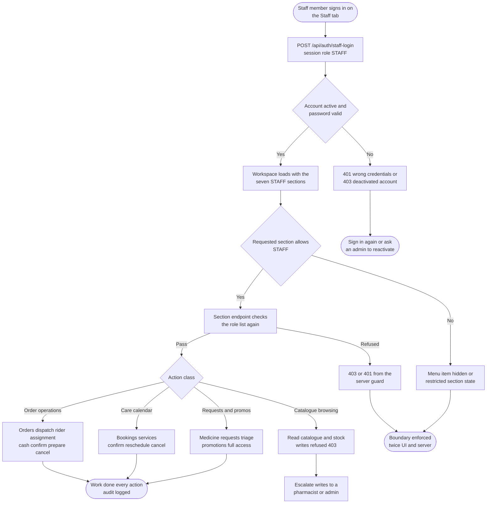

# T02 — Counter staff workspace and access boundaries

The STAFF role is the counter operator: order processing, dispatch handoffs, medicine requests, the care calendar and the service catalogue are theirs, and — unusually — so are promotions, which pharmacists do not see. Seven of the sixteen admin sections render for STAFF; the clinical, quality and owner surfaces do not. The sidebar is only a picture: every section's endpoints re-check the role server-side through `requireStaff` role lists, and two surfaces (catalogue edits and CSV import) draw controls the server will refuse for a STAFF session — this journey documents that gap honestly rather than hiding it.

| Metadata | Value |
| --- | --- |
| Primary actor | Staff (staff role `STAFF` on `StaffUser.role`) |
| Secondary actors | Admin (escalation target), Pharmacist (clinical gatekeeper) |
| Functional area | Workspace and access control |
| Entry point | `/admin` after staff sign-in on the Staff tab |
| Status | Implemented — verified against code |
| Section visibility | 7 of 16 sections: Orders, Dispatch, Medicine requests, Bookings, Services, Catalogue, Promotions |
| Enforcement | `NAV` role lists in `admin-view.tsx` (UI) + `requireStaff([...])` / session role checks on every API route (server) |

## Journey map

## Journey steps

### Step 1 — Sign in to the staff workspace

- **User action:** The staff member opens `/admin`, chooses the Staff tab of the sign-in dialog and submits their staff email and password.
- **Location:** Staff gate and auth dialog in `src/components/views/admin/admin-view.tsx`; `POST /api/auth/staff-login` in `src/app/api/auth/staff-login/route.ts`.
- **Destination:** The workspace shell with the STAFF navigation.
- **Purpose:** Establish the STAFF identity every later check reads.
- **System behaviour:** The login route rate-limits 5 attempts per 15 minutes per IP+email, verifies the password hash, refuses deactivated accounts (403) and creates a staff session carrying `staffId` and `staffRole: "STAFF"`. Staff sessions expire after 12 hours idle and 7 days at most, and are revoked immediately when an admin changes the account.
- **Outcome:** The workspace renders only the sections whose role list includes STAFF; a customer session instead sees the staff gate.
- **Next step:** Read the navigation.
- **Alternative paths:** Five failed attempts trigger the rate limit (429); a deactivated account must be reactivated by an admin first (journey A15).

### Step 2 — Read the STAFF navigation

- **User action:** The staff member scans the sidebar (or the mobile sheet / command palette) to see their workspace.
- **Location:** `NAV` array and `visibleNav` filter in `src/components/views/admin/admin-view.tsx`.
- **Destination:** Seven sections grouped as Workspace (Orders, Dispatch), Patient care (Medicine requests, Bookings, Services) and Business (Catalogue, Promotions).
- **Purpose:** Know where the counter work lives — and where it does not.
- **System behaviour:** `visibleNav` keeps only items whose `roles` include the session role. For STAFF the absent sections are Overview (ADMIN), Prescriptions (ADMIN/PHARMACIST), Service analytics (ADMIN), Reviews (ADMIN/PHARMACIST), Staff (ADMIN), Reports (ADMIN), Compliance (ADMIN/PHARMACIST), Settings (ADMIN) and POS Sync (ADMIN/PHARMACIST). The live-changes poll that toasts new orders and bookings runs for ADMIN, PHARMACIST and STAFF, so the counter hears about new work without refreshing.
- **Outcome:** STAFF lands on Orders (the first visible section) with a daily-operations workspace.
- **Next step:** Work the sections.
- **Alternative paths:** Navigating directly to a restricted section URL renders a Restricted empty state; the `goTo` helper also refuses with a toast.

### Step 3 — Work the order and dispatch surface

- **User action:** The staff member processes orders to pickup (journey A02), hands parcels to riders, and works the dispatch board.
- **Location:** `orders-section.tsx` and `dispatch-section.tsx` / `dispatch-control-room.tsx` under `src/components/views/admin/sections/`.
- **Destination:** Orders moved through their lifecycle; riders assigned and dispatched.
- **Purpose:** The core counter duty.
- **System behaviour:** The order scopes (`scope=all|dispatch|dispatch-history`), rider assignment (`POST /api/orders/[id]/assign`), the prepare flow, cash confirmation, payment requests and cancellation all accept STAFF sessions (riders get their own restricted subset). STAFF cannot set an order to `REJECTED` or `REFUNDED` — `canTransitionOrder` blocks both for the role — and refunds are ADMIN-only regardless. Every transition writes history and audit rows under the staff member's name.
- **Outcome:** The counter can run the whole fulfillment pipeline except verdicts and refunds.
- **Next step:** Cross into the care calendar.
- **Alternative paths:** Prescription review inside an order is not offered: the "Review here" button renders only for ADMIN/PHARMACIST, and the review endpoints would refuse a STAFF session anyway.

### Step 4 — Work the care calendar and requests

- **User action:** The staff member manages medicine requests (journey A06), runs appointments (journeys A11/A12) and maintains services and booking hours (journey A10).
- **Location:** `medicine-requests-section.tsx`, `service-bookings-section.tsx`, `services-section.tsx`.
- **Destination:** Requests triaged; appointments confirmed, rescheduled, cancelled; services published.
- **Purpose:** The customer-care half of the counter role.
- **System behaviour:** All of these routes accept ADMIN, PHARMACIST and STAFF: the medicine-request list/PATCH/photo proxy, the bookings manage/detail/PATCH/assignment routes, the service create/edit/archive routes and the availability PUT. Booking status changes write history and notify customers; service changes go live on the storefront immediately.
- **Outcome:** STAFF can run the entire appointment and service pipeline without escalation.
- **Next step:** Recognise the catalogue boundary.
- **Alternative paths:** Photo uploads inside the service editor are the exception — the `services` upload folder accepts only ADMIN/PHARMACIST sessions, so a STAFF user publishes services with existing images or hands the upload over.

### Step 5 — Meet the catalogue boundary (the honest gap)

- **User action:** The staff member opens Catalogue (visible to STAFF), tries a stock stepper, an edit or the CSV import.
- **Location:** `catalogue-section.tsx`; writes to `PATCH /api/products/[id]`, `POST /api/products`, `POST /api/products/bulk`; uploads via `POST /api/upload` (folder `products`).
- **Destination:** A refusal — 403 from the server.
- **Purpose:** Understand that this section is read-only for STAFF even though the controls are drawn.
- **System behaviour:** The catalogue list (admin view) accepts STAFF sessions, but every write endpoint requires `requireStaff(["ADMIN", "PHARMACIST"])` — product updates, creation and the CSV import all refuse a STAFF session, as do product photo uploads (folder rule). The UI does not hide the edit pencil, stock steppers or import button for STAFF, so the first sign is the error toast on submit; journeys A07 and A09 document this gap from the task side. Add product and Delete product, by contrast, are admin-only in the UI as well.
- **Outcome:** Catalogue browsing and stock visibility for STAFF; every write escalates to a pharmacist or admin.
- **Next step:** Escalate the write.
- **Alternative paths:** Promotions are the mirror image: the section is STAFF+ADMIN, so pharmacists do not see it and the promotion routes (`requireStaff(["ADMIN", "STAFF"])`) refuse PHARMACIST — the only business surface where STAFF outranks the clinical roles.

### Step 6 — Escalation, revocation and audit

- **User action:** None in the UI — this step records how the boundary behaves over time.
- **Location:** `src/lib/session.ts` (`requireStaff`, `revokeStaffSessions`); `audit` in `src/lib/notify.ts`; admin journeys A15/A17.
- **Destination:** Admin-side handling of escalations and account changes.
- **Purpose:** Close the loop on who can change a staff member's access.
- **System behaviour:** Every action the staff member does perform — order transitions, cash confirmations, rider assignments, booking changes, request updates, promotion writes — lands in the audit log with actor and role. When an admin changes the account's role, password or active flag, `revokeStaffSessions` ends the open sessions immediately; idle sessions die after 12 hours and all staff sessions after 7 days. The audit trail itself (`GET /api/admin/audit`) is ADMIN-only, so reviewing a staff member's actions is an admin task.
- **Outcome:** Access is accountable and revocable at any moment.
- **Next step:** The staff member continues the shift within their seven sections.
- **Alternative paths:** A session that fails the activity/version check is deleted on read — the next request simply returns to the staff gate.

## Decision points

| Decision | Branches | Enforced by/where |
| --- | --- | --- |
| Sign-in validity | Correct password + active account → session; wrong → 401; deactivated → 403; over limit → 429 | `POST /api/auth/staff-login` (rate limit 5/15 min) |
| Section visibility | Role in the item's `roles` list → rendered; else hidden / restricted empty state | `NAV` + `visibleNav` in `admin-view.tsx` |
| Order operations | Manage, prepare, cash-confirm, assign riders, cancel → STAFF allowed; REJECTED/REFUNDED targets → refused | Orders route role lists; `canTransitionOrder` in `src/lib/security/order-workflow.ts` |
| Prescription review | PHARMACIST/ADMIN only — no section, no button, 403 server-side | `requireStaff(["PHARMACIST", "ADMIN"])` in prescriptions routes; `canReview` in the orders section |
| Catalogue writes | Read for STAFF; create/update/import → ADMIN/PHARMACIST; delete → ADMIN; uploads products/services folders → ADMIN/PHARMACIST | `POST/PATCH /api/products*` role lists; folder rules in `POST /api/upload` |
| Promotions | ADMIN + STAFF — pharmacist excluded | `requireStaff(["ADMIN", "STAFF"])` in `src/app/api/promotions/*` |
| Care calendar | Bookings and services management → ADMIN/PHARMACIST/STAFF | `can()` guards in the service-bookings and services routes |
| Owner controls | Staff CRUD, stats, audit, reports, analytics, settings writes, refunds, compliance, POS sync → not STAFF | `requireStaff(["ADMIN"])` (and PHARMACIST variants) across `src/app/api/admin/*`, `src/app/api/settings`, `src/app/api/payments/refund` |

## Error and recovery paths

- **Deactivated account at sign-in (403):** contact an admin; reactivation restores access without data loss (journey A15).
- **Direct URL to a restricted section:** the menu never offered it, the section renders a Restricted empty state, and the section's data endpoint would refuse the call anyway — the server is the lock.
- **Catalogue write refused (403):** expected for STAFF despite the visible controls — hand the change to a pharmacist or admin; the failed call changed nothing.
- **Hand-crafted API call with a STAFF session:** prescription, product-write, review, staff, settings, refund and analytics routes answer 403; promotions routes answer 403 only for non-ADMIN/STAFF. This is enforcement working, not an outage.
- **Session lost mid-shift:** after 12 hours idle (or 7 days absolute) the session is deleted on read and the workspace falls back to the staff gate — sign in again.
- **Role or password changed by an admin:** all open sessions end immediately (`revokeStaffSessions` + `authVersion` bump) — no stale access survives a role change, and a promotion to PHARMACIST/ADMIN takes effect at the next sign-in.

## Traceability

| Concern | Implementation reference |
| --- | --- |
| Workspace shell, NAV role lists, restricted-section state | `src/components/views/admin/admin-view.tsx` |
| Staff sign-in | `src/app/api/auth/staff-login/route.ts` |
| Guard helpers and session rules | `src/lib/session.ts` (`requireStaff`, `revokeStaffSessions`) |
| Roles and labels | `ROLES` / `ROLE_LABELS` in `src/lib/constants.ts` |
| Order scopes and transitions | `src/app/api/orders/route.ts`; `src/lib/security/order-workflow.ts` |
| Prescription review guard | `src/app/api/prescriptions/route.ts` and `[id]/route.ts` |
| Product write vs read boundary | `src/app/api/products/route.ts`, `[id]/route.ts`, `bulk/route.ts` |
| Upload folder rules | `POST /api/upload` (folders `products`/`services`) |
| Promotions role list | `src/app/api/promotions/route.ts`, `[id]/route.ts` |
| Bookings and services guards | `src/app/api/admin/service-bookings/route.ts`; `src/app/api/services/*` |
| Admin-only surfaces | `src/app/api/admin/staff/*`, `stats`, `audit`, `service-analytics`; `src/app/api/settings`; `src/app/api/payments/refund` |
| Route-to-role matrix | `docs/security/access-control.md` |

## Related journeys and documents

- **A02** — the order pipeline STAFF runs end-to-end
- **A06 / A10 / A11 / A12** — requests, services and appointments, all fully STAFF-capable
- **A07 / A09** — catalogue journeys where the STAFF write boundary surfaces
- **A15** — how an admin changes the roles that define these boundaries
- Docs: [access control](../../security/access-control.md) · [user roles and permissions](../../product/user-roles-and-permissions.md) · [orders and fulfillment](../../features/orders-and-fulfillment.md)
