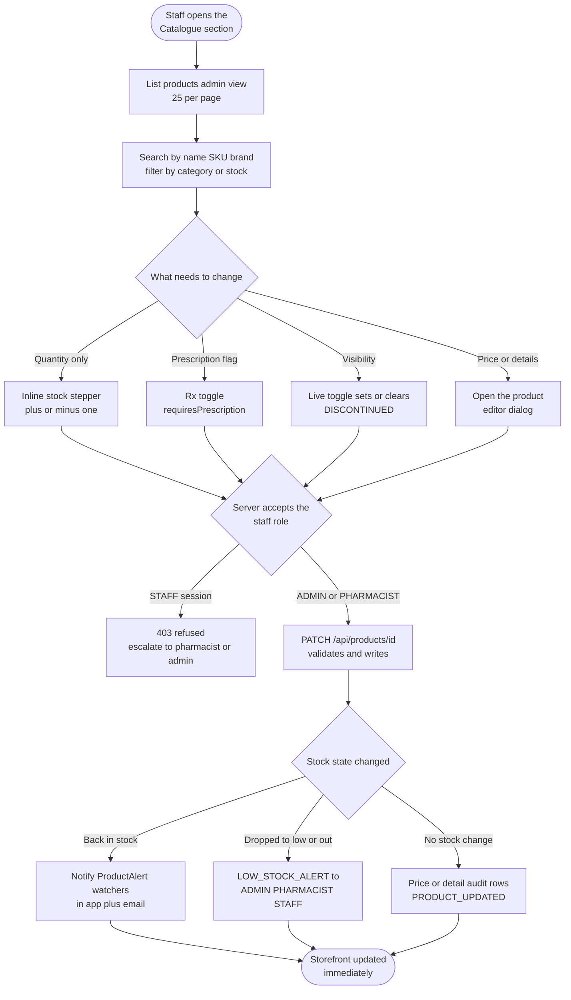

# A07 — Update products and stock

The Catalogue section is the day-to-day inventory surface: find a listing by name, SKU, brand or category, nudge stock with inline steppers, flip the prescription flag, and open the full editor for prices, pack details and photos. Every change goes live on the storefront immediately and lands in the audit log. One boundary matters before anything else: the section is visible to all staff roles, but the write endpoints behind it accept only ADMIN and PHARMACIST sessions — a counter-STAFF click on an edit control is refused by the server (journey T02 documents this gap honestly).

| Metadata | Value |
| --- | --- |
| Primary actor | Staff role in the UI; writes require ADMIN or PHARMACIST |
| Secondary actors | Admin (product deletion), Customer (storefront reader, stock-alert watcher) |
| Functional area | Catalogue and inventory |
| Entry point | `/admin?section=catalogue` — `catalogue-section.tsx` |
| Status | Implemented — verified against code |
| Stock statuses | `IN_STOCK`, `LOW_STOCK`, `OUT_OF_STOCK`, `DISCONTINUED` (`STOCK_STATUSES`) |
| End condition | Product updated; stock fields consistent; watchers/staff alerted where thresholds crossed |

## Journey map

## Journey steps

### Step 1 — Find the product

- **User action:** The staff member opens the Catalogue section and searches by name, SKU or brand, optionally narrowing by category, stock status or sort order.
- **Location:** Filter bar in `src/components/views/admin/sections/catalogue-section.tsx`; data from `catalogApi.products({ admin: "yes", … })` → `GET /api/products?admin=yes`.
- **Destination:** A paged table (25 per page) with image, product, SKU, category, price, stock stepper and status badge, Rx switch, Live switch and edit/delete actions.
- **Purpose:** Locate the exact listing that needs maintenance.
- **System behaviour:** The admin view of the products endpoint requires a staff session (ADMIN, PHARMACIST or STAFF — the section is read-only for STAFF in practice). Search terms are split per word and matched case-insensitively against name, brand, SKU, description, pack size, usage info, warnings and category name; `stockStatus` filters by the four statuses; sorts include name, date and stock quantity. Discontinued rows render dimmed; out-of-stock rows are highlighted.
- **Outcome:** The target product row is on screen with its current price, quantity and stock status.
- **Next step:** Choose the quickest change surface.
- **Alternative paths:** When the catalogue is empty the empty state offers Add product (admin-only); a failed load shows an inline error with Retry.

### Step 2 — Adjust stock with the inline stepper

- **User action:** The staff member clicks the plus or minus button next to a product's quantity to record a unit-level stock movement without opening the editor.
- **Location:** Stock cell in `catalogue-section.tsx` (`adjustStock`); `adminApi.updateProduct(id, { stockQty, stockStatus })` → `PATCH /api/products/[id]`.
- **Destination:** The row's quantity and stock badge update immediately.
- **Purpose:** Fast shelf-keeping — receiving or dispensing single units.
- **System behaviour:** The client clamps the new quantity at zero and computes the accompanying status with a local `LOW_STOCK_THRESHOLD` of 10 (≤ 0 → `OUT_OF_STOCK`, ≤ 10 → `LOW_STOCK`, else `IN_STOCK`) and sends both fields. Server-side, `stockQty` must be a non-negative integer; when a change arrives without an explicit status the server instead recomputes from the product's own `lowStockThreshold` (schema default 5). The PATCH route accepts only ADMIN and PHARMACIST sessions — a STAFF attempt returns 403.
- **Outcome:** Quantity and status are persisted and visible on the storefront at once.
- **Next step:** Continue with the next row, or let the threshold alerts fire.
- **Alternative paths:** For larger receipts or corrections, the editor dialog (Step 4) takes an absolute quantity instead of a delta.

### Step 3 — Toggle Rx requirement or storefront visibility

- **User action:** The staff member flips the Rx switch (customers must upload a prescription) or the Live switch (storefront visibility) directly in the row.
- **Location:** Rx and Live switches in `catalogue-section.tsx`; both call `PATCH /api/products/[id]` with `requiresPrescription` or `stockStatus`.
- **Destination:** The flag changes and the row reflects it.
- **Purpose:** Re-classify a medicine or hide a listing without deleting it.
- **System behaviour:** `requiresPrescription` must be a boolean (400 otherwise). "Live off" sends `stockStatus: "DISCONTINUED"`, which the server pairs with `active: false`; switching it back on recomputes a live status from the current quantity and reactivates the product. Reactivating a previously out-of-stock product into `IN_STOCK`/`LOW_STOCK` triggers the back-in-stock fan-out (Step 5).
- **Outcome:** The product's compliance classification or visibility changes instantly; the storefront catalogue and product page follow.
- **Next step:** None — this is a terminal quick action.
- **Alternative paths:** Deletion is deliberately not offered here: the Delete button is admin-only in the UI, and the DELETE route (`requireStaff(["ADMIN"])`) converts referenced products to `DISCONTINUED` rather than removing them, preserving order history.

### Step 4 — Edit details and pricing in the editor

- **User action:** The staff member opens the editor (pencil icon or by clicking the price) and updates name, SKU, category, brand, pack size, price, compare-at price, stock quantity and status, description, usage info, warnings, photo and the prescription flag, then saves.
- **Location:** `ProductEditorDialog` in `catalogue-section.tsx`; edit mode calls `PATCH /api/products/[id]`.
- **Destination:** The dialog closes and the row updates with the saved values.
- **Purpose:** Make the substantive corrections a stepper cannot.
- **System behaviour:** The client validates before submit: name ≥ 2 characters, a chosen category, price > 0, compare-at price strictly greater than price when present, stock a non-negative whole number. The server re-validates each field (name 2–160; description trimmed to 5,000; image must pass `managedImage` — an owned `/images/…` path or an HTTPS URL on the configured `R2_PUBLIC_URL` origin; `compareAtPrice` must remain above the effective price, including the existing value when only price changes). Successful saves write `PRICE_UPDATE` and/or `STOCK_UPDATE` audit rows when the value actually moved, plus a `PRODUCT_UPDATED` row.
- **Outcome:** The listing reflects the new details on the storefront immediately.
- **Next step:** Verify the customer-facing result (journey P03) if the change is significant.
- **Alternative paths:** The photo picker offers the curated gallery, previously uploaded product photos (reusable), a new upload (10 MB image cap, via the `products` upload folder — ADMIN/PHARMACIST only) or a pasted managed URL; an invalid image is rejected with a 400 before anything is saved.

### Step 5 — Threshold alerts fire automatically

- **User action:** None — this step records what the system does after a stock-changing save.
- **Location:** Back-in-stock and low-stock blocks in `PATCH /api/products/[id]`.
- **Destination:** Customer in-app/email notifications and a staff notification.
- **Purpose:** Close the inventory loop without manual outreach.
- **System behaviour:** When a product transitions from `OUT_OF_STOCK` or inactive into `IN_STOCK`/`LOW_STOCK`, every pending `ProductAlert` watcher (journey C07) is notified in-app with an email template and their row is stamped `notifiedAt`. When a previously healthy product drops to `LOW_STOCK`/`OUT_OF_STOCK` or below its `lowStockThreshold`, a `LOW_STOCK_ALERT` notification goes to ADMIN, PHARMACIST and STAFF with current quantity and threshold. Both use the shared notification pipeline (journey SYS-10) for channel delivery.
- **Outcome:** Customers who asked to be told learn the product is back; staff learn the shelf needs attention.
- **Next step:** Restock follows through procurement; the cycle repeats.
- **Alternative paths:** If notification delivery fails, the product update itself is already committed; the pipeline retries channel delivery independently.

## Decision points

| Decision | Branches | Enforced by/where |
| --- | --- | --- |
| Who may write | ADMIN/PHARMACIST accepted; STAFF session → 403 despite visible controls | `requireStaff(["ADMIN", "PHARMACIST"])` in `PATCH /api/products/[id]` |
| Stock status derivation | Explicit status honored; qty-only change recomputed from the product's `lowStockThreshold` (default 5); stepper sends a client-computed status using threshold 10 | stockQty/stockStatus block in the PATCH route; `stockStatusForQty` in the section |
| Visibility semantics | `DISCONTINUED` ⇒ `active: false` (hidden); any live status reactivates | stockStatus block in the PATCH route |
| Price integrity | `compareAtPrice` must exceed the effective sale price, including against the stored value | compareAt validation in the PATCH route |
| Delete vs discontinue | Referenced by orders → soft-discontinued; unreferenced → deleted (ADMIN only) | DELETE handler in `src/app/api/products/[id]/route.ts` |
| Back-in-stock fan-out | Only on OUT_OF_STOCK/inactive → IN_STOCK/LOW_STOCK transitions | `becameAvailable` guard in the PATCH route |
| Stock field authority | `stockQty` is the sellable authority; `stock` is the legacy/POS counter; availability = max 0 of min of both minus safety buffer and virtual reservation | `docs/database/schema-overview.md` stock authority; `InventoryGuard.getAvailableStock` in `src/lib/inventory-guard.ts` |

## Error and recovery paths

- **STAFF write refused (403):** the controls are visible to every staff role but the endpoint is not — this is the server boundary doing its job; a pharmacist or admin performs the edit (journey T02).
- **Invalid price or compare-at (400):** zero/negative price or a compare-at not above the sale price is rejected; the dialog shows the field error and nothing is saved.
- **Invalid stock quantity (400):** fractional or negative quantities are rejected; the editor requires a whole number ≥ 0.
- **Unmanaged image (400):** images must be an owned site image or an upload on the configured public R2 origin; pasting an arbitrary external URL is refused.
- **Categories failed to load:** the editor asks the user to close and retry; products can still be browsed.
- **Batch-level corrections are not possible here:** `ProductBatch` rows (lot numbers, expiry, FEFO sellable-stock computation) are written by the BandaGo POS sync, not by this UI — batch data is corrected upstream in the POS and re-synced (journey SYS-08). Per-batch FEFO deduction at order time is not implemented; the web flow moves aggregate counters only.
- **Low-stock threshold cannot be edited in the UI:** `lowStockThreshold` (default 5) is read by the server's status recompute but has no field in the editor — adjusting it requires a database change, an honest limitation of the current surface.

## Traceability

| Concern | Implementation reference |
| --- | --- |
| Section UI, steppers, toggles, editor | `src/components/views/admin/sections/catalogue-section.tsx` |
| Product list (admin view) and search | `GET /api/products` in `src/app/api/products/route.ts` |
| Update endpoint and guards | `PATCH /api/products/[id]` in `src/app/api/products/[id]/route.ts` |
| Delete / soft-discontinue | `DELETE /api/products/[id]` in the same route file |
| Stock statuses and labels | `STOCK_STATUSES` / `STOCK_LABELS` in `src/lib/constants.ts` |
| Stock field authority and availability formula | `src/lib/inventory-guard.ts`; stock-authority section of `docs/database/schema-overview.md` |
| Batches and FEFO | `ProductBatch` model (`prisma/schema.prisma`); `docs/workflows/inventory-lifecycle.md` |
| Back-in-stock alerts | `ProductAlert` model; notification block in the PATCH route |
| Image validation | `managedImage` in `src/lib/security/service.ts` |
| Uploads for product photos | `POST /api/upload` (folder `products`, ADMIN/PHARMACIST only) |
| Inventory workflow reference | `docs/workflows/inventory-lifecycle.md` |

## Related journeys and documents

- **A08** — creating the product in the first place (admin journey)
- **A09** — bulk catalogue changes via CSV import
- **C07** — the customer-side back-in-stock subscription this journey notifies
- **SYS-08** — the BandaGo sync that writes `stock`, `stockQty`, batches and expiry from the POS
- **T02** — the ADMIN/PHARMACIST-vs-STAFF write boundary explained
- Docs: [inventory lifecycle](../../workflows/inventory-lifecycle.md) · [storefront and catalogue](../../features/storefront-and-catalogue.md) · [schema overview — stock authority](../../database/schema-overview.md)
