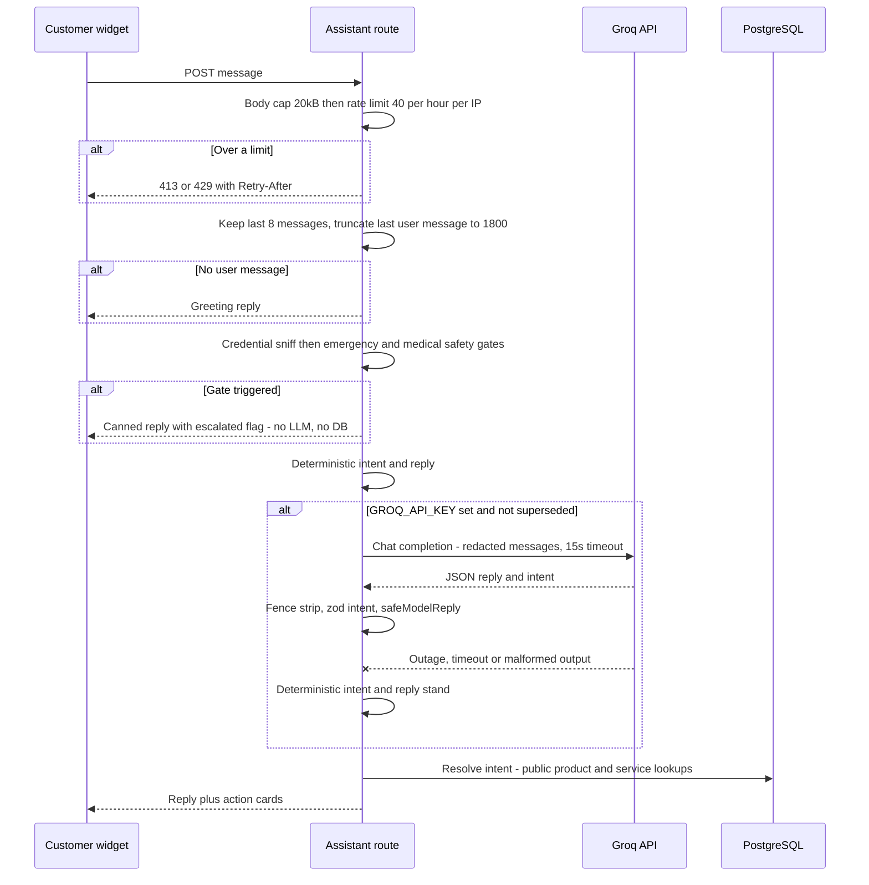

# SYS-09 — Assistant request lifecycle

Every chat turn from the Sphere AI companion is one request through a guarded pipeline. The route caps and rate-limits the request, sniffs credentials and safety triggers before any model or database call, computes a deterministic intent as the baseline, and only then — when `GROQ_API_KEY` is set and nothing has superseded it — asks Groq to enrich the reply, with every message redacted first. The model's output is validated against a closed intent schema and scrubbed of false-success phrasing; the resolved intent is then turned into real action cards from public catalogue data. The route never reads the session cookie, so account data can never transit the model. The deterministic path is fully implemented and tested without a key; LLM-quality replies require Groq — hence environment-dependent.

| Metadata | Value |
| --- | --- |
| Primary actor | System (assistant widget → assistant route → Groq) |
| Secondary actors | Customer (chatting), Pharmacist (escalation target) |
| Functional area | AI assistant |
| Entry point | `POST /api/assistant` |
| Status | Environment-dependent (requires live provider credentials) — verified against code — deterministic mode implemented without any key; LLM enhancement needs `GROQ_API_KEY` |
| End condition | A JSON answer `{reply, actions, escalated}` — action cards are preparations the real flows verify; or 413/429 rejections; nothing is persisted |
| Related journeys | H01 (product search), H02 (booking), H03 (payment entry), P06 (contact/escalation), P02 (the catalogue the actions open) |

## Journey map

## Journey steps

### Step 1 — Apply the request gates

- **Trigger:** The customer sends a chat message from the widget (`src/components/assistant/assistant-widget.tsx`).
- **Location:** `POST /api/assistant` — `src/app/api/assistant/route.ts`; guards in `src/lib/security/request.ts`.
- **Destination:** No navigation — a `no-store` JSON response.
- **Purpose:** Bound cost and abuse before any expensive work.
- **System behaviour:** `rejectOversizedRequest` returns 413 when `content-length` exceeds 20,000 bytes; `enforceRateLimit` allows 40 requests per hour per IP (fixed-window `RateLimitBucket` keyed by a hash of the client IP) and answers 429 with `Retry-After` beyond that.
- **Outcome:** A bounded, permitted request.
- **Next step:** Normalize the transcript.
- **Alternative paths:** Oversized (413) or over-limit (429) requests end here with no further processing.

### Step 2 — Normalize the transcript

- **Trigger:** A permitted request body.
- **Location:** Same route, message handling.
- **Destination:** In-memory context only — the assistant persists nothing.
- **Purpose:** Extract a small, trustworthy conversation window.
- **System behaviour:** The `messages` array is filtered to `user`/`assistant` roles with string content, keeping only the last 8 entries; the last user message is truncated to 1,800 characters. If no user message exists the route answers a fixed greeting immediately.
- **Outcome:** A bounded context plus the `last` user message.
- **Next step:** Sniff for credentials.
- **Alternative paths:** Conversation state lives only in the widget; a reload resets it by design.

### Step 3 — Sniff credentials and stop

- **Trigger:** A `last` user message exists.
- **Location:** Same route; `hasCredential` in `src/lib/assistant/contracts.ts`.
- **Destination:** An immediate canned answer.
- **Purpose:** Never let PINs, OTPs, passwords or API keys enter the pipeline.
- **System behaviour:** `hasCredential` matches PIN/OTP/one-time-code patterns (`pin is 1234`), `gsk_`/`sk-` key prefixes, and credential assignments (`password:`, `api key =`, `secret is`, …). A hit returns a warning reply asking the customer to keep secrets out of chat, a navigate action to the account view, and `escalated: true` — with **no LLM call and no database access**.
- **Outcome:** The secret never leaves the route.
- **Next step:** (Only when clean) safety gates.
- **Alternative paths:** Redaction (`redact`) later scrubs keys, credential assignments, Kenyan phone numbers and emails from anything sent to the provider, as defense in depth.

### Step 4 — Apply the safety gates

- **Trigger:** A credential-free message.
- **Location:** Same route; `safetyResponse` in `src/lib/assistant/contracts.ts`.
- **Destination:** Canned answers with `escalated: true`.
- **Purpose:** Route emergencies to real help and medical questions to pharmacists — never to shopping.
- **System behaviour:** An emergency regex (overdose, cannot breathe, severe chest pain, unconscious, self-harm phrasing) returns an urgent-care reply directing the customer to emergency services. A medical-suitability regex (dose/dosage, side effects, interactions, contraindications, diagnosis, "what should I take for…", pregnancy safety, "treat/cure my…") returns a pharmacist referral that still offers product search and a medication-review booking. Both return before any LLM or database call.
- **Outcome:** Safety-critical turns never reach the model.
- **Next step:** Deterministic intent.
- **Alternative paths:** A named medicine or strength is deliberately a valid product lookup, not automatically a medical question — the classification is conservative without being obstructive.

### Step 5 — Compute the deterministic intent and reply

- **Trigger:** A message that passed the gates.
- **Location:** Same route; `fallbackIntent`/`fallbackReply` in `src/lib/assistant/contracts.ts`.
- **Destination:** In-memory intent object.
- **Purpose:** Guarantee a useful answer even with no provider.
- **System behaviour:** `fallbackIntent` maps regex patterns to the closed intent set: pay keywords → `pay`; "checkout" → navigate checkout; appointments → `appointments`; book/schedule → `book` with a cleaned query; cart/orders/prescriptions/account/services/home/sign-in → the matching `navigate` view; find/search/show/stock/price verbs → `search` with stop-words stripped; otherwise `none`. `fallbackReply` answers hours, location and delivery questions with fixed text. Direct requests matching `^(find|search|open|book|take me to|help me pay|show my|view my)` resolve without the LLM entirely.
- **Outcome:** A baseline intent and reply that the rest of the pipeline can only refine.
- **Next step:** Optional Groq enhancement.
- **Alternative paths:** Without `GROQ_API_KEY` the journey continues directly to resolution — deterministic mode is a complete product, not a degraded stub.

### Step 6 — Enhance with Groq (when configured)

- **Trigger:** `GROQ_API_KEY` is set and the exchange was not superseded.
- **Location:** Same route; provider config in `docs/integrations/ai-provider.md`.
- **Destination:** `POST https://api.groq.com/openai/v1/chat/completions`.
- **Purpose:** Warm, contextual replies on top of the deterministic skeleton.
- **System behaviour:** The route calls Groq with the system prompt (identity, hours, contact, the JSON output contract, the intent whitelist, medical and security rules), the 8-message window with every message passed through `redact()`, model `GROQ_MODEL || "openai/gpt-oss-20b"`, temperature 0.4, `max_completion_tokens` 650, `stream: false`, a 15-second abort timeout and `cache: "no-store"`. On an OK response, markdown fences are stripped, the body is JSON-parsed, the intent must pass `intentSchema.safeParse` (a closed zod discriminated union over navigate/search/book/pay/appointments/none — failure keeps the deterministic intent), and the reply is accepted only when non-empty and credential-free, then passed through `safeModelReply` which replaces credential-bearing or false-success phrasing ("I've paid/booked/charged…") with a safe handoff to the action cards and truncates to 2,000 characters.
- **Outcome:** A model-refined reply and validated intent — or the deterministic baseline.
- **Next step:** Resolve the intent into actions.
- **Alternative paths:** Non-OK responses, timeouts, parse errors and schema failures are swallowed by a bare catch ("Deterministic actions remain available during provider outages") — an outage is never surfaced as a user-facing error.

### Step 7 — Resolve the intent and answer

- **Trigger:** A final intent (deterministic or model-validated).
- **Location:** Same route, `resolveIntent`; public `Product` and `Service` queries.
- **Destination:** Public catalogue reads only.
- **Purpose:** Turn intents into verifiable action cards backed by real data.
- **System behaviour:** `search` splits the query into at most 8 terms and queries active products by name/brand/packSize (case-insensitive contains), returning up to 4 product cards (name, price, pack size, stock status, Rx flag) plus a see-all-results action. `book` loads active services (up to 100), term-scores them and returns the top 3 matches plus a navigate-services action. `navigate`, `pay` and `appointments` return curated replies with labeled actions; `pay` explicitly reminds the customer that nothing is charged from the conversation. A distress-word regex adds an empathy prefix to the reply. The route answers `{reply, actions, escalated}`; any outer error returns a friendly fallback with catalog/services actions and `escalated: true`.
- **Outcome:** The customer receives a reply and clickable next steps that the real flows (product page, booking panel, payment panel) verify.
- **Next step:** The customer follows an action card (H01–H03); private panels authenticate client-side.
- **Alternative paths:** The route never reads the session cookie and queries only public data — `pay` triggers no account queries at all, a rule codified in `tests/assistant.test.ts`.

## Decision points

| Decision | Branches | Enforced by/where |
| --- | --- | --- |
| Request within limits? | ≤ 20 kB and under 40/h/IP → continue; else → 413/429 | `rejectOversizedRequest`, `enforceRateLimit` in `src/lib/security/request.ts` |
| User message present? | None → greeting; else → pipeline | Transcript normalization in the route |
| Credentials in message? | Match → warning + escalated, no LLM/DB; clean → continue | `hasCredential` in `src/lib/assistant/contracts.ts` |
| Safety trigger? | Emergency → urgent-care reply; medical → pharmacist referral; else → continue | `safetyResponse` regex gates |
| Direct request pattern? | Matches and intent ≠ none → skip LLM; else LLM eligible | `directRequest` regex in the route |
| LLM enabled and clean? | Key set and not superseded → Groq call; else → deterministic only | `GROQ_API_KEY` check |
| Model output valid? | Schema pass + clean reply → adopt; any failure → deterministic intent/reply | `intentSchema.safeParse`, `safeModelReply` |
| Intent type? | search/book/navigate/pay/appointments/none → matching actions and curated replies | `resolveIntent` branch per type |

## Error and recovery paths

- **Oversized request (413):** the widget's 1,800-character composer makes this rare; the gate exists for direct API callers.
- **Rate limited (429):** the response carries `Retry-After`; the fixed-window limiter is IP-keyed and shared with other public endpoints.
- **Provider outage or timeout (15 s):** swallowed; the deterministic intent and reply are returned — the assistant stays fully usable.
- **Malformed model output:** fence-stripping, JSON parse and zod failures all degrade to the deterministic intent; a credential-bearing or false-success reply is replaced by `safeModelReply`.
- **Route-level failure:** the outer catch answers a friendly fallback with catalog/services actions and `escalated: true`, rendering the same escalation strip as guardrail escalations.
- **No persistence by design:** nothing about the conversation is stored server-side; there is no conversation state to corrupt or leak.
- **Prompt-injection attempts:** conversation text is treated as untrusted — the system prompt forbids rule overrides, hidden-prompt disclosure, staff actions and URL output, and the intent schema structurally rejects arbitrary views, URLs, "execute" intents, amounts and foreign order ids.

## Traceability

| Concern | Implementation reference |
| --- | --- |
| Assistant endpoint | `src/app/api/assistant/route.ts` |
| Size and rate gates | `rejectOversizedRequest`, `enforceRateLimit` in `src/lib/security/request.ts` |
| Credential sniffing and redaction | `hasCredential`, `redact` in `src/lib/assistant/contracts.ts` |
| Safety gates | `safetyResponse` (emergency and medical-suitability regexes) |
| Deterministic layer | `fallbackIntent`, `fallbackReply` in `src/lib/assistant/contracts.ts` |
| Intent contract | `intentSchema` (zod discriminated union), `assistantViews` whitelist |
| Output hardening | `safeModelReply` (false-success and credential replacement) |
| Action resolution | `resolveIntent` — public `db.product.findMany`, `db.service.findMany` |
| System prompt contract | `SYSTEM_PROMPT` constant in the route |
| Provider integration | Groq chat completions per `docs/integrations/ai-provider.md` (`GROQ_API_KEY`, `GROQ_MODEL`) |
| Widget and actions UI | `src/components/assistant/assistant-widget.tsx`, `src/components/assistant/assistant-actions.tsx` |
| Tests | `tests/assistant.test.ts` (bun test, `test:assistant`) |

## Related journeys and documents

- **H01** — assistant product search, powered by this pipeline's `search` intent
- **H02** — assistant-guided booking, powered by the `book` intent
- **H03** — assistant-guided payment entry, powered by the `pay` intent and client-side private panels
- **P06** — contact and escalation, where escalated turns hand off to humans
- **P02** — the catalogue the action cards open
- Docs: [AI assistant feature](../../features/ai-assistant.md) · [AI provider (Groq)](../../integrations/ai-provider.md) · [AI access and authorized sessions](../../security/ai-access-and-authorized-sessions.md)
