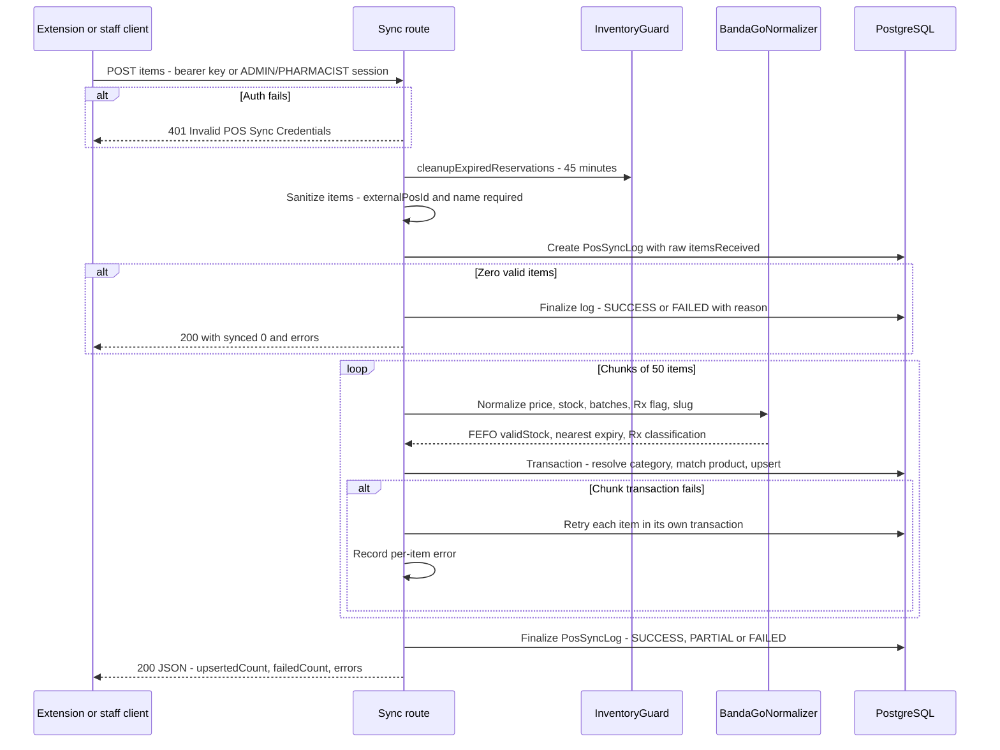

# SYS-08 — BandaGo inventory ingestion

The physical pharmacy runs its counter sales and stock in BandaGo, an iDempiere-based POS. This journey is the server-side receiving end: a browser extension (external to this repo) pushes product, price, stock and batch data to the sync route — or staff upload a CSV, which delegates into the same handler. The route treats every payload as untrusted: it re-parses numbers, classifies prescription requirements under Kenya PPB rules, applies first-expired-first-out (FEFO) batch hygiene so expired stock can never sell online, preserves staff-curated images and Rx flags, and upserts in chunked transactions with per-item isolation so one poisoned item cannot ruin a batch. Every run is audited in `PosSyncLog`. The ingestion code is implemented and testable locally; end-to-end operation depends on the live BandaGo side and its extension — hence environment-dependent.

| Metadata | Value |
| --- | --- |
| Primary actor | System (BandaGo POS → Sphere ingestion routes) |
| Secondary actors | Pharmacist, Admin (staff-session uploads, CSV imports, telemetry) |
| Functional area | Inventory and catalogue |
| Entry point | `POST /api/integrations/bandago/sync` (machine bearer or staff session) |
| Status | Environment-dependent (requires live provider credentials) — verified against code — routes and normalizer implemented; live flow needs BandaGo, the extension and `BANDAGO_SYNC_API_KEY` |
| End condition | 200 JSON `{success, upsertedCount, failedCount, durationMs, errors}` — even partial failures answer 200 — with the `PosSyncLog` row finalized as SUCCESS, PARTIAL or FAILED |
| Related journeys | A07 (staff stock management), A09 (CSV product import), P02 (the catalogue customers browse), SYS-03 (reservation release pre-step), O02 (orders that consume synced stock) |

## Journey map

## Journey steps

### Step 1 — Authenticate the push

- **Trigger:** The `api_data_transformer` Chrome extension (running in the pharmacist's browser, sniffing BandaGo responses) POSTs a JSON batch, or a staff member triggers an import from the admin POS hub.
- **Location:** `POST /api/integrations/bandago/sync` — `src/app/api/integrations/bandago/sync/route.ts`.
- **Destination:** No navigation — a JSON response for the caller.
- **Purpose:** Allow machine-to-machine pushes and human uploads through one dual-mode gate.
- **System behaviour:** The route accepts either `Authorization: Bearer <BANDAGO_SYNC_API_KEY>` (plain string comparison) or an active staff session with role `ADMIN` or `PHARMACIST` (via `requireStaff` from `src/lib/session.ts`). Neither passes → 401 "Unauthorized: Invalid POS Sync Credentials".
- **Outcome:** An authenticated ingestion request.
- **Next step:** Release stale reservations.
- **Alternative paths:** The CSV route (`src/app/api/integrations/bandago/csv-import/route.ts`) uses the same dual auth and delegates internally to this handler. Known credential-handling defects (browser-exposed `NEXT_PUBLIC_POS_SYNC_SECRET`, a hard-coded fallback secret in the CSV route, example-file defaults) are documented in the integration doc as requiring remediation.

### Step 2 — Release expired virtual reservations

- **Trigger:** An authenticated push, before any item processing.
- **Location:** `InventoryGuard.cleanupExpiredReservations(45)` in `src/lib/inventory-guard.ts`.
- **Destination:** Order and product tables.
- **Purpose:** Free stock locked by abandoned checkouts so the incoming physical truth is not masked.
- **System behaviour:** The guard finds unpaid, un-released orders older than 45 minutes, cancels them with version-guarded claims, clamps `virtualReservedStock` with raw SQL (`GREATEST(0, reserved − qty)`), restores physical stock and re-credits points. A cleanup failure only logs a warning — the sync continues.
- **Outcome:** Reservations older than 45 minutes are released; sync proceeds regardless.
- **Next step:** Sanitize the items.
- **Alternative paths:** The same cleanup runs in-process at checkout; the TTL-driven cron (SYS-03) remains the backstop for physical holds.

### Step 3 — Sanitize items and normalize the trigger

- **Trigger:** The payload body.
- **Location:** Same route; `BandaGoNormalizer` parsers in `src/lib/bandago-normalizer.ts`.
- **Destination:** In-memory item list plus an `errors[]` array.
- **Purpose:** Treat the payload as untrusted — reject items without identity, re-parse every number.
- **System behaviour:** Each item's identifier is resolved as `externalPosId ?? id ?? uu ?? M_Product_UU` (iDempiere vocabulary) and trimmed; the name is required. Items missing either are pushed onto `errors[]` and skipped. Prices pass through `parseNumber` (strips currency symbols and commas — "KSh 3,400" parses), stock through `parseInteger` (clamped to non-negative integers). The `trigger` field is normalized to one of `EXTENSION_STREAM`, `BACKGROUND_POLL`, `CSV_IMPORT`, `MANUAL_RECONCILE`, defaulting to `EXTENSION_STREAM`.
- **Outcome:** A sanitized `IngestedProductItem[]` plus per-item rejects.
- **Next step:** Open the audit log.
- **Alternative paths:** A packet where every item is invalid finalizes the log as FAILED ("All items provided were invalid or lacked required identifiers"); an empty packet logs SUCCESS with "Zero items provided in synchronization packet" — both return 200 with counts.

### Step 4 — Open the PosSyncLog audit row

- **Trigger:** Sanitization finished.
- **Location:** Same route; `PosSyncLog` model (`prisma/schema.prisma`, table `pos_sync_logs`).
- **Destination:** One telemetry row created up-front.
- **Purpose:** Make every run observable from the admin POS hub (`/api/admin/pos-status`, `pos-sync-section.tsx`).
- **System behaviour:** The row is created with `posSource: BANDAGO`, the trigger, status `SUCCESS` initially, `itemsReceived` set to the **raw** item count (before validation) and `startedAt`. It is finalized later with `itemsUpserted`, `itemsFailed`, `durationMs`, `completedAt` and a `details` JSON whose error entries are capped at 50.
- **Outcome:** A run under audit, whatever happens next.
- **Next step:** Resolve categories and match products.
- **Alternative paths:** A fatal pipeline error later finalizes the log as FAILED with a `fatalError` detail and answers 500.

### Step 5 — Resolve categories and match each product

- **Trigger:** A chunk transaction begins for up to 50 items.
- **Location:** Same route, `processSingleItem`; `Category` and `Product` models.
- **Destination:** Database lookups and upserts inside the chunk transaction.
- **Purpose:** Map every POS product onto exactly one catalogue row, without collisions or data loss.
- **System behaviour:** Categories are cached in memory; unknown slugs are auto-created (Title Case name, `Pill` icon) via upsert. Product matching runs in order: exact `externalPosId` unique lookup; otherwise `externalPosId` OR `slug` (with/without the external-id suffix) OR case-insensitive name match limited to legacy rows with `externalPosId = null` — a legacy match gets **linked** (its `externalPosId` is set) and keeps its slug. Slug collisions owned by another product are disambiguated with an 8-character externalPosId-derived suffix, then a random 4-character suffix. Incoming SKUs already owned by a different product re-suffix the old row (`-{id.slice(0,6)}`) so the incoming row can claim the clean SKU.
- **Outcome:** A target product row (existing or to-be-created) with a unique slug and SKU.
- **Next step:** Upsert with FEFO and PPB rules.
- **Alternative paths:** The category cache makes repeated slugs cheap; the collision ladder guarantees the upsert's `where: { externalPosId }` is always well-defined.

### Step 6 — Upsert with FEFO and PPB rules

- **Trigger:** A matched item inside the chunk transaction.
- **Location:** Same route; `BandaGoNormalizer.processBatches`/`classifyRequiresPrescription`; `Product` and `ProductBatch` models.
- **Destination:** Product upsert plus batch replacement.
- **Purpose:** Make expired stock unsellable, keep Rx flags honest, and never overwrite staff-curated data.
- **System behaviour:** `processBatches` aggregates duplicate batch numbers across warehouse locators (quantities summed, earliest expiry wins; a missing expiry defaults to now + 365 days), flags batches with `expiry <= now` as `isExpired`, and excludes them from `validStock`; `nearestExpiryDate` is the earliest valid expiry and `hasNearExpiry` flags under 90 days. With batches present, `stockQty` = FEFO-valid stock; without batches it is the raw stock, or 0 if the item-level expiry has passed. `classifyRequiresPrescription` returns true for an explicit flag, an Rx/POM/Prescription category or name, or a ~30-item keyword list of prescription-only medicines — and the result is OR'd with the existing flag, so a sync can **raise** but never lower the Rx requirement. Custom local images under `/images/products/*` (other than the generic placeholder) are never overwritten. `inStock`/`stockStatus` are computed from effective stock after subtracting `virtualReservedStock` (`OUT_OF_STOCK` / `LOW_STOCK` at ≤ 5 / `IN_STOCK`). Batch persistence: `stock === 0` deletes all batches; a non-empty `batches[]` replaces them (blank batch numbers filtered); no batches array leaves existing batches untouched.
- **Outcome:** The catalogue row reflects POS truth under PPB constraints; `lastSyncedAt` is stamped.
- **Next step:** Continue the chunk loop; finalize.
- **Alternative paths:** New products are created with `posSource: BANDAGO`, `safetyStockBuffer: 2`, the incoming image or the generic placeholder, and an empty description.

### Step 7 — Chunk, fall back, finalize and respond

- **Trigger:** All items processed or failed.
- **Location:** Same route, chunk loop and finalization.
- **Destination:** `PosSyncLog` finalization and the HTTP response.
- **Purpose:** Bound transaction size, isolate poison items, and report honestly.
- **System behaviour:** Items are processed in chunks of 50 inside `prisma.$transaction` (`maxWait` 10 s, `timeout` 30 s). A chunk failure falls back to per-item isolated transactions; individual failures accumulate in `errors[]` (externalPosId, name, message). The log is finalized as `SUCCESS` (no errors), `PARTIAL` (some) or `FAILED` (every item failed), and the response is **200 even for partial failure** — `{success, upsertedCount, failedCount, durationMs, timestamp, errors}` with at most 20 errors inline. A global catch finalizes the log as FAILED and answers 500.
- **Outcome:** A converged catalogue and an auditable run.
- **Next step:** Customers see fresh stock (P02); orders reserve against it (O02).
- **Alternative paths:** Automation must read `success`/`failedCount`, not the status code. FEFO applies at ingestion only — batch-level deduction per pick is not implemented (a documented limitation).

## Decision points

| Decision | Branches | Enforced by/where |
| --- | --- | --- |
| Caller authenticated? | Bearer key or ADMIN/PHARMACIST session → run; else → 401 | Dual auth in the sync and CSV routes; `requireStaff` in `src/lib/session.ts` |
| Item valid? | `externalPosId` + name present → ingest; else → errors[] | Sanitization loop in the route |
| Trigger recognized? | One of the four enum values → use it; else → `EXTENSION_STREAM` | `validTriggers` check |
| Product matched? | externalPosId → slug/baseSlug → legacy name (externalPosId null) → link and keep slug; slug/SKU collisions disambiguated with suffixes; no match → create | Matching ladder and collision handling in `processSingleItem` |
| Batch expired? | `expiry <= now` → `isExpired`, excluded from `validStock`; valid → counted, nearest expiry tracked | `processBatches` in `src/lib/bandago-normalizer.ts` |
| Rx classification? | Flag/category/keyword → true; result OR'd with existing flag (never downgraded) | `classifyRequiresPrescription` |
| Batch payload shape? | `stock === 0` → delete all; batches present → replace; absent → keep existing | Batch persistence rules in the route |
| Chunk failure? | Whole-chunk transaction → per-item retry; item error recorded | Chunk loop with fallback |

## Error and recovery paths

- **Unauthorized (401):** neither bearer key nor staff session passed; verify `BANDAGO_SYNC_API_KEY` and staff role. Rotate the key if it ever ran with the example value (documented credential defects).
- **Invalid items:** rejected individually into `errors[]`; the rest of the batch proceeds — one bad item never crashes the run.
- **Chunk transaction failure:** the chunk is retried item-by-item in isolated transactions; only the true offenders fail.
- **Partial failure (HTTP 200):** callers must inspect `failedCount`/`errors`; the `PosSyncLog` row records `PARTIAL` with capped error details for the admin hub.
- **Fatal pipeline error (500):** the log is finalized FAILED with a `fatalError` detail; the extension's next push is a fresh, fully idempotent run (externalPosId-keyed upserts converge).
- **Idempotence:** repeated pushes converge to the same state — upserts by `externalPosId`, not request dedupe.
- **Security remediation owed:** browser-exposed `NEXT_PUBLIC_POS_SYNC_SECRET`, the CSV route's hard-coded fallback secret, and plain `===` bearer comparisons are documented as requiring remediation; operators must compensate until fixed.

## Traceability

| Concern | Implementation reference |
| --- | --- |
| Sync endpoint | `src/app/api/integrations/bandago/sync/route.ts` |
| CSV import (delegates to sync) | `src/app/api/integrations/bandago/csv-import/route.ts`, `parseCsv` in `src/lib/bandago-normalizer.ts` |
| Auth | `BANDAGO_SYNC_API_KEY` bearer or `requireStaff(['ADMIN','PHARMACIST'])` in `src/lib/session.ts` |
| Reservation pre-cleanup | `InventoryGuard.cleanupExpiredReservations(45)` in `src/lib/inventory-guard.ts` |
| Normalization and FEFO | `BandaGoNormalizer` (`parseNumber`, `parseInteger`, `slugify`, `processBatches`) in `src/lib/bandago-normalizer.ts` |
| Rx classification (PPB) | `BandaGoNormalizer.classifyRequiresPrescription` |
| Telemetry models | `PosSyncLog`, `ProductBatch`, `Product`, `Category` in `prisma/schema.prisma` |
| Chunking and fallback | Chunk loop (50 items, `maxWait` 10 s, `timeout` 30 s) in the sync route |
| Admin observability | `GET /api/admin/pos-status`; `src/components/views/admin/sections/pos-sync-section.tsx` |
| Tests | `tests/bandago-pos-crm-integration.test.mjs` |
| Integration doc | `docs/integrations/bandago-pos-crm.md` |
| API contract | `openapi/sphere-api.yaml` — `POST /integrations/bandago/sync` |

## Related journeys and documents

- **A07** — staff stock and product management over the synced catalogue
- **A09** — the staff CSV import journey (the human counterpart of machine ingestion)
- **P02** — the catalogue customers browse, kept fresh by this job
- **SYS-03** — the reservation expiry job whose pre-step this sync shares
- **O02** — orders that consume the synced stock
- Docs: [BandaGo POS and CRM integration](../../integrations/bandago-pos-crm.md) · [inventory and stock](../../features/inventory-and-stock.md) · [environment variables](../../operations/environment-variables.md)
