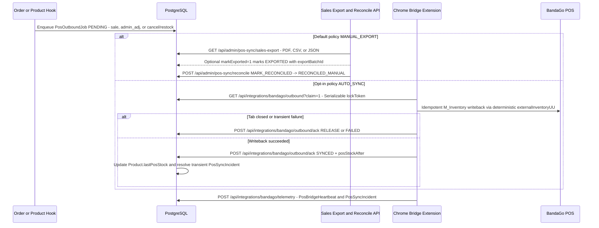

# SYS-11 — BandaGo outbound reconciliation and daily sales export

While inbound sync (`SYS-08`) keeps Sphere updated from BandaGo, online purchases and admin edits happen in Sphere first. If BandaGo is closed or sits idle between shifts, a naive inbound sync would overwrite online sales back up. This journey documents the outbound half of the bi-directional loop: Sphere queues idempotent `PosOutboundJob` ledger rows on paid/prepared orders and staff stock edits, protects those pending deductions during inbound sync (`computeReconciledStock`), and reconciles them back into BandaGo either through the **default Manual-First Daily Sales Export** (`PDF`/`CSV`/`JSON` + one-click confirmation) or **opt-in `AUTO_SYNC` writeback** executed by the external Chrome bridge (`api_data_transformer`). Bridge health and errors flow into `/api/integrations/bandago/telemetry` and the POS Error Console (`PosSyncIncident`).

| Metadata | Value |
| --- | --- |
| Primary actor | System (Order/Product hooks + Outbound reconciliation engine) |
| Secondary actors | Admin (policy & baseline cutover), Pharmacist (Daily Sales Export, manual confirmation, incident triage) |
| Functional area | Inventory and POS synchronization |
| Entry point | `enqueueOrderPosDeduction` / `enqueueAdminStockEdit` / `cancelOrderPosDeduction` → Admin → POS Sync (`pos-sync-section.tsx`) & `/api/integrations/bandago/outbound*` |
| Status | Environment-dependent — server routes, PDF generator, drift protection and Error Console implemented; live `AUTO_SYNC` writebacks depend on the external Chrome extension & open `go.bandahealth.org` tab |
| End condition | Outbound jobs resolved (`SYNCED`, `RECONCILED_MANUAL`, or `CANCELLED`), `Product.lastPosStock` updated, and transient incidents auto-resolved |
| Related journeys | SYS-08 (inbound BandaGo ingestion), O01/O02 (checkout orders), O03/O04 (payment webhooks), A07 (staff stock edits) |

## Journey map

## Journey steps

### Step 1 — Enqueue or compensate outbound POS jobs

- **Trigger:** Payment succeeds (`mpesa/callback`, `intasend/webhook`, `cash-confirm`), staff start preparing an order (`POST /api/orders/[id]/prepare`), staff edit `stockQty` (`PATCH /api/products/[id]`), or an order is cancelled, rejected, refunded, or expired (`cancel`, `orders/[id]` PATCH, `payments/refund`, `/api/cron/order-reservations`, `InventoryGuard.cleanupExpiredReservations`).
- **Location:** `src/lib/pos-reconciliation.ts` (`enqueueOrderPosDeduction`, `enqueueAdminStockEdit`, `cancelOrderPosDeduction`).
- **Destination:** `pos_outbound_jobs` (`PosOutboundJob` model).
- **Purpose:** Record every Sphere-initiated stock change once with an idempotent key so inbound syncs never erase online deductions.
- **System behaviour:** `enqueueOrderPosDeduction` groups order lines by product and inserts `ONLINE_SALE` jobs (`PENDING`, negative `qtyDelta`, `idempotencyKey = sale:{orderId}:{productId}`, deterministic UUIDv4 `externalInventoryUU`). `enqueueAdminStockEdit` records `ADMIN_STOCK_ADJUST` (`admin_adj:{productId}:{timestamp}:{newQty}`). `cancelOrderPosDeduction` marks unsynced jobs `CANCELLED` or, if an online sale already `SYNCED` or `RECONCILED_MANUAL`, inserts a compensating `REFUND_RESTOCK` job (`restock:{orderId}:{productId}`, positive `qtyDelta`).
- **Outcome:** Open `PosOutboundJob` rows exist and immediately feed `getUnreconciledOffsetsByProduct` for `SYS-08` drift protection.
- **Next step:** Jobs await either Manual Daily Sales Export or `AUTO_SYNC` writeback, depending on `PosSyncPolicy.outboundSyncMode`.
- **Alternative paths:** Admins can also manually push the current Sphere stock for any mapped product via `POST /api/admin/pos-sync/reconcile` (`QUEUE_STOCK_PUSH`).

### Step 2 — Manual-First Daily Sales Export & confirmation (`MANUAL_EXPORT` default)

- **Trigger:** Pharmacist or Admin opens Admin → POS Sync → **Sales Export & Reconciliation** and exports pending/today/range online sales.
- **Location:** `GET /api/admin/pos-sync/sales-export`, `src/lib/pdf/daily-sales-pdf.ts`, `POST /api/admin/pos-sync/reconcile`.
- **Destination:** Downloaded Zero-PHI A4 PDF, formula-safe UTF-8 BOM CSV, or JSON payload with `X-Export-Batch-Id` (`EXP-...`), followed by job status update.
- **Purpose:** Let dispensary staff enter online deductions cleanly at the BandaGo counter without requiring automated browser writebacks.
- **System behaviour:** `sales-export` (`ADMIN`/`PHARMACIST`) aggregates or itemizes `ONLINE_SALE`, `REFUND_RESTOCK`, and `ADMIN_STOCK_ADJUST` jobs without patient PII (Zero-PHI). Passing `?markExported=1` transitions `PENDING`/`FAILED` jobs to `EXPORTED` under `exportBatchId` and audits `POS_DAILY_SALES_EXPORTED`. Once entered in BandaGo, staff click **Confirm Entered in BandaGo POS** (`POST /api/admin/pos-sync/reconcile` with `action: 'MARK_RECONCILED'`), transitioning those jobs to `RECONCILED_MANUAL` and clearing the drift-protection offset.
- **Outcome:** POS and Sphere balances converge cleanly without stock resurrection or double-deduction.
- **Next step:** Subsequent `SYS-08` inbound syncs observe the updated BandaGo stock with zero pending offset.
- **Alternative paths:** If an Admin configures a fresh cutover date, `SET_BASELINE_NOW` on `/api/admin/pos-sync/reconcile` updates `reconciliationBaselineAt` and optionally closes pre-cutover open jobs.

### Step 3 — Opt-in `AUTO_SYNC` claim and acknowledgement

- **Trigger:** An `ADMIN` switches `PosSyncPolicy.outboundSyncMode` to `AUTO_SYNC` (`PUT /api/admin/pos-sync/policy`) and the Chrome bridge runs its outbound poll (every `outboundPollIntervalMinutes`, default 2 min).
- **Location:** `GET /api/integrations/bandago/outbound` and `POST /api/integrations/bandago/outbound/ack`.
- **Destination:** `PosOutboundJob` lease state and `Product.lastPosStock` + `PosSyncLog` (`direction: OUTBOUND`).
- **Purpose:** Automate Physical Inventory (`M_Inventory`) deductions inside the pharmacist's open `go.bandahealth.org` tab safely under retries and restarts.
- **System behaviour:** First, `outbound` releases any `PROCESSING` locks stale past 5 minutes and skips unmapped products (`SKIPPED_UNMAPPED` + `UNMAPPED_PRODUCT` warning). When `?claim=1` and `AUTO_SYNC` is enabled for the job's `eventType`, a Serializable transaction claims up to `limit` (1–50) `PENDING` rows into `PROCESSING` with a fresh `lockToken` and increments `attempts`. The extension posts writebacks into BandaGo using `externalInventoryUU` for idempotency and reports back to `/outbound/ack`: `SYNCED` updates the job, stamps `Product.lastPosStock = posStockAfter`, and auto-resolves transient outbound incidents (`NO_POS_TAB`, `OUTBOUND_WRITEBACK_FAILED`, `NETWORK_TIMEOUT`, `AUTH_EXPIRED`); `RELEASE` restores the job to `PENDING` without burning attempts; `FAILED` retries until `maxAttempts` (5) or permanent codes (`POS_PERMISSION_DENIED`, `TENANT_MISMATCH`, `UNMAPPED_PRODUCT`).
- **Outcome:** Writeback results are durably recorded in `PosOutboundJob` and `PosSyncLog` (`direction: OUTBOUND`, `trigger: OUTBOUND_WRITEBACK`).
- **Next step:** Bridge reports ongoing heartbeat and any errors in Step 4.
- **Alternative paths:** Staff can manually trigger `RETRY_JOBS` or `CANCEL_JOBS` on `/api/admin/pos-sync/reconcile` at any time.

### Step 4 — Bridge telemetry & Zero-PHI Error Console triage

- **Trigger:** Extension heartbeat cycle or any inbound/outbound sync failure.
- **Location:** `POST /api/integrations/bandago/telemetry`, `recordPosIncident` (`src/lib/pos-reconciliation.ts`), and `POST /api/admin/pos-sync/reconcile`.
- **Destination:** `Setting` (`posBridgeHeartbeat`), `pos_sync_incidents` (`PosSyncIncident`), and `AuditLog`.
- **Purpose:** Give admins and pharmacists immediate visibility into offline POS tabs, expired BandaGo logins, tenant mismatches, or permission errors with copy-free Zero-PHI remediation guides.
- **System behaviour:** `/telemetry` saves the structural `PosBridgeHeartbeat` (`bandagoTabOpen`, `tenantUU`, queue counts, poll timestamps) and deduplicates up to 20 reported errors by `(code, externalPosId, resolved: false)`, incrementing `occurrences`. `CRITICAL` incidents (`AUTH_EXPIRED`, `TENANT_MISMATCH`, `POS_PERMISSION_DENIED`) trigger hourly-throttled `POS_SYNC_CRITICAL` notifications to `ADMIN` and `PHARMACIST`. Staff resolve single or bulk incidents via `RESOLVE_INCIDENT` / `RESOLVE_ALL_INCIDENTS` on `/api/admin/pos-sync/reconcile`.
- **Outcome:** Live bridge status and guided troubleshooting remain visible in Admin → POS Sync.
- **Next step:** Normal bi-directional sync resumes on the next inbound/outbound cycle.
- **Alternative paths:** If `AUTO_SYNC` stays blocked by `NO_POS_TAB` or `POS_PERMISSION_DENIED`, staff switch back to Daily Sales Export (`Step 2`).

## Decision points

| Decision | Branches | Enforced by/where |
| --- | --- | --- |
| Outbound mode? | `MANUAL_EXPORT` → `/outbound?claim=1` returns `AUTO_SYNC_DISABLED`; `AUTO_SYNC` → claim `PENDING` jobs | `getPosSyncPolicy` in `outbound/route.ts` |
| Policy edits allowed? | `ADMIN` → 200 `{ ok, policy }` + audit; non-ADMIN → 403 | `requireStaff(['ADMIN'])` in `policy/route.ts` |
| Export/reconcile allowed? | `SET_BASELINE_NOW` → `ADMIN` only; other reconcile actions & export → `ADMIN`/`PHARMACIST` | `reconcile/route.ts` and `sales-export/route.ts` |
| Outbound ack outcome? | `SYNCED` → update `lastPosStock` & auto-resolve; `RELEASE` → revert to `PENDING`; `FAILED` → retry or terminal `FAILED` | `outbound/ack/route.ts` |
| Critical incident? | `CRITICAL` severity → hourly-deduped `notifyStaff` alert to `ADMIN` & `PHARMACIST` | `recordPosIncident` in `src/lib/pos-reconciliation.ts` |

## Error and recovery paths

- **`NO_POS_TAB`:** Extension releases claimed jobs (`RELEASE`) without burning attempts; open an authenticated `go.bandahealth.org` tab or export Daily Sales PDF/CSV.
- **`AUTH_EXPIRED` / `POS_PERMISSION_DENIED`:** Surfaces as `CRITICAL` in the Error Console with guided remediation; sign back into BandaGo or grant `M_Inventory` permissions (or keep `MANUAL_EXPORT`).
- **Stale claim lease (> 5 min):** Automatically unlocked back to `PENDING` on the next `GET /api/integrations/bandago/outbound` call.
- **`INSUFFICIENT_POS_STOCK`:** Warning incident recorded when BandaGo clamped physical stock to 0; check physical shelf counts in Live Stock Variance Inspector.

## Traceability

| Concern | Implementation reference |
| --- | --- |
| Core math & policy defaults | `src/lib/pos-reconciliation-core.ts` |
| Outbound hooks & incident deduplication | `src/lib/pos-reconciliation.ts` |
| Daily Sales PDF generator | `src/lib/pdf/daily-sales-pdf.ts` |
| Admin POS Sync APIs | `src/app/api/admin/pos-sync/{policy,reconcile,sales-export}/route.ts`, `src/app/api/admin/pos-status/route.ts` |
| Bridge APIs | `src/app/api/integrations/bandago/{outbound,outbound/ack,telemetry}/route.ts` |
| Order/product/expiry hooks | `src/app/api/payments/{mpesa/callback,intasend/webhook,refund}/route.ts`, `src/app/api/orders/[id]/{prepare,cash-confirm,cancel,route}.ts`, `src/app/api/products/[id]/route.ts`, `src/app/api/cron/order-reservations/route.ts`, `src/lib/inventory-guard.ts` |
| Timing-safe dual auth | `src/lib/security/bandago-auth.ts`, `src/lib/security/bandago-bearer.ts` |
| Admin UI | `src/components/views/admin/sections/pos-sync-section.tsx` |
| Schema & migration | `PosOutboundJob`, `PosSyncIncident`, `PosSyncLog` in `prisma/migrations/20261119120000_add_bandago_bidirectional_sync/` |
| Tests | `tests/bandago-bidirectional-sync.test.mjs` |

## Related journeys and documents

- **SYS-08** — inbound BandaGo inventory ingestion & drift protection
- **O01 / O02 / O03 / O04** — checkout and payment confirmations that enqueue `ONLINE_SALE` jobs
- **A07** — manual product and stock edits that enqueue `ADMIN_STOCK_ADJUST` jobs
- Docs: [BandaGo POS & CRM integration](../../integrations/bandago-pos-crm.md) · [inventory lifecycle](../../workflows/inventory-lifecycle.md) · [inventory and stock](../../features/inventory-and-stock.md)
