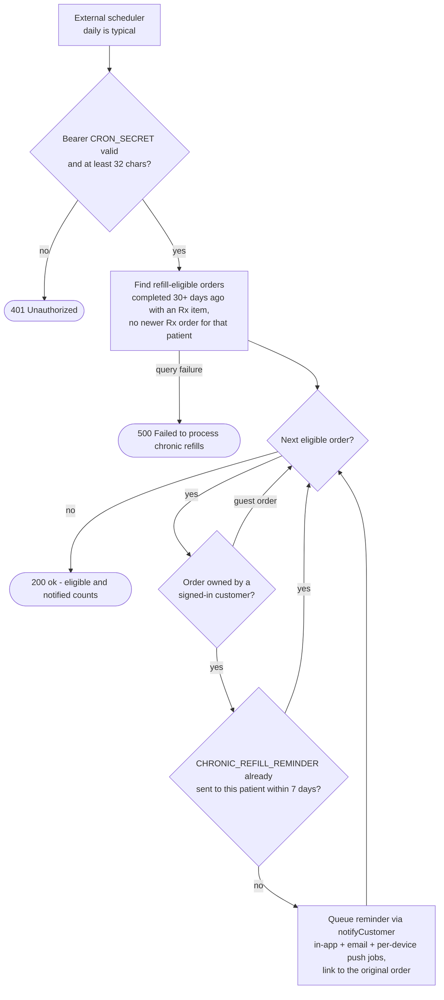

# SYS-04 — Chronic refill reminders job

Thirty days after a completed order containing prescription-only medicines, a chronic patient's supply is likely running out. This cron endpoint closes that care loop: it asks the BandaGo CRM reconciler which orders are refill-eligible, applies a one-reminder-per-patient-per-week throttle, and queues a friendly nudge through the standard notification pipeline. The eligibility logic is deliberately time-based only — the job never infers dosage or remaining supply. It is a single-actor batch process, so the journey map is a `flowchart TD` with decision diamonds, matching the exemplar's failure-branch completeness in the form that best shows a batch loop. Queueing (in-app rows) always works; the email leg of the reminder needs a configured Resend provider, hence the environment-dependent status.

| Metadata | Value |
| --- | --- |
| Primary actor | System (external scheduler → Sphere cron endpoint) |
| Secondary actors | Customer (chronic patient receiving the reminder) |
| Functional area | Prescriptions and CRM outreach |
| Entry point | `GET /api/cron/chronic-refills` |
| Status | Environment-dependent (requires live provider credentials) — verified against code — in-app reminders queue without providers; email delivery needs Resend |
| End condition | `{ok, eligible, notified}` — each reminded patient has one `CHRONIC_REFILL_REMINDER` with a re-order link; or 401/500 with nothing queued |
| Related journeys | X03 (prescription outcomes and refills), O06 (the order the reminder links to), SYS-10 (notification fan-out), SYS-05 (delivery), A06 (medicine requests as the fallback) |

## Journey map

## Journey steps

### Step 1 — The scheduler invokes the job

- **Trigger:** The platform scheduler issues an authenticated GET; a daily cadence (for example 07:00) is typical, and the job is safe to run manually at any time.
- **Location:** `GET /api/cron/chronic-refills` — `src/app/api/cron/chronic-refills/route.ts`.
- **Destination:** No navigation — the JSON response is consumed by the scheduler.
- **Purpose:** Prove the caller holds the cron secret before reading patient order history.
- **System behaviour:** The route requires `Authorization: Bearer <CRON_SECRET>` with the secret set and at least 32 characters; anything else answers 401 (plain string comparison).
- **Outcome:** An authorized cron invocation.
- **Next step:** Determine refill eligibility.
- **Alternative paths:** Wrong secret (401) — check the environment; there is no in-repo scheduler, so a missed schedule simply delays outreach.

### Step 2 — Find refill-eligible orders

- **Trigger:** An authorized call.
- **Location:** `BandaGoCrmReconciler.checkChronicRefillEligible(30)` in `src/lib/crm/bandago-crm.ts`.
- **Destination:** Read-only order queries.
- **Purpose:** Identify patients whose prescription supply is plausibly exhausted, using time alone.
- **System behaviour:** The reconciler selects orders created at least 30 days ago in a completed status (`DELIVERED`, `COMPLETED_DELIVERY` or `COMPLETED_PICKUP`) that contain at least one item with `requiresPrescription: true`, newest first. It walks that list keeping one order per patient identity (`userId`, else `guestPhone`, else the order id) and excludes any patient who already has a newer non-`CANCELLED`/`REJECTED` prescription order created after the 30-day cutoff — a refill already placed means no nudge.
- **Outcome:** A deduplicated list of eligible orders (the `eligible` count in the response).
- **Next step:** Throttle per patient.
- **Alternative paths:** The reconciler still queries the legacy `DELIVERED` status alongside the current terminal statuses. Eligibility never touches dosage, quantity or validity windows — by design.

### Step 3 — Apply the seven-day per-patient throttle

- **Trigger:** An eligible order with a signed-in owner.
- **Location:** Same route; `Notification` lookup.
- **Destination:** A notification-history query per candidate.
- **Purpose:** Never message a patient about refills more than once a week, even if the job runs daily.
- **System behaviour:** For each order with a `userId`, the route looks for an existing `CHRONIC_REFILL_REMINDER` notification for that user created within the last 7 days; if one exists, the candidate is skipped. Guest orders (no `userId`) are skipped entirely — reminders need an account inbox.
- **Outcome:** Only genuinely un-notified patients remain.
- **Next step:** Compose and queue the reminder.
- **Alternative paths:** If the job runs several times a day, the throttle (not the cron cadence) is the real rate limit for patient-facing messages.

### Step 4 — Compose and queue the reminder

- **Trigger:** An eligible, un-throttled patient.
- **Location:** Same route; `notifyCustomer` in `src/lib/notify.ts` (journey SYS-10).
- **Destination:** The notification outbox — no network I/O happens here.
- **Purpose:** Deliver a short, actionable nudge back to the original order.
- **System behaviour:** The medicine names come from the order items flagged `requiresPrescription`. The reminder is titled "Prescription Refill Reminder" with a message noting the chronic medication may be due for a refill and a link `${NEXT_PUBLIC_APP_URL}/orders/{orderId}` (defaulting to `https://spherepharmacy.co.ke`). `notifyCustomer` writes the in-app `Notification` row and queues one email job (personalized greeting, message, "Order Refill Now" link) when the user has an email address, plus one push job per registered device token — all with stable dedupe keys inside one transaction.
- **Outcome:** The reminder exists in the inbox and the outbox; `notified` increments.
- **Next step:** Continue the loop, then report.
- **Alternative paths:** Customers without an email still get the in-app row and push jobs. Actual email/push delivery happens later in the SYS-05 dispatcher; a provider failure there never fails this job.

### Step 5 — Report the run

- **Trigger:** The candidate loop finishes.
- **Location:** Same route, response and error handling.
- **Destination:** The scheduler's monitoring.
- **Purpose:** Expose outreach volume and failures to operators.
- **System behaviour:** The route returns `{ok: true, eligible, notified}`. Any thrown error (for example a database failure) is caught and answered 500 with "Failed to process chronic refills" plus the error message — nothing partial is silently dropped, and the next run reconsiders everyone the throttle has not yet counted.
- **Outcome:** An observable, idempotent outreach run.
- **Next step:** Nothing automatic — the scheduler calls again on cadence.
- **Alternative paths:** Email delivery failures surface later in notification health (`/api/admin/notification-health`), not in this job's response; check there after large runs.

## Decision points

| Decision | Branches | Enforced by/where |
| --- | --- |
| Caller authenticated? | Valid Bearer secret (≥ 32 chars) → continue; else → 401 | Header check in the route |
| Order refill-eligible? | Completed 30+ days ago + Rx item + no newer Rx order → eligible; newer order exists → excluded | `checkChronicRefillEligible(30)` in `src/lib/crm/bandago-crm.ts` |
| One order per patient? | Newest eligible order kept; older duplicates skipped | `seenUsers` set keyed by userId / guestPhone / order id |
| Owner signed in? | `userId` present → throttle check; guest order → skip | `if (!order.userId) continue` |
| Recently reminded? | `CHRONIC_REFILL_REMINDER` within 7 days → skip; else → queue | `Notification.findFirst` with `createdAt >= oneWeekAgo` |
| Email available? | User email present → email job with template; absent → in-app + push only | `notifyCustomer` extra.email |
| Run failed? | Error → 500 with details; success → `{ok, eligible, notified}` | Route try/catch |

## Error and recovery paths

- **Unauthorized (401):** wrong or missing `CRON_SECRET`; fix the environment — no patient data was read.
- **Query or transaction failure (500):** the run aborts with the error message; nothing is partially sent because each reminder is queued transactionally. Re-run the job — the 7-day throttle and dedupe keys prevent duplicates.
- **Email provider outage:** reminders still land in the in-app inbox; the email jobs retry in SYS-05 with exponential backoff for up to 23 hours before failing.
- **Patient already refilled:** excluded by the newer-order check, so outreach stops naturally once the patient re-orders.
- **Guest chronic patients:** not reachable by this job (no account inbox) — staff can follow up via the CRM lookup or medicine-request flow (A06).
- **Wrong app URL:** reminder links are built from `NEXT_PUBLIC_APP_URL` (with a production fallback); a misconfigured origin sends patients to the wrong host — verify the variable per the deployment checklist.

## Traceability

| Concern | Implementation reference |
| --- | --- |
| Cron endpoint | `src/app/api/cron/chronic-refills/route.ts` |
| Eligibility logic | `BandaGoCrmReconciler.checkChronicRefillEligible` in `src/lib/crm/bandago-crm.ts` |
| Completed statuses used | `DELIVERED`, `COMPLETED_DELIVERY`, `COMPLETED_PICKUP` (order statuses in `src/lib/constants.ts`) |
| Seven-day throttle | `Notification.findFirst` on event `CHRONIC_REFILL_REMINDER` |
| Reminder content | Title, message and link composition in the route |
| Queueing | `notifyCustomer` in `src/lib/notify.ts` (journey SYS-10) |
| Delivery | `dispatchNotifications` in `src/lib/notifications/delivery.ts` (journey SYS-05) |
| App URL | `NEXT_PUBLIC_APP_URL` with `https://spherepharmacy.co.ke` fallback |
| Scheduling and runbook | `docs/operations/scheduled-jobs.md` |
| Integration context | `docs/integrations/bandago-pos-crm.md` (chronic-refill cron section) |
| API contract | `openapi/sphere-api.yaml` — `GET /cron/chronic-refills` |

## Related journeys and documents

- **X03** — the prescription outcomes and refills journey this nudge feeds back into
- **O06** — the order page the reminder links to
- **SYS-10** — the fan-out pipeline that turns the reminder into inbox/email/push jobs
- **SYS-05** — the dispatcher that delivers those jobs
- **A06** — staff triage for patients who respond with a medicine request instead
- Docs: [scheduled jobs runbook](../../operations/scheduled-jobs.md) · [BandaGo POS and CRM](../../integrations/bandago-pos-crm.md) · [prescriptions](../../features/prescriptions.md) · [notifications](../../features/notifications.md)
