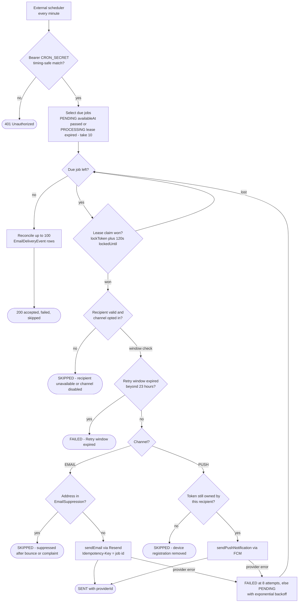

# SYS-05 — Notification queue job

Business events never send email or push directly — they enqueue `NotificationDelivery` jobs transactionally (journey SYS-10). This cron endpoint is the other half of the outbox pattern: it claims due jobs with atomic leases so concurrent runs never double-send, re-validates the recipient and their channel preferences, delivers EMAIL through Resend and PUSH through Firebase Cloud Messaging, retries failures with exponential backoff inside a 23-hour window, and closes the loop by reconciling the provider's own delivery events (delivered, bounced, complained) into job states and a permanent suppression list. It is a single-actor batch process, so the journey map is a `flowchart TD` with decision diamonds. The claim, validation and reconciliation machinery is fully implemented; actual provider delivery requires Resend and FCM credentials — hence environment-dependent.

| Metadata | Value |
| --- | --- |
| Primary actor | System (external scheduler → Sphere cron endpoint) |
| Secondary actors | Customer, Staff (message recipients) |
| Functional area | Notifications |
| Entry point | `GET /api/cron/notifications` |
| Status | Environment-dependent (requires live provider credentials) — verified against code — claims and reconciliation run regardless; EMAIL needs Resend, PUSH needs FCM |
| End condition | `{accepted, failed, skipped}` — each due job is SENT (provider accepted), SKIPPED (recipient gone, opted out, suppressed, stale token), FAILED (8 attempts or window expired) or back to PENDING with backoff |
| Related journeys | SYS-10 (queueing), SYS-07 and SYS-04 (reminder producers), C06 (preferences honored), A01 (notification health surfaced to admins) |

## Journey map

## Journey steps

### Step 1 — The scheduler invokes the dispatcher

- **Trigger:** The platform scheduler issues an authenticated GET every minute (the runbook's hard requirement); `maxDuration` is set to 300 seconds and the route runs on the Node.js runtime.
- **Location:** `GET /api/cron/notifications` — `src/app/api/cron/notifications/route.ts`; auth in `authorizedJob` (`src/lib/notifications/delivery.ts`).
- **Destination:** No navigation — a `no-store` JSON response for the scheduler.
- **Purpose:** Authorize the run before touching the outbox.
- **System behaviour:** `authorizedJob` compares the full `Authorization: Bearer …` header against `CRON_SECRET` with `timingSafeEqual` (the only cron route to do so) and requires the secret to be at least 32 characters; otherwise 401.
- **Outcome:** An authorized dispatcher invocation.
- **Next step:** Select and claim due jobs.
- **Alternative paths:** Wrong secret (401) — fix `CRON_SECRET`; jobs simply wait as `PENDING` until a valid run occurs.

### Step 2 — Select and claim due jobs with leases

- **Trigger:** An authorized call; `dispatchNotifications(10)` runs.
- **Location:** `dispatchNotifications` in `src/lib/notifications/delivery.ts`; `NotificationDelivery` model.
- **Destination:** Database claim per job.
- **Purpose:** Guarantee at-most-once delivery per attempt window even with overlapping runs or a crashed worker.
- **System behaviour:** Due jobs are `PENDING` rows with `availableAt ≤ now` plus `PROCESSING` rows whose 120-second lease has expired (crash recovery), ordered by `availableAt`, capped at 10 per run. Each job is claimed by a conditional `updateMany` that flips it to `PROCESSING` with a random `lockToken`, `lockedUntil = now + 120s` and `attempts + 1`; a lost claim (another run won it) is skipped.
- **Outcome:** The dispatcher exclusively owns up to 10 jobs.
- **Next step:** Re-validate the recipient.
- **Alternative paths:** A worker crash mid-send leaves a `PROCESSING` row whose lease expires and is reclaimed by a later run — the email `Idempotency-Key` prevents a true duplicate send.

### Step 3 — Re-validate recipient, preferences and retry window

- **Trigger:** A claimed job.
- **Location:** Same function; `User`, `StaffUser`, `NotificationPref` lookups.
- **Destination:** Read-only checks, then a terminal `SKIPPED`/`FAILED` update.
- **Purpose:** Respect the recipient's current state, not the state when the event fired.
- **System behaviour:** Deleted users, deactivated staff, or a channel preference turned off (email/push in `NotificationPref`) mark the job `SKIPPED` with "Recipient unavailable or channel disabled". Jobs with prior attempts older than 23 hours are failed with "Retry window expired" — ambiguous old submissions are never auto-retried; operators review provider history first.
- **Outcome:** Only live, opted-in recipients with fresh jobs proceed.
- **Next step:** Deliver on the job's channel.
- **Alternative paths:** Opt-outs recorded in journey C06 take effect here at dispatch time, not at queueing time.

### Step 4 — Deliver email via Resend

- **Trigger:** A claimed EMAIL job.
- **Location:** `sendEmail` in `src/lib/email/resend.ts`; `EmailSuppression` model.
- **Destination:** Resend REST API (`POST https://api.resend.com/emails`, 12-second timeout).
- **Purpose:** Send the queued message exactly once, to a deliverable address.
- **System behaviour:** The recipient address is checked against `EmailSuppression` (bounced/complained addresses are permanent skips). `sendEmail` sends the stored payload `{to, subject, html, text}` with an `Idempotency-Key` header equal to the job id (provider-side dedupe), refusing unverified `@resend.dev` senders in production. Success marks the job `SENT` with the provider id and `sentAt`; failure throws into the retry path.
- **Outcome:** Email accepted by Resend, or a scheduled retry.
- **Next step:** Push jobs follow the same shape; then reconciliation.
- **Alternative paths:** Suppressed addresses are `SKIPPED` until an admin removes the row. The Resend webhook (SYS-10) later refines `SENT` into `DELIVERED`, `BOUNCED` or `COMPLAINED`.

### Step 5 — Deliver push via FCM

- **Trigger:** A claimed PUSH job.
- **Location:** `sendPushNotification` in `src/lib/firebase/admin.ts`; `PushToken` model.
- **Destination:** Firebase Cloud Messaging HTTP v1 API.
- **Purpose:** Reach registered devices without sending to stale or stolen tokens.
- **System behaviour:** The dispatcher re-verifies the token still belongs to the job's owner (user or staff) before sending — a removed registration is `SKIPPED` ("Device registration removed or owner changed"). `sendPushNotification` mints a Google OAuth token from the service account, sends the notification with a same-origin click action, and reports invalid (unregistered) tokens; those mark the job `SKIPPED` ("Device unregistered") and FCM's pruning deletes dead tokens. Success marks the job `SENT`.
- **Outcome:** Push accepted by FCM, a skip for dead tokens, or a scheduled retry.
- **Next step:** Reconciliation.
- **Alternative paths:** Provider-accepted push is best-effort device delivery — `SENT` does not mean read. Unconfigured Firebase credentials fail closed with an error string, sending the job into backoff.

### Step 6 — Retry, back off and reconcile provider events

- **Trigger:** A provider error, or the batch completing.
- **Location:** Same function; backoff update and `reconcileEmailEvents`.
- **Destination:** `NotificationDelivery` and `EmailDeliveryEvent`/`EmailSuppression` tables.
- **Purpose:** Bound retries, and let the provider's own delivery events close the truth loop.
- **System behaviour:** A thrown delivery error counts the attempt: at 8 or more attempts the job is `FAILED`; otherwise it returns to `PENDING` with `availableAt = now + min(3600, 60·2^(attempts−1))` seconds and a `lastError` breadcrumb. After the batch, `reconcileEmailEvents` processes up to 100 unprocessed `EmailDeliveryEvent` rows: each is matched to jobs by `providerId`, job status is updated (never overwriting `BOUNCED`/`COMPLAINED`), bounce/complaint addresses are upserted into `EmailSuppression`, and the event is marked processed. Events younger than 24 hours with no matching job wait — they can arrive before the send response is stored.
- **Outcome:** `{accepted, failed, skipped}` returned; the outbox reflects provider truth.
- **Next step:** The next minute's run continues draining.
- **Alternative paths:** Terminal `FAILED`/`SENT` rows are retained (no purge job — an operations decision); a backlog is drained by tightening the scheduler interval, not raising the fixed batch of 10.

## Decision points

| Decision | Branches | Enforced by/where |
| --- | --- | --- |
| Caller authenticated? | Timing-safe Bearer match (≥ 32 chars) → run; else → 401 | `authorizedJob` in `src/lib/notifications/delivery.ts` |
| Job due? | `PENDING` + `availableAt ≤ now`, or `PROCESSING` + expired lease → claim | Due filter in `dispatchNotifications` |
| Lease claim won? | Conditional `updateMany` on the due filter → own it; lost → skip | `lockToken`/`lockedUntil` (120 s) |
| Recipient deliverable? | User missing / staff inactive / channel opted out → `SKIPPED` | Recipient + `NotificationPref` re-validation |
| Retry window open? | Prior attempts > 23 h old → `FAILED`; else → attempt | Window check before dispatch |
| Email suppressed? | Address in `EmailSuppression` → `SKIPPED`; else → send | `EmailSuppression` lookup |
| Push token valid? | Token not re-found for owner → `SKIPPED`; FCM unregistered → `SKIPPED` + prune | Ownership re-check; `invalidTokens` result |
| Attempt exhausted? | attempts ≥ 8 → `FAILED`; else → `PENDING` + backoff `min(3600, 60·2^(attempts−1))` s | Catch branch in `dispatchNotifications` |

## Error and recovery paths

- **Unauthorized (401):** wrong `CRON_SECRET`; jobs wait — fix the secret and the queue drains on the next runs.
- **Provider rejection (email/push):** bounded retry with exponential backoff; terminal `FAILED` retains `lastError` for investigation — do not blindly reset rows.
- **Crash mid-dispatch:** the 120-second lease expires and the next run reclaims the job; the email `Idempotency-Key` (job id) prevents duplicate provider sends.
- **Events before send response:** `reconcileEmailEvents` waits up to 24 hours for the matching job to appear, then applies the event.
- **Bounced or complained addresses:** permanently suppressed until an admin removes the row — future jobs skip them rather than damaging sender reputation.
- **Dead device tokens:** skipped and pruned automatically; users re-register by re-enabling push (journey C06).
- **Queue backlog:** 10 jobs per minute is the steady-state drain; for large backlogs tighten the scheduler cadence (the batch size is fixed), and monitor `oldestPendingAt` in `/api/admin/notification-health`.
- **No retention policy:** terminal rows accumulate — an explicit governance decision tracked in the technical-debt register, not an automated purge.

## Traceability

| Concern | Implementation reference |
| --- | --- |
| Cron endpoint | `src/app/api/cron/notifications/route.ts` (runtime nodejs, maxDuration 300) |
| Timing-safe auth | `authorizedJob` in `src/lib/notifications/delivery.ts` |
| Claim leases and backoff | `dispatchNotifications` — `lockToken`, `lockedUntil`, `availableAt`, `attempts` |
| Outbox model | `NotificationDelivery` model (`prisma/schema.prisma`) — `ScheduledJobDelivery` is dead schema, unreferenced |
| Email delivery | `sendEmail` in `src/lib/email/resend.ts` (Resend REST, `Idempotency-Key`) |
| Push delivery | `sendPushNotification` in `src/lib/firebase/admin.ts` (FCM HTTP v1) |
| Suppression | `EmailSuppression` model; upserts in `reconcileEmailEvents` |
| Delivery events | `EmailDeliveryEvent` model; producer `POST /api/notifications/email-webhook` |
| Queueing (producer side) | `notifyCustomer`/`notifyStaff` in `src/lib/notify.ts` (journey SYS-10) |
| Observability | `GET /api/admin/notification-health`; `GET /api/notifications/dispatch-test` |
| Scheduling and runbook | `docs/operations/scheduled-jobs.md` |
| API contract | `openapi/sphere-api.yaml` — `GET /cron/notifications` |

## Related journeys and documents

- **SYS-10** — the queueing half of the outbox this dispatcher drains
- **SYS-07** — booking reminders produced into this queue
- **SYS-04** — chronic refill reminders produced into this queue
- **C06** — the preferences honored at dispatch time
- **A01** — admins watch delivery health from the workspace
- Docs: [scheduled jobs runbook](../../operations/scheduled-jobs.md) · [notifications](../../features/notifications.md) · [Resend integration](../../integrations/resend.md) · [Firebase integration](../../integrations/firebase.md)
