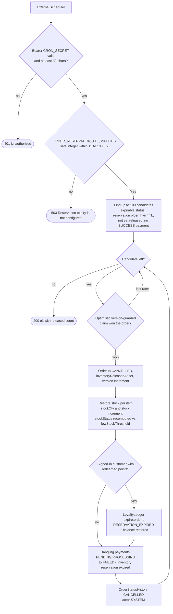

# SYS-03 — Order reservation expiry job

When a customer places an order (journeys O02/O05), checkout reserves inventory by stamping `inventoryReservedAt`; if the customer never pays, that stock would sit locked forever. This cron endpoint is the release path: a scheduler calls it with the shared secret, it finds unpaid orders whose reservations predate the configured TTL, and per order it atomically cancels the order, restores product stock, re-credits redeemed Sphere Points, fails dangling payment attempts and writes an audit history row. It is a single-actor batch process, so the journey map below is a `flowchart TD` with decision diamonds — the same failure-branch completeness as the exemplar's sequence diagrams, in the form that best shows a batch loop. The job is implemented and needs only the CRON secret and its TTL variable to run.

| Metadata | Value |
| --- | --- |
| Primary actor | System (external scheduler → Sphere cron endpoint) |
| Secondary actors | Customer (unpaid order cancelled, points restored) |
| Functional area | Orders and inventory |
| Entry point | `GET /api/cron/order-reservations` |
| Status | Implemented — verified against code |
| End condition | `{ok, released}` — each released order is `CANCELLED`, stock is back in the sellable pool, points are re-credited, payments `FAILED`; or 401/503 with nothing changed |
| Related journeys | O05 (reservations), O02 (delivery orders), O06 (tracking shows the cancellation), C08 (points re-credited), SYS-08 (stock that comes back) |

## Journey map

## Journey steps

### Step 1 — The scheduler invokes the job

- **Trigger:** The platform scheduler (system crontab, Vercel Cron, or an external monitor — there is no in-repo scheduler) issues an authenticated GET on its cadence; the runbook suggests every 5 minutes, with the TTL defining staleness.
- **Location:** `GET /api/cron/order-reservations` — `src/app/api/cron/order-reservations/route.ts`.
- **Destination:** No navigation — the JSON response is consumed by the scheduler.
- **Purpose:** Prove the caller holds the environment's cron secret before touching order data.
- **System behaviour:** The route requires `Authorization: Bearer <CRON_SECRET>` where the secret is set and at least 32 characters; anything else answers 401. The comparison is a plain string equality (a known LOW-severity note in the technical-debt register; the notifications cron uses `timingSafeEqual`).
- **Outcome:** An authorized cron invocation.
- **Next step:** Validate the TTL configuration.
- **Alternative paths:** Wrong or short secret (401) — check `CRON_SECRET` per `docs/operations/environment-variables.md`.

### Step 2 — Fail closed without a TTL

- **Trigger:** An authorized call.
- **Location:** Same route, configuration gate.
- **Destination:** None — an HTTP status only.
- **Purpose:** Never guess how long reservations should live.
- **System behaviour:** `ORDER_RESERVATION_TTL_MINUTES` must be a safe integer between 15 and 10,080 (one week); otherwise the route answers 503 "Reservation expiry is not configured" and does nothing. CI pins 60; the production value is a deliberate deployment decision.
- **Outcome:** Either a rejected run or a concrete cutoff timestamp `now - TTL minutes`.
- **Next step:** Find expired candidates.
- **Alternative paths:** A 503 on every run means the variable is missing or out of range — set it and re-run; the job is safe to invoke manually at any time.

### Step 3 — Find expired reservation candidates

- **Trigger:** A valid cutoff exists.
- **Location:** Same route; `Order` model with `items` included.
- **Destination:** Database query only.
- **Purpose:** Select exactly the orders whose inventory hold has lapsed without payment.
- **System behaviour:** The query targets orders in `RECEIVED`, `UNDER_REVIEW`, `PRESCRIPTION_VERIFIED`, `AVAILABILITY_CONFIRMED` or `AWAITING_PAYMENT` with `inventoryReservedAt` at or before the cutoff, `inventoryReleasedAt` still null, and no `SUCCESS` payment — up to 100 rows per run. `inventoryReservedAt` is stamped at order creation (`src/app/api/orders/route.ts`) and on prescription refills (`src/app/api/prescriptions/[id]/refill/route.ts`).
- **Outcome:** A bounded batch of expired, unpaid, still-held orders.
- **Next step:** Release each one.
- **Alternative paths:** No candidates → the run returns `{ok, released: 0}`. Orders with a successful payment are structurally excluded, so a paid order can never be cancelled by this job.

### Step 4 — Claim the order optimistically

- **Trigger:** A candidate order.
- **Location:** Same route, per-order transaction (15 s timeout, 5 s maxWait).
- **Destination:** One transaction per order.
- **Purpose:** Make the release race-safe against staff actions, payment callbacks and concurrent workers.
- **System behaviour:** The claim is a conditional `updateMany` requiring the order's `id`, the previously-read `version`, `inventoryReleasedAt: null` and an expirable status; it sets `CANCELLED`, `inventoryReleasedAt = now` and increments `version`. If the claim count is not exactly 1 the transaction returns early — the order changed underneath (paid, cancelled by the customer via O06, or claimed by another worker) and nothing else happens.
- **Outcome:** Exactly one actor owns the release.
- **Next step:** Restore stock and settle side effects.
- **Alternative paths:** A transaction error is swallowed per order ("another worker or request won the race") and the loop continues; the next run reconsiders the order.

### Step 5 — Restore stock, re-credit points, fail payments, record history

- **Trigger:** The claim was won.
- **Location:** Same transaction; `Product`, `LoyaltyLedger`, `User`, `Payment`, `OrderStatusHistory` writes.
- **Destination:** Same transaction — all side effects commit together.
- **Purpose:** Leave no trace of the reservation except an honest audit trail.
- **System behaviour:** Items with a `productId` are processed in sorted order: `stockQty` and `stock` are incremented by the item quantity, `inStock` is set true, and `stockStatus` is recomputed against `lowStockThreshold` (`OUT_OF_STOCK` / `LOW_STOCK` / `IN_STOCK`). If the order belongs to a signed-in customer who redeemed points, an idempotent `LoyaltyLedger` upsert with event key `expire:{orderId}` and reason `RESERVATION_EXPIRED` re-credits `pointsRedeemed` to the user's balance — a retry can never double-credit. Dangling `PENDING`/`PROCESSING` payments are set to `FAILED` with reason "Inventory reservation expired". Finally an `OrderStatusHistory` row records `CANCELLED` with actor `SYSTEM` and note "Inventory reservation expired before payment."
- **Outcome:** Stock is sellable again, points are back, payments are honestly failed, the cancellation is auditable (visible to the customer in O06).
- **Next step:** Continue the loop; report at the end.
- **Alternative paths:** Guest orders skip the loyalty step. A sibling mechanism — `InventoryGuard.cleanupExpiredReservations(45)` in `src/lib/inventory-guard.ts` — releases virtual reservations in-process at 45 minutes during checkout and POS sync; this cron is the TTL-driven backstop for physical holds.

### Step 6 — Report and let the next run continue

- **Trigger:** The candidate loop finishes.
- **Location:** Same route, response.
- **Destination:** The scheduler's monitoring.
- **Purpose:** Give operators a observable outcome per run.
- **System behaviour:** The route responds `{ok: true, released}` with the count of successfully released orders. Rows beyond the 100-row batch are picked up by the next invocation; the job is idempotent (released orders are excluded by status and `inventoryReleasedAt`).
- **Outcome:** A drained batch and an audit trail in `OrderStatusHistory`.
- **Next step:** Nothing automatic — the scheduler calls again on cadence.
- **Alternative paths:** If the job never runs (no scheduler), unpaid orders hold reserved stock indefinitely — flagged as a critical operational dependency in `docs/operations/scheduled-jobs.md`.

## Decision points

| Decision | Branches | Enforced by/where |
| --- | --- |
| Caller authenticated? | Valid Bearer secret (≥ 32 chars) → continue; else → 401 | Header check in the route; `CRON_SECRET` env |
| TTL configured? | Safe integer 15–10,080 → compute cutoff; else → 503 fail-closed | `ORDER_RESERVATION_TTL_MINUTES` gate |
| Order expirable? | Status in the five pre-payment statuses + reservation past cutoff + not released + no SUCCESS payment → candidate | Candidate `findMany` where-clause |
| Claim won? | `version`-guarded `updateMany` count = 1 → release; otherwise → skip silently | Optimistic concurrency in the per-order transaction |
| Points to restore? | Signed-in user with `pointsRedeemed > 0` → ledger upsert + balance increment; else skip | `expire:{orderId}` unique event key |
| Payments dangling? | `PENDING`/`PROCESSING` → `FAILED` with reason; terminal statuses untouched | Conditional `payment.updateMany` |
| Batch boundary? | 100 rows per run → remainder next run | `take: 100` on the candidate query |

## Error and recovery paths

- **Unauthorized (401):** wrong or missing `CRON_SECRET` (or below 32 characters); fix the environment and re-run — nothing was modified.
- **Not configured (503):** `ORDER_RESERVATION_TTL_MINUTES` unset or out of the 15–10,080 range; the job refuses to guess a default. Set the variable, redeploy/restart, re-run.
- **Per-order race loss:** another actor (payment webhook, customer cancellation, concurrent worker) changed the order first; the transaction backs off without side effects and the next run re-evaluates.
- **Partial batch failure:** one order's transaction throwing does not abort the run — the loop continues and the failed order is retried by a later invocation.
- **Backlog after downtime:** each run drains at most 100 orders; re-running the job by hand is safe and encouraged (`curl` examples in the scheduled-jobs runbook).
- **Double points credit:** prevented by the `expire:{orderId}` unique ledger key — replays and retries converge.
- **No in-app customer notification:** the job cancels silently (history only); the customer discovers it via order tracking (O06) — a deliberate scope decision, not an oversight.

## Traceability

| Concern | Implementation reference |
| --- | --- |
| Cron endpoint | `src/app/api/cron/order-reservations/route.ts` |
| Reservation stamping (origin) | `src/app/api/orders/route.ts` (order creation); `src/app/api/prescriptions/[id]/refill/route.ts` |
| Expirable statuses | `EXPIRABLE` constant in the route; order statuses in `src/lib/constants.ts` |
| TTL gate | `ORDER_RESERVATION_TTL_MINUTES` check (15–10,080, else 503) |
| Optimistic claim | Conditional `order.updateMany` on `version` + `inventoryReleasedAt` |
| Stock restoration and status | `Product.stockQty`/`stock`/`inStock`/`stockStatus` updates vs `lowStockThreshold` |
| Points re-credit | `LoyaltyLedger` upsert, event key `expire:{orderId}`, reason `RESERVATION_EXPIRED` |
| Payment failure | Conditional `payment.updateMany` → `FAILED`, "Inventory reservation expired" |
| Audit history | `OrderStatusHistory` row, actor `SYSTEM` |
| Sibling in-process release | `InventoryGuard.cleanupExpiredReservations(45)` in `src/lib/inventory-guard.ts` |
| Scheduling and runbook | `docs/operations/scheduled-jobs.md` |
| API contract | `openapi/sphere-api.yaml` — `GET /cron/order-reservations` |

## Related journeys and documents

- **O05** — the reservation flow whose unpaid holds this job releases
- **O02** — delivery orders that create reservations at checkout
- **O06** — where the customer sees the SYSTEM cancellation
- **C08** — redeemed Sphere Points restored by the ledger entry
- **SYS-08** — the POS ingestion whose stock truth is unmasked by released holds
- Docs: [scheduled jobs runbook](../../operations/scheduled-jobs.md) · [orders and fulfillment](../../features/orders-and-fulfillment.md) · [inventory and stock](../../features/inventory-and-stock.md) · [loyalty and promotions](../../features/loyalty-and-promotions.md)
