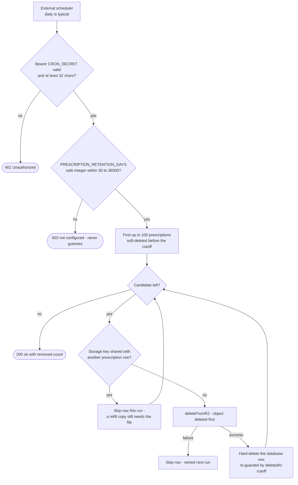

# SYS-06 — Prescription retention job

Prescriptions are the only data class with a fully automated retention pipeline. A soft delete (journey X01's owner action, or an admin) only stamps `deletedAt` — the file stays in private R2 storage and detail reads return 404. This cron endpoint performs the hard half: after the configured window elapses it deletes the R2 object first, then the database row, skipping any storage key still referenced by another prescription (refill copies share keys) and skipping rows whose R2 delete fails. It is a single-actor batch process, so the journey map is a `flowchart TD` with decision diamonds. The scheduling, ordering and skip logic are implemented; the R2 deletion step needs live Cloudflare R2 credentials and the window itself is a deliberate environment decision (CI pins 365 days; the BandaGo blueprint states a 2-year Kenya PPB Cap 244 intent) — hence environment-dependent.

| Metadata | Value |
| --- | --- |
| Primary actor | System (external scheduler → Sphere cron endpoint) |
| Secondary actors | Customer (whose prescription data expires) |
| Functional area | Compliance and retention |
| Entry point | `GET /api/cron/prescription-retention` |
| Status | Environment-dependent (requires live provider credentials) — verified against code — job logic implemented; R2 deletion needs configured R2 credentials, and the window value is environment-driven |
| End condition | `{ok, removed}` — expired rows and their objects are gone, shared keys and R2 failures skipped deterministically; or 401/503 with nothing deleted |
| Related journeys | X01 (upload and soft delete), X03 (refills that share storage keys), A17 (compliance surfaces), SYS-04 (the refill loop that creates shared keys) |

## Journey map

## Journey steps

### Step 1 — The scheduler invokes the job

- **Trigger:** The platform scheduler issues an authenticated GET; a daily off-peak cadence (the runbook example uses 02:30) is typical, and manual invocation is safe at any time.
- **Location:** `GET /api/cron/prescription-retention` — `src/app/api/cron/prescription-retention/route.ts`.
- **Destination:** No navigation — the JSON response is consumed by the scheduler.
- **Purpose:** Authorize the caller before any health data is destroyed.
- **System behaviour:** The route requires `Authorization: Bearer <CRON_SECRET>` with the secret set and at least 32 characters; anything else answers 401 (plain string comparison).
- **Outcome:** An authorized cron invocation.
- **Next step:** Validate the retention window.
- **Alternative paths:** Wrong secret (401); with no scheduler registered, soft-deleted prescriptions are retained forever — an explicit compliance exposure flagged in the runbook.

### Step 2 — Fail closed without a retention window

- **Trigger:** An authorized call.
- **Location:** Same route, configuration gate.
- **Destination:** None — an HTTP status only.
- **Purpose:** Never run retention with an accidental default.
- **System behaviour:** `PRESCRIPTION_RETENTION_DAYS` must be a safe integer between 30 and 36,500 (about a century); otherwise the route answers 503 "Prescription retention is not configured" and deletes nothing. CI sets 365; the integration blueprint records a 2-year Kenya PPB Cap 244 archive intent — the production value is a decision the pharmacy must make and record.
- **Outcome:** Either a rejected run or a concrete cutoff timestamp.
- **Next step:** Select soft-deleted candidates.
- **Alternative paths:** A 503 on every run means the variable is missing or out of range — set it deliberately and re-run.

### Step 3 — Select soft-deleted candidates

- **Trigger:** A valid cutoff exists.
- **Location:** Same route; `Prescription` model.
- **Destination:** Database query only.
- **Purpose:** Pick exactly the rows whose retention window has elapsed, measured from the soft-delete time.
- **System behaviour:** The query selects prescriptions with `deletedAt` at or before the cutoff, fetching only `id` and `storageKey`, capped at 100 rows per run. The cutoff semantics are deliberate: age is computed from `deletedAt`, not `createdAt` — deleting late keeps the record late.
- **Outcome:** A bounded batch of expired prescriptions.
- **Next step:** Delete the R2 object for each.
- **Alternative paths:** Active (never-deleted) prescriptions are never selected; rows without a `storageKey` skip the R2 step and go straight to the row delete.

### Step 4 — Delete the R2 object first, guarding shared keys

- **Trigger:** A candidate row with a `storageKey`.
- **Location:** Same route; `deleteFromR2` in `src/lib/r2.ts` (S3-compatible `DeleteObjectCommand`).
- **Destination:** Cloudflare R2 private object storage.
- **Purpose:** Never hard-delete a database row while its bytes remain, and never destroy a file another live prescription still uses.
- **System behaviour:** The route first counts other `Prescription` rows with the same `storageKey`; if any exist (refills create new rows referencing the same file), the row is skipped this run — a refill's live prescription is never destroyed by an older copy's expiry. Otherwise `deleteFromR2` removes the object; a thrown error (missing credentials, network) also skips the row for a later run rather than proceeding.
- **Outcome:** Either a verified object deletion, or a deterministic skip.
- **Next step:** Hard-delete the row.
- **Alternative paths:** Without R2 credentials every keyed row is skipped every run — the pipeline visibly stalls rather than silently orphaning or destroying data.

### Step 5 — Hard-delete the row and report

- **Trigger:** The R2 object is gone (or the row never had one).
- **Location:** Same route; conditional `prescription.deleteMany`.
- **Destination:** Database deletion, then the response.
- **Purpose:** Complete the retention action with a re-guard, and leave the surrounding evidence intact.
- **System behaviour:** The delete is re-guarded by `id` + `deletedAt ≤ cutoff`, and the `removed` count accumulates per successful deletion. The route responds `{ok: true, removed}`. Surrounding evidence is deliberately untouched: `OrderStatusHistory`, `AuditLog` and `LoyaltyLedger` rows survive, and a prescription's own `PrescriptionAccessLog` rows are removed with it by the schema's `onDelete: Cascade` on the relation — the who-accessed-what trail persists only for surviving prescriptions, which is why `AuditLog` (never cascaded) is the durable compliance record.
- **Outcome:** The prescription, its file, and its access log are gone; order history and audit rows remain.
- **Next step:** The next run continues any backlog at 100 rows per invocation.
- **Alternative paths:** For a subject-erasure request that cannot wait for the window, the manual runbook in the retention doc describes running the cron logic against specific rows sooner.

## Decision points

| Decision | Branches | Enforced by/where |
| --- | --- | --- |
| Caller authenticated? | Valid Bearer secret (≥ 32 chars) → continue; else → 401 | Header check in the route |
| Retention window configured? | Safe integer 30–36,500 → compute cutoff; else → 503 fail-closed | `PRESCRIPTION_RETENTION_DAYS` gate |
| Row expired? | `deletedAt ≤ cutoff` → candidate; else not selected | Candidate `findMany` |
| Storage key shared? | Another row references the same key → skip; unique → delete object | `prescription.count` on `storageKey` |
| R2 delete succeeded? | Success → hard-delete row; failure → skip row for next run | try/catch around `deleteFromR2` |
| Row still expired at delete time? | Re-guard `deletedAt ≤ cutoff` holds → delete; else → no-op | Conditional `deleteMany` |
| Batch boundary? | 100 rows per run → remainder next run | `take: 100` |

## Error and recovery paths

- **Unauthorized (401):** wrong or missing `CRON_SECRET`; nothing was deleted.
- **Not configured (503):** `PRESCRIPTION_RETENTION_DAYS` unset or out of the 30–36,500 range; the job refuses to guess. Set the value, redeploy, re-run.
- **R2 failure (soft-fail):** the row is skipped and picked up by the next run; check R2 credentials and `R2_ENDPOINT` per `docs/operations/environment-variables.md`.
- **Shared storage key:** skipped deterministically until the referencing refill copy itself expires — deletions converge without ever orphaning a live prescription.
- **Backlog pressure:** a short window over many soft-deleted rows drains at 100 rows per invocation; increase run frequency, not batch size.
- **Wrong window chosen:** recover by restoring from backup (see `docs/operations/backup-and-restore.md`) — hard deletion is irreversible, which is exactly why the window is fail-closed and env-driven.
- **Access-log evidence:** a deleted prescription's `PrescriptionAccessLog` rows cascade away with it; audits that must outlive prescriptions belong in `AuditLog`, which this job never touches.

## Traceability

| Concern | Implementation reference |
| --- | --- |
| Cron endpoint | `src/app/api/cron/prescription-retention/route.ts` |
| Soft-delete origin | `DELETE /api/prescriptions/[id]` (owner or ADMIN; 409 for order-linked non-admin) |
| Window gate | `PRESCRIPTION_RETENTION_DAYS` check (30–36,500, else 503) |
| Cutoff semantics | `deletedAt ≤ now − days·86,400,000` in the route |
| Shared-key guard | `prescription.count` on same `storageKey` |
| R2 deletion | `deleteFromR2` in `src/lib/r2.ts` (`DeleteObjectCommand`) |
| Hard delete | Conditional `prescription.deleteMany` |
| Access-log cascade | `PrescriptionAccessLog.prescription` relation `onDelete: Cascade` (`prisma/schema.prisma`) |
| Preserved evidence | `AuditLog`, `OrderStatusHistory`, `LoyaltyLedger` (no automated deletion) |
| Scheduling and runbook | `docs/operations/scheduled-jobs.md` |
| Retention policy | `docs/security/retention-and-deletion.md` |
| API contract | `openapi/sphere-api.yaml` — `GET /cron/prescription-retention` |

## Related journeys and documents

- **X01** — the upload journey whose soft delete starts this clock
- **X03** — refills, whose shared storage keys this job protects
- **A17** — the compliance surfaces where retention decisions are evidenced
- **SYS-04** — the refill loop that creates the shared-key situation
- Docs: [scheduled jobs runbook](../../operations/scheduled-jobs.md) · [retention and deletion](../../security/retention-and-deletion.md) · [prescriptions](../../features/prescriptions.md) · [file storage security](../../security/file-storage-security.md)
