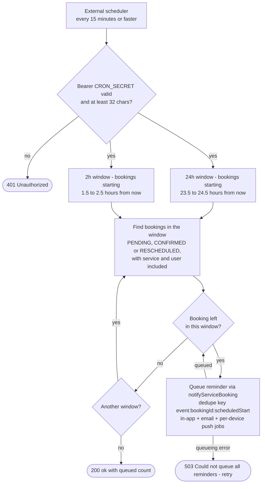

# SYS-07 — Service booking reminders job

Customers who book clinical services (journey S01) often need a nudge before the appointment: one the day before, one shortly before it starts. This cron endpoint scans two timing windows — 23.5–24.5 hours ahead and 1.5–2.5 hours ahead — for bookings still in an active status, and queues a reminder through the standard notification pipeline for each, keyed by a stable dedupe key built from the event, booking id and scheduled start. Because the windows are only ± 30 minutes wide, the scheduler must run at least every 15 minutes to guarantee every eligible booking is caught. It is a single-actor batch process, so the journey map is a `flowchart TD` with decision diamonds. Queueing (in-app rows) always works; the email and push legs need Resend and FCM — hence environment-dependent.

| Metadata | Value |
| --- | --- |
| Primary actor | System (external scheduler → Sphere cron endpoint) |
| Secondary actors | Customer (booking owner) |
| Functional area | Services and notifications |
| Entry point | `GET /api/cron/service-booking-reminders` |
| Status | Environment-dependent (requires live provider credentials) — verified against code — reminders queue without providers; email delivery needs Resend, push needs FCM |
| End condition | `{ok, queued}` — each due booking has one 24h and/or 2h reminder queued with a stable dedupe key; or 503 "Could not queue all reminders. Retry this job." with the batch safely re-runnable |
| Related journeys | S01 (booking), S03 (tracking and reschedule), SYS-10 (fan-out), SYS-05 (delivery), A11 (staff appointment workflow) |

## Journey map

## Journey steps

### Step 1 — The scheduler invokes the job

- **Trigger:** The platform scheduler issues an authenticated GET at least every 15 minutes; the runbook's example crontab uses `*/15 * * * *`.
- **Location:** `GET /api/cron/service-booking-reminders` — `src/app/api/cron/service-booking-reminders/route.ts`.
- **Destination:** No navigation — the JSON response is consumed by the scheduler.
- **Purpose:** Authorize the caller and begin a window scan.
- **System behaviour:** The route requires `Authorization: Bearer <CRON_SECRET>` with the secret set and at least 32 characters; anything else answers 401 (plain string comparison).
- **Outcome:** An authorized cron invocation.
- **Next step:** Scan the two reminder windows.
- **Alternative paths:** Wrong secret (401). A slower cadence than 15 minutes can miss bookings whose scheduledStart passes entirely through a ± 30-minute window between runs.

### Step 2 — Define the two timing windows

- **Trigger:** An authorized call.
- **Location:** Same route, `windows` array.
- **Destination:** In-memory window computation.
- **Purpose:** Decide which bookings are "tomorrow" and "starting soon".
- **System behaviour:** Two windows are computed from now: `SERVICE_BOOKING_REMINDER_24H` covers bookings starting 23.5–24.5 hours ahead with the text "Reminder: your Sphere Pharmacy appointment is tomorrow.", and `SERVICE_BOOKING_REMINDER_2H` covers 1.5–2.5 hours ahead with "…starts in about 2 hours." Each window yields a `from`/`to` pair around the booking's `scheduledStart`.
- **Outcome:** Concrete query bounds for each reminder type.
- **Next step:** Find eligible bookings.
- **Alternative paths:** The ± 30-minute window width is what forces the ≥ 15-minute scheduler cadence — the design trades window precision for cadence guarantees rather than remembering per-booking state.

### Step 3 — Find eligible bookings

- **Trigger:** A window is defined.
- **Location:** Same route; `ServiceBooking` model with `service` and `user` included.
- **Destination:** Database query per window.
- **Purpose:** Select bookings that are still happening, at the right time, for the right recipient.
- **System behaviour:** The query selects bookings whose `scheduledStart` falls between the window bounds and whose status is `PENDING`, `CONFIRMED` or `RESCHEDULED`. Rescheduled bookings are reminded at their **new** time because the dedupe key includes the scheduled start. Completed, cancelled and no-show bookings are structurally excluded.
- **Outcome:** The set of bookings due for this reminder type.
- **Next step:** Queue each reminder.
- **Alternative paths:** An empty window simply contributes zero bookings; both windows are always evaluated on every run.

### Step 4 — Queue the reminder

- **Trigger:** An eligible booking.
- **Location:** Same route; `notifyServiceBooking` in `src/lib/notify.ts`; template in `src/lib/email/templates.ts`.
- **Destination:** The notification outbox — no network I/O happens here.
- **Purpose:** Deliver an actionable reminder tied to the booking's exact schedule.
- **System behaviour:** The reminder is queued through `notifyServiceBooking` with the customer's name and email, the booking reference and service name, and a message that appends the service name and the schedule formatted for the Africa/Nairobi timezone (weekday, day, month, hour, minute). The dedupe key is `${event}:${booking.id}:${scheduledStart.toISOString()}` — stable across retries. `notifyServiceBooking` renders the email via `serviceBookingTemplate` (subject, branded HTML, plain text) and queues the in-app `Notification` row, one email job and one push job per registered device token, all transactionally, linking to `/services?tab=bookings`.
- **Outcome:** The reminder exists in the inbox and the outbox; the `sent` counter increments.
- **Next step:** Continue the loop; fail fast if anything throws.
- **Alternative paths:** Customers without an email still receive the in-app row and push jobs. Actual delivery happens later in SYS-05 with its retry, suppression and preference machinery.

### Step 5 — Fail fast and report

- **Trigger:** Any `notifyServiceBooking` call throws, or all windows complete.
- **Location:** Same route, error branch and response.
- **Destination:** The scheduler's monitoring.
- **Purpose:** Make failures loud and retries safe.
- **System behaviour:** On the first queueing error the route immediately returns 503 "Could not queue all reminders. Retry this job." — it does not continue the batch. Because dedupe keys are stable, an immediate retry re-queues only what had not yet been queued; already-queued reminders become no-ops (`skipDuplicates`). On success the route returns `{ok: true, queued: sent}`.
- **Outcome:** An all-or-retryable batch with a count the scheduler can alert on.
- **Next step:** Nothing automatic — the scheduler calls again on cadence.
- **Alternative paths:** Re-running the job by hand at any time is safe; every already-queued reminder is deduplicated away.

## Decision points

| Decision | Branches | Enforced by/where |
| --- | --- | --- |
| Caller authenticated? | Valid Bearer secret (≥ 32 chars) → continue; else → 401 | Header check in the route |
| Which window? | 23.5–24.5 h ahead → 24h reminder; 1.5–2.5 h ahead → 2h reminder | `windows` array with event, bounds and text |
| Booking still active? | `PENDING`/`CONFIRMED`/`RESCHEDULED` → remind; terminal statuses → excluded | Status filter in the booking query |
| Reminder already queued? | Same event + booking + scheduledStart → deduplicated no-op; new → queue | Dedupe key `${event}:${booking.id}:${scheduledStart ISO}` |
| Queueing succeeded? | Success → next booking; error → 503 fail-fast | try/catch around `notifyServiceBooking` |
| Rescheduled booking? | Reminded at the new time (key includes scheduledStart) | Dedupe key composition |

## Error and recovery paths

- **Unauthorized (401):** wrong or missing `CRON_SECRET`; nothing queued.
- **Queueing failure (503):** the job stops at the first error; honor it with an immediate retry — stable dedupe keys make the retry a no-op for already-queued reminders. Check database health and `NotificationDelivery` writes.
- **Missed window (scheduler down):** a booking whose start passes out of both windows is never reminded — the every-15-minute cadence is a hard external dependency; alert on the cron itself (dead-man's-switch).
- **Email provider outage:** reminders still land in-app; email jobs retry in SYS-05 with backoff for up to 23 hours before failing.
- **Duplicate reminders:** prevented by the dedupe key even across overlapping runs or manual retries; a reschedule legitimately produces a new key and a fresh reminder.
- **Timezone mistakes:** the schedule string is formatted with `Africa/Nairobi` explicitly, so server timezone drift does not misstate appointment times; the window math itself uses absolute UTC timestamps.

## Traceability

| Concern | Implementation reference |
| --- | --- |
| Cron endpoint | `src/app/api/cron/service-booking-reminders/route.ts` |
| Reminder windows and texts | `windows` array — `SERVICE_BOOKING_REMINDER_24H`, `SERVICE_BOOKING_REMINDER_2H` |
| Eligible statuses | `PENDING`, `CONFIRMED`, `RESCHEDULED` filter on `ServiceBooking.scheduledStart` |
| Dedupe key | `${event}:${booking.id}:${scheduledStart.toISOString()}` in the route |
| Reminder queueing | `notifyServiceBooking` in `src/lib/notify.ts` (journey SYS-10) |
| Email template | `serviceBookingTemplate` in `src/lib/email/templates.ts` |
| Nairobi formatting | `toLocaleString` with `timeZone: Africa/Nairobi` in the route |
| Delivery | `dispatchNotifications` in `src/lib/notifications/delivery.ts` (journey SYS-05) |
| Scheduling and runbook | `docs/operations/scheduled-jobs.md` |
| API contract | `openapi/sphere-api.yaml` — `GET /cron/service-booking-reminders` |

## Related journeys and documents

- **S01** — the booking journey whose appointments get reminded
- **S03** — where the customer sees and reschedules the appointment (reschedule resets the reminder clock)
- **SYS-10** — the fan-out pipeline that turns each reminder into inbox/email/push jobs
- **SYS-05** — the dispatcher that delivers them
- **A11** — the staff appointment workflow on the receiving side
- Docs: [scheduled jobs runbook](../../operations/scheduled-jobs.md) · [services and bookings](../../features/services-and-bookings.md) · [notifications](../../features/notifications.md)
