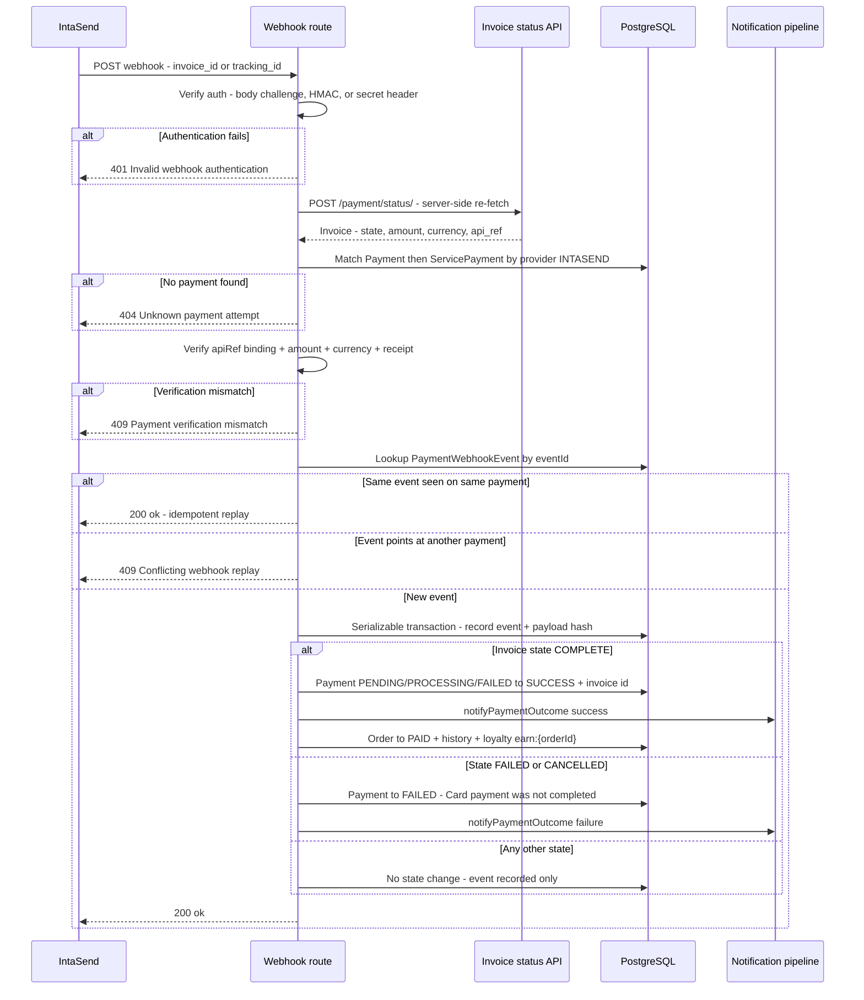

# SYS-02 — IntaSend card webhook processing

IntaSend calls the Sphere webhook endpoint after a hosted card checkout ends. The endpoint verifies the call three ways (body challenge, HMAC signature, or secret header — all timing-safe), then refuses to trust the webhook body: it re-fetches the invoice from IntaSend's status API, matches it to a payment, and only then flips payment, order/booking, loyalty and notification state inside one serializable transaction. This is the system-side half of journey O04, and the same route also settles card payments for clinical service bookings (S02). Refunds deliberately do not flow through this webhook — they are poll-driven from the admin refund route.

| Metadata | Value |
| --- | --- |
| Primary actor | System (IntaSend → Sphere API) |
| Secondary actors | Customer (payer) |
| Functional area | Payments |
| Entry point | `POST /api/payments/intasend/webhook` |
| Status | Environment-dependent (requires live provider credentials) — verified against code |
| End condition | Payment `SUCCESS` + order `PAID` (or booking `PAID`) + points credited + notifications queued; or payment `FAILED` recorded idempotently; or rejection (401/400/404/409) with no state change |
| Related journeys | O04 (customer card payment), S02 (booking card payment), SYS-01 (M-Pesa equivalent), SYS-10 (notification fan-out), A03 (delivery after payment) |

## Journey map

## Journey steps

### Step 1 — IntaSend delivers the signed webhook

- **Trigger:** The customer finishes (or abandons) the hosted checkout page; IntaSend POSTs the transaction event to the registered webhook URL.
- **Location:** `POST /api/payments/intasend/webhook` — `src/app/api/payments/intasend/webhook/route.ts`; verification in `src/lib/intasend/client.ts` (`verifyIntaSendWebhook`).
- **Destination:** No navigation — a server-to-server request whose response is consumed by IntaSend.
- **Purpose:** Authenticate the caller before anything else happens.
- **System behaviour:** The route reads the raw body text and verifies it with any one of three timing-safe methods: a JSON body `challenge` equal to `INTASEND_WEBHOOK_SECRET` (≥ 24 chars), an HMAC-SHA256 signature in `x-intasend-signature`/`x-webhook-signature` (optional `sha256=` prefix) over the raw body, or the secret in `x-intasend-webhook-secret`. Failure answers 401 before any database work. The body must parse as JSON and yield an `invoice_id` or `tracking_id`; otherwise 400.
- **Outcome:** An authenticated, well-formed webhook carrying an invoice identifier.
- **Next step:** Re-fetch the invoice from IntaSend.
- **Alternative paths:** Invalid authentication (401) or missing invoice id (400) end the request with no state change. The `api/payments/intasend/initiate` route never collects card data — card details exist only on IntaSend's hosted page.

### Step 2 — Re-fetch the invoice server-to-server

- **Trigger:** An authenticated webhook arrived.
- **Location:** `getIntaSendInvoice` in `src/lib/intasend/client.ts` (`POST /payment/status/`).
- **Destination:** IntaSend's invoice status API.
- **Purpose:** Never trust the webhook body — the provider's status API is the mandatory source of truth; the webhook is only a trigger to call it.
- **System behaviour:** The route fetches the invoice (15 s timeout) and normalizes `id`, `state`, `amount`, `currency`, `api_ref` and `tracking_id`. It derives an event id `intasend:{event_id}` — or `intasend:{invoice.id}:{state}:{trackingId}` when the body carries no event id — plus a SHA-256 `payloadHash` of the raw body for the replay ledger. The only success state is exactly `COMPLETE`; `FAILED` and `CANCELLED` are terminal failures.
- **Outcome:** A normalized invoice ready to match against a local payment.
- **Next step:** Match the payment.
- **Alternative paths:** If the status API is unreachable or errors, the outer catch answers 503 "Webhook verification is temporarily unavailable" — IntaSend retries, and nothing has changed locally.

### Step 3 — Match and verify the payment

- **Trigger:** A verified invoice is in hand.
- **Location:** Same route; `Payment` then `ServicePayment` models; `paymentMatchesExpected` in `src/lib/security/payment.ts`.
- **Destination:** Database lookups only.
- **Purpose:** Bind the invoice to exactly one local payment attempt and confirm it says what Sphere expects.
- **System behaviour:** The route first looks for an order `Payment` with provider `INTASEND` where `id = invoice.apiRef`, or `checkoutRequestId`/`providerReference` matches the invoice id or the body's invoice id. The invoice's `api_ref` must equal the payment id or the order reference, and `paymentMatchesExpected` must confirm amount (± cent), currency (KES) and receipt shape (`[A-Z0-9-]{6,64}`). A lookup that matches nothing falls through to `ServicePayment` (Step 5); neither found answers 404 "Unknown payment attempt".
- **Outcome:** The invoice is bound to one order payment with matching money.
- **Next step:** Replay-check and commit.
- **Alternative paths:** An `api_ref` pointing at a different payment, or an amount/currency/receipt mismatch, answers 409 "Payment verification mismatch" with no state change — the payment stays reconcilable.

### Step 4 — Replay-check and commit atomically

- **Trigger:** A verified order payment.
- **Location:** Same route; `PaymentWebhookEvent`, `Payment`, `Order`, `OrderStatusHistory`, `LoyaltyLedger` tables; `notifyPaymentOutcome` in `src/lib/notifications/payment.ts`.
- **Destination:** One serializable database transaction (15 s timeout, 5 s maxWait).
- **Purpose:** Apply each provider event at most once, and move payment, order and loyalty state together or not at all.
- **System behaviour:** A prior `PaymentWebhookEvent` for the same `eventId` on the same payment is acknowledged 200 with no side effects; one pointing at a different payment is a conflicting replay (409). Otherwise, inside the transaction (re-checked): the event is recorded with its payload hash. On `COMPLETE`, the payment flips `PENDING`/`PROCESSING`/`FAILED` → `SUCCESS` with `providerReference = invoice.id` (no-op if already terminal); `notifyPaymentOutcome(success)` queues customer and staff notifications; the order moves from `AWAITING_PAYMENT`, `AVAILABILITY_CONFIRMED` or `PRESCRIPTION_VERIFIED` to `PAID` with a version bump and an `OrderStatusHistory` row noting the invoice id; and signed-in customers earn points via an idempotent `LoyaltyLedger` event `earn:{orderId}` that increments balance and `pointsEarned`. On `FAILED`/`CANCELLED`, the payment becomes `FAILED` with reason "Card payment was not completed" and the customer is notified; the order stays payable. Any other invoice state records the event without a state change.
- **Outcome:** Payment and order (or booking) state settled consistently, notifications queued.
- **Next step:** The customer sees the paid state (O04); fulfillment proceeds (A02/A03); SYS-05 delivers the queued notifications.
- **Alternative paths:** A transaction failure propagates to the 503 catch and IntaSend retries; the event ledger guarantees the retry applies at most once. Returning from the hosted checkout is cosmetic — the storefront's status polling reads local state and never queries IntaSend.

### Step 5 — Settle the service-booking mirror

- **Trigger:** No order `Payment` matched, but a `ServicePayment` does.
- **Location:** Same route, service branch; `ServicePayment`, `ServiceBooking` models.
- **Destination:** A second serializable transaction.
- **Purpose:** Give booking card payments (journey S02) the same guarantees as order payments.
- **System behaviour:** The match, `api_ref`/reference binding, amount check, replay ledger and transaction mirror Step 4: on `COMPLETE` the service payment becomes `SUCCESS` and the booking's `paymentStatus` becomes `PAID` with notifications queued; on `FAILED`/`CANCELLED` the payment fails with the same reason and the customer is notified. The event row stores `servicePaymentId` instead of `paymentId`.
- **Outcome:** Booking payment settled idempotently.
- **Next step:** The booking is treated as paid in the appointment workflow (A11).
- **Alternative paths:** Same rejections as Step 3/4 (404 unknown, 409 mismatch or conflicting replay, 503 on verification trouble).

### Step 6 — Refunds stay outside the webhook

- **Trigger:** An admin later refunds a card payment.
- **Location:** `POST /api/payments/refund` — `src/app/api/payments/refund/route.ts`; `createIntaSendRefund`/`getIntaSendRefund` in `src/lib/intasend/client.ts`.
- **Destination:** IntaSend chargebacks API (`POST /chargebacks/`, `GET /chargebacks/<id>/`).
- **Purpose:** Refund state changes are admin-initiated and poll-driven, never webhook-driven.
- **System behaviour:** An admin creates a chargeback; the payment becomes `REFUND_PENDING` with a `refundReference` and an audited `REFUND_REQUESTED` event. A later refund call polls the chargeback; when its state is `COMPLETED`, `finalizeRefund` runs serializably: payment `REFUNDED`, order `REFUNDED` with history, loyalty clawback of earned points and re-credit of redeemed points, and a refund notice.
- **Outcome:** Refunds complete without any involvement of this webhook.
- **Next step:** None for this journey — see the payments feature doc for the refund runbook.
- **Alternative paths:** There is no chargeback-completion webhook, so `REFUND_PENDING` payments stay pending until an admin (or an operator job) re-submits the refund action to poll again — a documented limitation.

## Decision points

| Decision | Branches | Enforced by/where |
| --- | --- |
| Webhook authenticated? | Challenge / HMAC / secret header passes → process; all fail → 401 | `verifyIntaSendWebhook` (timing-safe, ≥ 24-char `INTASEND_WEBHOOK_SECRET`) |
| Invoice state | `COMPLETE` → success path; `FAILED`/`CANCELLED` → failure path; other → event recorded, no state change | Route branches on `invoice.state` |
| Payment matched? | Order `Payment` → Step 4; else `ServicePayment` → Step 5; neither → 404 | provider `INTASEND` + apiRef/checkoutRequestId/providerReference lookups |
| Invoice bound to this payment? | `apiRef` = payment id or order/booking reference → continue; else → 409 | Route check on `invoice.apiRef` |
| Money verified? | Amount + currency + receipt match → continue; mismatch → 409 | `paymentMatchesExpected` in `src/lib/security/payment.ts` |
| Event seen before? | Same payment → 200 idempotent; different payment → 409; new → process | `PaymentWebhookEvent.eventId` unique; re-check inside the transaction |
| Payment still open? | `PENDING`/`PROCESSING`/`FAILED` → transition; terminal → no-op (early return) | conditional `updateMany` status guards |
| Order in payable state? | `AWAITING_PAYMENT`/`AVAILABILITY_CONFIRMED`/`PRESCRIPTION_VERIFIED` → `PAID` + history; else unchanged | conditional order `updateMany` + `OrderStatusHistory` |

## Error and recovery paths

- **Invalid webhook authentication (401):** rejected before any database work; configure `INTASEND_WEBHOOK_SECRET` (≥ 24 chars) per `docs/operations/environment-variables.md`.
- **Malformed payload (400):** unparseable JSON or missing invoice id — nothing is recorded.
- **Unknown payment attempt (404):** the invoice cannot be matched to any `Payment` or `ServicePayment`; investigate via the payments table and the initiate route's idempotency keys.
- **Verification mismatch (409):** the invoice disagrees with the stored expectation — no state changes; reconcile manually per the payments runbook. Uncertain outcomes are never falsely reset.
- **Verification temporarily unavailable (503):** the status API failed; IntaSend retries the webhook and the replay ledger keeps the retry safe.
- **Duplicate loyalty credit:** impossible by design — the ledger event key `earn:{orderId}` is unique, so replays cannot double-credit.
- **Refund completion stalls:** poll-driven by design (no chargeback webhook); an admin must re-run the refund action to advance `REFUND_PENDING` → `REFUNDED`.

## Traceability

| Concern | Implementation reference |
| --- | --- |
| Webhook endpoint | `src/app/api/payments/intasend/webhook/route.ts` |
| Three-way webhook verification | `verifyIntaSendWebhook` in `src/lib/intasend/client.ts` |
| Server-side invoice re-fetch | `getIntaSendInvoice` (`POST /payment/status/`) in `src/lib/intasend/client.ts` |
| Checkout session creation (creates the payment row) | `POST /api/payments/intasend/initiate`; `createIntaSendCheckoutSession` |
| Booking card initiation | `POST /api/service-bookings/[id]/pay/card` |
| Money verification | `paymentMatchesExpected`, `sameMoney` in `src/lib/security/payment.ts` |
| Idempotency ledger | `PaymentWebhookEvent` model (`prisma/schema.prisma`), unique `eventId`, `payloadHash` |
| Payment/order/booking state | `Payment`, `ServicePayment`, `Order`, `ServiceBooking`, `OrderStatusHistory` models; statuses in `src/lib/constants.ts` |
| Loyalty credit | `LoyaltyLedger` (event key `earn:{orderId}`), `pointsForAmount` in `src/lib/constants.ts` |
| Notifications | `notifyPaymentOutcome` in `src/lib/notifications/payment.ts` (journey SYS-10) |
| Refunds (poll-driven) | `POST /api/payments/refund`; `createIntaSendRefund`, `getIntaSendRefund` |
| API contract | `openapi/sphere-api.yaml` — `POST /payments/intasend/webhook` |
| Provider doc | `docs/integrations/intasend.md` |

## Related journeys and documents

- **O04** — the customer-facing card payment journey this webhook completes
- **S02** — booking card payments settled by the same route's service branch
- **SYS-01** — the M-Pesa callback, the sibling webhook with the same guarantees
- **SYS-10** — how the payment-outcome notification reaches in-app/email/push
- **A03** — paid delivery orders flow to the dispatch board
- Docs: [IntaSend integration](../../integrations/intasend.md) · [payment lifecycle](../../workflows/payment-lifecycle.md) · [payments and refunds](../../features/payments-and-refunds.md)
