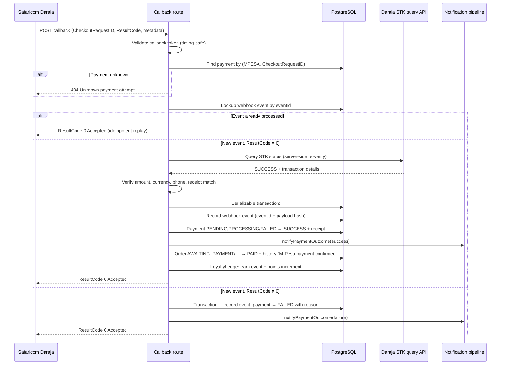

# SYS-01 — M-Pesa STK callback processing

Safaricom Daraja calls the Sphere callback endpoint after an STK Push ends. The endpoint authenticates the call, replays-protects it with a webhook event ledger, re-verifies the outcome against Daraja itself, and only then flips payment, order, loyalty and notification state inside one serializable transaction. This is the system-side half of journey O03.

| Metadata | Value |
| --- | --- |
| Primary actor | System (Safaricom Daraja → Sphere API) |
| Secondary actors | Customer (payer) |
| Functional area | Payments |
| Entry point | `POST /api/payments/mpesa/callback?token=…` |
| Status | Environment-dependent (requires live provider credentials) — verified against code |
| End condition | Payment `SUCCESS` + order `PAID` + points credited + notifications sent; or payment `FAILED` recorded idempotently |
| Related journeys | O03 (customer side), SYS-02 (card equivalent), SYS-10 (notification fan-out), A03 (delivery after payment) |

## Journey map

## Journey steps

### Step 1 — Daraja delivers the callback

- **Trigger:** The customer completes or cancels the STK prompt on their phone (journey O03); Safaricom POSTs the transaction result to the registered callback URL.
- **Location:** `POST /api/payments/mpesa/callback` — `src/app/api/payments/mpesa/callback/route.ts`.
- **Destination:** No navigation — this is a server-to-server request; the response is consumed by Daraja.
- **Purpose:** Deliver the authoritative outcome of the STK Push.
- **System behaviour:** The route first authenticates: the URL must carry a `token` query parameter matching `MPESA_CALLBACK_TOKEN` (≥ 24 chars, compared with `timingSafeEqual`); otherwise 401. The JSON body must contain `Body.stkCallback` with a `CheckoutRequestID` and integer `ResultCode`; otherwise 400. Metadata items (receipt number, phone, amount) are extracted from `CallbackMetadata`.
- **Outcome:** An authenticated, well-formed callback ready to be matched to a payment.
- **Next step:** Match and replay-check.
- **Alternative paths:** Invalid token (401), malformed payload (400) or unknown `CheckoutRequestID` (404) end the request immediately; nothing is recorded.

### Step 2 — Match the payment and replay-check the event

- **Trigger:** A valid callback arrived.
- **Location:** Same route; `Payment` and `PaymentWebhookEvent` tables.
- **Destination:** Database lookups only.
- **Purpose:** Guarantee that each provider event is applied at most once, even when Daraja retries.
- **System behaviour:** The payment is found by the composite key `(provider: "MPESA", checkoutRequestId)`. An `eventId` is derived as `mpesa:{checkoutRequestId}:{resultCode}:{receipt|none}` plus a SHA-256 hash of the raw payload. If an event row already exists for the same payment, the route answers `ResultCode 0 Accepted` without side effects; if the event exists but points at a different payment, it is treated as a conflicting replay (409).
- **Outcome:** Either an early idempotent acknowledgement, or a new event ready to be processed.
- **Next step:** Branch on `ResultCode`.
- **Alternative paths:** Conflicting replay (409) is an anomaly worth investigating — it means the same provider event maps to two different payment rows.

### Step 3 — Success path: re-verify and commit atomically

- **Trigger:** `ResultCode === 0` (customer approved the payment).
- **Location:** Same route; Daraja STK query API (`src/lib/mpesa/daraja.ts` `queryStkPush`), `src/lib/security/payment.ts` (`paymentMatchesExpected`).
- **Destination:** One serializable database transaction (`isolationLevel: Serializable`, 15 s timeout).
- **Purpose:** Never trust the callback alone — confirm with the provider that the transaction really succeeded and matches what Sphere expects.
- **System behaviour:** The route queries Daraja for the STK status and requires `SUCCESS`, then compares amount, currency (KES), phone and receipt against the stored payment expectation. Inside the transaction it: (re-checks and) records the `PaymentWebhookEvent`; flips the payment to `SUCCESS` with the receipt only when it was `PENDING`/`PROCESSING`/`FAILED` (a no-op if already terminal); calls `notifyPaymentOutcome(success)`; moves the order from `AWAITING_PAYMENT`, `AVAILABILITY_CONFIRMED` or `PRESCRIPTION_VERIFIED` to `PAID` with an `OrderStatusHistory` row noting the receipt; and, for signed-in customers, credits loyalty points via an idempotent `LoyaltyLedger` event (`earn:{orderId}`) incrementing both ledger and user balance.
- **Outcome:** Payment `SUCCESS`, order `PAID`, points credited, notifications queued — all or nothing.
- **Next step:** The customer sees the paid state (journey O03); fulfillment proceeds (A02/A03).
- **Alternative paths:** If the provider query or the amount/phone/receipt verification fails, the route returns 409 "Payment verification mismatch" and changes nothing — the payment stays in its prior state and stays reconcilable. If the transaction throws, the route answers 503 so Daraja retries later.

### Step 4 — Failure path: record the outcome idempotently

- **Trigger:** `ResultCode ≠ 0` (customer cancelled, entered the wrong PIN, or the push timed out).
- **Location:** Same route, failure branch.
- **Destination:** A short transaction.
- **Purpose:** Persist the failure so the customer and staff see the truth and can retry.
- **System behaviour:** The webhook event is recorded and the payment (when still `PENDING`/`PROCESSING`/`FAILED`) is set to `FAILED` with reason `M-Pesa request failed ({resultCode})`, then `notifyPaymentOutcome(failure)` informs the customer. The order is deliberately left in `AWAITING_PAYMENT` so the customer can retry payment from the order detail view (journey O06/O03).
- **Outcome:** Payment `FAILED` with a reason; customer notified; order still payable.
- **Next step:** The customer may retry M-Pesa, switch to card, or (for pickup) pay cash at the counter.
- **Alternative paths:** A late duplicate callback for the same event is short-circuited by the event ledger. If the transaction fails, 503 prompts Daraja to retry.

## Decision points

| Decision | Branches | Enforced by/where |
| --- | --- | --- |
| Callback authenticated? | Valid token → process; invalid → 401 | `validCallbackToken` (timing-safe compare, ≥ 24-char `MPESA_CALLBACK_TOKEN`) |
| Payment known? | Found → continue; unknown CheckoutRequestID → 404 | `Payment.provider_checkoutRequestId` unique key |
| Event seen before? | Same payment → acknowledge (idempotent); different payment → 409; new → process | `PaymentWebhookEvent.eventId` unique |
| Provider outcome | ResultCode 0 → success path; otherwise → failure path | Route branch on `resultCode` |
| Server-side verification passed? | Match → commit; mismatch → 409, no state change | `queryStkPush` + `paymentMatchesExpected` |
| Payment still open? | PENDING/PROCESSING/FAILED → transition; already terminal → no-op | conditional `updateMany` status guards |
| Order in payable state? | AWAITING_PAYMENT/AVAILABILITY_CONFIRMED/PRESCRIPTION_VERIFIED → PAID; else unchanged | conditional order `updateMany` + history row |

## Error and recovery paths

- **Invalid callback authentication (401):** rejected before any database work; the token must be configured via `MPESA_CALLBACK_TOKEN` (see `docs/operations/environment-variables.md`).
- **Verification mismatch (409):** callback data disagrees with Daraja's own query or the stored expectation; nothing changes. Investigate via the payments table and Daraja portal; the customer's money, if actually taken, is reconciled manually per the payments runbook.
- **Processing failure (503):** Daraja retries the callback; the event ledger guarantees the retry applies cleanly.
- **Callback never arrives:** the payment stays `PROCESSING`/`PENDING`; staff can trigger a status query or the customer can retry — the reconciliation procedure is documented in the payments feature doc. Uncertain outcomes are never falsely reset (project rule).
- **Duplicate loyalty credit:** impossible by design — the ledger event key `earn:{orderId}` is unique, so retries or replays cannot double-credit points.

## Traceability

| Concern | Implementation reference |
| --- | --- |
| Callback endpoint | `src/app/api/payments/mpesa/callback/route.ts` |
| STK initiation (creates the payment row) | `POST /api/payments/mpesa/initiate`; `src/lib/mpesa/daraja.ts` |
| Server-side re-verification | `queryStkPush` in `src/lib/mpesa/daraja.ts`; `paymentMatchesExpected` in `src/lib/security/payment.ts` |
| Idempotency ledger | `PaymentWebhookEvent` model (`prisma/schema.prisma`), unique `eventId` |
| Payment/order state | `Payment`, `Order`, `OrderStatusHistory` models; statuses in `src/lib/constants.ts` |
| Loyalty credit | `LoyaltyLedger` (event key `earn:{orderId}`), `pointsForAmount` in `src/lib/constants.ts` |
| Notifications | `notifyPaymentOutcome` in `src/lib/notifications/payment.ts` (journey SYS-10) |
| Transaction safety | Serializable isolation, conditional `updateMany` guards, version increment |
| Provider doc | `docs/integrations/mpesa-daraja.md` |
| API contract | `openapi/sphere-api.yaml` — `POST /payments/mpesa/callback` |

## Related journeys and documents

- **O03** — the customer-facing STK Push journey this callback completes
- **SYS-02** — the IntaSend card webhook, same guarantees for card payments
- **SYS-10** — how the payment-outcome notification reaches in-app/email/push
- **A03** — paid delivery orders flow to the dispatch board
- Docs: [M-Pesa Daraja integration](../../integrations/mpesa-daraja.md) · [payment lifecycle](../../workflows/payment-lifecycle.md) · [payments and refunds](../../features/payments-and-refunds.md)
