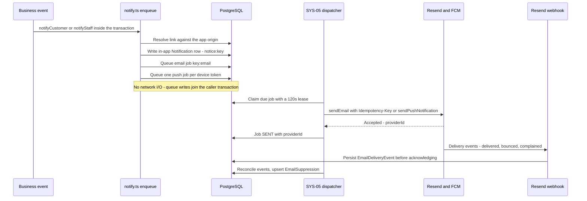

# SYS-10 — Notification fan-out pipeline

Business code never sends email or push directly. When something happens — a payment succeeds (SYS-01/SYS-02), an order moves, a refill or booking reminder fires (SYS-04/SYS-07) — the route calls `notifyCustomer` or `notifyStaff`, and the fan-out pipeline writes the in-app inbox row and one durable outbox job per channel target inside the caller's own transaction. Because queueing is pure database work, an event and its notifications commit or roll back together; because delivery happens later in the SYS-05 dispatcher, a provider outage never breaks a payment. This journey covers the queueing half and the feedback loop; SYS-05 covers the dispatcher drain. In-app delivery always works; the email channel needs Resend and the push channel needs FCM — hence environment-dependent.

| Metadata | Value |
| --- | --- |
| Primary actor | System (business event → notify.ts outbox → SYS-05 dispatcher → providers) |
| Secondary actors | Customer, Staff (recipients) |
| Functional area | Notifications |
| Entry point | `notifyCustomer` / `notifyStaff` in `src/lib/notify.ts` |
| Status | Environment-dependent (requires live provider credentials) — verified against code — in-app rows always queue; EMAIL needs Resend, PUSH needs FCM |
| End condition | Inbox row `notice:{key}` written plus jobs `{key}:email` and `{key}:push:{tokenId}` queued with `skipDuplicates`; SMS and WhatsApp are never dispatched (OTP-only and `wa.me` links respectively) |
| Related journeys | SYS-01/SYS-02 (producers), SYS-05 (dispatcher), SYS-07 (reminder producer), C06 (the preferences and inbox customers manage) |

## Journey map

## Journey steps

### Step 1 — A business event fires

- **Trigger:** Any state change that should tell someone: a payment outcome (`notifyPaymentOutcome`), an order status change, a refill or booking reminder, a back-in-stock alert.
- **Location:** `src/lib/notify.ts` (`notifyCustomer`, `notifyStaff`); worked example `notifyPaymentOutcome` in `src/lib/notifications/payment.ts`.
- **Destination:** The caller's transaction, or a fresh 15-second one.
- **Purpose:** Queue notifications atomically with the event they describe.
- **System behaviour:** `notifyPaymentOutcome` (called inside the payment webhooks' serializable transactions) deduplicates on `payment:{paymentId}:{success|failed}`, notifies the customer (linking to the order or the bookings tab, and emailing a guest's `guestEmail` for orders), and on success fans out a `PAYMENT_RECEIVED` staff notification to ADMIN, PHARMACIST and STAFF roles linking to the relevant admin surface. If a caller passes a `transaction`, the enqueue joins it; otherwise `notifyCustomer` opens its own transaction.
- **Outcome:** A fan-out request with a stable identity.
- **Next step:** Resolve the recipient and link.
- **Alternative paths:** `notifyCustomer` without a userId and without an explicit email recipient returns immediately — nothing is queued for nobody.

### Step 2 — Resolve the recipient, channel targets and link

- **Trigger:** A fan-out request.
- **Location:** `enqueue` in `src/lib/notify.ts`; `notificationUrl` helper.
- **Destination:** Read-only lookups (user/staff email, `PushToken` rows).
- **Purpose:** Decide who gets what, and where taps land.
- **System behaviour:** The link is resolved against `NEXT_PUBLIC_APP_URL` (default `https://spherepharmacy.co.ke`): a link on another origin degrades to `/account` (staff default `/admin`), so notification taps can never leave the app. The recipient email is the explicit `extra.email.to`, else the user's or staff member's stored email. Registered device tokens for the owner are loaded in parallel.
- **Outcome:** A recipient email (maybe), a token list, and a safe deep link.
- **Next step:** Write the inbox row and queue the jobs.
- **Alternative paths:** Staff emails are only queued when the caller supplies email content — staff fan-out defaults to in-app plus push.

### Step 3 — Write the in-app inbox row

- **Trigger:** Recipients resolved.
- **Location:** Same function; `Notification` model.
- **Destination:** One `Notification` insert (or none for email-only fan-outs).
- **Purpose:** The always-works channel: the header bell every customer and staff member sees.
- **System behaviour:** The row is written with id `notice:{key}` (the dedupe key or a random UUID), `channel: IN_APP`, the event, title, message, and a metadata JSON that folds the caller's metadata plus the resolved link. `createMany` with `skipDuplicates` makes replays no-ops.
- **Outcome:** The message is in the inbox (journey C06 reads it via `GET /api/notifications`).
- **Next step:** Queue the channel jobs.
- **Alternative paths:** `Notification.channel` only ever holds `IN_APP` in practice — the broader channel constant exists but email/push live in the outbox table instead.

### Step 4 — Queue one email job and one push job per device

- **Trigger:** The inbox row is ready.
- **Location:** Same function; `NotificationDelivery` model.
- **Destination:** Outbox inserts in the same transaction.
- **Purpose:** Durable, independently retried delivery — one job per recipient/device so a failed token never blocks a successful one.
- **System behaviour:** An email job `{dedupeKey: {key}:email, channel: EMAIL, payload: {to, subject, html, text}}` is queued when a recipient email exists — the default HTML escapes the message and appends a "View your update" link, and callers can supply full templates (the booking reminder's branded template, the refill reminder's personalization). A push job `{dedupeKey: {key}:push:{tokenId}, channel: PUSH}` is queued per registered token with payload `{token, title: "Sphere Pharmacy", body: "You have a new update. Open Sphere to view it securely.", link, data: {event, notificationId}}`. All inserts use `skipDuplicates`. **No network I/O occurs here** — this is the outbox pattern's whole point.
- **Outcome:** The outbox holds every channel delivery as a claimable row.
- **Next step:** Staff fan-out shapes the same writes per member.
- **Alternative paths:** SMS exists only for OTP via Africa's Talking (`src/lib/sms.ts`) and WhatsApp only as `wa.me` links — neither is a dispatched channel, and their preference flags are stored but inert.

### Step 5 — Fan out to staff by role

- **Trigger:** A staff-facing event (`notifyStaff`).
- **Location:** Same file; `StaffUser` and `PushToken` queries.
- **Destination:** Per-member inbox rows and jobs.
- **Purpose:** Tell the right roles without callers enumerating people.
- **System behaviour:** `notifyStaff` selects active staff by `staffId` or by role (default `[ADMIN]`), loads their push tokens, and for each member writes an inbox row plus an email job (only when the caller supplied `emailHtml`) plus one push job per token — each with per-member dedupe keys (`{key}:{memberId}` variants). Payment success fans out to `["ADMIN","PHARMACIST","STAFF"]` with an `/admin/orders` or `/admin/services` link.
- **Outcome:** Every targeted staff member has an inbox row and channel jobs.
- **Next step:** Delivery happens in SYS-05.
- **Alternative paths:** Deactivated staff are filtered out at queue time (and again at dispatch time).

### Step 6 — Delivery and the provider feedback loop

- **Trigger:** Outbox rows exist.
- **Location:** SYS-05 dispatcher (`src/lib/notifications/delivery.ts`); `sendEmail` (`src/lib/email/resend.ts`); `sendPushNotification` (`src/lib/firebase/admin.ts`); `POST /api/notifications/email-webhook`.
- **Destination:** Resend and FCM; then back into the database.
- **Purpose:** Complete the loop — provider-accepted, then provider-confirmed, with bounces remembered.
- **System behaviour:** The dispatcher claims due jobs with leases and sends them (EMAIL with `Idempotency-Key = job.id`, PUSH after re-verifying token ownership), honoring `NotificationPref` email/push opt-outs and `EmailSuppression` at dispatch time. Resend's delivery events arrive at the Svix-authenticated webhook, which persists an `EmailDeliveryEvent` (matched by provider id) **before** acknowledging — events can precede the send response. The dispatcher's `reconcileEmailEvents` then maps DELIVERED/BOUNCED/COMPLAINED/FAILED onto jobs (never overwriting terminal bounce states) and upserts bounced/complained addresses into `EmailSuppression`, which is deliberately permanent until an admin removes it.
- **Outcome:** Job states reflect provider truth; bad addresses stop being emailed; health is visible at `/api/admin/notification-health`.
- **Next step:** The next business event starts the cycle again.
- **Alternative paths:** Provider failures retry with exponential backoff (max 8 attempts, 23-hour window) inside SYS-05; a crashed dispatcher run's leases expire and are reclaimed — the outbox never silently drops.

## Decision points

| Decision | Branches | Enforced by/where |
| --- | --- | --- |
| Recipient resolvable? | userId/staffId or explicit email → queue; neither → return | `notifyCustomer` early return; `enqueue` owner resolution |
| Link trustworthy? | Same-origin as app URL → use; foreign origin → `/account` fallback | `notificationUrl` in `src/lib/notify.ts` |
| Email target? | Recipient email present → one `{key}:email` job; absent → in-app + push only | `enqueue` email job condition |
| Devices registered? | Each token → its own `{key}:push:{tokenId}` job; none → skip push | Token loop in `enqueue` |
| Staff or customer fan-out? | `notifyStaff` by role (default ADMIN) or staffId, active only; `notifyCustomer` single owner | Role filter in `notifyStaff` |
| Duplicate event? | Same dedupe key → `skipDuplicates` no-ops on all writes | `Notification` id + `NotificationDelivery.dedupeKey` unique |
| Own transaction or caller's? | `transaction` passed → join it; else → fresh 15 s transaction | `notifyCustomer`/`notifyStaff` transaction choice |
| Channel dispatched at all? | EMAIL/PUSH only — SMS is OTP-only, WhatsApp is links | Dispatcher channel switch; `src/lib/sms.ts` sole OTP caller |

## Error and recovery paths

- **Queueing failure:** the enqueue runs inside the caller's transaction — the business event and its notifications commit or roll back together, eliminating the commit-to-enqueue gap for the flows that pass their transaction (payment callbacks, cash-confirm, service payment selection; some legacy routes still notify after commit, a known gap).
- **Provider outage:** jobs stay `PENDING` and retry with backoff in SYS-05; the in-app row is already visible regardless.
- **Recipient opted out:** preference checks happen at dispatch time — the inbox row still exists, the channel job is `SKIPPED`.
- **Bounced or complained address:** suppressed permanently; future jobs skip the email while the in-app row still lands.
- **Duplicate fan-out:** dedupe keys (`payment:{paymentId}:{outcome}`, reminder keys, random UUIDs) make replays no-ops at both tables.
- **Dead device token:** skipped and pruned by the dispatcher; customers re-register via the account view (C06).
- **Queue backlog:** terminal rows are retained (no purge job — a governance decision); monitor `oldestPendingAt` via notification health and drain by tightening the scheduler cadence.
- **Stale `ScheduledJobDelivery` schema:** the model exists but has zero code references — `NotificationDelivery` is the real outbox; do not build against the vestigial table.

## Traceability

| Concern | Implementation reference |
| --- | --- |
| Queueing API | `notifyCustomer`, `notifyStaff`, `enqueue` in `src/lib/notify.ts` |
| Link safety | `notificationUrl` (same-origin enforcement) in `src/lib/notify.ts` |
| Inbox model | `Notification` model (`prisma/schema.prisma`), read via `GET /api/notifications` |
| Outbox model | `NotificationDelivery` (`dedupeKey` unique, channel EMAIL/PUSH); `ScheduledJobDelivery` is dead schema |
| Payment producer | `notifyPaymentOutcome` in `src/lib/notifications/payment.ts` |
| Booking producer | `notifyServiceBooking` + `serviceBookingTemplate` in `src/lib/email/templates.ts` |
| Dispatcher | `dispatchNotifications` in `src/lib/notifications/delivery.ts` (journey SYS-05) |
| Email provider | `sendEmail` in `src/lib/email/resend.ts` (Resend REST, Idempotency-Key) |
| Push provider | `sendPushNotification` in `src/lib/firebase/admin.ts` (FCM HTTP v1) |
| Delivery events | `POST /api/notifications/email-webhook` (Svix HMAC); `EmailDeliveryEvent`, `EmailSuppression` models |
| Preferences | `NotificationPref` model; `GET/PUT /api/notifications/prefs` |
| Observability | `GET /api/admin/notification-health`; `GET/POST /api/notifications/dispatch-test` |

## Related journeys and documents

- **SYS-01 / SYS-02** — the payment webhooks whose `notifyPaymentOutcome` calls feed this pipeline
- **SYS-05** — the dispatcher that drains the outbox this journey fills
- **SYS-07** — booking reminders queued through `notifyServiceBooking`
- **C06** — the inbox, channel preferences and push opt-in customers manage
- Docs: [notifications feature](../../features/notifications.md) · [scheduled jobs runbook](../../operations/scheduled-jobs.md) · [Resend integration](../../integrations/resend.md) · [Firebase integration](../../integrations/firebase.md)
