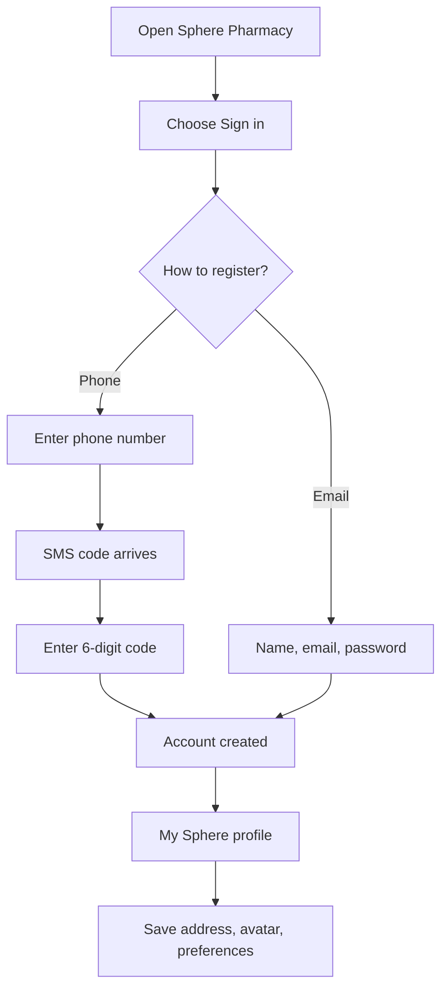
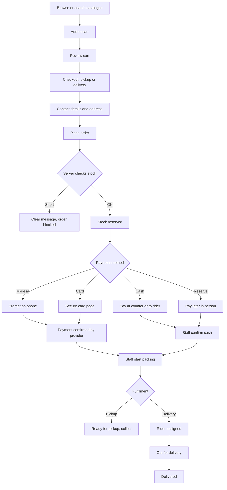
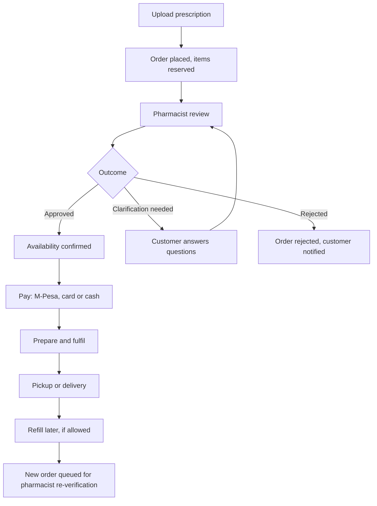
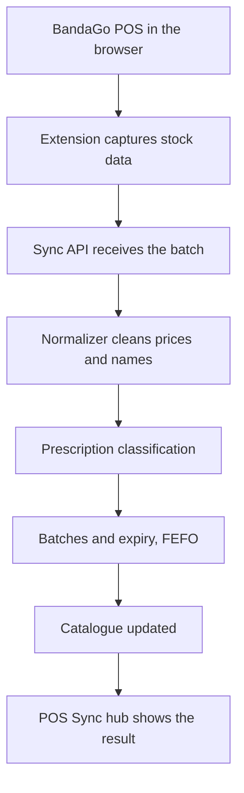
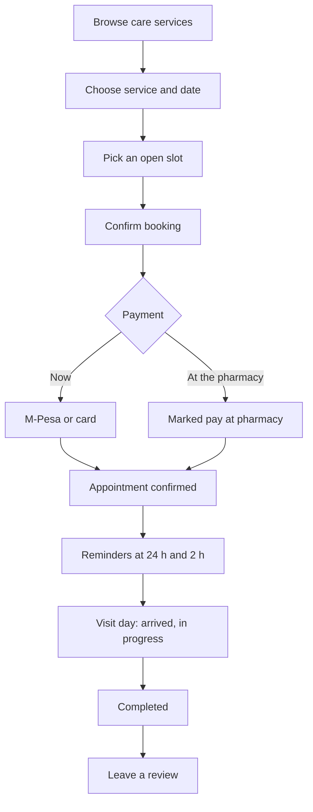
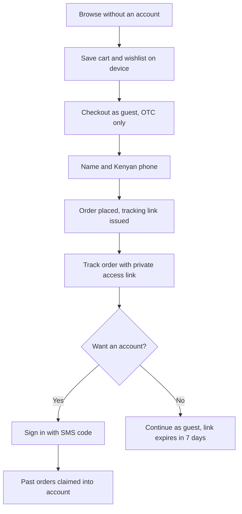

# Customer journeys

This page walks through the six core journeys that keep the pharmacy running, in everyday language with simple flowcharts. Use it to train new staff, to explain the platform to the owner, and to check that a deployment behaves as expected. The complete acceptance matrix is the 51-journey recording script in [../recording/](../recording/) — this page covers the six journeys everything else hangs off.

| Audience | Status | Verified |
| --- | --- | --- |
| Pharmacy owner, pharmacists, staff | Implemented — verified against code | November 2026 |

## 1. Customer onboarding

A new customer turns from a visitor into a known patient with saved details. Two routes exist: classic email/password registration, or phone-only sign-in with an SMS code (OTP — a one-time 6-digit password sent by text). The phone route is the fastest for most Kenyan customers.

What happens along the way:

- Passwords need 10+ characters with at least one letter and one digit. Kenyan phone numbers are normalised automatically (07… and 2547… both work).
- The SMS-code route needs the SMS provider to be configured (**Environment-dependent**); the email/password route works out of the box.
- After signing in, the customer lands back wherever they were heading — if they were sent to sign in mid-checkout, their cart is preserved and they return straight to checkout.
- The profile ("My Sphere") collects addresses (with GPS option), notification preferences, a restock watchlist and the Sphere Points balance.

Recording reference: C01 (account creation), C02 (phone-code sign-in), C04 (profile and security).

## 2. Over-the-counter (OTC) order

The everyday sale: non-prescription items, paid and fulfilled. One important design choice: **stock is checked and reserved the moment the order is placed**, so two customers cannot both buy the last pack.

What happens along the way:

- Orders with an online payment method start at "awaiting payment"; cash and reserve orders start at "received". A paid order cannot be prepared until payment is genuinely confirmed by the provider — a sent prompt is not a payment.
- Delivery fees follow the zones (Roysambu 150 → other Nairobi 500 KSh, free over KSh 3,000); pickup is free of delivery fees.
- Unpaid orders hold their reserved stock only for the configured reservation window; after that a background job cancels them and returns the stock (**Environment-dependent** — needs the scheduler).
- Customers can cancel until payment succeeds. Captured payments are never auto-refunded — a refund is a separate, deliberate step.
- M-Pesa and card payments are **Requires live verification** before real money moves.

Recording reference: O01–O06 (cash pickup, delivery, M-Pesa, card, reserve, track/cancel/reorder), plus the handoffs O01 → A02 (staff processing) → O06 (customer status) and A03 (dispatch) → R01 (rider completes).

## 3. Prescription order

The clinically controlled sale. Prescription-only medicines can never be bought outright: the order waits in "under review" until a pharmacist decides.

What happens along the way:

- Uploads are photos or PDFs up to 10 MB, stored privately — every viewing is logged, and download links expire in minutes (needs R2 storage configured: **Environment-dependent**).
- The pharmacist approves, rejects, requests clarification, or partially approves. They can allow **0–6 refills** and set the approval's validity (30/60/90/180 days).
- When all prescriptions on an order are approved, the order moves to "prescription verified" and becomes payable; if any is rejected, the order is rejected and the customer is told.
- **Refills are never automatic.** Each refill use creates a fresh prescription record that a pharmacist re-verifies — a deliberate safety choice. Refills also need valid remaining uses, an unexpired approval, and current stock.
- Patients who completed a prescription order roughly 30 days ago can receive an in-app/email refill reminder from a background job (time-based only, never dosage advice).

Recording reference: X01 (upload), X02 (prescription order), X03 (outcomes and refills); staff side A04 (approve) and A05 (clarify / partially approve / reject).

## 4. Inventory synchronization (BandaGo POS)

How the catalogue stays truthful: stock, prices, batches and expiry dates flow **from the pharmacy's BandaGo POS** (the till system) into the platform. The receiving side is fully implemented; the capturing side is a small Chrome extension that runs in the pharmacist's browser and is delivered separately.

What happens along the way:

- Prices arrive in messy human formats ("KSh 3,400", "1,250.50") and are cleaned automatically. Products are matched by their POS identifier; unknown categories are created; custom local product images are never overwritten.
- Prescription classification follows a Kenya PPB-aligned keyword list (antibiotics, insulin, blood-pressure medicines and so on). Once an item is flagged as prescription-only, a sync can never downgrade it.
- Batches are deduplicated and expiry-tracked. **Expired batches never count as sellable stock**, and batches within 90 days of expiry raise a near-expiry flag (shown as a PPB audit alert in the hub).
- A **CSV import** path uses the exact same pipeline — useful before the extension is installed, or for bulk day-one loads. CSVs accept many column aliases and can be dropped straight into the POS Sync hub.
- The hub shows what mapped, what failed, batch counts, near-expiry flags and the last live signal, plus a ledger of every sync event.
- Extension status: **Requires live verification** — it is not part of this repository; until it is connected the hub reads "Awaiting extension".

Recording reference: A07 (update products and stock), A08 (create a product, choose images), A09 (import products from CSV).

## 5. Clinical service booking

Health services — for example a medication review or a blood-pressure check — booked and managed in the same system as shopping.

What happens along the way:

- Services carry a duration (5–480 minutes, default 15) and either a price or "price on asking". Availability is set per service as weekly rules; slots are generated live, one customer per slot, in Nairobi time.
- The server re-checks the price at booking — if it changed, the customer is told rather than silently overcharged. If the slot was just taken by someone else, booking is refused with a clear message.
- Staff can confirm, reschedule, cancel, mark no-show, and assign a team member. Bookings can also be paid by M-Pesa or card (**Requires live verification** in production) or marked "pay at pharmacy" — which records intent, not money; the in-store cash settlement endpoint is **Planned or not shipped**.
- Customers get an in-app/email reminder 24 hours and 2 hours before (needs the scheduler: **Environment-dependent**), can download a calendar file (.ics), and can review the visit after it is completed.

Recording reference: S01 (browse and book), S02 (choose payment), S03 (track and review); staff side A10 (publish a service, set hours), A11 (run the appointment workflow), A12 (reschedule/cancel).

## 6. Guest journey

Not everyone wants an account. Guests can do real business — with clear, safe limits.

What happens along the way:

- Guests can browse, search, keep a cart and wishlist, request missing medicines (with a photo), and **check out over-the-counter items only** — prescriptions require an account so the pharmacist workflow is fully traceable.
- The order confirmation includes a private access link (a one-time token stored only as a secure hash) that works for 7 days for tracking, cancelling and paying. Treat it like a receipt: anyone holding it can see that order.
- When the guest later signs in with the same phone number via SMS code, matching past guest orders are claimed into the account automatically and the token is cleared.
- Guests earn no Sphere Points and cannot use per-user promo codes.

Recording reference: P01–P06 (homepage, find/filter, product details, medicine requests with and without photo, contact), C03 (cart review and sign-in return).

## Cross-role handoffs worth rehearsing

The recording checklist highlights handoffs where one journey hands the baton to another team:

- Pickup order (O01) → staff processing (A02) → customer sees status (O06).
- Prescription order (X02) → pharmacist review (A04/A05) → customer outcome and refills (X03).
- Appointment (S01) → care workflow (A11) → completed-visit review (S03).
- Dispatch assignment (A03) → rider completes (R01) → customer order history.
- Medicine request (P04/P05) → staff follow-up (A06).
- Restock alert (C07) → stock update (A07) → customer notified.
- Review written (C09) → moderation (A13) → visibility.
- Promotion created (A14) → customer uses the code at checkout.

## Where the engineering detail lives

Each journey has a step-by-step engineering walkthrough in [../workflows/](../workflows/) and module deep-dives in [../features/](../features/). The full 51-journey script with clicks, captions and expected results is in [../recording/recording-checklist.md](../recording/recording-checklist.md) (printable copies live in `output/pdf/`). For the staff side of these journeys, see [pharmacy-operations.md](pharmacy-operations.md); for who may do what, [user-roles-and-permissions.md](user-roles-and-permissions.md). Project README: [../../README.md](../../README.md).
