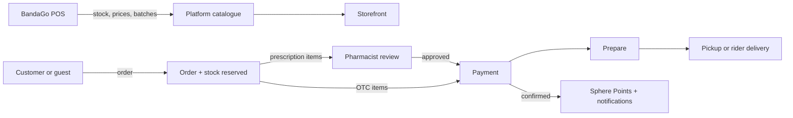

# Sphere Pharmacy platform — product overview

This page explains, in plain language, what the Sphere Pharmacy platform is, who it serves, what it covers today, and — just as importantly — what it does **not** do yet. Read it first: the other product pages (feature catalogue, roles, journeys and the operations guide) all assume you have this overall picture. Every statement here has been checked against the actual code in November 2026.

| Audience | Status | Verified |
| --- | --- | --- |
| Pharmacy owner, pharmacists, staff | Implemented — verified against code | November 2026 |

## The business problem

The Sphere Pharmacy runs a busy retail operation: walk-in customers on Lumumba Drive, phone and WhatsApp enquiries, deliveries across Nairobi, prescriptions that must be reviewed by a pharmacist, chronic patients who need refills, and a BandaGo point-of-sale (POS — the till system) that records every sale. Without a platform, that information lives in separate places: stock levels only in the POS, orders in chat threads, prescriptions on paper or in a drawer, and no single view of who ordered what.

The platform brings all of it together:

- A **public storefront** customers can browse any time — with or without an account.
- A **pharmacist-controlled prescription workflow**: uploads are reviewed by a qualified pharmacist before any prescription-only medicine can be paid for or dispatched.
- **Live stock, prices, batches and expiry dates** flowing in from the BandaGo POS — with stagnant-POS drift protection and Daily Sales Export / optional Auto-Sync reconciliation back to the till.
- **Order and delivery management** with rider dispatch.
- **Payments** (M-Pesa, cards, cash), **loyalty** (Sphere Points), **promotions**, **clinical service bookings**, **medicine requests** and **notifications** — all in the same system.

## The pharmacy at a glance

These details are built into the platform and can be edited by an admin under **Admin → Settings**.

| Detail | Value |
| --- | --- |
| Pharmacy | The Sphere Pharmacy |
| Location | Lumumba Drive, Roysambu, Nairobi, Kenya |
| Opening hours | Every day, 8:00 – 22:30 (the storefront shows an open/closed indicator based on these hours) |
| Phone | +254 707 475 208 |
| WhatsApp | Click-to-chat via wa.me/254707475208 — it opens a chat with the pharmacy; it is **not** automated messaging |
| Email shown in the app | orders@spherepharmacy.co.ke (a placeholder — replace it in Settings before going live) |
| Payments | M-Pesa STK push (the payment prompt that appears on a customer's phone), card via IntaSend's secure hosted page, cash on pickup or delivery, and reserve-now-pay-later |
| Delivery | Zone-based fees across Nairobi: Roysambu/TRM KSh 150 · Kasarani KSh 200 · Githurai 44 KSh 250 · Ruaraka/Baba Dogo KSh 250 · Nairobi CBD KSh 400 · other Nairobi KSh 500 · **free over KSh 3,000** (pre-discount subtotal) |

> **Honest status note on payments:** the payment layer uses real providers (Safaricom Daraja for M-Pesa, IntaSend for cards) and is fully wired into the code, but it is **Requires live verification** — going live needs production credentials and certification from each provider. The sandbox values in the configuration template are examples only. An older project README described payments as "simulated"; that is out of date, but "live-certified" is not yet true either.

## Who the platform serves

### Walk-in pickup customers
People near Roysambu who want to check availability and price before walking in, reserve items, or order ahead and collect. They choose **pickup** at checkout, receive an order reference (SPH-…) and a pickup code, and pay online or at the counter.

### Delivery customers
Customers anywhere in the covered Nairobi zones. They choose **delivery**, pay online (or cash on delivery), and their order is prepared, assigned to a rider and tracked to the door.

### Chronic and refill patients
Registered customers with repeating prescriptions. When a pharmacist approves a prescription they can allow **refills** (up to 6) and set how long the approval stays valid (30–180 days). A background job can also remind patients who completed a prescription order around 30 days ago that a refill may be due — the reminder is time-based, never a dosage instruction.

### Guests (no account)
Visitors can browse, search, save a cart and a wishlist on their device, request hard-to-find medicines (with a photo), and even check out without an account — over-the-counter (OTC, non-prescription) items only. They receive a private order-tracking link that works for 7 days, and can later claim those orders into a real account by signing in with their phone number and an SMS code.

### The pharmacy team
Five roles use the staff workspace: **Admin** (owner/manager), **Pharmacist**, **Staff** (counter), **Rider** — plus **Customers** on the public side. Who sees what is described in [user-roles-and-permissions.md](user-roles-and-permissions.md).

## Core value proposition

1. **One place for the whole operation.** Storefront, prescriptions, orders, deliveries, payments, loyalty, services and stock — no more juggling chat threads and paper.
2. **Pharmacist control where it matters.** Prescription-only medicines cannot move through checkout to fulfilment without pharmacist review; every refill is re-verified; expired stock is never counted as sellable.
3. **Stock you can trust.** Catalogue quantities come from the BandaGo POS (or a CSV import), with batch numbers and expiry dates, and stock is reserved the moment an order is placed so two customers cannot buy the last pack.
4. **Convenience customers expect.** M-Pesa and card payments, Nairobi-wide delivery, saved addresses, Sphere Points, and an AI assistant that helps without ever giving medical advice.
5. **Honest systems.** The platform records what actually happened — payments only count as paid when the provider confirms, and staff screens show real statuses, not optimistic ones.

## How the pieces fit together

The simplest mental model: stock and money flow through the middle, and every prescription passes a human pharmacist.

Two things to notice in that picture: nothing reaches payment for prescription items without the pharmacist, and payment is only "confirmed" when the provider (M-Pesa or IntaSend) says so — not when a prompt is sent.

## What the platform covers

| Module | What it does | Deep-dive documentation |
| --- | --- | --- |
| Public storefront & home | Landing page, search, categories, contact routes | [../features/storefront-and-catalogue.md](../features/storefront-and-catalogue.md) |
| Product catalogue | Browsing, filters, product pages, stock badges | [../features/storefront-and-catalogue.md](../features/storefront-and-catalogue.md) |
| Shopping | Cart, wishlist, recently viewed, offers page | [../features/storefront-and-catalogue.md](../features/storefront-and-catalogue.md) |
| Checkout | 4 steps, OTC/Rx separation, guest checkout, pickup + delivery | [../features/orders-and-fulfillment.md](../features/orders-and-fulfillment.md) |
| Customer accounts | Registration, phone-code (OTP) sign-in, profiles, addresses, preferences | [../features/customer-crm.md](../features/customer-crm.md) |
| Prescriptions | Upload, pharmacist review, refills, secure storage | [../features/prescriptions.md](../features/prescriptions.md) |
| Inventory | Batches, expiry, FEFO sellable stock, reservations | [../features/inventory-and-stock.md](../features/inventory-and-stock.md) |
| Orders & fulfilment | Statuses, preparation, pickup, delivery, cancellation, riders | [../features/orders-and-fulfillment.md](../features/orders-and-fulfillment.md) |
| Payments & refunds | M-Pesa, IntaSend cards, cash, refund handling | [../features/payments-and-refunds.md](../features/payments-and-refunds.md) |
| Sphere Points (loyalty) | Earn, redeem, reverse on cancellation/refund | [../features/loyalty-and-promotions.md](../features/loyalty-and-promotions.md) |
| Promotions | Percentage discount codes with usage limits | [../features/loyalty-and-promotions.md](../features/loyalty-and-promotions.md) |
| Clinical services | Service catalogue, slots, appointments, reviews | [../features/services-and-bookings.md](../features/services-and-bookings.md) |
| Product reviews | Star ratings with staff moderation | [../features/storefront-and-catalogue.md](../features/storefront-and-catalogue.md) |
| Medicine requests | "Find this medicine" requests with optional photo | [../features/medicine-requests.md](../features/medicine-requests.md) |
| Notifications | In-app inbox, email, push alerts | [../features/notifications.md](../features/notifications.md) |
| AI assistant | Product-finding and navigation help with strict medical guardrails | [../features/ai-assistant.md](../features/ai-assistant.md) |
| BandaGo POS sync & CRM | Bi-directional stock/batch sync, stagnant-POS drift protection, Daily Sales Export, CRM reconciliation | [../integrations/bandago-pos-crm.md](../integrations/bandago-pos-crm.md) |
| Interactive documentation portal | `/docs` hub with 69 user journeys, API & DB explorers, ⌘K search, and "Ask Sphere Docs" | [../README.md](../README.md) |

## System boundaries — what the platform does NOT do today

Being clear about boundaries avoids unpleasant surprises. Verified against the code:

1. **No automated WhatsApp or SMS order messaging.** WhatsApp in this platform is a **click-to-chat link** (wa.me/254707475208) that opens a conversation with a human — the platform never sends WhatsApp messages by itself. SMS is used **only** for one-time sign-in codes (OTP). Order updates reach customers through the in-app inbox, email and push notifications. Preference toggles for SMS/WhatsApp exist in the customer's account, but they do not dispatch anything. **Planned or not shipped.**
2. **No PPB licence claim.** The Admin → Compliance section records the premise licence and superintendent pharmacist details internally — it explicitly is *not* Pharmacy and Poisons Board verification, and it must not be presented as such to the public until the client confirms and verifies the details. The platform also follows PPB-aligned rules in code (expired batches are never sellable; prescription items require review), but that is good practice, not a licence.
3. **Payments are real-provider-capable but not live-certified.** M-Pesa (Daraja STK push) and card (IntaSend hosted checkout) are fully implemented with callbacks, receipts and reconciliation — but live money movement requires production credentials, verified callback URLs and provider certification. **Requires live verification.** Also note: M-Pesa refunds are **not** automated — they must be completed in the M-Pesa organisation portal and then recorded in the system.
4. **No group or multi-capacity bookings.** Every clinical service slot holds exactly one customer. If you need group sessions, that is **planned or not shipped**.
5. **Delivery is Nairobi-local.** Zones and distance pricing cover Nairobi areas only (Roysambu 150 → other Nairobi 500 KSh, free over KSh 3,000). There is no up-country or international delivery.
6. **Background jobs need a scheduler.** Reminders, reservation expiry, notification delivery and record retention are implemented as secure scheduled endpoints (called with a secret key by an external scheduler every minute / 15 minutes / daily). Scheduling itself is a deployment responsibility — nothing in the repository switches it on automatically.
7. **The BandaGo browser extension is not part of this codebase.** All the receiving infrastructure (sync API, normalizer, CRM, admin hub) is implemented, but the Chrome extension that captures data from the BandaGo POS screen is a separate external deliverable. Until it is installed and verified, stock arrives via CSV import or manual entry. **Requires live verification.**
8. **Refunds have no admin screen yet.** A secure refund endpoint exists (IntaSend refunds automated, cash refunds confirmed with a till reference, M-Pesa refused with instructions), but no admin UI calls it today — refunds are currently an engineering/API operation.
9. **Demo credentials in the older project README are historical.** The database seed creates only starter categories and (optionally) one admin account. Accounts like "admin123" date from the demo era and do not exist in a fresh install. See [pharmacy-operations.md](pharmacy-operations.md).

## How status is described across these docs

| Label | Meaning |
| --- | --- |
| **Implemented** | Built and working in the code; works in a normal deployment without extra setup. |
| **Environment-dependent** | Code is complete, but the feature only works once the required provider credentials or infrastructure are configured (e.g. Resend for email, Firebase for push, R2 for file storage, a scheduler for background jobs). |
| **Requires live verification** | Built and working against sandbox/test settings, but must be certified with the live provider before real use (M-Pesa Daraja, IntaSend, the BandaGo extension). |
| **Planned or not shipped** | Mentioned in plans or older documents, but not present in the code today. |

## Common questions

Quick, honest answers to questions the team hears most often:

| Question | Answer |
| --- | --- |
| Do you deliver outside Nairobi? | No. Delivery zones cover Nairobi areas only, from Roysambu (KSh 150) to other Nairobi (KSh 500); delivery is free over KSh 3,000. |
| Can customers order without an account? | Yes — over-the-counter items only, with a private tracking link valid for 7 days. Prescriptions require an account. |
| Does the pharmacy send WhatsApp or SMS order updates? | No. WhatsApp is a click-to-chat link to a human, and SMS carries only sign-in codes. Updates arrive in-app, by email and as push notifications. |
| Can two customers buy the last pack? | No. Stock is checked and reserved the moment an order is placed. |
| What if a customer never pays? | After the configured reservation window, a background job cancels the order and returns the stock. |
| Do guest orders earn Sphere Points? | No — points are for registered customers, awarded when payment is confirmed. |
| Can one appointment slot hold a group? | No. Every clinical service slot holds exactly one customer. |
| Is the platform itself a licence to sell online? | No. The compliance section is an internal record; make no PPB licence claim until it is verified. |
| What do staff need to install? | Only a browser. The one optional install is the BandaGo browser extension for live POS stock sync. |

## Where to go next

- [feature-catalogue.md](feature-catalogue.md) — the complete inventory of features, module by module, with honest status labels.
- [user-roles-and-permissions.md](user-roles-and-permissions.md) — who can do what, and why hidden buttons are not security.
- [customer-journeys.md](customer-journeys.md) — the six core journeys, from onboarding to guest checkout.
- [pharmacy-operations.md](pharmacy-operations.md) — the day-in-the-life guide to the staff workspace.
- [../recording/recording-checklist.md](../recording/recording-checklist.md) — the 51-journey recording checklist used as the full acceptance matrix.
- [../README.md](../README.md) — documentation index · [../../README.md](../../README.md) — project README.
