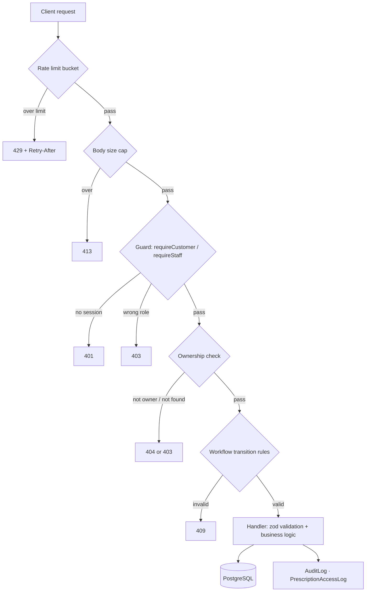

# Access Control

This is the enforcement reference for authorization in Sphere Pharmacy: the role values, the guard helpers and their exact failure behaviour, the complete route-to-role matrix, the ownership-check patterns that keep customers inside their own data, the rider authorization model, the session revocation paths, and an honest statement about what client-side gating does and does not do. If a route is not listed here, its guard can be read directly from the route file — guards are always the first thing a handler calls.

| Audience | Status | Verified |
| --- | --- | --- |
| Engineers, security reviewers, AI coding agents | **Implemented** | November 2026 |

## Roles

Staff roles (`src/lib/constants.ts`): `ADMIN`, `PHARMACIST`, `STAFF`, `RIDER`. Customers are not a staff role — a signed-in customer resolves to the pseudo-role `CUSTOMER`. Every resolved session carries exactly one of these five identities (or none, for anonymous requests).

## Guard helpers (code-level behaviour)

All three live in `src/lib/session.ts` and return `{ session, error }` — handlers return `error` directly when it is non-null.

| Guard | Checks | On failure |
| --- | --- | --- |
| `requireCustomer()` | Valid session, `role === "CUSTOMER"`, `userId` present | 401 `{"error":"Please sign in to your account to continue."}` |
| `requireStaff(roles?)` | Valid session with `staffId`; if `roles` given, `staffRole` must be in the list | 401 `{"error":"Staff sign-in required."}` (no session) or 403 `{"error":"You do not have permission to perform this action."}` (wrong role) |
| `requireAuth()` | Any valid session (customer or staff) | 401 `{"error":"Please sign in to continue."}` |

A "valid session" means the cookie token matched a `Session` row that is unexpired, and — for staff — the account is still active, `authVersion` still matches, and the 12-hour idle timeout has not passed. Expired or invalid sessions are deleted on read.

## Guarded request flow

## Route-to-role matrix

Grouped by who may call. Within a group, narrower ownership rules still apply (next section). Webhook and cron routes are machine-to-machine and carry their own authentication (see [security-architecture.md](security-architecture.md)).

### ADMIN only

| Route / capability |
| --- |
| `GET/POST/PATCH/DELETE /api/admin/staff*` (team, roles, activation, deletion — triggers `revokeStaffSessions`) |
| `GET /api/admin/audit` |
| `GET /api/admin/stats` |
| `GET /api/admin/notification-health`, `GET/POST /api/notifications/dispatch-test` |
| Product `DELETE` / discontinue |
| `POST /api/payments/refund` (order → `REFUNDED` is ADMIN-only from paid/preparing/ready/out-for-delivery/completed states) |
| `PUT /api/settings` |
| `PUT /api/admin/pos-sync/policy` (switch `MANUAL_EXPORT` / `AUTO_SYNC`, drift guard, tenant pin) |
| `POST /api/admin/pos-sync/reconcile` (`SET_BASELINE_NOW` cutover action only) |
| `GET /api/admin/service-analytics` |

### PHARMACIST + ADMIN

| Route / capability |
| --- |
| `GET /api/prescriptions?scope=queue`, `PATCH /api/prescriptions/[id]` (review) |
| Product `POST`/`PATCH`/bulk import |
| Review moderation actions (publish/hide) |
| `POST /api/admin/pos-sync/reconcile` (`MARK_RECONCILED`, `RETRY_JOBS`, `CANCEL_JOBS`, `RESOLVE_INCIDENT`, `RESOLVE_ALL_INCIDENTS`, `QUEUE_STOCK_PUSH`) and `GET /api/admin/pos-sync/sales-export` |
| `POST /api/integrations/bandago/sync`, `csv-import`, `crm`, `outbound/ack`, `telemetry` and `GET /api/integrations/bandago/outbound` (the staff-session path of the dual auth) |

### Any staff (ADMIN, PHARMACIST, STAFF)

| Route / capability |
| --- |
| `GET /api/orders?scope=all|dispatch|dispatch-history`, `GET /api/orders/riders` |
| `POST /api/orders/[id]/assign` (rider assignment) |
| Orders prepare (`startPreparing`), status transitions per workflow map (STAFF blocked from `REFUNDED`/`REJECTED`) |
| `GET/PATCH /api/admin/medicine-requests*` (incl. photo streaming) |
| `GET /api/admin/pos-status`, `GET /api/admin/pos-sync/policy`, `GET /api/admin/pos-sync/reconcile`, `GET /api/admin/live-changes` (adds `Vary: Cookie`) |
| `GET /api/integrations/bandago/crm` (lookup/eligibility) |
| Service bookings management (`PATCH /api/admin/service-bookings`, assignment, `GET /api/admin/service-staff`) |
| Services `POST`/`PATCH`, availability `PUT` |

### All four staff roles including RIDER

| Route / capability | Note |
| --- | --- |
| `POST /api/orders/[id]/request-payment` | Riders restricted to their assigned orders |
| `POST /api/orders/[id]/cash-confirm` | Riders: cash-on-delivery, own `OUT_FOR_DELIVERY` orders |
| `PATCH /api/orders/[id]` | Riders: per-order restricted, two transitions only (below) |

### RIDER only

| Route / capability |
| --- |
| `GET /api/orders?scope=rider` (the personal dispatch board) |

### Customer (session-scoped to own data)

| Route / capability |
| --- |
| Own orders (`GET /api/orders`, `GET /api/orders/[id]`, cancel), prescriptions (list, upload, detail, refill), addresses CRUD, notifications + prefs, stock alerts, reviews, service bookings (create, mine, pay, review), loyalty summary, `PATCH /api/auth/profile` |
| Uploads to `prescriptions` and `avatars` folders |

### Public (no session)

| Route / capability | Note |
| --- | --- |
| `GET /api/catalog*`, `GET /api/categories` | Public catalogue |
| `POST /api/orders` | Guest checkout — returns a one-time guest access token |
| `POST /api/medicine-requests` | Guest by design (phone-only) |
| `POST /api/promotions/validate` | Rate-limited |
| `GET /api/location/search`, `POST /api/location/reverse-geocode` | Rate-limited |
| `POST /api/assistant` | Never reads the session — see [ai-access-and-authorized-sessions.md](ai-access-and-authorized-sessions.md) |
| `GET /api/docs-index`, `POST /api/docs-assistant` | Public documentation portal search & AI Q&A (public corpus only; never reads session) |
| Payment initiate/status with guest token | Ownership via `x-order-access-token` |
| Webhooks + cron | Own secret-based auth |

## Ownership check patterns

Guards answer "what role are you"; ownership checks answer "is this row yours". The pattern is consistent: query with the session identity folded into the `where` clause, then return 404 (not 403) when the row is not found — avoiding existence disclosure.

- **Orders.** Default customer scope is `userId = session.user.id`. Single-order GET allows: owner OR staff (riders only when assigned to that `DELIVERY` order) OR a valid guest token (`x-order-access-token` header ≤256 chars, HMAC `tokenHash` match, `guestAccessExpiresAt` within 7 days). Cancel allows owner/staff-non-rider/guest token for statuses `RECEIVED`…`AWAITING_PAYMENT`, blocked when a `SUCCESS` payment exists.
- **Prescriptions.** Customers list only their own (`GET /api/prescriptions`); the review queue is PHARMACIST/ADMIN; single `GET /api/prescriptions/[id]` allows owner or ADMIN/PHARMACIST (403 otherwise, 404 when missing or soft-deleted). `DELETE`: owner or ADMIN; an order-linked prescription returns 409 for non-admins. **Refill by a non-owner returns 404** — deliberately, so one customer cannot probe another's prescription ids.
- **Addresses.** `PATCH`/`DELETE` use `findFirst({ id, userId })` — anything else is a 404.
- **Service bookings.** `mine`/`pay`/`review` check `booking.userId` → 404 for anyone else. Payment-status polling is customer-only.
- **Payment initiation.** Owner, staff, or guest token — otherwise 403 `"You can only pay for your own order."`
- **Notifications and push tokens.** Strictly session-scoped; a push token is bound to the registering user/staff and re-verified at dispatch.

## Rider authorization model

Riders are staff, but the most constrained staff:

- **Assignment scoping.** Only active `RIDER` accounts can be assigned (by ADMIN/STAFF/PHARMACIST) to `DELIVERY` orders in dispatch statuses, under an optimistic version guard; the assignment writes an audit record (`RIDER_ASSIGNED`) and notifies rider + customer.
- **Allowed transitions.** `canTransitionOrder` restricts riders to exactly two: `READY_FOR_PICKUP → OUT_FOR_DELIVERY` and `OUT_FOR_DELIVERY → COMPLETED_DELIVERY` — and only on orders assigned to them.
- **Exclusions.** Riders cannot cancel orders, cannot set `REJECTED` or `REFUNDED`, are excluded from staff order scopes (the `all|dispatch|dispatch-history` scopes are non-rider staff), and see only `scope=rider`. Request-payment (M-Pesa) works only on their own `OUT_FOR_DELIVERY` orders; cash-confirm only on `CASH_ON_DELIVERY` orders in `OUT_FOR_DELIVERY`.

## Staff session revocation paths

| Path | Mechanism |
| --- | --- |
| Logout | `destroySession()` deletes the session row and cookie |
| Admin changes a staff member's role, active flag or password | `revokeStaffSessions(staffId)` deletes all sessions for that staff id; each of those admin actions also bumps `authVersion`, so any straggler session fails the `getSession()` version check and is deleted on read |
| Idle | Staff sessions invalid after 12 h without a request (`lastSeenAt`) |
| Absolute expiry | Staff sessions capped at 7 days; customer sessions at 30 days |

## Client-side gating honesty

**UI hiding is not enforcement.** The admin workspace filters its sections by role and shows a staff gate to non-staff visitors; the storefront swaps member/guest affordances based on the Zustand auth store, which is hydrated from `GET /api/auth/me` (no-store). That is presentation only — the same endpoints are reachable with `curl`. Every mutation re-checks identity and role server-side through the guards and ownership checks above. When you add a feature, the client may render whatever it likes; the server must refuse on its own. The static test suite codifies examples (e.g. the admin product view requires staff server-side, not just in the UI).

The admin workspace routes its 16 sections through per-section role checks in the UI (for example reports, staff management and settings render for ADMIN only; the prescription queue renders for ADMIN/PHARMACIST; dispatch splits riders onto a personal board) — but each section's data endpoints independently enforce the same roles server-side. A rider who navigates to `/admin` sees the personal dispatch board rather than the control room because `/api/orders?scope=rider` is the only orders scope their session can read; the UI split and the API split agree, and only the API split is load-bearing.

## Rate limiting as access control

Rate limits are the outermost authorization layer: they cap what any identity — including anonymous ones — can do per window, protecting credential-stuffing, OTP guessing, resource exhaustion and enumeration. Buckets are keyed `${scope}:${sha256(clientIp + ":" + identity)}` (details and the full inventory table are in [security-architecture.md](security-architecture.md#4--rate-limiting)). The abuse-facing highlights:

| Bucket | Limit | Protects |
| --- | --- | --- |
| `customer-login` | 10 / 15 min per IP+identifier | Credential stuffing |
| `staff-login` | 5 / 15 min per IP+email | Staff credential attacks |
| `otp-request` / `otp-verify` | 3 / 10 min · 8 / 10 min per IP+phone | OTP enumeration and SMS pumping |
| `register` | 5 / 30 min per IP | Junk accounts |
| `prescription-refill` | 5 / 24 h per user | Refill abuse |
| `medicine-request-create` | 10 / 60 min per IP | Anonymous spam + 3 MB photo floods |
| `assistant` | 40 / 60 min per IP | LLM cost and abuse |
| `docs-assistant` | 20 / 60 min per IP | Documentation AI abuse and cost protection |

## Adding a new guarded route (checklist)

1. Pick the narrowest guard: `requireCustomer()` for customer data, `requireStaff([roles])` with an explicit role list for staff surfaces, `requireAuth()` only for genuinely any-principal resources (uploads, push tokens).
2. Fold the session identity into every query (`where: { userId: session.user.id }`) or add an explicit ownership check — and return 404 for other people's rows, not 403.
3. Choose a rate-limit bucket (or add one) sized to the route's abuse surface; see the inventory in [security-architecture.md](security-architecture.md#4--rate-limiting).
4. Cap the body with `rejectOversizedRequest()` before parsing anything.
5. For status-changing actions, enforce the transition map (`canTransitionOrder` or the domain equivalent) and write an `AuditLog` entry.
6. If the route accepts or serves files, follow [file-storage-security.md](file-storage-security.md) — private folder, presign restrictions, access log.
7. Add the route to the matrix above and to [../api/api-reference.md](../api/api-reference.md); if it changes what the AI assistant can reach, update [ai-access-and-authorized-sessions.md](ai-access-and-authorized-sessions.md) too.

## Related documents

- [security-architecture.md](security-architecture.md) — the layers around these guards
- [ai-access-and-authorized-sessions.md](ai-access-and-authorized-sessions.md) — the assistant's deliberate lack of session access
- [file-storage-security.md](file-storage-security.md) — folder-level upload permissions
- [../architecture/authentication.md](../architecture/authentication.md) — how sessions come to exist
- [../api/api-reference.md](../api/api-reference.md) — full route inventory
