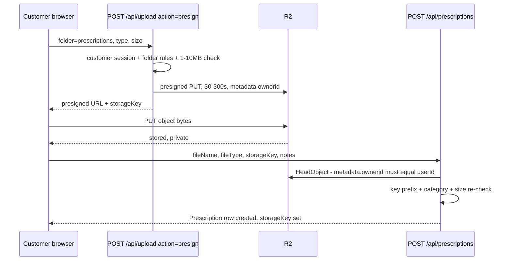
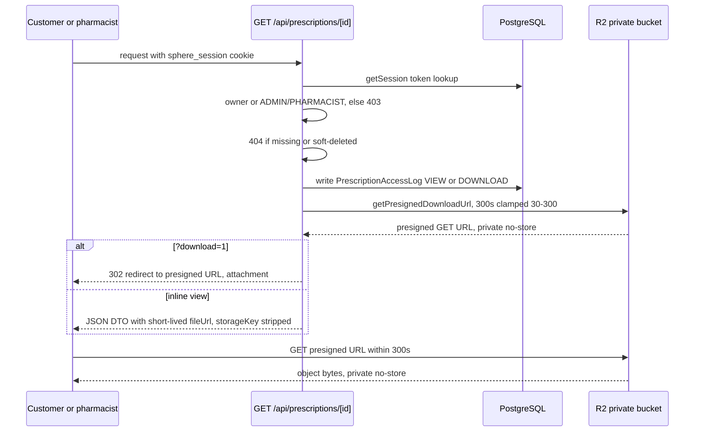

# File Storage Security

This document describes how uploaded files are stored, who can put what where, and how private objects are reached: the R2 access model, key layout, the upload permission matrix, content validation, presign restrictions, the prescription download flow with access logging, medicine-request photo proxying, managed-image URL validation, and orphan cleanup. It applies to every route that accepts or serves file bytes.

| Audience | Status | Verified |
| --- | --- | --- |
| Engineers, security reviewers, AI coding agents | **Implemented** — active when the `R2_*` environment is configured | November 2026 |

## The R2 access model

All object storage is Cloudflare R2 via the AWS SDK v3 S3 API (`src/lib/r2.ts`), configured by `R2_ACCOUNT_ID`, `R2_ACCESS_KEY_ID`, `R2_SECRET_ACCESS_KEY`, `R2_BUCKET_NAME` (plus `R2_ENDPOINT` and `R2_PUBLIC_URL`). Two visibility classes, chosen per upload:

| Class | Cache-Control | URL exposure | Used for |
| --- | --- | --- | --- |
| **Public immutable** | `public, max-age=31536000, immutable` | Served from `${R2_PUBLIC_URL}/${key}` (throws if unset) | `products/`, `avatars/`, `services/`, `general/` |
| **Private** (default) | `private, no-store, max-age=0` | Never served from a public URL; only via short presigned GETs or server-side byte streaming | `prescriptions/`, `medicine-requests/` |

The CSP `img-src` allows `https://*.r2.dev` and `https://*.cloudflarestorage.com` for the public class only; private objects are not referenced by the browser directly except through time-boxed presigned URLs.

## Key layout

- Uploads: `{folder}/{ownerId}/{uuid}.{ext}` — the owner id is part of the key, so a user's objects are namespaced and ownership is re-verifiable from the key itself.
- Medicine-request photos: `medicine-requests/{uuid}.{ext}` — no owner segment because submitters are guests by design.
- Prescription keys therefore always look like `prescriptions/{userId}/{uuid}.{ext}`, and the registration route enforces exactly that prefix.

## Upload permission matrix

`POST /api/upload` requires any signed-in session (`requireAuth`), is rate-limited to 20 per 15 minutes per principal, and then authorizes by folder:

| Folder | Visibility | Who may upload |
| --- | --- | --- |
| `prescriptions` | Private | Customers only |
| `avatars` | Public | Any signed-in session |
| `products` | Public | ADMIN, PHARMACIST |
| `services` | Public | ADMIN, PHARMACIST |
| `general` | Public | ADMIN, STAFF |

File names are sanitized (`safeName` ≤80 chars). Objects carry metadata `{ownerid, originalname, category}`.

## Folder summary

| Folder | Visibility | Upload | Read | Deletion |
| --- | --- | --- | --- | --- |
| `prescriptions` | Private | Customers via the upload route, or presigned PUT + verified registration | Owner or ADMIN/PHARMACIST via presigned 300 s URL; every access logged | Retention cron — [retention-and-deletion.md](retention-and-deletion.md) |
| `medicine-requests` | Private | Guests (3 MB, phone-only request) | Staff-only byte streaming | Orphan cleanup on failed row creation; no scheduled purge |
| `avatars` | Public immutable | Any signed-in session | Public URL | Replaced on profile update |
| `products` | Public immutable | ADMIN, PHARMACIST | Public URL | Product lifecycle |
| `services` | Public immutable | ADMIN, PHARMACIST | Public URL | Service lifecycle |
| `general` | Public immutable | ADMIN, STAFF | Public URL | — |

## Content validation

Every upload path validates content, not just claims:

- **MIME allowlist**: `image/jpeg`, `image/png`, `image/webp`, `image/gif`, `image/heic`/`heif`, `application/pdf`.
- **Magic-byte sniffing** (`src/lib/security/file.ts`): `%PDF-`, JPEG `FF D8 FF`, PNG signature, `RIFF…WEBP`, `GIF87a`/`GIF89a`, HEIC `ftyp` brands. A file whose bytes do not match its declared type is rejected.
- **Extension consistency**: the extension must be one of the mapped extensions for the declared MIME.
- **Size caps**: 10 MB for uploads generally; **3 MB for medicine-request photos** (checked via the header *and* a hard stream cap on that route — the one route that bounds the actual stream, not just `Content-Length`).

Magic-byte signatures actually checked (`sniffMime`):

| Type | Signature |
| --- | --- |
| PDF | leading `%PDF-` |
| JPEG | `FF D8 FF` |
| PNG | 8-byte PNG signature |
| WebP | `RIFF` … `WEBP` |
| GIF | `GIF87a` / `GIF89a` |
| HEIC/HEIF | `ftyp` with heic/heix/hevc/hevx/mif1/msf1 brand |

A file that sniffs as nothing, or whose sniffed type disagrees with the declared MIME (one HEIC/HEIF aliasing exception), is rejected — a renamed executable or a mislabeled image never lands in the bucket.

## Presign restrictions

The `action: "presign"` mode of `POST /api/upload` (presigned PUT for direct-to-R2 uploads) is deliberately narrow:

- **Folder**: `prescriptions` only.
- **Size**: 1–10 MB declared content length.
- **Expiry**: clamped to 30–300 seconds.
- **Metadata**: `ownerid`, `originalname`, `category`.

When the client then registers the upload via `POST /api/prescriptions`, the server re-verifies before creating the row: the storage key must carry the `prescriptions/{userId}/` prefix, a `HeadObject` call must confirm `metadata.ownerid === userId`, the category must be `prescriptions`, and the size must be 1–10 MB — otherwise 400. The owner cannot register an object belonging to someone else, and a presigned PUT cannot be used to park an oversized file.

Presigned URL properties, wherever they are issued:

| Property | Value |
| --- | --- |
| Expiry | Clamped to 30–300 s (download callers ask for 300) |
| Cache control | `private, no-store` |
| Disposition | Optional attachment with a sanitized download name |
| Scope | GET downloads, plus the prescriptions-only presigned PUT |
| Failure | 503 — never a fallback to longer expiry or public exposure |

The presign registration flow, end to end:

## Private prescription download flow

`GET /api/prescriptions/[id]`:

1. **Authorization**: owner or ADMIN/PHARMACIST — 403 for anyone else; 404 when the prescription is missing or soft-deleted (no existence disclosure).
2. **Access log**: every GET writes a `PrescriptionAccessLog` row — action `VIEW`, or `DOWNLOAD` when `?download=1`.
3. **Presign**: `getPresignedDownloadUrl(storageKey, 300, downloadName?)` — expiry clamped to 30–300 seconds, response cache control `private, no-store`, optional attachment disposition. Presign failure returns 503 (the file is never silently unavailable-or-exposed).
4. **DTO hygiene**: `fileData` is blanked to `""` and `storageKey` is stripped — storage keys never leave the server.
5. **Redirect**: with `?download=1` the API answers a 302 to the presigned URL with attachment semantics; otherwise the JSON DTO carries the short-lived `fileUrl`.

## Medicine-request photo proxying

Medicine requests are guest-accessible (phone-only), so their photos get the strictest path:

- Upload (within `POST /api/medicine-requests`): magic-byte validated, 3 MB cap, stored private at `medicine-requests/{uuid}.{ext}`.
- Viewing: `GET /api/admin/medicine-requests/[id]/photo` — **staff only** (ADMIN/PHARMACIST/STAFF). The server streams the object bytes with the original Content-Type, inline disposition, `private, no-store` and `nosniff`. **No presigned URL is ever exposed** for these objects; the bytes pass through the authenticated route on every view.

## Managed-image URL validation for services

Service hero and gallery images are constrained by `managedImage()` (`src/lib/security/service.ts`): a value is accepted only if it is

- a site path starting `/images/` with no `..` traversal and ≤500 chars, or
- an HTTPS URL whose host matches the configured `R2_PUBLIC_URL` host and whose pathname starts with the base path, ≤1,000 chars.

Anything else — external hosts, HTTP, relative tricks — is rejected ("Hero image must be an owned upload or site image."). This keeps service imagery on infrastructure the pharmacy controls.

## Orphan cleanup and fail-safes

- **Medicine-request photos**: if row creation fails after the object was written, the object is deleted immediately (orphan cleanup on the write path).
- **Prescription retention**: the retention cron deletes the R2 object first and the row second; if the R2 delete fails the row is skipped, so a record is never hard-deleted while its bytes remain. Refill copies share a `storageKey`; the cron skips keys still referenced by another row. See [retention-and-deletion.md](retention-and-deletion.md).
- **Public catalogue imagery**: the BandaGo sync never overwrites curated local images under `/images/products/*`, and products synced without images get a generic placeholder — sync cannot poison the public bucket path with arbitrary remote URLs (any `imageUrl` is stored, but rendering goes through the same R2 public host model).

## Failure modes

- **R2 not configured**: `isR2Configured()` gates the paths; prescription registration fails rather than falling back to inline storage — the legacy `fileData` column is never populated, and DTOs blank it anyway.
- **Presign failure** → 503, never a longer-lived or public URL.
- **Orphan object on a failed medicine-request row** → immediate delete attempt on the write path.
- **Retention R2 failure** → the row is skipped and retried next run (fail-safe ordering: object first, row second).
- **Mismatched owner metadata at registration** → 400; the object may exist in the bucket but is never linked to a prescription, and an unregistered key under `prescriptions/{userId}/` has no API path that will serve it.

## Related documents

- [security-architecture.md](security-architecture.md) — body caps, headers and the concerns register
- [access-control.md](access-control.md) — the guards behind the permission matrix
- [privacy-and-health-data.md](privacy-and-health-data.md) — why prescriptions are the most protected class
- [retention-and-deletion.md](retention-and-deletion.md) — end-of-life for stored objects
- [../operations/environment-variables.md](../operations/environment-variables.md) — the `R2_*` variables
