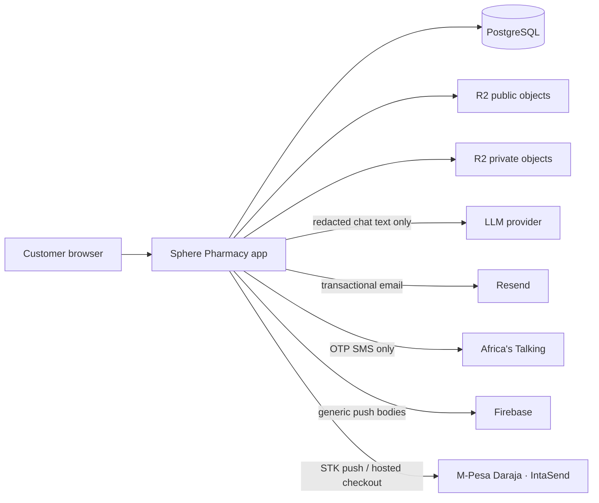

# Privacy and Health Data

This document states what personal and health-adjacent data Sphere Pharmacy actually holds, where it lives, and how the system's behaviour lines up with Kenyan regulatory expectations — the Pharmacy and Poisons Board (Cap 244) for medicine retail rules, and the Office of the Data Protection Commissioner under the Kenya Data Protection Act for personal data. It is written from the shipped code, not from aspirations: where a control is environment-driven or unverified, it says so. It cross-links the two documents that carry the operational detail — [retention-and-deletion.md](retention-and-deletion.md) and [file-storage-security.md](file-storage-security.md).

| Audience | Status | Verified |
| --- | --- | --- |
| Engineers, security reviewers, AI coding agents | **Implemented** — retention window is **Environment-dependent** | November 2026 |

## What the system holds

| Data class | Fields (verified) | Primary storage |
| --- | --- | --- |
| Customer identity | name, email (optional), phone (optional, Kenyan normalization), avatar, `phoneVerifiedAt` | PostgreSQL `User` |
| Addresses | label, text, area, notes, `latitude`/`longitude` (GPS), default flag | PostgreSQL `Address` |
| Prescription files | fileName, fileType, notes (≤1,000), review notes (≤2,000), refills, validity, soft-delete marker | PostgreSQL `Prescription` + **private** R2 objects `prescriptions/{userId}/{uuid}.{ext}` |
| Order history | items with price snapshots, totals, delivery address/area/notes/GPS, guest contact details, pickup codes, rider assignment, status history | PostgreSQL `Order`, `OrderItem`, `OrderStatusHistory` |
| Payments | provider, method, amount, phone used for M-Pesa, `cardLast4` only, provider references, failure reasons | PostgreSQL `Payment`, `ServicePayment` |
| Loyalty | points earned/redeemed per order, ledger with reasons | PostgreSQL `LoyaltyLedger`, `User.loyaltyPoints` |
| Service bookings | service, scheduled times, customer notes, price snapshot, assigned staff, reviews | PostgreSQL `ServiceBooking`, `ServiceReview` |
| Medicine requests | medicine name, phone, optional photo (private R2) | PostgreSQL `MedicineRequest` + private R2 `medicine-requests/{uuid}.{ext}` |
| Notifications | in-app inbox rows, email/push delivery outbox, push tokens, notification preferences | PostgreSQL `Notification`, `NotificationDelivery`, `PushToken`, `NotificationPref` |
| Staff records | name, email, phone, password hash, role, title, active flag | PostgreSQL `StaffUser` |
| Access history | who viewed/downloaded which prescription, when | PostgreSQL `PrescriptionAccessLog`, `AuditLog` |

This table is the exhaustive list of persisted personal data. Anything else a customer types — chat messages, search queries in the catalogue, assistant conversations — is either ephemeral or client-local, as detailed in [ai-access-and-authorized-sessions.md](ai-access-and-authorized-sessions.md) and the frontend documentation. Optional fields are optional at the API level too: a customer may hold an account with only a phone or only an email.

## Health-adjacent, not clinical

Sphere deliberately holds the minimum health signal needed to retail medicine: which prescription files exist, their approval state, refill counts and validity windows, and which order lines were Rx-flagged. It does not hold diagnoses, clinical notes, lab results or prescriber records — those live in BandaGo and the prescribers' systems and are excluded from every sync contract. Treat `Prescription`, `PrescriptionAccessLog` and Rx-flagged order lines as the sensitive core; treat the rest as ordinary personal data protected by the controls in [security-architecture.md](security-architecture.md).

## Where it lives

- **PostgreSQL** (Neon managed Postgres; the integration blueprint specifies `sslmode=require` encrypted connections). No customer data is stored in any local file, cache or search index.
- **Cloudflare R2**: prescription files and medicine-request photos are private objects (never served from a public URL); product/avatars/services/general images are public immutable objects. The access model is documented in [file-storage-security.md](file-storage-security.md).
- **Third parties, minimally**: the LLM provider receives only redacted assistant chat text (see [ai-access-and-authorized-sessions.md](ai-access-and-authorized-sessions.md)); Resend receives transactional email; Firebase handles push; Africa's Talking receives OTP SMS bodies only; payment providers (Daraja, IntaSend) receive payment instructions. Card data never touches Sphere infrastructure (see below).

### Data flow and processors

| Processor | What it receives | What it never receives |
| --- | --- | --- |
| LLM provider | Redacted assistant chat (last 8 messages, 1,800-char cap) | Account data, order contents, prescriptions, credentials |
| Resend | Transactional emails from the branded templates | Anything beyond template content |
| Africa's Talking | OTP SMS to the customer's own phone | Any other message class — the notification queue never sends SMS |
| Firebase (FCM) | Push titles, generic bodies, links | Health context (kept behind sign-in) |
| M-Pesa Daraja | Payment instructions and callback state | Card data, M-Pesa PINs |
| IntaSend | Hosted-checkout session creation | Card data — collected on the provider's page only |

### Where data does not live

- **Nothing personal persists in the browser**: cart, wishlist, recently-viewed and the assistant conversation are local-only (`localStorage` / React state) and are never synced as profile data.
- **Nothing personal persists in the AI layer**: the assistant server stores no transcript; the provider sees only redacted text.
- **No PII in error logs**: `publicError()` logs an `errorId` and message, not request bodies; `PosSyncLog` carries sync telemetry, not customer records.
- **No payment secrets anywhere**: card data never enters the system (hosted checkout); M-Pesa PINs never enter the system (STK push is confirmed on the phone).

## Kenya regulatory context — Pharmacy and Poisons Board (Cap 244)

The code implements three PPB-aligned retail controls. This section describes what is **implemented in code**; it is not a claim that the pharmacy holds a PPB licence — see the compliance-record caveat below.

1. **Prescription gate before dispatch.** Products flagged `requiresPrescription` cannot pass through checkout unreviewed: orders carrying them become `UNDER_REVIEW`/`PRESCRIPTION_VERIFIED` types, and the order workflow blocks `READY_FOR_PICKUP` until pharmacist review of every linked prescription is complete. The flag is never downgraded by POS sync — classification (`classifyRequiresPrescription`) only ever ORs stricter.
2. **Expired stock exclusion.** Product batches past their expiry (`isExpired`) are excluded from sellable stock (`stockQty`); `getAvailableStock()` = `max(0, min(stock, stockQty) − safetyBuffer − virtualReserved)` — expired lots can never appear as available inventory.
3. **Prescription archive window.** The blueprint cites a 2-year archive intent per Cap 244, implemented as the `PRESCRIPTION_RETENTION_DAYS` environment variable driving the retention cron. **The env drives the truth**: CI sets 365 days; `.env.example` does not define the variable; the production value is a live decision for the pharmacy. This is flagged as **Requires live verification** in [retention-and-deletion.md](retention-and-deletion.md).

The retail controls behind those expectations, as implemented:

- **Rx classification is strict-only.** `classifyRequiresPrescription` sets the flag from the raw POS flag, the category (`prescription`/`rx`/`pom`) or a ~30-item keyword list (antibiotics, insulin, tramadol, codeine, diazepam, …); existing flags are OR'd — sync can add the requirement but never remove it.
- **Checkout attaches owned prescriptions only.** `POST /api/orders` accepts `prescriptionIds` that are owned, unlinked and not soft-deleted; any Rx line makes the order `UNDER_REVIEW` (type `PRESCRIPTION`/`MIXED`) until pharmacist review advances it.
- **Every refill is re-verified.** A refill creates a *new* `PENDING` prescription row referencing the same file, so the pharmacist re-reviews each use; refills are capped by `refillsAllowed` (0–6) and `validUntil` (30/60/90/180-day windows).
- **FEFO stock discipline.** Batches aggregate by lot; expired lots are flagged and excluded from sellable stock; near-expiry (≤90 days) is surfaced to staff as a Kenya PPB audit alert.

**Compliance record caveat.** The admin Compliance section stores an internal premise-licence/superintendent record. It is explicitly *not* PPB verification: `GET /api/settings` redacts compliance details to empty strings below ADMIN/PHARMACIST, and the audit message states "Internal compliance record updated (not PPB-verified)". No licence is claimed anywhere in the product.

## Kenya Data Protection Act / ODPC posture

The system acts as **data controller** for its own customer records and as **data processor** for the BandaGo POS side (per the integration blueprint). Implemented posture:

- **Data minimization on POS sync.** BandaGo CRM reconciliation (`BandaGoCrmReconciler.syncCustomerProfile`) syncs only phone (the canonical matching key), name, email, POS identifiers, loyalty balance and credit balance. **Patient diagnoses, doctor notes and clinical records held in BandaGo are never synced** — the blueprint states this as an explicit design rule and the sync payload has no fields for them.
- **Chronic-refill reminders are time-based only.** Eligibility is computed from order age and the presence of a prescription-only line item — no dosage inference, no clinical scoring. The reminder email lists prescription-only medicine names only.
- **Suppression lists.** Bounced or complained email addresses land in `EmailSuppression` and are skipped forever after; opt-out preferences (`NotificationPref`) are re-checked at dispatch time, so unsubscribing takes effect even for already-queued jobs.
- **Retention and deletion.** Prescription data has an automated (environment-driven) retention pipeline; everything else is governed by the decisions in [retention-and-deletion.md](retention-and-deletion.md).
- **Access minimization.** Every prescription read/write is role-guarded and logged (`PrescriptionAccessLog`); prescription storage keys are never exposed in DTOs (hardcoded `null`); downloads are short-lived presigned URLs.
- **No selling or sharing of data.** No analytics, advertising or third-party data egress exists in the codebase.
- **Cross-border processing.** The stack relies on providers that may store or process data outside Kenya (managed PostgreSQL, R2, the LLM, email, push, SMS and payment providers). A transfer/processor assessment is a governance item to complete before live operation — **Requires live verification**.
- **What this posture does not yet include**: a published privacy notice, a data-protection-impact assessment, breach-notification runbook, or an appointed data-protection officer. Those are governance items, not code — flagged in [../governance/technical-debt.md](../governance/technical-debt.md).

## Who can access personal data

Access follows the role matrix in [access-control.md](access-control.md); summarized for privacy review:

| Role | Personal data reachable |
| --- | --- |
| Customer | Own profile, orders, prescriptions, addresses, bookings, notifications, loyalty |
| RIDER | Assigned delivery orders only — drop address and contact for that job; no prescription files, no account history |
| STAFF | Order and medicine-request workflows; the compliance record is redacted below ADMIN/PHARMACIST; no prescription queue |
| PHARMACIST | Everything STAFF sees, plus the prescription queue, files and the compliance record |
| ADMIN | All of the above, plus staff management, the audit log, refunds and settings |
| Anonymous | Public catalogue only — plus their own guest order via a one-time hashed token |

Every prescription file read — whoever performs it — writes a `PrescriptionAccessLog` row, so the access history is reconstructible for any single prescription.

### The BandaGo direction of flow

Sphere's processor duties are bounded by what the integration actually moves. The BandaGo integration is **inbound-only**: the Chrome extension (running in the pharmacy's own browser) pushes sanitized inventory packets and CRM reconciliation records into Sphere; staff may run read-only lookups (phone → customer POS profile, chronic-refill eligibility). No customer record, order or prescription ever flows from Sphere back to BandaGo programmatically. The matching key is the canonical `+254…` phone number; guards prevent an email being re-pointed to a different phone's account or a POS partner id being re-linked to a different user.

## Customer rights touchpoints

| Right (DPA framing) | Touchpoint in the system | Status |
| --- | --- | --- |
| Access own data | `GET /api/auth/me` (profile), orders list/detail, prescriptions list with download, bookings, loyalty history — all session-scoped | **Implemented** |
| Correct own data | `PATCH /api/auth/profile` (name/avatar/email/phone with clash checks), address CRUD | **Implemented** |
| Erasure (prescriptions) | `DELETE /api/prescriptions/[id]` — owner- or ADMIN-initiated soft delete, then the retention cron hard-deletes after the window | **Implemented** (window is environment-dependent) |
| Erasure (account) | No self-serve account deletion. Manual runbook in [retention-and-deletion.md](retention-and-deletion.md) | **Planned or not shipped** — manual today |
| Object to marketing | Notification preferences (email/push opt-outs); no marketing automation exists | **Implemented** |
| Withdraw push consent | `DELETE /api/notifications/push-token` and the client's `disablePushNotifications()` — the token is deleted and the browser subscription removed | **Implemented** |
| Know the retention period | This document states the per-class lifetimes and the pending retention decisions | **Requires live verification** (prescription window) |
| Data portability | No export endpoint for customers (admin CSV exports exist for reports) | **Planned or not shipped** |

There is no automated decision-making with legal effect in the system: prescription approval, refunds and staff actions are human decisions; automation only enforces workflow rules, reservation timeouts and time-based refill reminders.

## Notification content minimization

- Push bodies are generic — "You have a new update. Open Sphere to view it securely." — so health context stays behind sign-in rather than on a lock screen.
- Email subjects carry the event name only (suffixed "— Sphere Pharmacy"); bodies use branded table templates without diagnoses or clinical notes (none exist in Sphere).
- The one deliberate exception: chronic-refill reminder emails list prescription-only medicine names for the patient's own recall — sent to the patient's own address, time-based eligibility only, no dosage information.
- In-app notification links resolve same-origin against `NEXT_PUBLIC_APP_URL` (falling back to `/account`); staff links go to `/admin`.
- Delivery payloads live in the `NotificationDelivery` database rows only — they are not written to application logs.

## What is deliberately NOT collected

- **Payment card data.** Card payments go through IntaSend **hosted checkout** only — the card session is created server-side and the customer enters details on the provider's page. Sphere stores at most `cardLast4` and provider references. No PAN, CVV or expiry ever reaches this codebase.
- **M-Pesa PINs.** M-Pesa uses STK push: the PIN is entered on the customer's phone in the Safaricom flow. The assistant, the checkout and the private payment panel all refuse to accept PINs ("Never enter your PIN in chat"; only the normal payment screen collects payment details).
- **Passwords, OTPs or secrets in chat.** The AI assistant detects credential-shaped input and short-circuits without calling the LLM or the database — see [ai-access-and-authorized-sessions.md](ai-access-and-authorized-sessions.md).
- **Clinical records.** No diagnoses, clinical notes or test results are stored by Sphere itself; the BandaGo sync contract excludes them by design.
- **Background tracking.** No analytics beacons, session recording, advertising pixels or cross-site trackers. Wishlist and recently-viewed lists are local-only (`localStorage`) and never synced.

## Purpose limitation

Each data class exists for a stated purpose and is not reused: identity for sign-in and fulfilment; GPS for delivery pricing and dispatch; order history for disputes, loyalty and refills; prescription files for pharmacist review; phones for OTP, payment and delivery contact. No class feeds advertising, profiling, scoring or resale — none of those subsystems exist in the codebase.

## High-risk data handling summary

The short version of which controls carry the weight, per class:

| Data | Highest-sensitivity handling |
| --- | --- |
| Prescription files | Private R2, owner-or-pharmacist access only, every access logged, presigned 300-second downloads, retention pipeline |
| Customer GPS coordinates | Collected only at checkout/account address entry with user action; used for delivery fee computation; never exposed to other customers or riders beyond the delivery need |
| Phone numbers | Used for OTP sign-in, M-Pesa initiation, delivery contact and BandaGo matching; normalized to E.164; redacted before any LLM call |
| OTP codes | Stored only as HMAC-SHA256 hashes, 5-minute expiry, single-use, ≤5 attempts |
| Passwords | scrypt (N=16384, r=8, p=1, 64-byte key, 16-byte salt); legacy formats upgraded opportunistically |
| Guest contact details | Stored only to fulfil and track unauthenticated orders; the access token is hashed, expires in 7 days, and is cleared when the order is claimed |
| Prescription access logs | Permanent record of who viewed or downloaded each prescription — kept precisely because the files are sensitive |

## How these properties are tested

Privacy-relevant invariants are pinned by the test suite, not just asserted in prose:

- `tests/security-static.test.mjs` — prescriptions stored privately (never public), OTP codes hashed (no demo code path, `codeHash` column required), webhook authentication present, security-hardening migration applied, real FCM tokens required.
- `tests/assistant.test.ts` — the assistant's public-only data access: pay intent triggers no product/service queries; the intent schema rejects admin views, arbitrary URLs, execute intents, amounts and foreign order ids.
- `tests/medicine-requests.test.mjs` — guest photo limits (3 MB) and validation.

Run them with `npm test` and `npm run test:assistant`; extend them whenever a change touches these paths. See [../testing/testing-strategy.md](../testing/testing-strategy.md).

## Related documents

- [retention-and-deletion.md](retention-and-deletion.md) — lifetimes per data class and the deletion runbook
- [file-storage-security.md](file-storage-security.md) — private-object access model
- [security-architecture.md](security-architecture.md) — the controls behind these privacy properties
- [access-control.md](access-control.md) — who can reach which data
- [../governance/technical-debt.md](../governance/technical-debt.md) — open privacy governance items
