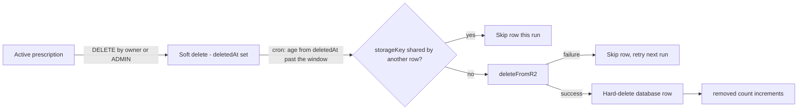

# Retention and Deletion

This document records how long each class of Sphere Pharmacy data lives, what deletes it, and what deliberately has no automated deletion. It is honest about the two things that most need honesty: the prescription retention window is **environment-driven** (CI runs 365 days; the integration blueprint states a 2-year Kenya PPB Cap 244 intent — the live value is a decision the pharmacy must make), and customer-account deletion is a **manual runbook**, not a feature. Nothing here should be read as legal advice; it documents what the code does so the pharmacy can operate it against its regulatory obligations.

| Audience | Status | Verified |
| --- | --- | --- |
| Engineers, security reviewers, AI coding agents | **Environment-dependent** — retention window **Requires live verification** | November 2026 |

## Principles applied across these lifetimes

- **Explicit over implicit**: where a lifetime is a decision (the prescription window, audit logs) the code refuses to guess — the retention cron returns 503 rather than defaulting.
- **Fail-safe deletes**: hard deletion only happens after the object delete succeeds, and shared references are skipped.
- **No silent loss**: cancelled reservations restore stock and re-credit points with ledger entries; nothing disappears without a record.
- **Honest manual steps**: where no automation exists (account erasure), this document says so instead of implying a button exists.

## The prescription lifecycle, pictured

## Prescription retention (the automated pipeline)

Prescriptions are the only data class with a full automated retention pipeline:

1. **Soft delete.** `DELETE /api/prescriptions/[id]` (owner or ADMIN; an order-linked prescription returns 409 for non-admins) sets `deletedAt`. The file stays in R2; the row stops appearing in listings and detail reads return 404.
2. **Cron hard-delete.** `GET /api/cron/prescription-retention` (Bearer `CRON_SECRET`, ≥32 chars) processes in batches of 100. It requires `PRESCRIPTION_RETENTION_DAYS` in the range 30–36,500, otherwise it fails with 503 rather than guessing.
3. **Cutoff semantics.** The cutoff is measured **from the soft-delete time** (`deletedAt`), not creation — deleting late keeps the record late.
4. **Shared keys.** Refills create a new `Prescription` row referencing the **same** `storageKey`; the cron skips any key still referenced by another row, so deleting one use never orphans (or destroys) another's file.
5. **Order of operations.** `deleteFromR2` first, then the database row. If the R2 delete fails, the row is skipped this run — a record is never hard-deleted while its bytes remain.
6. **Reporting.** Each run returns `{ok, removed}`.

### The retention window: env-driven truth

| Source | Value |
| --- | --- |
| Code constraint | 30–36,500 days (`PRESCRIPTION_RETENTION_DAYS`), else the cron 503s |
| CI (`.github/workflows/ci.yml`) | 365 days |
| `.env.example` | Not defined |
| Integration blueprint | 2-year archive intent per Kenya PPB Cap 244 |

**There is no single shipped answer.** The production deployment must set `PRESCRIPTION_RETENTION_DAYS` deliberately, and the pharmacy owner should confirm the Cap 244 archive expectation (blueprint intent: 2 years) before choosing a value. Until then this is flagged **Requires live verification**. See [privacy-and-health-data.md](privacy-and-health-data.md) for the regulatory framing and [../operations/environment-variables.md](../operations/environment-variables.md) for the variable.

## Operating the retention cron

- **Auth**: `GET /api/cron/prescription-retention` with `Authorization: Bearer CRON_SECRET` (≥32 chars). The route 503s when `PRESCRIPTION_RETENTION_DAYS` is unset or outside 30–36,500 — it never guesses a default.
- **Scheduling is external.** There is no in-repo scheduler (no `vercel.json`); the deployment must invoke the cron. Each run processes a batch of 100 rows, so a short window over a large backlog needs frequent runs.
- **Response**: `{ok, removed}` per run — surface it in monitoring alongside the other cron outcomes (`order-reservations`, `notifications`, `chronic-refills`, `service-booking-reminders`).
- **The decision to record**: set the production value in writing (environment plus this document), confirm the Cap 244 expectation, and note who decided and when. Until that happens the window is **Requires live verification**. See [../operations/environment-variables.md](../operations/environment-variables.md).

## Sessions and OTP expiry

| Artifact | Lifetime | Cleanup |
| --- | --- | --- |
| Customer session | 30 days absolute | Deleted on read when expired; deleted on logout |
| Staff session | 7 days absolute + 12 h idle | Same, plus `revokeStaffSessions` on role/active/password change (`authVersion` bump) |
| OTP code | 5 minutes, single-use, <5 attempts | Previous unused codes invalidated when a new one is requested; rows age out by `expiresAt` |

Session tokens are opaque database rows rather than self-contained credentials, so "expiry" and "deletion" are the same operation: the row is gone, the cookie dies with it, and no un-expirable token remains in the wild. Revocation is therefore immediate and complete — see [security-architecture.md](security-architecture.md#1--session-layer).

## Guest access tokens

Guest checkout issues a one-time 32-byte token (returned once, in the order response and a URL fragment) stored **only as an HMAC hash** with a 7-day expiry. It authorizes order GET/cancel, payment initiation and M-Pesa queries for that single order. When the guest later signs in via OTP, the claim flow (matching `guestPhone` + `guestAccessTokenHash`, unexpired) transfers the order to the account and **clears the token**.

## Notification data

| Store | Contents | Deletion |
| --- | --- | --- |
| `Notification` | In-app inbox rows (title, message, link metadata) | None automated; unbounded growth is an operations concern |
| `NotificationDelivery` | Durable outbox jobs (payload, status, attempts, provider ids) | Terminal `SENT`/`FAILED` rows are kept; no purge job |
| `EmailDeliveryEvent` + `EmailSuppression` | Provider delivery events; bounced/complained addresses | Suppression entries are deliberately permanent (safety); events are not purged |
| `PushToken` | Device tokens bound to user/staff | Deleted on logout / unsubscribe and when ownership fails re-verification |

Delivery jobs retry within a 23-hour window with exponential backoff (capped at 1 hour, at most 8 attempts) before being marked `FAILED` — the outbox's *active* lifecycle therefore self-terminates even though the rows are retained afterwards.

Operational watch item: inbox rows and outbox rows grow without bound — a purge or archival job for terminal rows is a governance decision tracked in [../governance/technical-debt.md](../governance/technical-debt.md), not an existing cron.

## Guest checkout data

Guest orders persist `guestName`, `guestPhone`, `guestEmail` and a hashed access token. If the guest later signs in with the matching phone, the order is claimed by the account and the token cleared; unclaimed orders keep their guest contact fields for order history and follow-up. They follow order-history retention (no automated deletion) — include them in any erasure request handled through the runbook below, matching on the phone number.

## Order status history as evidence

`OrderStatusHistory` rows (status, note, actor, timestamp) are append-only and never deleted — including the SYSTEM-authored entries for reservation expiry and refill queueing. Together with `AuditLog` and `LoyaltyLedger` they form a reconstructible timeline of what happened to any order, which is why order data is retained even when a customer account is erased (see the runbook).

## Audit log retention

`AuditLog` and `PrescriptionAccessLog` have **no automatic deletion**. This is intentional: they exist to answer "who did what, when" — including who accessed which prescription — and an auto-expiring audit log undermines that purpose. Any retention limit on them is a governance decision (below), not a code default.

## Seed and demo data

The database seed refuses to run in production (and against non-localhost hosts without explicit acknowledgement) and never creates customer, order, prescription or clinical-history data — the optional admin account requires `SEED_ADMIN_EMAIL` and a ≥14-character `SEED_ADMIN_PASSWORD`, and an update re-hashes the password, bumps `authVersion` and purges sessions. There is therefore no seeded personal data to retain or purge from a production install. Demo credentials that appear in historical README material refer to a sandbox era and are not created by the current seed.

## What has NO automated deletion today

Flagged explicitly so it reads as a decision, not an oversight:

| Data | Why kept | Governance note |
| --- | --- | --- |
| `AuditLog`, `PrescriptionAccessLog` | Compliance/forensics value | Decide a retention ceiling and add a purge job if one is required |
| Order history (`Order`, `OrderItem`, `OrderStatusHistory`, `Payment`) | Financial record, loyalty clawback, dispute handling | Retention requirement should be confirmed against Kenyan commercial/records expectations |
| `LoyaltyLedger` | Append-only ledger; balances are derived from it | Never purge without a settlement/archival plan |
| `User` accounts | No deletion path exists | See the runbook below |
| Medicine requests + photos | Follow-up workflow | Photos could join the prescription retention pipeline as a future improvement |
| `RateLimitBucket` rows | Fixed-window counters | One row per scope + identity hash; no purge job exists — slow but unbounded growth |
| `OtpCode` rows | Sign-in attempt history | Superseded and used codes are invalidated but not purged |

These are tracked in [../governance/technical-debt.md](../governance/technical-debt.md).

## Data subject deletion runbook (manual)

There is **no self-serve account deletion endpoint** — status: **Planned or not shipped**. Until one exists, honouring an erasure request is a manual operator procedure. Perform it with a database backup taken first, and prefer the admin endpoints over direct SQL where both can do the job, because the endpoints leave audit rows.

1. **Identify the subject.** Locate the `User` by phone/email (canonical `+254…` phone form). List their orders, prescriptions, addresses, bookings, reviews, notifications and ledger entries for scope confirmation.
2. **Prescriptions first.** Soft-delete each `Prescription` row (`deletedAt`) — as owner-side DELETE would, or directly as ADMIN. Order-linked rows need the admin path. The retention cron will then hard-delete the R2 object and the row after `PRESCRIPTION_RETENTION_DAYS` from the soft-delete time. To delete sooner, run the cron logic manually against the specific rows.
3. **R2 cleanup.** Verify no `prescriptions/{userId}/` objects remain (the cron covers linked rows; check for strays). Medicine-request photos are keyed by uuid, not user — find them via the `MedicineRequest` rows matching the phone.
4. **Sessions and tokens.** Delete the user's `Session` rows, `PushToken` rows and `NotificationPref`; clear `Notification` and `NotificationDelivery` rows scoped to the user id.
5. **Account itself.** There is no deactivation flag for customers. The honest manual options today: delete the `User` row (cascades addresses, sessions, alerts, push tokens, reviews, bookings; **orders, prescriptions and ledger rows are deliberately non-cascading** and will orphan — they hold financial history), or retain the row with contact fields cleared. Choose per the pharmacy's legal advice; do not improvise in production without a backup.
6. **Irreducibles.** `AuditLog` entries reference actors by name; `LoyaltyLedger` and order history may need to survive erasure for financial-integrity reasons. Record what was retained and why.
7. **Verify.** Spot-check that `GET /api/auth/me` no longer resolves, the phone/email no longer match on login, and the R2 prefix is empty.
8. **Evidence.** Prefer the admin endpoints (which write `AuditLog` rows) over direct database edits where both are possible, and keep the ticket with the list of deleted keys/rows and what was deliberately retained.

Every step above is manual by design today — mark it in the ticket when performed, and see [../governance/technical-debt.md](../governance/technical-debt.md) for the tracked request to build a supported endpoint.

## Ephemeral state that does get cleaned up

Not everything is long-lived — three classes of derived state have automated expiry:

| State | Lifetime | Cleanup |
| --- | --- | --- |
| Inventory reservations (`inventoryReservedAt`, `virtualReservedStock`) | 45 minutes in-process, or `ORDER_RESERVATION_TTL_MINUTES` (15–10,080) via the cron | Stale unpaid orders cancelled, stock restored, redeemed points re-credited (`RESERVATION_EXPIRED`), dangling payments failed, status history written by SYSTEM |
| Payment attempts | Same reservation window | Uncertain provider responses stay `PROCESSING` with a reconcile note; the reservation expiry fails them explicitly |
| Promotion redemption intents | Per-order | One `PromotionRedemption` per order; unclaimed intents never persist |

This is the system's only "use it or lose it" data — everything else in this document outlives it by design.

## Verifying lifetimes in a live deployment

1. `GET /api/cron/prescription-retention` with the Bearer secret — expect `{ok, removed}`; with `PRESCRIPTION_RETENTION_DAYS` unset or out of range, expect 503 (proving the no-guessing rule).
2. Check the deployed environment actually sets `PRESCRIPTION_RETENTION_DAYS`, and that the value matches what was decided and recorded here.
3. Confirm the external scheduler invokes all five cron routes — there is no in-repo scheduler.
4. `GET /api/admin/notification-health` (ADMIN) — the oldest-pending age and failure counts reveal outbox growth between purges.
5. Soft-delete a test prescription: it must vanish from listings immediately, and its object must be gone after the window elapses.

## Quick reference

| Data | Automated deletion | Window | Notes |
| --- | --- | --- | --- |
| Prescription rows + files | Yes (cron) | `PRESCRIPTION_RETENTION_DAYS` from soft-delete | 30–36,500; CI=365; blueprint intent 2 years |
| Sessions | Yes (on read/logout/revocation) | 30 d customer, 7 d + 12 h idle staff | Immediate revocation via DB |
| Inventory reservations | Yes (in-process + cron) | 45 min or `ORDER_RESERVATION_TTL_MINUTES` | Restores stock and points |
| Notification outbox active lifecycle | Yes (dispatcher) | 23-h retry window, ≤8 attempts | Rows retained after terminal status |
| OTP codes | Invalidation on re-request | 5 min | Single-use |
| Guest tokens | Expiry + claim-clear | 7 d | HMAC-hashed at rest |
| Notification inbox / outbox | No | — | Operations concern |
| Audit + access logs | No | — | Intentional; governance ceiling pending |
| Orders / payments / loyalty | No | — | Financial records |
| User accounts | No | — | Manual runbook above |

## Changing a lifetime

When the pharmacy changes a retention decision:

1. Set the environment value in the deployment first — for the prescription window, `PRESCRIPTION_RETENTION_DAYS`.
2. Update this document (the quick-reference table and the relevant section) so the recorded truth matches the operated truth.
3. For a shorter window, expect the cron to work through the backlog at 100 rows per invocation.
4. For audit- or order-history ceilings, record the governance decision in [../governance/technical-debt.md](../governance/technical-debt.md) before any purge code is written.

## Related documents

- [privacy-and-health-data.md](privacy-and-health-data.md) — the regulatory framing for these windows
- [file-storage-security.md](file-storage-security.md) — the private-object model the retention cron empties
- [security-architecture.md](security-architecture.md) — cron authentication and fail-safes
- [../operations/environment-variables.md](../operations/environment-variables.md) — `PRESCRIPTION_RETENTION_DAYS` and friends
- [../governance/technical-debt.md](../governance/technical-debt.md) — tracked deletion-endpoint work
