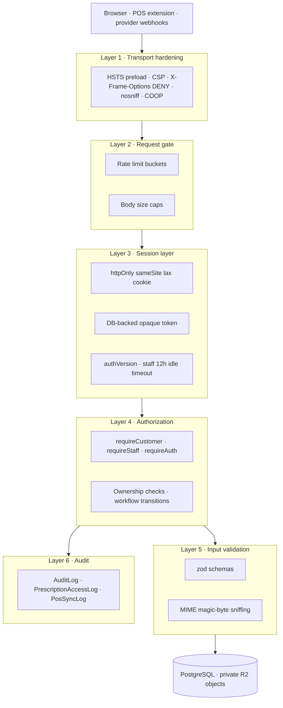

# Security Architecture

Sphere Pharmacy processes prescriptions, customer identities, phone numbers, delivery coordinates, payment records and other health-adjacent information for a retail pharmacy in Roysambu, Nairobi. This document is the defence-in-depth overview of how that data is protected in the shipped code — the session layer, authorization guards, input validation, rate limiting, webhook authentication, transport hardening, audit trails, secrets management and error handling — and it closes with a register of known concerns that are documented deliberately rather than silently ignored. Every statement is grounded in `src/lib/session.ts`, `src/lib/hash.ts`, `src/lib/security/*`, `src/lib/r2.ts`, the API routes and `next.config.ts`.

| Audience | Status | Verified |
| --- | --- | --- |
| Engineers, security reviewers, AI coding agents | **Implemented** — exceptions tracked in the concerns register | November 2026 |

> This repository is public. No real credential value may ever appear in documentation, code or examples. Where a concern involves a literal secret, this document refers to it by location (for example, "the hard-coded fallback in `csv-import/route.ts`") rather than repeating the value.

## In this section

- [Access control](access-control.md) — the route-by-role enforcement reference
- [AI access and authorized sessions](ai-access-and-authorized-sessions.md) — how AI systems may touch account data
- [File storage security](file-storage-security.md) — the R2 public/private access model
- [Privacy and health data](privacy-and-health-data.md) — data classes and the Kenyan regulatory posture
- [Retention and deletion](retention-and-deletion.md) — data lifetimes and the deletion runbook

## Defence-in-depth overview

A request passes the layers in order: transport headers apply to every response, the request gate rejects floods and oversized bodies before parsing, the session layer resolves (or rejects) identity, authorization guards and ownership checks decide whether the identity may act, and validation constrains what the handler accepts. The audit layer records what authorized logic did.

## 1 · Session layer

Sessions are opaque, database-backed tokens — there are no JWTs.

- **Cookie**: `sphere_session`, `httpOnly`, `sameSite: "lax"`, `secure` in production, `path: "/"`, cookie expiry mirrors the database `expiresAt`.
- **Token**: 32 random bytes, hex-encoded (64 characters), stored in `Session.token`. See concern S-6 — tokens are stored raw at rest, unlike guest access tokens which are stored only as HMAC hashes.
- **Customer sessions**: 30 days absolute (`SESSION_DAYS = 30`).
- **Staff sessions**: 7 days absolute plus a 12-hour idle timeout (`STAFF_IDLE_MS`); `lastSeenAt` is refreshed at most every 5 minutes to avoid write amplification.
- **Invalidation on read**: `getSession()` deletes and rejects a session that is expired, whose staff account is inactive, whose `authVersion` no longer matches `staff.authVersion`, or whose staff `lastSeenAt` is older than 12 hours.
- **Revocation paths**: `destroySession()` on logout; `revokeStaffSessions(staffId)` whenever an administrator changes a staff member's role, active flag or password — each of those changes bumps `authVersion`, invalidating every existing staff session for that account.

Details of the authentication flows (register, login, OTP sign-in, password policy, scrypt parameters) live in [../architecture/authentication.md](../architecture/authentication.md).

## 2 · Authorization layer

Three guard helpers in `src/lib/session.ts` are the single enforcement point for route protection:

| Guard | Failure behaviour | Use |
| --- | --- | --- |
| `requireCustomer()` | 401 "Please sign in to your account to continue." | Customer-owned resources (orders, prescriptions, addresses, bookings) |
| `requireStaff(roles?)` | 401 "Staff sign-in required." / 403 "You do not have permission to perform this action." | Staff consoles; optional role allow-list |
| `requireAuth()` | 401 "Please sign in to continue." | Any authenticated principal (e.g. uploads, push tokens) |

Guards are complemented by **ownership checks** (orders — including guest-token access, prescriptions, addresses, service bookings) and **workflow transition checks** (`canTransitionOrder` restricts which status each role may set; refunds are ADMIN-only; riders may only move their own assigned deliveries through two transitions). The complete route-to-role matrix, ownership patterns and the rider model are the subject of [access-control.md](access-control.md) — this is deliberately not duplicated here.

## 3 · Input validation and body caps

- **Schema validation**: request bodies are parsed with zod schemas (for example the assistant intent schema, booking validation, OTP `/^\d{6}$/`, phone `/^(?:\+?254|0)?(7\d{8}|1\d{8})$/` normalized to `+254XXXXXXXXX`, password policy length 10–128 with at least one letter and one digit).
- **Body size caps**: `rejectOversizedRequest()` rejects requests whose `Content-Length` exceeds a per-route maximum (register 8,192 B; logins 4,096 B; assistant 20,000 B; email webhook 65,536 B; settings 64 KB). Medicine-request photo uploads additionally bound the actual stream, not just the header (see concern S-5).
- **File validation**: uploads are checked by declared MIME, magic-byte sniffing (`src/lib/security/file.ts` recognizes PDF, JPEG, PNG, WebP, GIF, HEIC), extension consistency and size cap. Full details in [file-storage-security.md](file-storage-security.md).
- **Payment phone normalization**: `normalizePaymentPhone()` canonicalizes Kenyan numbers; `paymentMatchesExpected()` compares amount, currency, phone and receipt shape before any webhook state is trusted.
- **URL validation**: `managedImage()` accepts only `/images/...` site paths or HTTPS URLs on the configured `R2_PUBLIC_URL` host; IntaSend checkout redirects are checked against a hostname allowlist (`payment`/`sandbox`/`checkout` `.intasend.com`).

## 4 · Rate limiting

Implemented in `src/lib/security/request.ts` on the `RateLimitBucket` table (fixed-window counters, database-backed so limits survive restarts and apply across instances).

- **Key formula**: `${scope}:${sha256(clientIp + ":" + identity)}` — the identity component is route-supplied (email, phone, user id, order id…) where noted.
- **Client IP resolution**: first `x-forwarded-for` entry → `cf-connecting-ip` → `x-real-ip` → `"unknown"`. See concern S-4 — these headers are client-spoofable if traffic does not pass a trusted proxy.
- **On limit**: HTTP 429 with a `Retry-After` header and `Cache-Control: no-store`.

### Bucket inventory

| Scope | Limit | Window | Keyed by |
| --- | --- | --- | --- |
| `register` | 5 | 30 min | IP |
| `customer-login` | 10 | 15 min | IP + lowercased identifier |
| `staff-login` | 5 | 15 min | IP + email |
| `otp-request` | 3 | 10 min | IP + phone |
| `otp-verify` | 8 | 10 min | IP + phone |
| `order-create` | 12 | 15 min | IP |
| `order-cancel` | 8 | 15 min | IP |
| `cash-confirm` | 20 | 15 min | IP |
| `staff-payment-request` | 5 | 15 min | IP + order id |
| `mpesa-initiate` | 5 | 15 min | IP + orderId:phone |
| `intasend-initiate` | 8 | 15 min | IP + orderId |
| `mpesa-status` | 40 | 10 min | IP + checkoutRequestId |
| `service-booking` | 8 | 60 min | user id |
| `service-mpesa` | 5 | 15 min | bookingId:phone |
| `service-card` | 8 | 15 min | booking id |
| `service-payment-status` | 40 | 10 min | booking id |
| `prescription-create` | 10 | 60 min | user id |
| `prescription-refill` | 5 | 24 h | user id |
| `medicine-request-create` | 10 | 60 min | IP |
| `upload` | 20 | 15 min | principal |
| `promotion-validate` | 40 | 60 s | IP |
| `refund` | 10 | 60 min | staff id |
| `notification-test` | 10 | 60 min | admin |
| `assistant` | 40 | 60 min | IP |
| `location-search` | 30 | 10 min | IP |
| `reverse-geocode` | 30 | 10 min | IP |

## 5 · Webhook and cron authentication

Every machine-to-machine entry point requires its own secret; no endpoint trusts an unauthenticated state change.

| Caller | Endpoint | Scheme | Verification beyond the secret |
| --- | --- | --- | --- |
| IntaSend | `POST /api/payments/intasend/webhook` | `INTASEND_WEBHOOK_SECRET` (≥24 chars). Accepts an HMAC-SHA256 signature over the raw body (`x-intasend-signature` / `x-webhook-signature`, `sha256=` prefix stripped, timing-safe), a shared-secret header, or a body challenge | Always re-fetches the invoice server-side (`getIntaSendInvoice`) before trusting state; `PaymentWebhookEvent.eventId` unique (replay → ok, conflict → 409); amount/currency/phone/receipt/apiRef re-checked; serializable transactions |
| M-Pesa Daraja | `POST /api/payments/mpesa/callback`, `/service-callback` | `?token=` query compared `timingSafeEqual` against `MPESA_CALLBACK_TOKEN` (≥24 chars) | `ResultCode 0` still requires a re-query (`queryStkPush` = SUCCESS) plus `paymentMatchesExpected`; event id dedupe on `(provider, checkoutRequestId)`; unknown → 404 |
| Resend | `POST /api/notifications/email-webhook` | Svix verification with `RESEND_WEBHOOK_SECRET`: `svix-id` + `svix-timestamp` (±300 s) + HMAC-SHA256 over `id.timestamp.raw`; `v1,` signatures compared timing-safe | Persists an `EmailDeliveryEvent` row **before** acknowledging (events can precede the send response); maps delivered/bounced/complained/failed |
| Cron jobs | `GET /api/cron/*` | `Authorization: Bearer CRON_SECRET` (≥32 chars) | The notifications route uses `authorizedJob()` (timing-safe); the other four use a plain `===` comparison — see concern S-3 |

Two invariants hold across all payment webhooks: **state is never trusted from the webhook body alone** (the server re-fetches or re-queries the provider), and **every accepted event is recorded exactly once** (`PaymentWebhookEvent` unique `eventId`).

## 6 · Transport and header hardening

Applied to every route in `next.config.ts`:

| Header | Value |
| --- | --- |
| `Content-Security-Policy` | `default-src 'self'`; `base-uri 'self'`; `frame-ancestors 'none'`; `form-action 'self'`; `object-src 'none'`; `script-src 'self' 'unsafe-inline'`; `style-src 'self' 'unsafe-inline'`; `img-src 'self' data: blob: https://*.r2.dev https://*.cloudflarestorage.com`; `font-src 'self' data:`; `connect-src 'self'`; `upgrade-insecure-requests` |
| `Strict-Transport-Security` | `max-age=63072000; includeSubDomains; preload` |
| `X-Content-Type-Options` | `nosniff` |
| `X-Frame-Options` | `DENY` |
| `Referrer-Policy` | `strict-origin-when-cross-origin` |
| `Permissions-Policy` | `camera=(), microphone=(), geolocation=(self), payment=()` |
| `Cross-Origin-Opener-Policy` | `same-origin` |

The `unsafe-inline` entries for scripts and styles are a known gap (concern S-8). Sensitive responses add `Cache-Control: no-store` (or `private, no-store`); the admin live-changes feed adds `Vary: Cookie`. M-Pesa production configuration requires HTTPS callback URLs. The deployment edge is Caddy (which sets `X-Forwarded-For`/`X-Forwarded-Proto`/`X-Real-IP`) fronting a standalone Next.js server — see the deployment notes in [../operations/environment-variables.md](../operations/environment-variables.md).

## 7 · Audit trails

Three write-mostly logs record security-relevant activity:

- **`AuditLog`** (`src/lib/notify.ts audit()`): actor, actorRole, action, entity, entityId, details. Events include settings/compliance updates, staff lifecycle, promotions, product changes (entityId = SKU), CSV import, order cancellations and status transitions, rider assignment, cash confirmation, payment requests and refunds, all prescription review outcomes (`RX_APPROVED`, `RX_REJECTED`, `RX_CLARIFICATION_REQUESTED`, `RX_PARTIALLY_APPROVED`, `RX_REFILL_REQUESTED`), notification tests and medicine-request updates. Readable only by ADMIN via `GET /api/admin/audit` (latest 200, newest first).
- **`PrescriptionAccessLog`**: one row per `GET /api/prescriptions/[id]` (action VIEW or DOWNLOAD), regardless of who accessed it — a compliance record for health-data access. Write-only; no API reads it back.
- **`PosSyncLog`**: BandaGo POS synchronization telemetry (trigger, status, counts, capped error details), readable by ADMIN/PHARMACIST/STAFF via `/api/admin/pos-status`.

Retention of these logs is a governance decision — see [retention-and-deletion.md](retention-and-deletion.md).

## 8 · Secrets management

All secrets arrive via environment variables; none are committed (the repository is public). `requiredSecret()` enforces a minimum effective length of 32 characters for the hashing secrets and throws at request time otherwise.

| Secret | Constraint | Notes |
| --- | --- | --- |
| `SESSION_SECRET` | ≥32 chars | Root secret |
| `TOKEN_HASH_SECRET` | ≥32 chars | HMAC key for guest access tokens and promotion hashes. **Never casually rotate** — `.env.example` warns that promotion HMAC identifiers must stay comparable |
| `OTP_HASH_SECRET` | ≥32 chars | HMAC key for OTP code hashes (`HMAC-SHA256(OTP_HASH_SECRET, phone:code)`) |
| `CRON_SECRET` | ≥32 chars | Bearer token for all cron routes |
| `INTASEND_WEBHOOK_SECRET` | ≥24 chars | IntaSend webhook verification |
| `MPESA_CALLBACK_TOKEN` | ≥24 chars | M-Pesa callback query token |
| `RESEND_WEBHOOK_SECRET` | Svix format | Resend email webhook verification |

If `OTP_HASH_SECRET` or `TOKEN_HASH_SECRET` is unset they fall back to `SESSION_SECRET` — the effective value must still meet the length floor. Provider credentials (`GROQ_API_KEY`, `RESEND_API_KEY`/`RESEND_FROM_EMAIL`, Africa's Talking trio, Daraja credentials, IntaSend keys, the six `R2_*` variables, Firebase service account / web config plus `VAPID_KEY`) are documented with their constraints in [../operations/environment-variables.md](../operations/environment-variables.md). `SEED_ADMIN_EMAIL` plus a ≥14-character `SEED_ADMIN_PASSWORD` are required before the seed will create an administrator. The BandaGo pair (`BANDAGO_SYNC_API_KEY`, `NEXT_PUBLIC_POS_SYNC_SECRET`) is a live concern — see S-1/S-2 below and [../governance/technical-debt.md](../governance/technical-debt.md).

## 9 · Error handling and fail-safe behaviour

- **`publicError()`** returns a safe message plus a random `errorId` (UUID) and logs the detail server-side as structured JSON. Stack traces and internal errors never reach the client; the `errorId` is the support correlation key.
- **No user enumeration**: login returns a generic 401 for unknown identifiers; prescription refill returns 404 (not 403) to avoid disclosing that a prescription exists.
- **Provider timeouts**: all outbound provider fetches use `AbortSignal.timeout(12–15s)`.
- **Uncertain payment outcomes stay `PROCESSING`** with a reconcile note and a 503 — never a silent success or failure.
- **Inventory fail-safe**: reservations expire (cron) and stock is restored rather than double-sold.
- **Retention fail-safe**: the prescription-retention cron skips any row whose R2 object cannot be deleted, so records are never lost while bytes remain (or vice versa).
- **Static codification**: `tests/security-static.test.mjs` pins invariants (no build-error bypass, private prescription storage, no OTP demo code, webhook auth functions present, security-hardening migration, staff-login legacy upgrade, real FCM tokens, admin product view requires staff). See [../testing/testing-strategy.md](../testing/testing-strategy.md).

## Known concerns register

These are verified, documented, and deliberately not fixed in the current tree. Each entry states the impact and the recommended remediation; tracking and prioritization live in [../governance/technical-debt.md](../governance/technical-debt.md).

| # | Concern | Impact | Recommended remediation |
| --- | --- | --- | --- |
| S-1 | `NEXT_PUBLIC_POS_SYNC_SECRET` is sent as a Bearer token from the browser (`pos-sync-section.tsx`) to `/api/integrations/bandago/*` | The credential ships in the client bundle and is readable by anyone; possession authorizes POS sync calls | Route manual CSV import through a staff-session endpoint; remove the `NEXT_PUBLIC_` variant; rotate the secret |
| S-2 | Hard-coded fallback secret in `csv-import/route.ts` (line 122) when the env var is unset; `.env.example` ships the same literal as the default for both BandaGo keys | An unset environment still accepts the publicly known fallback, defeating the bearer check | Delete the fallback, require the env var at boot, rotate the value out of example files |
| S-3 | Non-constant-time Bearer comparisons in the BandaGo routes and 4 of 5 cron routes | Theoretical timing side channel on secret comparison | Use `timingSafeEqual` everywhere (the `authorizedJob()` helper already does) |
| S-4 | `clientIp()` trusts the first `x-forwarded-for` entry, then `cf-connecting-ip`/`x-real-ip` | Callers can spoof their IP and fan out across rate-limit buckets | Trust only the edge proxy hop (Caddy) and strip inbound forwarding headers |
| S-5 | `rejectOversizedRequest()` relies on `Content-Length` (medicine-requests is the one route that also bounds the stream) | A lying header can push oversized bodies at routes that parse them | Bound the actual stream on every body-accepting route |
| S-6 | Session tokens are stored plaintext in the `Session` table (guest tokens are stored as HMAC hashes) | A database read compromises live sessions | Store an HMAC of the session token, as guest tokens already do |
| S-7 | No CSRF tokens or origin checks; cross-site protection relies on `sameSite: "lax"` | State-changing POSTs are defended only by cookie policy | Add origin checks or per-session CSRF tokens for mutations |
| S-8 | CSP allows `unsafe-inline` for scripts and styles | A single XSS foothold executes inline script | Move to nonces/hashes |
| S-9 | M-Pesa callback token travels in the URL query (`?token=`) | Query strings leak into logs and proxies | Switch to a header-based token |
| S-10 | IntaSend webhook accepts a body challenge (broadest of its three accepted schemes) | A party that can guess/observe the challenge shape could spoof a callback (mitigated: the route always re-fetches the invoice before trusting state) | Require the HMAC signature; drop challenge acceptance |
| S-11 | Legacy `salt:hash` scrypt hashes remain verifiable, and staff login upgrades legacy hashes even when the password fails current policy (a documented trade-off codified in tests) | Weaker legacy hashes persist until the owner next logs in | Force re-hash and password reset on legacy accounts |
| S-12 | Sandbox M-Pesa passkey/shortcode values in `.env.example` | None as examples; risk only if copied to production | Keep production credentials strictly out of the repo |

Related operational notes: OTP codes are never demo-mode (a static test asserts this); the seed refuses to run in production or against non-localhost hosts without explicit acknowledgement; admin seed requires a ≥14-character password.

## Related documents

- [../architecture/authentication.md](../architecture/authentication.md) — flows behind the session layer
- [../api/api-reference.md](../api/api-reference.md) — route inventory
- [../integrations/ai-provider.md](../integrations/ai-provider.md) — the assistant's LLM provider
- [../governance/technical-debt.md](../governance/technical-debt.md) — prioritized remediation tracking
- [../../README.md](../../README.md) — project overview
