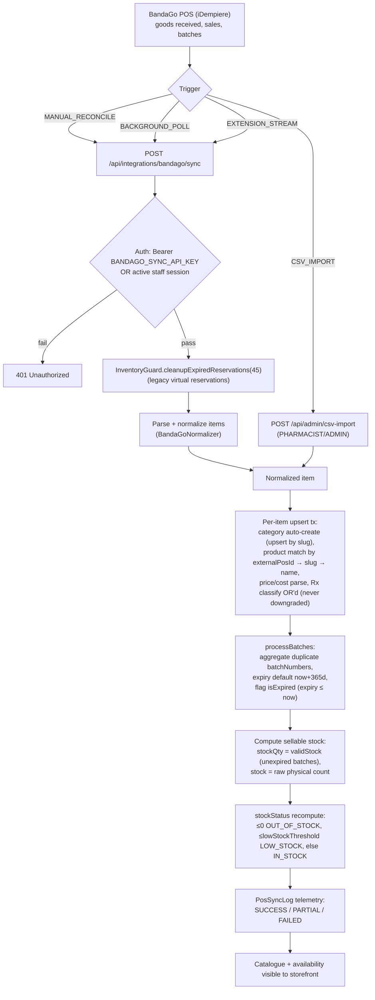

# Inventory Lifecycle

This document follows stock from the BandaGo POS (iDempiere) into the web catalogue, through normalization and batch/expiry handling, into the per-product stock fields that power availability, and finally through reservation and release during the order lifecycle. The PPB rule that expired stock is never sellable is enforced structurally, at sellable-stock computation.

| Audience | Status | Verified |
| --- | --- | --- |
| Engineers, pharmacy operators, AI coding agents | Implemented — verified against code | November 2026 |

## 1. Pipeline overview — goods received to sellable stock

Goods are received and sold in the BandaGo POS (iDempiere). The web platform is a **read-mostly mirror** of POS truth: products, prices and stock flow *in* via sync; the only web-side mutations are order-time reservations (physical deduct + release) and admin catalogue edits.



### 1.1 Sync mechanics

| Aspect | Behavior |
| --- | --- |
| Dual auth | `Authorization: Bearer <BANDAGO_SYNC_API_KEY>` **or** an active staff session. **Known concern:** the browser admin panel sends `NEXT_PUBLIC_POS_SYNC_SECRET` as the Bearer — a client-bundle-exposed credential (see [../security/security-architecture.md](../security/security-architecture.md)). |
| Chunking | Items are processed in transactions of **50** (`CHUNK_SIZE = 50`). |
| Per-item fallback | A failing chunk is retried **item-by-item** so one bad record cannot poison a whole chunk; individual failures are collected. |
| Telemetry | `PosSyncLog` row per run: `trigger`, `status` = `SUCCESS` (no errors) / `PARTIAL` (some failed) / `FAILED` (all failed, or fatal), `itemsReceived/Upserted/Failed`, `details.errors` capped at 50. Readable at `/api/admin/pos-status` (ADMIN/PHARMACIST/STAFF). |
| Side effect | Every sync invokes `InventoryGuard.cleanupExpiredReservations(45)` — the legacy virtual-reservation janitor (§4.3). |

### 1.2 PosSyncLog status semantics

| Status | Condition | Operator action |
| --- | --- | --- |
| `SUCCESS` | `errors.length === 0` | None. |
| `PARTIAL` | `0 < errors.length < rawItems.length` | Inspect `details.errors` (first 50); fix source rows; re-sync. |
| `FAILED` | `errors.length ≥ rawItems.length`, or a fatal error before items processed | Check auth, DB connectivity, payload shape; previous catalogue state is untouched. |

### 1.3 Reservation timeline (order to release)

| Elapsed | Event | Stock effect |
| --- | --- | --- |
| T+0 | Order created | `stockQty`/`stock` decremented; `inventoryReservedAt` stamped |
| T+0…TTL | Customer pays (online or cash-confirm) | None — reservation converts to a sale |
| any time before TTL | Customer/staff cancels | full restore, `inventoryReleasedAt` stamped |
| T+TTL, unpaid | order-reservations cron | full restore, order `CANCELLED` (actor `SYSTEM`), points re-credited, dangling payments failed |

## 2. Normalization rules (BandaGoNormalizer)

| Rule | Detail |
| --- | --- |
| Price parsing | `parseNumber` strips currency symbols, commas and formatting; invalid → fallback 0. `costPrice` parsed the same way. |
| Quantity parsing | `parseInteger` clamps to non-negative whole numbers. |
| Category | slugs canonicalized to lowercase; **categories auto-created** via upsert-by-slug when a POS item references an unknown category. |
| Rx classification | `classifyRequiresPrescription(name, categorySlug, rawFlag)`: POS raw flag truthy → Rx; category matches `\b(prescription|rx|pom)\b`; name matches `\b(pom|rx)\b` or a Kenya POM keyword list (antibiotic families, insulin, tramadol, codeine, diazepam, …). |
| Never downgraded | On update: `finalRequiresPrescription = existing.requiresPrescription ∣∣ incoming` — once a product is Rx-classified, a later sync flag of `false` **cannot** clear it. New products take the incoming classification. |
| Product matching | by `externalPosId`, then slug, then case-insensitive name; pre-existing catalog products without a POS id are linked; SKU collisions are de-duplicated by suffixing. |
| Expiry parsing | `safeParseDate` never returns `Invalid Date`; a batch without a parseable expiry defaults to **now + 365 days**. |

## 3. Batches and expiry

`processBatches` (per product):

1. **Aggregate** duplicate `batchNumber`s, keeping the earliest expiry and summing quantities.
2. Flag each batch `isExpired` when `expiryDate ≤ now`.
3. `validStock` = sum of quantities of **unexpired** batches only — per Kenya PPB rules, expired stock never contributes to sellable stock.
4. `nearestExpiryDate` = earliest expiry among unexpired batches; `hasNearExpiry` = true when any unexpired batch expires within **90 days**.
5. Batch rows (`ProductBatch`: `batchNumber`, `quantityOnHand`, `expiryDate`, `isExpired`, `externalBatchId`) are replaced wholesale when the payload carries batches; a payload with `stock = 0` deletes all batches; a payload without a `batches` array leaves existing batches untouched (no wipe).

### 3.1 Stock fields after sync

| Field | Meaning |
| --- | --- |
| `stock` | Physical count from POS (raw). |
| `stockQty` | **FEFO-valid sellable count** (`validStock` — unexpired batches; equals `stock` when no batch data arrives). The effective authority for `stockStatus` computation. |
| `virtualReservedStock` | Legacy virtual reservation counter (see §4.3). |
| `safetyStockBuffer` | Default **2** units held back from web availability. |
| `lowStockThreshold` | Default **5** units for `LOW_STOCK`. |
| `inStock` / `stockStatus` | Recomputed after every sync and every order-time mutation. |

### 3.2 stockStatus recompute

```
stockStatus = post-mutation stockQty ≤ 0                 → OUT_OF_STOCK
            = post-mutation stockQty ≤ lowStockThreshold  → LOW_STOCK
            = otherwise                                    → IN_STOCK
```

## 4. Reservation at order time

### 4.1 The availability formula

```
available = max(0, min(stock, stockQty) − safetyStockBuffer(2) − max(0, virtualReservedStock))
```

This is `InventoryGuard.getAvailableStock` — the only legacy helper still invoked by live flows — and it is embedded verbatim in the order-create bulk SQL. Expiry safety is inherited from `stockQty` (never includes expired batches).

### 4.2 Physical deduct-and-restore

Order creation runs **one bulk SQL statement** inside the Serializable create transaction (one statement instead of N — large carts used to blow Prisma's 5-second interactive-transaction budget on pooled connections):

```sql
UPDATE "Product" AS product
SET "stockQty" = product."stockQty" - requested.qty,
    "stock" = GREATEST(0, COALESCE(product."stock", product."stockQty") - requested.qty),
    "in_stock" = (product."stockQty" - requested.qty) > 0,
    "stockStatus" = CASE ... END
FROM (VALUES ...) AS requested(id, qty)
WHERE product.id = requested.id AND product.active = true
  AND (LEAST(product."stockQty", COALESCE(product."stock", product."stockQty"))
       - COALESCE(product.safety_stock_buffer, 2)
       - COALESCE(product.virtual_reserved_stock, 0)) >= requested.qty
RETURNING product.id
```

Any line that fails the availability predicate returns no row → the whole transaction rolls back → 409 `"<Product> just went out of stock."`.

**Release paths** (both restore `stockQty` + `stock` and recompute `stockStatus`):

| Path | Trigger |
| --- | --- |
| Cancellation | `POST /api/orders/[id]/cancel` — per-line restore inside the cancel transaction. |
| Reservation expiry | `/api/cron/order-reservations` with `ORDER_RESERVATION_TTL_MINUTES` (15–10,080 min; required else 503), batch 100, version-guarded claims. |

### 4.3 Legacy InventoryGuard virtual path — clarification

`InventoryGuard` also implements a virtual-counter scheme (`reserveStockForCheckout`, `releaseReservation`, `commitReservation`). **Only two of its methods are invoked today:** `getAvailableStock` (availability formula, embedded above) and `cleanupExpiredReservations(45)` (45-minute janitor, called by BandaGo sync). The virtual reserve/release/commit methods are dead code paths; live reservation is the physical deduct-and-restore of §4.2. Document your changes against §4.2, not the virtual API.

### 4.4 FEFO truth

**FEFO (First-Expiry-First-Out) is enforced at POS-ingestion / sellable-stock computation level only.** Expired batches are excluded from `stockQty` so they can never be sold online; `nearestExpiryDate` and `hasNearExpiry` surface expiry intelligence. **Per-batch FEFO deduction at order time is NOT implemented** — the web order path decrements aggregate product counters, not individual `ProductBatch` rows. Actual batch-level picking remains a POS/in-store process. Do not represent the web flow as batch-level FEFO.

### 4.5 Who writes which stock field

| Writer | Fields touched |
| --- | --- |
| BandaGo sync / CSV import | `stock` (raw POS count), `stockQty` (recomputed `validStock`), `stockStatus`, `inStock`, `nearestExpiryDate`, `ProductBatch` rows, `lastSyncedAt` |
| Order create (bulk SQL) | `stockQty −= qty`, `stock −= qty` (clamped ≥ 0), `in_stock`, `stockStatus` |
| Cancel / expiry cron / refill rollback | `stockQty += qty`, `stock += qty`, `in_stock`, `stockStatus` recompute |
| Refill (per-line, conditional) | same decrement set, guarded per line |
| Admin catalogue edits | price, images, `requiresPrescription`, active/`DISCONTINUED` — not counters |

### 4.6 Worked example

A product syncs from POS with physical `stock = 60` and three batches: A (qty 20, expired yesterday), B (qty 25, expires in 45 days), C (qty 15, expires in 200 days):

1. Normalizer flags A `isExpired`; `validStock = 25 + 15 = 40` → `stockQty = 40`, `stock = 60`, `nearestExpiryDate` = B's date, `hasNearExpiry = true` (45 d < 90 d).
2. Web availability = `max(0, min(60, 40) − 2 − 0) = 38`. Expired batch A is structurally unsellable — PPB rule.
3. A customer orders 3 → bulk SQL decrements `stockQty` to 37 and `stock` to 57; `stockStatus` stays `IN_STOCK` (37 > 5).
4. The order is cancelled before payment → cancel transaction restores `stockQty` 40, `stock` 60.
5. Had the order gone unpaid until the TTL, the reservation cron would have performed step 4 instead (actor `SYSTEM`, `expire:<orderId>` points re-credit).

## 5. Alerts, monitoring, and import

| Feature | Detail |
| --- | --- |
| Back-in-stock alerts | `ProductAlert` (`[productId, userId]` unique): customers register interest on out-of-stock products; when stock returns, a `backInStockTemplate` email is queued (Notification queue → Resend). |
| Near-expiry monitoring | `hasNearExpiry` (<90 d) + `nearestExpiryDate` surfaced in the admin POS hub for stock rotation decisions. |
| CSV import | `POST /api/admin/csv-import` (PHARMACIST/ADMIN) parses CSV (multiline quotes, escaped quotes, UTF-8 BOM) through the same normalizer; audited via `CSV_IMPORT`. **Known concern:** hard-coded fallback sync secret in the route. |
| POS status | `/api/admin/pos-status` reads `PosSyncLog` telemetry for ops dashboards. |

## 6. Failure cases and recovery

| Stage | Failure | System behavior | Recovery |
| --- | --- | --- | --- |
| Sync auth | Bad/missing Bearer and no staff session | 401 before any write. | Fix credentials; note the client-exposed `NEXT_PUBLIC_POS_SYNC_SECRET` concern. |
| Sync chunk | One item fails inside a 50-item chunk | Chunk rolls back, then each item retried individually; failures recorded. | Inspect `PosSyncLog.details.errors` (first 50); fix source data; re-sync. |
| Sync run | All items fail / fatal error | `PosSyncLog` status `FAILED`, HTTP 500; previous catalogue state untouched. | Fix root cause (schema drift, DB outage) and re-run. |
| Zero-item packet | Sync called with `items: []` | Nothing to upsert; run completes without mutation (telemetry row still written). | None — benign; verify the POS extension is streaming. |
| All-invalid items | Every item fails parsing/validation | Status `FAILED` (`errors.length >= rawItems.length`); no partial catalogue. | Correct POS field formats; re-sync. |
| Bad batch data | Unparseable expiry | Defaults to now + 365 d (never `Invalid Date`) — deliberately conservative. | Fix the source `GuaranteeDate`; next sync replaces batches. |
| Expired stock | Batches past expiry | Flagged `isExpired`, excluded from `validStock`/`stockQty` — **expired stock is never sellable online**, even if physical count is positive. | Dispose per PPB; POS write-off. |
| Stock drift | Web/POS counts diverge | Every sync overwrites `stock`/`stockQty` from POS truth; order-time decrements ride on top until the next sync. | Periodic `MANUAL_RECONCILE` sync; monitor `pos-status`. |
| Reservation leak | Order created but never paid/cancelled | Expiry cron restores stock after TTL (requires `ORDER_RESERVATION_TTL_MINUTES`); cancel restores immediately. | Ensure cron is scheduled externally (see [../operations/scheduled-jobs.md](../operations/scheduled-jobs.md)). |
| Legacy janitor | Stale virtual reservations | `cleanupExpiredReservations(45)` runs on each sync. | No action; path is legacy. |
| CSV import | Malformed rows | Row-level errors reported; same normalization guards as sync. | Fix CSV, re-import. |

## 7. Data model

| Model | Role |
| --- | --- |
| `Product` | `stock` (physical), `stockQty` (FEFO-valid), `virtualReservedStock`, `safetyStockBuffer` (2), `lowStockThreshold` (5), `inStock`, `stockStatus`, `requiresPrescription`, `nearestExpiryDate`, `externalPosId`/`posSource`/`lastSyncedAt` (BandaGo linkage). |
| `ProductBatch` | POS Lot/Batch rows: `batchNumber`, `quantityOnHand`, `expiryDate` (iDempiere `GuaranteeDate`), `isExpired`, `externalBatchId`; unique `[productId, batchNumber]`, indexed by expiry. |
| `ProductAlert` | back-in-stock registrations, unique per product+user. |
| `PosSyncLog` | sync telemetry: trigger, status, counts, capped error details. |
| `Order` | `inventoryReservedAt` / `inventoryReleasedAt` — the reservation ledger driving release. |

## Related documentation

- [order-lifecycle.md](order-lifecycle.md) — the create/cancel/expiry transactions that mutate these fields.
- [prescription-lifecycle.md](prescription-lifecycle.md) — refill-time conditional stock decrements.
- [../features/inventory-and-stock.md](../features/inventory-and-stock.md) — admin inventory UI.
- [../integrations/bandago-pos-crm.md](../integrations/bandago-pos-crm.md) — BandaGo/iDempiere integration setup.
- [../database/data-lifecycle.md](../database/data-lifecycle.md) — schema and retention.
- [../operations/scheduled-jobs.md](../operations/scheduled-jobs.md) — cron cadences.
- [../../README.md](../../README.md)
