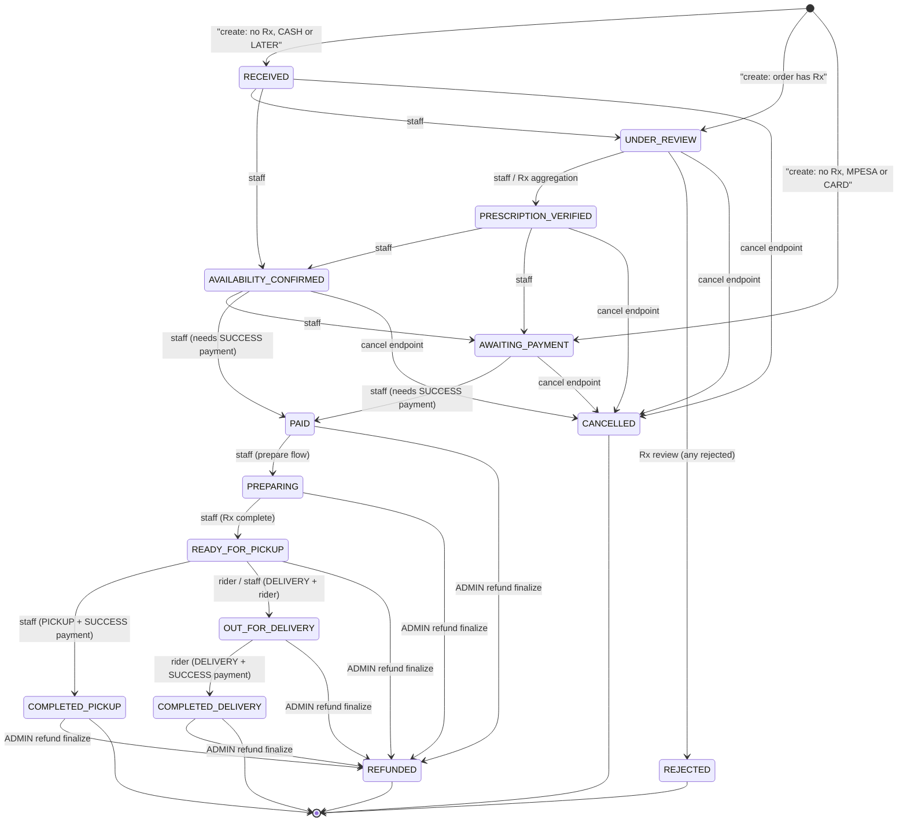
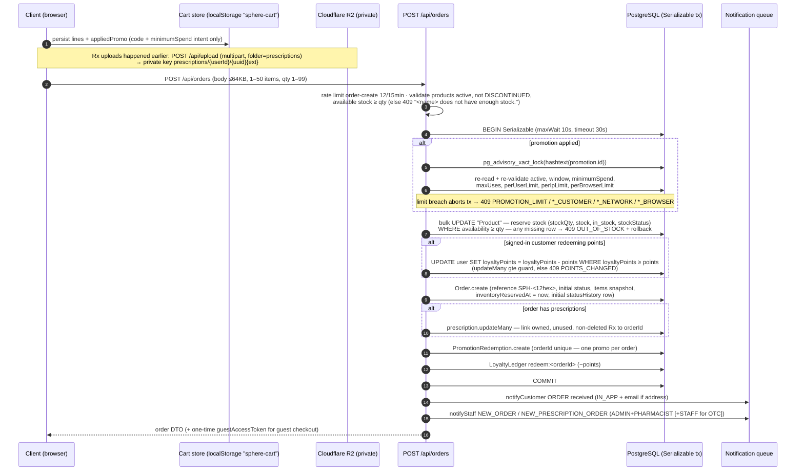

# Order Lifecycle

This document is the authoritative walkthrough of how an order moves through Sphere Pharmacy: the 14-status state machine enforced by `src/lib/security/order-workflow.ts`, how an order is created (stock reservation, promotion locking, loyalty debit), how it is cancelled, expired, prepared, dispatched by riders, and how every transition is recorded for audit. Every rule below is enforced server-side; the client UI only suggests.

| Audience | Status | Verified |
| --- | --- | --- |
| Engineers, pharmacy operators, AI coding agents | Implemented — verified against code | November 2026 |

## 1. The 14 order statuses

| # | Status | Meaning |
| --- | --- | --- |
| 1 | `RECEIVED` | New order, no prescription, cash/pay-later chosen. Awaiting staff triage. |
| 2 | `UNDER_REVIEW` | Order has attached prescriptions awaiting pharmacist review (initial Rx status). |
| 3 | `PRESCRIPTION_VERIFIED` | All linked prescriptions approved (or none needed); clinical gate passed. |
| 4 | `AVAILABILITY_CONFIRMED` | Staff confirmed stock/availability for a reviewed order. |
| 5 | `AWAITING_PAYMENT` | Waiting for M-Pesa STK / card / cash settlement. Initial status for online-payment OTC carts. |
| 6 | `PAID` | A `SUCCESS` payment captured the order total. |
| 7 | `PREPARING` | Staff accepted the order and began packing (prepare flow). |
| 8 | `READY_FOR_PICKUP` | Packed and ready; pickup orders await the customer, delivery orders await dispatch. |
| 9 | `OUT_FOR_DELIVERY` | Assigned rider collected the order; in transit. |
| 10 | `COMPLETED_PICKUP` | Customer collected. Terminal. |
| 11 | `COMPLETED_DELIVERY` | Rider delivered. Terminal. |
| 12 | `REJECTED` | Pharmacist rejected the prescription(s). Terminal (staff-triggered via review). |
| 13 | `CANCELLED` | Cancelled by customer/staff/guest or expired reservation cron. Terminal. |
| 14 | `REFUNDED` | ADMIN recorded a refund of a captured payment. Terminal. |

## 2. State machine

The transition map below is the **authoritative `STAFF_TRANSITIONS`** in `src/lib/security/order-workflow.ts`. Riders get a strict subset; `REFUNDED` is ADMIN-only; `CANCELLED` is only reachable through the cancel endpoint (and the reservation-expiry cron); `REJECTED` is produced by pharmacist prescription review, not by free-form PATCH.



### 2.1 Role rules (canTransitionOrder)

| Rule | Detail |
| --- | --- |
| Rider subset | A `RIDER` may only set `READY_FOR_PICKUP → OUT_FOR_DELIVERY` and `OUT_FOR_DELIVERY → COMPLETED_DELIVERY`, and only on orders assigned to them. |
| Staff blocked from verdicts | `STAFF` cannot set `REFUNDED` or `REJECTED`. |
| REFUNDED is ADMIN-only | Allowed from `PAID`, `PREPARING`, `READY_FOR_PICKUP`, `OUT_FOR_DELIVERY`, `COMPLETED_PICKUP`, `COMPLETED_DELIVERY` — and only through the refund endpoint (see [payment-lifecycle.md](payment-lifecycle.md)). |
| Everything else | Must appear in `STAFF_TRANSITIONS[from]`; unknown pairs are rejected. |

### 2.2 Status groups

| Group | Statuses | Used for |
| --- | --- | --- |
| `ACTIVE_STATUSES` | First 9 (`RECEIVED` … `OUT_FOR_DELIVERY`) | Customer-facing "in progress" filtering. |
| `TERMINAL_STATUSES` | `COMPLETED_PICKUP`, `COMPLETED_DELIVERY`, `REJECTED`, `CANCELLED`, `REFUNDED` | No further transitions (empty transition lists). |
| `DISPATCH_STATUSES` | `PAID`, `PREPARING`, `READY_FOR_PICKUP`, `OUT_FOR_DELIVERY` | Delivery dispatch board; rider assignment eligibility (DELIVERY fulfillment only). |
| `RIDER_ALLOWED_STATUSES` | `OUT_FOR_DELIVERY`, `COMPLETED_DELIVERY` | Statuses a rider may set. |

`NEXT_STATUS` (in `src/lib/constants.ts`) is a **UI suggestion map only** — it is not authorization. The server always re-checks `canTransitionOrder` plus the contextual guards below.

### 2.3 Initial status derivation

```
initialStatus = hasRx ? UNDER_REVIEW
             : (paymentMethod === "MPESA" || paymentMethod === "CARD") ? AWAITING_PAYMENT
             : RECEIVED   // CASH or LATER
```

`type` is derived in the same breath: `hasRx ? (all lines Rx ? PRESCRIPTION : MIXED) : (reservation ? RESERVATION : OTC)`.

## 3. PATCH guards (contextual, beyond the map)

`PATCH /api/orders/[id]` re-derives permissions per target status:

| Target status | Extra guard (in addition to the transition map) |
| --- | --- |
| `CANCELLED` | Rejected in PATCH — only the cancel endpoint (or expiry cron) may cancel. |
| `REFUNDED` | Rejected in PATCH — only the refund flow may set it (ADMIN). |
| `PAID` | Order must have a `SUCCESS` payment. |
| `READY_FOR_PICKUP` | Every linked prescription must be `APPROVED` or `PARTIALLY_APPROVED`. |
| `OUT_FOR_DELIVERY` | `fulfillment = DELIVERY` and a rider is assigned. |
| `COMPLETED_PICKUP` | `fulfillment = PICKUP` + `SUCCESS` payment. |
| `COMPLETED_DELIVERY` | `fulfillment = DELIVERY` + `SUCCESS` payment + rider assigned. |
| Rider callers | May only touch orders assigned to them, and only the two rider transitions. |

Every accepted transition increments `Order.version`, writes an `OrderStatusHistory` row and an `AuditLog` entry `ORDER_STATUS_<STATUS>`. `REJECTED` additionally notifies ADMIN + PHARMACIST.

## 4. Order creation — end-to-end sequence

Covers both OTC and prescription carts. Guests can order OTC only (Rx requires an account → 401).



### 4.1 Totals, fees and promo math

- `subtotal = Σ price × qty`; `discount = min(subtotal, subtotal × discountPct / 100)` — delivery fee is never discounted.
- `pointsRedeemed = redemptionQuote(subtotal − discount, balance)` — server-side quote, capped at 25% of post-discount subtotal, minimum 100 points to redeem.
- `total = max(0, subtotal − discount + deliveryFee − points)`.
- Delivery fee: free over `freeOver` (pre-discount subtotal); else flat / distance bands / zone match (defaults: flat KSh 200, free over KSh 3,000; Roysambu/TRM 150, Kasarani 200, Githurai 44 250, Ruaraka/Baba Dogo 250, Nairobi CBD 400, Other Nairobi 500).
- `paymentMethod` `CASH` is stored as `CASH_ON_DELIVERY` / `CASH_ON_PICKUP`; `LATER` is stored as-is with order type `RESERVATION`.

### 4.2 Guest checkout access

Guest orders mint a one-time opaque 32-byte `guestAccessToken` (base64url); only its HMAC hash is stored, 7-day expiry, presented via `x-order-access-token` header (or `#access=` fragment link). It is honored by order GET/cancel, both payment initiators, and the M-Pesa query endpoint; cleared when the guest later signs in via OTP claim. See [../features/orders-and-fulfillment.md](../features/orders-and-fulfillment.md) and [../security/access-control.md](../security/access-control.md).

## 5. Cancellation flow

`POST /api/orders/[id]/cancel` (owner, staff excluding riders, or guest token; rate limit 8/15min):

1. **Status gate** — order must still be in `RECEIVED`, `UNDER_REVIEW`, `PRESCRIPTION_VERIFIED`, `AVAILABILITY_CONFIRMED`, or `AWAITING_PAYMENT`; otherwise 409 "This order can no longer be cancelled online."
2. **Payment gate** — any `SUCCESS` payment blocks cancellation with 409: *"A captured payment cannot be cancelled. An administrator must request and confirm a provider refund."*
3. **Retry loop (3 attempts)** — inside a transaction, re-read `status/version/inventoryReleasedAt`; `updateMany` guarded by `{ id, status, version, inventoryReleasedAt: null }` sets `CANCELLED`, stamps `inventoryReleasedAt`, bumps `version`. Conflicts/deadlocks retry with `50ms × attempt` backoff. If already `CANCELLED`, idempotent success.
4. **Inside the winning transaction:** restore stock per line (`stockQty` and `stock` incremented, `inStock` re-set), re-credit redeemed points via idempotent `LoyaltyLedger cancel:<orderId>` (`+pointsRedeemed`, reason `ORDER_CANCELLED`), fail dangling `PENDING`/`PROCESSING` payments (`"Order cancelled before payment"`), write `OrderStatusHistory` with the actor's name.
5. Audit `ORDER_CANCELLED`; customer notified.

> The customer-facing cancel toast promises automatic refunds — this contradicts server behavior. Captured payments are **never** auto-refunded on cancel; only an ADMIN refund (see [payment-lifecycle.md](payment-lifecycle.md)) returns money.

## 6. Reservation expiry cron

`GET /api/cron/order-reservations` (Bearer `CRON_SECRET` ≥ 32) releases inventory held by stale unpaid orders. **Environment-dependent:** requires `ORDER_RESERVATION_TTL_MINUTES` (range 15–10,080; missing/misconfigured → 503; the variable is not in `.env.example`). Scheduling is an external deployment responsibility — see [../operations/scheduled-jobs.md](../operations/scheduled-jobs.md).

- Targets `RECEIVED`, `UNDER_REVIEW`, `PRESCRIPTION_VERIFIED`, `AVAILABILITY_CONFIRMED`, `AWAITING_PAYMENT` with `inventoryReservedAt ≤ now − TTL` and **no** `SUCCESS` payment.
- Claims rows via `updateMany` version guard (no double-release), batch of 100 per run.
- Per order: restore `stockQty`/`stock`, recompute `stockStatus`, stamp `inventoryReleasedAt`, re-credit redeemed points (`expire:<orderId>`, reason `RESERVATION_EXPIRED`), fail `PENDING`/`PROCESSING` payments, write history with actor `SYSTEM` — *"Inventory reservation expired before payment."* Returns `{ ok, released }`.

## 7. Rider assignment and rider transitions

- `GET /api/orders/riders` (ADMIN/PHARMACIST/STAFF) lists active `RIDER` staff.
- `POST /api/orders/[id]/assign`: requires `fulfillment = DELIVERY` and status in `DISPATCH_STATUSES`; idempotent for the same rider; version-guarded. History note at the *current* status (`"Rider assigned: X"` / `"Rider reassigned: A → B"`), audit `RIDER_ASSIGNED`, customer + rider notified (`NEW_DELIVERY_ASSIGNED`).
- Rider transitions: **only** `READY_FOR_PICKUP → OUT_FOR_DELIVERY` and `OUT_FOR_DELIVERY → COMPLETED_DELIVERY` (PATCH guard additionally requires `DELIVERY` + rider for `OUT_FOR_DELIVERY`, and `DELIVERY` + `SUCCESS` payment + rider for `COMPLETED_DELIVERY`).
- Riders see only their assigned `DELIVERY` orders (`?scope=rider`), can request payment and cash-confirm on those orders, and can never cancel or set `REJECTED`/`REFUNDED`.
- Dispatch scopes: `?scope=dispatch` (DELIVERY in DISPATCH_STATUSES), `?scope=dispatch-history` (COMPLETED_DELIVERY within 7 days), searchable by reference/name/phone/area.

## 8. Prepare flow

`POST /api/orders/[id]/prepare` (ADMIN/PHARMACIST/STAFF) — "One deliberate staff action accepts the order and begins packing."

| Eligibility | Rule |
| --- | --- |
| Paid path | status `PAID` **and** a `SUCCESS` payment exists. |
| Cash path | status in `RECEIVED`, `PRESCRIPTION_VERIFIED`, `AVAILABILITY_CONFIRMED`, `AWAITING_PAYMENT` with no online payment captured (unpaid cash order). |
| Reservation intact | `inventoryReservedAt` set and not released. |
| Rx complete | all linked prescriptions `APPROVED`/`PARTIALLY_APPROVED`. |
| No dangling payment | if unpaid, no `PENDING`/`PROCESSING` payment. |

Transaction: status → `PREPARING` (version guard), history note, audit `ORDER_PREPARATION_STARTED`, customer notified. Admin UI supports bulk "Start packing" / "Mark ready" for up to 25 orders.

## 9. Optimistic concurrency

`Order.version` (Int, default 0) is the optimistic lock for **every** status mutation. Writes use `updateMany({ where: { id, status: <expected>, version: <expected> }, data: { status, version: { increment: 1 } } })`; `changed.count !== 1` → conflict. The generic PATCH answers **409 "order changed"**; the cancel endpoint retries (3 × 50 ms·n) before giving up. This prevents lost updates between staff actions, rider actions, webhooks and cron jobs racing on the same order.

## 10. History and audit records

| Record | Written when | Fields |
| --- | --- | --- |
| `OrderStatusHistory` | every transition (create, PATCH, cancel, expiry, refund, rider) | `orderId`, `status`, `note`, `actor` (`SYSTEM` / `CUSTOMER` / staff name). |
| `AuditLog` | every transition | `ORDER_STATUS_<STATUS>`; plus `ORDER_PREPARATION_STARTED`, `RIDER_ASSIGNED`, `ORDER_CANCELLED`, `PAYMENT_REQUESTED`, `CASH_CONFIRMED`, `REFUND_REQUESTED`, `PAYMENT_REFUNDED`. |
| `Order.version` | every mutation | optimistic lock. |
| `inventoryReservedAt` / `inventoryReleasedAt` | create / cancel+expiry | reservation ledger driving the expiry cron. |

## 11. Failure cases and recovery

| Stage | Failure | System behavior | Recovery |
| --- | --- | --- | --- |
| Create — stock | A line's availability < qty | Bulk SQL returns fewer rows → tx rolls back entirely, 409 `"<Product> just went out of stock."` | Customer adjusts cart; nothing to clean up (atomic). |
| Create — promo | Limit exhausted between validate and place | Advisory-locked re-validation aborts tx → 409 `PROMOTION_LIMIT` / `PROMOTION_CUSTOMER_LIMIT` / `PROMOTION_NETWORK_LIMIT` / `PROMOTION_BROWSER_LIMIT`. | Re-place without the code. |
| Create — points | Balance changed concurrently | `updateMany` gte guard fails → 409 `POINTS_CHANGED`. | Re-review total, re-place. |
| Create — tx | Serialization/deadlock | Serializable tx retried by caller or errors out; no partial order. | Retry checkout. |
| Payment | STK/card fails or user abandons | Order stays `AWAITING_PAYMENT`; reservation expires via cron after TTL. | Customer may retry payment; staff may `request-payment`; else stock returns. |
| Cancel | Version conflict | 3-attempt retry loop with backoff. | Client refreshes order state. |
| Cancel | Captured payment exists | 409 refusal — no stock release. | ADMIN runs refund flow (M-Pesa manual portal / IntaSend / cash), order → `REFUNDED`. |
| Expiry cron | `ORDER_RESERVATION_TTL_MINUTES` unset/invalid | 503; job refuses to run. | Set env var; re-invoke job. |
| Rider dispatch | No rider assigned at `READY_FOR_DELIVERY` time | PATCH to `OUT_FOR_DELIVERY` blocked (needs rider). | Assign rider via `/assign` first. |
| Webhook race | Payment callback vs staff PATCH simultaneously | `version` guard makes one win; loser gets 409. | Re-read order, re-apply action. |
| History | Always | Every terminal and non-terminal transition recorded with actor | Audit trail at `/api/admin/audit` (ADMIN, latest 200). |

## Related documentation

- [payment-lifecycle.md](payment-lifecycle.md) — payments, cash confirmation, refunds.
- [prescription-lifecycle.md](prescription-lifecycle.md) — the review gate that drives `UNDER_REVIEW → PRESCRIPTION_VERIFIED/REJECTED`.
- [inventory-lifecycle.md](inventory-lifecycle.md) — stock fields, availability formula, FEFO truth.
- [../features/orders-and-fulfillment.md](../features/orders-and-fulfillment.md) — UI flows.
- [../features/loyalty-and-promotions.md](../features/loyalty-and-promotions.md) — points and promo rules.
- [../api/api-reference.md](../api/api-reference.md) — endpoint reference.
- [../operations/scheduled-jobs.md](../operations/scheduled-jobs.md) — cron cadences.
- [../../README.md](../../README.md)
