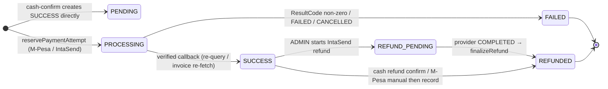
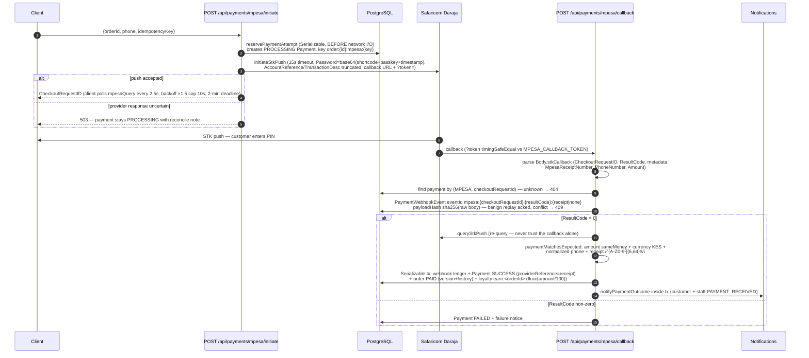
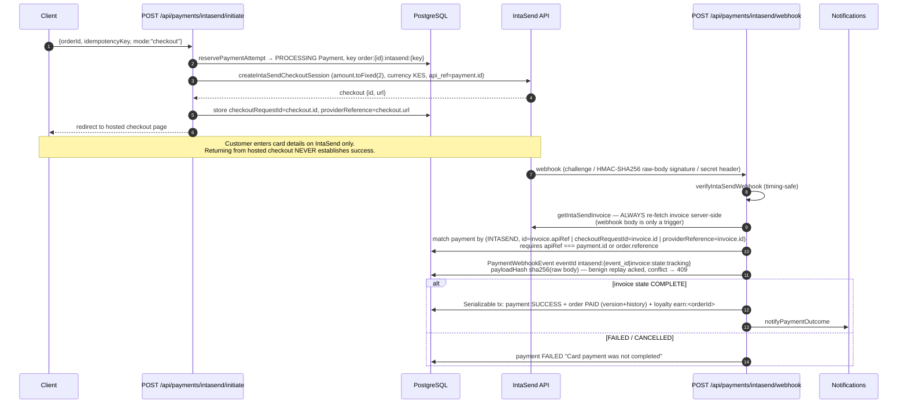

# Payment Lifecycle

This document describes how money moves through Sphere Pharmacy: the `Payment` status machine shared by all providers (M-Pesa STK, IntaSend card, cash), the one-active-attempt-per-order rule enforced by `reservePaymentAttempt`, callback verification and re-query, the idempotent webhook ledger, refunds, and the uncertain-outcome policy that keeps reconciliation honest. Orders are the anchor — every payment belongs to exactly one order and every `SUCCESS` moves that order to `PAID`.

| Audience | Status | Verified |
| --- | --- | --- |
| Engineers, pharmacy operators, AI coding agents | Implemented — verified against code | November 2026 |

## 1. Payment status state machine

Providers: `MPESA` / `INTASEND` / `CASH`. Methods: `STK_PUSH`, `HOSTED_CHECKOUT`, `CASH_ON_DELIVERY`, `CASH_ON_PICKUP` (plus legacy `CARD`, `PAYBILL` labels). Statuses: `PENDING → PROCESSING → SUCCESS | FAILED`; `SUCCESS → REFUND_PENDING → REFUNDED`.

**One active attempt per order, across providers.** `reservePaymentAttempt` (`src/lib/security/payment-attempt.ts`) runs in a **Serializable transaction *before* any network I/O** and:

- rejects a duplicate `idempotencyKey`;
- rejects the attempt if the order already has any payment in `PENDING`, `PROCESSING`, `SUCCESS`, `REFUND_PENDING` or `REFUNDED` (`PAYMENT_ATTEMPT_EXISTS` → 409);
- verifies payability — customer flow requires order status exactly `AWAITING_PAYMENT`; staff flow the `PAYABLE` set (§5); `sameMoney(order.total, amount)`; all Rx approved (or booking `PENDING..IN_PROGRESS`, unpaid);
- creates the `PROCESSING` row that reserves the attempt.

Money handling: all amounts `Decimal(12,2)`, KES; `money()` rounds 2 dp; `sameMoney()` compares at 2 dp; M-Pesa amounts must be **whole-KSh positive integers** (`Math.round`); IntaSend sends `amount.toFixed(2)`.

### 1.1 Provider configuration (fail-closed)

| Provider | Required environment | Production guard |
| --- | --- | --- |
| M-Pesa Daraja | `MPESA_CONSUMER_KEY` / `MPESA_CONSUMER_SECRET` / `MPESA_PASSKEY` / `MPESA_SHORTCODE` + `MPESA_CALLBACK_TOKEN` (≥ 24 chars) | requires `MPESA_ENVIRONMENT=production`; base URL flips sandbox → api.safaricom.co.ke; HTTPS enforced for the callback URL |
| IntaSend | `INTASEND_PUBLISHABLE_KEY` + `INTASEND_SECRET_KEY` + `INTASEND_WEBHOOK_SECRET` (≥ 24 chars) | requires `INTASEND_ENVIRONMENT=production`; checkout URL hostname allowlist (payment/sandbox/checkout.intasend.com) |
| Cash | none (no provider network) | — |

Missing/short secrets throw at module load — the platform refuses to start half-configured rather than accept unauthenticated webhooks. Phone numbers are normalized to `+254…` / `2547|2541…` for matching. `Payment.cardLast4` exists in the schema but is never populated (cards never touch our servers).

### 1.2 Payment ↔ order status correspondence

| Payment event | Order effect | Loyalty effect |
| --- | --- | --- |
| `SUCCESS` (M-Pesa/IntaSend callback, cash-confirm) | → `PAID` (from `AWAITING_PAYMENT` / `AVAILABILITY_CONFIRMED` / `PRESCRIPTION_VERIFIED`) + version + history | `earn:<orderId>` + `floor(amount/100)` pts (guests earn nothing) |
| `FAILED` | order unchanged (stays awaiting) | none |
| Cancel before payment | `PENDING`/`PROCESSING` payments → `FAILED` | `cancel:<orderId>` re-credits redeemed |
| Reservation expiry | dangling `PENDING`/`PROCESSING` payments → `FAILED` | `expire:<orderId>` re-credits redeemed |
| `REFUNDED` (finalizeRefund) | order → `REFUNDED` | `refund-earn:<orderId>` clawback (clamped) + `refund-redeem:<orderId>` re-credit |

## 2. M-Pesa STK (Daraja)

Customer-initiated `POST /api/payments/mpesa/initiate` (owner/staff/guest token; rate limit 5/15min keyed `orderId:phone`; client `idempotencyKey` 16–100 chars):

- order must be exactly `AWAITING_PAYMENT`, `total > 0`, no `SUCCESS` payment; replay of the same key returns `"Payment request already sent."`; a `PROCESSING` payment younger than 15 minutes blocks a new one.
- Server key: `order:{id}:mpesa:{clientKey}`. Phone normalized to `2547/2541…`.
- **Uncertain provider response** (network error/timeout on `initiateStkPush`): payment **stays `PROCESSING`** with `failureReason "Provider response uncertain; reconcile before another attempt"` and the API answers **503** — never a false failure that would allow double-charging.

### 2.1 ResultCode failure mapping (queryStkPush)

| ResultCode | Meaning | Mapped payment outcome |
| --- | --- | --- |
| `0` | Success | `SUCCESS` (after `paymentMatchesExpected`) |
| `1032` | User cancelled the PIN prompt | `FAILED` |
| `1037` | Transaction timeout | `FAILED` |
| `1` | Insufficient balance | `FAILED` |
| `2001` | Invalid PIN / wrong initiator credentials | `FAILED` |
| `1019` | Transaction rejected | `FAILED` |
| other | Still in progress | `PENDING` |

`GET /api/payments/mpesa/query?checkoutRequestId=` is **read-only local state** (owner / assigned rider / guest token; 40/10min). "Provider reconciliation is performed only by authenticated callbacks/jobs" — this endpoint never mutates payment state.

## 3. IntaSend card (hosted checkout)

`POST /api/payments/intasend/initiate` (8/15min per order). `mode` must be `checkout` — *"Card details must be entered only on IntaSend's hosted checkout."* Session creation: `POST /checkout/` with `api_ref = payment.id`, `redirect_url = /orders/{orderId}`, `method CARD-PAYMENT`, `card_tarrif BUSINESS-PAYS`; URL must be on `payment|sandbox|checkout.intasend.com`. Key `order:{id}:intasend:{key}`; a retry while `PROCESSING` with a stored `https` `providerReference` returns the **same** checkout URL.

## 4. Cash confirmation

`POST /api/orders/[id]/cash-confirm` — any staff; riders only for their assigned `CASH_ON_DELIVERY` `DELIVERY` orders in `OUT_FOR_DELIVERY`. Rate limit 20/15min.

| Rule | Value |
| --- | --- |
| `CASH_ALLOWED` order statuses | `AVAILABILITY_CONFIRMED`, `AWAITING_PAYMENT`, `READY_FOR_PICKUP`, `OUT_FOR_DELIVERY` |
| Pre-conditions | all Rx approved; no existing `SUCCESS` payment |
| Payment row | `provider CASH`, method by fulfillment (`CASH_ON_PICKUP`/`CASH_ON_DELIVERY`), status **`SUCCESS`**, idempotencyKey `cash:<orderId>`, providerReference `CASH-<ref>` |
| Serializable tx | re-check no active payment → create payment → `notifyPaymentOutcome` inside tx → if status was `AVAILABILITY_CONFIRMED`/`AWAITING_PAYMENT` also order → `PAID` + `pointsEarned`; else just `pointsEarned` → loyalty award → audit `CASH_CONFIRMED` |

## 5. Staff-initiated request-payment

`POST /api/orders/[id]/request-payment` (all staff incl. riders; 5/15min per order). `PAYABLE` statuses: `PRESCRIPTION_VERIFIED`, `AVAILABILITY_CONFIRMED`, `AWAITING_PAYMENT`, `READY_FOR_PICKUP`, `OUT_FOR_DELIVERY`; all Rx must be approved. Phone fallback: `guestPhone → user.phone`. Server key `staff:{orderId}:mpesa:{key}`. The order moves to `AWAITING_PAYMENT`; audit `PAYMENT_REQUESTED`.

## 6. Refunds

`POST /api/payments/refund` — **ADMIN only**, 10/h per staff, body ≤16KB: `paymentId`, `reason` ≤100, `details` ≤500.

| Provider | Flow |
| --- | --- |
| MPESA `SUCCESS` | **Refused with 409** — *"M-Pesa Express refunds must be completed and verified in the M-PESA organisation portal before recording them here."* The B2C refund is a manual out-of-band process; the endpoint refuses to guess. |
| CASH `SUCCESS` | Requires `cashConfirmed=true` + `cashRefundReference` `/^[A-Za-z0-9_-]{6,100}$/` (till reference); records `refundReference CASH:<ref>`; audit `CASH_REFUND_CONFIRMED`. |
| INTASEND `SUCCESS` | `createIntaSendRefund` (validates invoiceId + amount ±0.001) → payment `REFUND_PENDING` + `refundReference = refund.id`; audit `REFUND_REQUESTED`. |
| INTASEND `REFUND_PENDING` | `getIntaSendRefund`; provider state `COMPLETED` → `finalizeRefund`. |

`finalizeRefund` (Serializable): payment `REFUNDED`; order `REFUNDED` + version + history; loyalty clawback of earned points (`refund-earn:<orderId>`, clamped to balance) and re-credit of redeemed points (`refund-redeem:<orderId>`); refund notice in-app + email; audit `PAYMENT_REFUNDED`.

> **Cancel ≠ refund.** The cancel endpoint refuses orders with a `SUCCESS` payment (409 "A captured payment cannot be cancelled…"), and no admin UI currently calls the refund API — refunds are endpoint-only. The customer cancel toast promising automatic refunds contradicts server behavior.

## 7. Idempotency and reconciliation model

| Mechanism | Guarantee |
| --- | --- |
| Payment idempotency keys | `order:{id}:mpesa|intasend:{clientKey}`, `staff:{orderId}:mpesa:{key}`, `service:{id}:mpesa|intasend:{key}`, `cash:<orderId>` — unique per Payment row; replays return the original outcome (e.g. "Payment request already sent."). |
| `PaymentWebhookEvent` ledger | unique `eventId` per provider event (`mpesa:{checkoutRequestId}:{resultCode}:{receipt|none}`, `intasend:{event_id|invoice:state:tracking}`); `payloadHash` = sha256 of raw body. A replay with the same hash is benign → acked; a different payload under the same `eventId` is a **conflict → 409**. |
| Loyalty idempotency | `LoyaltyLedger.eventKey` unique: `earn:/redeem:/cancel:/expire:/refund-earn:/refund-redeem:` + orderId. Double callbacks can never double-award. |
| Uncertain provider outcome | Timeouts/network errors on initiate **never** reset the payment to `FAILED`. It stays `PROCESSING` with a reconcile note and the caller gets 503, so no second charge can be started blindly. Resolution only happens via an authenticated callback (or provider portal). |
| Re-query before trust | M-Pesa `ResultCode 0` triggers `queryStkPush` + `paymentMatchesExpected` (amount/currency/phone/receipt); IntaSend webhooks trigger a server-side invoice re-fetch. Callback bodies are triggers, not truth. |
| Read-only status endpoints | `mpesa/query` and `service payment-status` return local DB state only. **Known gap:** there is no cron that reconciles stuck `PROCESSING` payments with the provider — recovery relies on callbacks arriving. |
| One attempt invariant | `reservePaymentAttempt` blocks a second concurrent attempt across providers while any payment is `PENDING/PROCESSING/SUCCESS/REFUND_PENDING/REFUNDED`. |

## 8. Service booking payments (summary)

Service bookings use a parallel `ServicePayment` model with the same disciplines: **pay-at-pharmacy** records an intent marker (booking `paymentStatus = "PAY_AT_PHARMACY"`, `ServicePayment` `IN_STORE`/`PAY_AT_PHARMACY`/`PENDING`, key `service:{id}:pay-at-pharmacy`) — there is no cash-settlement endpoint for bookings (documented gap). Card (`service:{id}:intasend:{key}`) and M-Pesa (`service:{id}:mpesa:{key}`) mirror the order flows; the dedicated `/api/payments/mpesa/service-callback` (eventId prefix `mpesa-service:`) and the IntaSend webhook's service path reconcile and set booking `paymentStatus = PAID`. Customers poll `GET /api/service-bookings/[id]/payment-status` (read-only, 40/10min). Full detail: [service-bookings.md](service-bookings.md).

## 9. Failure cases and recovery

| Stage | Failure | System behavior | Recovery |
| --- | --- | --- | --- |
| Initiate (any) | Second attempt while an attempt is active | 409 `PAYMENT_ATTEMPT_EXISTS` / "Payment request already sent." | Wait for the first attempt's callback; check order payments. |
| Initiate | Provider timeout / network error | Payment stays `PROCESSING` + reconcile note; 503 to client. | Await callback; check provider portal; do **not** force-reset. |
| STK | Customer cancels PIN / timeout / insufficient balance / bad PIN | Callback or re-query maps ResultCode → `FAILED` with reason. | Customer may retry (order still `AWAITING_PAYMENT`). |
| Callback | Token mismatch / unknown checkoutRequestId | 401/404 — no state change. | Verify `MPESA_CALLBACK_TOKEN` wiring; Daraja retry behavior. |
| Callback | Amount/phone/receipt mismatch on `ResultCode 0` | Payment not marked `SUCCESS`; mismatch recorded. | Manual reconciliation against the M-Pesa portal. |
| Callback | Duplicate delivery | `PaymentWebhookEvent` benign replay acked. | None needed. |
| Callback | Same eventId, different payload | 409 conflict. | Investigate — possible tampering or provider bug. |
| Webhook never arrives | Payment stuck `PROCESSING` | No automatic reconciliation job exists. | Compare provider portal to DB; refund via ADMIN flow if charged-but-stuck. |
| Card | Customer abandons hosted checkout | Payment remains `PROCESSING` until a `FAILED`/`CANCELLED` webhook (or never). Order stays `AWAITING_PAYMENT` → reservation expiry releases stock. | Retry via IntaSend retry-with-same-URL path. |
| Cash | Staff confirms cash without money | No system protection — trust + audit trail (`CASH_CONFIRMED`, till refs). | Till reconciliation at closing. |
| Refund | M-Pesa refund attempted in-app | 409 refusal — manual portal process by design. | Complete B2C refund in the M-Pesa organisation portal first. |
| Refund | IntaSend refund stuck `REFUND_PENDING` | Re-POST refund request polls provider; `COMPLETED` finalizes. | Re-invoke the refund endpoint to poll again. |
| Refund | Loyalty clawback exceeds balance | Clawback clamped to current balance (never negative). | Acceptable loss documented in ledger. |

## Related documentation

- [order-lifecycle.md](order-lifecycle.md) — order state machine and reservation expiry.
- [service-bookings.md](service-bookings.md) — ServicePayment flows.
- [../features/payments-and-refunds.md](../features/payments-and-refunds.md) — UI and provider configuration.
- [../features/loyalty-and-promotions.md](../features/loyalty-and-promotions.md) — earn/redeem/clawback ledger.
- [../integrations/mpesa-daraja.md](../integrations/mpesa-daraja.md) and [../integrations/intasend.md](../integrations/intasend.md) — Daraja / IntaSend setup.
- [../operations/scheduled-jobs.md](../operations/scheduled-jobs.md) — cron jobs.
- [../../README.md](../../README.md)
