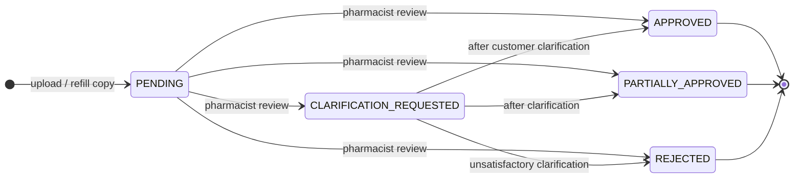
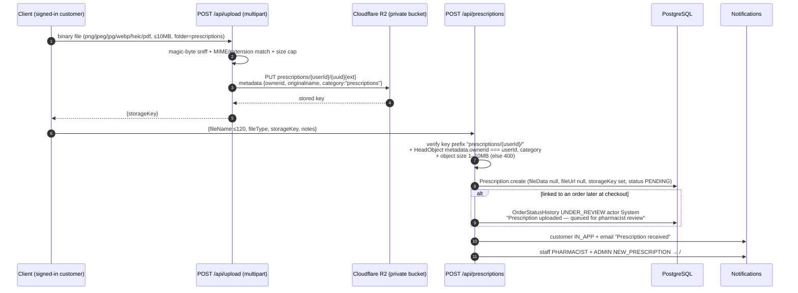
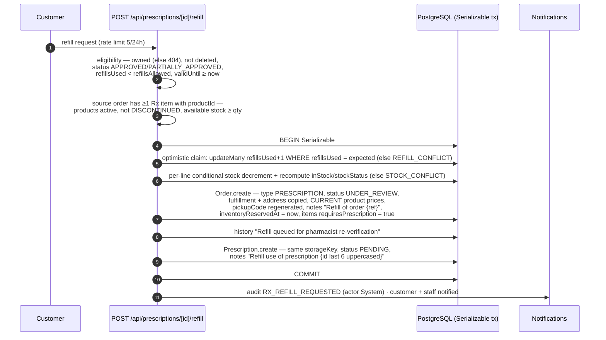
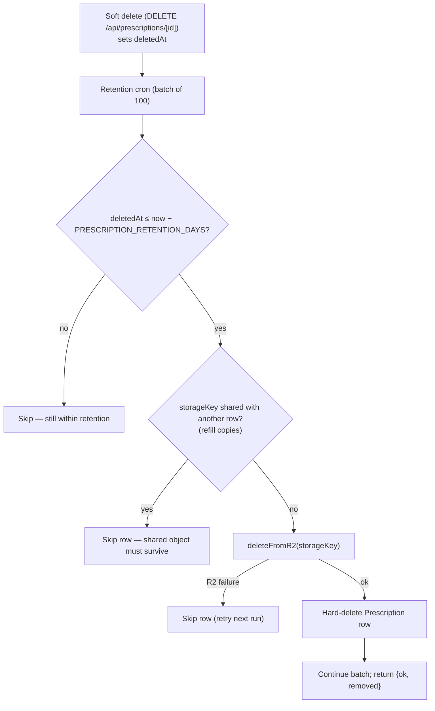

# Prescription Lifecycle

This document tracks a prescription from upload (private R2 object) through pharmacist review, order linkage, refill reuse, access auditing, and finally PPB-aligned retention deletion. Prescriptions are the clinical gate on the order state machine: an order carrying them cannot be paid-ready or dispatched until every linked prescription is approved. See [order-lifecycle.md](order-lifecycle.md) for the order side of that gate.

| Audience | Status | Verified |
| --- | --- | --- |
| Engineers, pharmacy operators, AI coding agents | Implemented — verified against code | November 2026 |

## 1. Status state machine

`RX_STATUSES` (src/lib/constants.ts): `PENDING`, `APPROVED`, `REJECTED`, `CLARIFICATION_REQUESTED`, `PARTIALLY_APPROVED`. Transitions are pharmacist decisions made via `PATCH /api/prescriptions/[id]` (PHARMACIST or ADMIN only) — there is no free-form transition map; any of the five statuses may be assigned from `PENDING` (or to correct an earlier decision).

> The queue (`GET /api/prescriptions?scope=queue`) is client-side re-sorted by priority: `PENDING < CLARIFICATION_REQUESTED < PARTIALLY_APPROVED < APPROVED < REJECTED`.

### 1.1 Linked-order aggregation

Reviewing one prescription re-evaluates **every** prescription linked to the same order and moves the order accordingly (version bump + history + in-app notice):

| Condition on the order's prescriptions | Order status |
| --- | --- |
| All are `APPROVED` or `PARTIALLY_APPROVED` | `PRESCRIPTION_VERIFIED` |
| All decided and **any** is `REJECTED` | `REJECTED` (staff-notified) |
| Otherwise (still undecided) | stays/moves to `UNDER_REVIEW` (only if currently `UNDER_REVIEW`) |

## 2. Upload flow

Guests are blocked (`requireCustomer`); rate limit `prescription-create` 10/hour per user; upload endpoint itself 20/15min. Two paths exist, R2-first with a base64 fallback:

**Base64 fallback:** if multipart upload is unavailable, the client posts the file inline; the route validates magic bytes and calls `uploadBase64ToR2` with the same key layout before creating the row.

**Checkout attachment** (`POST /api/orders` `prescriptionIds[]`): each prescription must be owned by the customer, unused (`orderId null`), and not soft-deleted; they are linked inside the create transaction and the order starts `UNDER_REVIEW` with type `PRESCRIPTION` (all lines Rx) or `MIXED`.

### 2.1 Upload validation rules

| Field | Rule | Failure |
| --- | --- | --- |
| Auth | `requireCustomer` — guests blocked (Rx requires an account) | 401 |
| Rate limit | `prescription-create` 10/hour per user; `upload` 20/15min per principal | 429 |
| `fileName` | ≤ 120 chars | 400 |
| `fileType` | `png / jpeg / jpg / webp / heic / pdf` | 400 |
| Size | ≤ 10 MB (multipart body; registered object 1–10 MB) | 413 / 400 |
| `storageKey` | must start `prescriptions/{userId}/`; `HeadObject` metadata `ownerid === userId`, `category === "prescriptions"` | 400 |
| `notes` | ≤ 1,000 chars | 400 |
| Magic bytes | content sniffed (base64 fallback) — extension/MIME must match | 400 |

## 3. Pharmacist review — validation rules

`PATCH /api/prescriptions/[id]` (PHARMACIST/ADMIN):

| Field | Rule |
| --- | --- |
| `status` | must be one of `RX_STATUSES`. |
| `reviewNotes` | **required** unless status is `APPROVED` or `PARTIALLY_APPROVED`; ≤ 2,000 chars. |
| `refillsAllowed` | integer 0–6; **only persisted for APPROVED / PARTIALLY_APPROVED** (else stored 0). |
| `validDays` | one of `{30, 60, 90, 180}`, default 90; `validUntil = now + validDays` set only on approval (else null). |
| Side effects | stamps `reviewedById` / `reviewedAt`; recomputes linked-order aggregation (§1.1); audit `RX_<STATUS>`; customer notified IN_APP + email (`prescriptionStatusTemplate`). |

## 4. Refill flow

`POST /api/prescriptions/[id]/refill` (customer; rate limit 5/24h). **Every refill use is re-verified by a pharmacist** — the refill creates a *new* order in `UNDER_REVIEW` and a *new* `PENDING` prescription row sharing the same R2 `storageKey`.

Why a fresh `PENDING` row: the pharmacist must re-check the prescription against current stock, dosing and the customer's history on **every** dispense cycle — approval of the original never auto-approves refills.

### 4.1 Refill eligibility checklist

| Check | Source of truth | Failure |
| --- | --- | --- |
| Ownership (non-owner sees 404, not 403 — avoids disclosure) | `Prescription.userId` | 404 |
| Not soft-deleted | `deletedAt` | 404 |
| Status `APPROVED` / `PARTIALLY_APPROVED` | `status` | 409 |
| `refillsUsed < refillsAllowed` | both fields on the row | 409 |
| `validUntil ≥ now` | set at review (`now + validDays`) | 409 |
| Source order has ≥1 Rx item with `productId` | `OrderItem` of the original order | 409 |
| Products active, not `DISCONTINUED`, stock ≥ qty | availability formula (see [inventory-lifecycle.md](inventory-lifecycle.md)) | 409 |
| Concurrent claim of the same refill slot | optimistic `refillsUsed` update inside Serializable tx | 409 `REFILL_CONFLICT` |
| Stock moved mid-transaction | per-line conditional decrement | 409 `STOCK_CONFLICT` |

The refill order prices lines at **current** product prices (not the original order's snapshot), regenerates the `pickupCode`, copies fulfillment and delivery address from the source order, and records history *"Refill queued for pharmacist re-verification"*.

## 5. Access control and auditing

| Concern | Rule |
| --- | --- |
| List | `GET /api/prescriptions` — own prescriptions only (limit 1–100, default 50). `?scope=queue` (PHARMACIST/ADMIN) returns all; DTO **never** exposes `fileData`/`storageKey`; `fileUrl` is null in lists. |
| Read one | `GET /api/prescriptions/[id]` — owner or ADMIN/PHARMACIST (else 403); 404 if missing or soft-deleted. |
| Access log | **Every** GET writes a `PrescriptionAccessLog` row: `VIEW`, or `DOWNLOAD` when `?download=1`. Write-only compliance record (no API reads it). |
| File access | `fileUrl` = presigned R2 GET URL, 300 s expiry (clamped 30–300 s), `private, no-store` cache headers; `?download=1` adds attachment disposition + 302 redirect. `fileData` blanked `""`, `storageKey` stripped in the DTO. Presign failure → 503. |
| Delete | `DELETE /api/prescriptions/[id]` — owner or ADMIN; order-linked prescriptions refuse deletion (409) for non-admins; soft delete (`deletedAt`). |

## 6. Retention — soft delete to hard delete

`GET /api/cron/prescription-retention` (Bearer `CRON_SECRET` ≥ 32). **Environment-dependent:** requires `PRESCRIPTION_RETENTION_DAYS` (30–36,500; missing/invalid → 503). The blueprint cites 2 years per Kenya PPB Cap 244; CI exercises 365. Cutoff is computed from the **soft-delete time** (`deletedAt`), not upload time.

Order of operations is deliberate: the R2 object is deleted **before** the row, so a crash can never leave a dangling DB row pointing at a deleted object — worst case is an orphaned R2 object (idempotently retried next run because the row still exists). Scheduling itself is an external deployment responsibility — see [../operations/scheduled-jobs.md](../operations/scheduled-jobs.md).

## 7. Failure cases and recovery

| Stage | Failure | System behavior | Recovery |
| --- | --- | --- | --- |
| Upload | File >10MB / wrong type / extension mismatch | 400/413 before any storage write. | Customer re-uploads a valid file. |
| Upload | R2 put succeeds but prescription row creation fails | Route errors; object is orphaned in R2 (upload route does not garbage-collect). | Periodic R2 audit / manual cleanup of keys without rows. |
| Register | Key prefix or HeadObject metadata mismatch | 400 — the storage key is not accepted as the caller's prescription. | Re-upload through the normal flow. |
| Review | Missing `reviewNotes` on a rejection/clarification | 400 validation error. | Pharmacist supplies notes. |
| Review | Aggregation race (two pharmacists on same order) | Order `version` guard serializes; loser retries. | Re-open order, re-apply. |
| Refill | Concurrent refill claims the last allowed use | Optimistic `refillsUsed` claim fails → 409 `REFILL_CONFLICT`. | Customer sees updated refill count. |
| Refill | Stock moved between eligibility check and tx | Per-line conditional decrement fails → `STOCK_CONFLICT`, tx rolls back. | Retry when stock returns (ProductAlert back-in-stock). |
| Read | Presign failure (R2 outage) | 503; access log still records the attempt. | Retry when R2 recovers. |
| Retention | `PRESCRIPTION_RETENTION_DAYS` unset | 503 — job refuses to guess a compliance window. | Set env var, re-invoke. |
| Retention | R2 delete fails | Row skipped this run, retried next run. | Inspect PosSync/ops logs; verify bucket policy. |
| Guest | Guest tries to upload / attach Rx | 401 — Rx requires an account by design. | Register or sign in via OTP (guest orders can be claimed afterwards). |

## 8. Adjacent automation — chronic refill reminders

`GET /api/cron/chronic-refills` (Bearer `CRON_SECRET` ≥ 32) is **time-based only** — it infers nothing about dosage. `BandaGoCrmReconciler.checkChronicRefillEligible(30)` selects:

- orders created ≥ 30 days ago, status `COMPLETED_DELIVERY` / `COMPLETED_PICKUP` (plus legacy `DELIVERED`), with ≥ 1 `requiresPrescription` item;
- deduplicated per identity (userId, guestPhone, or order id);
- **excluding** users who already have a newer (post-cutoff) non-`CANCELLED`/`REJECTED` Rx order.

Per user, at most **1 `CHRONIC_REFILL_REMINDER` per 7 days** is queued (IN_APP + email listing prescription-only medicine names, link to the source order). Returns `{ ok, eligible, notified }`. Cadence and scheduling: [../operations/scheduled-jobs.md](../operations/scheduled-jobs.md).

## 9. Notifications emitted by this workflow

| Event | Recipients | Channels |
| --- | --- | --- |
| Prescription received (upload) | customer | IN_APP + email |
| `NEW_PRESCRIPTION` (upload) | PHARMACIST + ADMIN | IN_APP |
| Prescription order received | customer (+ guest email) | IN_APP + email |
| `NEW_PRESCRIPTION_ORDER` (order with Rx) | ADMIN + PHARMACIST | IN_APP |
| Status update (review) | customer | IN_APP + email (`prescriptionStatusTemplate`) |
| Rejection escalation | ADMIN + PHARMACIST | IN_APP |
| Refill queued | customer + staff | IN_APP |

All notifications are queued transactionally as DB work only (in-app `Notification` rows + one email/push `NotificationDelivery` job each); dispatch is the notification cron's job — see [../features/notifications.md](../features/notifications.md).

## 10. Data model

| Model | Role in this workflow |
| --- | --- |
| `Prescription` | `fileName/fileType`, `storageKey` (R2 private key), `status`, `reviewNotes`, `reviewedById/reviewedAt`, `refillsAllowed/refillsUsed`, `validUntil`, `deletedAt` (soft delete), `orderId` (link established at checkout). `fileData`/`fileUrl` are legacy and always null now. |
| `PrescriptionAccessLog` | one row per GET: `VIEW`/`DOWNLOAD`, `actorId`, `actorRole`, `createdAt`. |
| `Order` / `OrderStatusHistory` | aggregation writes `PRESCRIPTION_VERIFIED` / `REJECTED` / `UNDER_REVIEW` with history + version bump. |
| `AuditLog` | `RX_<STATUS>`, `RX_REFILL_REQUESTED`. |

See [../database/data-lifecycle.md](../database/data-lifecycle.md) for retention windows and [../features/prescriptions.md](../features/prescriptions.md) for the UI surface.

## Related documentation

- [order-lifecycle.md](order-lifecycle.md) — how prescription decisions gate order flow.
- [payment-lifecycle.md](payment-lifecycle.md) — paying for approved prescription orders.
- [inventory-lifecycle.md](inventory-lifecycle.md) — refill stock checks.
- [../features/prescriptions.md](../features/prescriptions.md) — customer + pharmacist screens.
- [../integrations/cloudflare-r2.md](../integrations/cloudflare-r2.md) — R2 storage configuration.
- [../../README.md](../../README.md)
